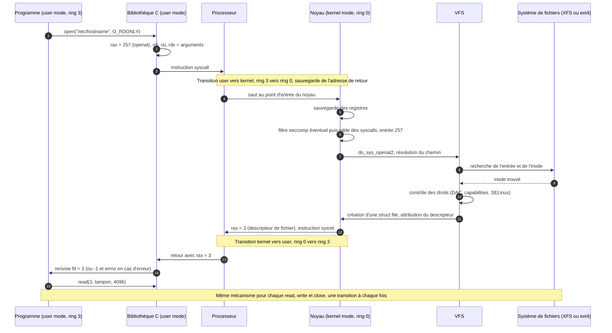
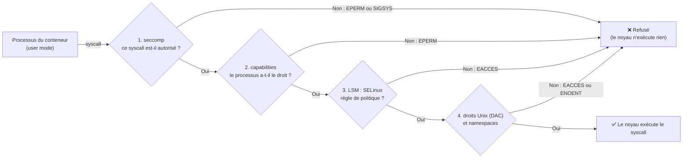

# Appels système et transitions user/kernel

> 🐧 **Note Red Hat**
> Ce cours utilise les commandes **Rocky Linux 9** (binaire-compatible RHEL 9). Si tu croises une documentation Ubuntu (`apt`, `ufw`, AppArmor), sache que l'équivalent Red Hat est `dnf`, `firewalld`, SELinux. Les concepts sont identiques, seule la commande change.

## Pourquoi ce cours ?

Un programme ne lit jamais un fichier, n'ouvre jamais une connexion et ne crée jamais un processus **tout seul** : il **demande** au noyau de le faire. Cette demande s'appelle un **appel système** (*syscall*), et c'est la **seule porte** entre le monde des programmes (*user mode*) et celui du noyau (*kernel mode*).

Comprendre cette porte change ta façon de travailler en DevOps :

- **Diagnostiquer** : quand un programme « ne fait rien » ou échoue avec `Permission denied`, `strace` te montre **exactement** quel appel système échoue et pourquoi, sans lire une ligne de code source.
- **Sécuriser** : tout ce qu'un conteneur peut faire au système passe par des syscalls. `seccomp` filtre ces appels, les *capabilities* limitent ce qu'ils peuvent faire, et les *namespaces* changent ce qu'ils voient.
- **Comprendre les conteneurs** : un conteneur n'est **pas** une machine virtuelle ; il **partage le noyau** de l'hôte. C'est pourquoi c'est une frontière de sécurité réelle, **mais pas totale**.

> Prérequis : [Noyau et performance](01-noyau-performance.md), [Conteneurs : namespaces et cgroups](02-conteneurs-namespaces.md) et les [processus](../../02-linux-intermediaire/cours/01-processus-services.md). Pour le côté sécurité des conteneurs : [Docker, sécurité](../../08-docker-approfondi/cours/06-securite-et-bonnes-pratiques.md).

## 1. Le modèle user/kernel

### Les anneaux de protection

Un processeur x86 propose quatre **niveaux de privilège** (*rings*, de 0 à 3). Linux n'en utilise que **deux** :

| Niveau | Nom | Qui y tourne | Ce qu'il peut faire |
|---|---|---|---|
| **Ring 0** | **Kernel mode** (mode noyau) | Le noyau : ordonnanceur, gestion de la mémoire, pilotes, systèmes de fichiers, pile réseau | **Tout** : exécuter toute instruction, accéder à toute la mémoire et aux périphériques |
| **Ring 3** | **User mode** (mode utilisateur) | Tous les programmes : `bash`, `nginx`, `python`, **et `root`** | Seulement ses propres calculs et sa mémoire ; **aucun accès direct** au matériel |

> 📌 **À retenir** : « root » n'est **pas** le mode noyau. Un processus `root` tourne en **ring 3** comme les autres ; il est simplement **autorisé par le noyau** à demander plus de choses. La frontière user/kernel est matérielle (le processeur) ; la frontière root/non-root est logicielle (le noyau).

Sur ARM (Raspberry Pi, serveurs ARM), le principe est identique avec d'autres noms : **EL0** (utilisateur) et **EL1** (noyau).

### Pourquoi cette séparation ?

| Raison | Explication |
|---|---|
| **Stabilité** | Un programme qui plante (`segmentation fault`) ne fait tomber que **lui-même**, pas le système |
| **Sécurité** | Un programme ne peut pas lire la mémoire d'un autre, ni parler directement au disque ou à la carte réseau |
| **Arbitrage** | Le noyau partage équitablement CPU, mémoire et périphériques entre des centaines de processus |

### Ce qui tourne en kernel mode

- l'**ordonnanceur** (qui s'exécute, sur quel cœur, combien de temps) ;
- la **gestion de la mémoire** (mémoire virtuelle, pagination, `mmap`) ;
- les **pilotes** (disque, réseau, GPU) et les **systèmes de fichiers** (le VFS, XFS, ext4) ;
- la **pile réseau** (TCP/IP, netfilter) et les mécanismes de sécurité (capabilities, SELinux, seccomp).

Un code qui s'exécute en kernel mode a **tous les droits** : c'est pourquoi une faille du noyau est si grave, et pourquoi on réduit au maximum ce qu'un programme (ou un conteneur) peut lui demander.

## 2. L'appel système (*syscall*)

### Le mécanisme sur x86-64

Quand un programme veut, par exemple, ouvrir un fichier, il ne peut pas « sauter » dans le noyau. Il exécute une instruction spéciale, **`syscall`**, qui provoque une **transition contrôlée** vers un point d'entrée unique choisi par le noyau :

1. Le programme place le **numéro** du syscall dans le registre `rax` et ses **arguments** dans `rdi`, `rsi`, `rdx`, `r10`, `r8`, `r9`.
2. Il exécute l'instruction **`syscall`**.
3. Le **processeur** passe en **ring 0**, sauvegarde l'adresse de retour (dans `rcx`) et saute au **point d'entrée du noyau** (configuré au démarrage dans un registre spécial).
4. Le noyau **sauvegarde les registres**, vérifie le numéro, consulte la **table des syscalls** et exécute la fonction correspondante.
5. Le noyau place le **résultat** dans `rax` et exécute **`sysret`** : le processeur repasse en **ring 3** et le programme reprend.

```text
Registres à l'entrée (x86-64)        Retour
rax = numéro du syscall              rax = résultat  (≥ 0 : succès)
rdi, rsi, rdx, r10, r8, r9 = args    rax = -errno    (entre -1 et -4095 : erreur)
```

### La table des syscalls

Chaque syscall a un **numéro** propre à l'architecture. Quelques-uns, sur x86-64 :

| N° | Nom | Rôle |
|---|---|---|
| 0 | `read` | Lire depuis un descripteur de fichier |
| 1 | `write` | Écrire dans un descripteur de fichier |
| 3 | `close` | Fermer un descripteur |
| 9 | `mmap` | Projeter un fichier ou de la mémoire |
| 39 | `getpid` | PID du processus |
| 56 | `clone` | Créer un processus ou un thread (avec ou sans namespaces) |
| 59 | `execve` | Remplacer le programme courant par un autre |
| 232 | `epoll_wait` | Attendre des événements sur des descripteurs |
| 257 | `openat` | Ouvrir un fichier |
| 272 | `unshare` | Quitter certains namespaces partagés |
| 308 | `setns` | Rejoindre un namespace existant |

```bash
ausyscall --dump | head -n 5      # table complète du système (paquet audit)
ausyscall 257                     # numéro → nom : openat
ausyscall openat                  # nom → numéro : 257
man 2 openat                      # la section 2 du manuel documente les appels système
```

Le noyau Linux compte **plus de 300 syscalls**. La section **2** de `man` est celle des appels système ; la section 3, celle des fonctions de bibliothèque.

### Syscall, fonction de bibliothèque et appel direct

Ces trois notions sont souvent confondues :

| Niveau | Exemple | Ce qui se passe |
|---|---|---|
| **Fonction de la bibliothèque C** (libc) | `fopen()`, `printf()`, `malloc()` | Fonction **en user mode** ; peut appeler **zéro, un ou plusieurs** syscalls (`printf` finit par `write`, `malloc` par `brk` ou `mmap`, mais pas à chaque appel : la libc met en mémoire tampon) |
| **Enveloppe (*wrapper*) de syscall** | `open()`, `read()`, `getpid()` | Mince fonction de la libc qui prépare les registres, exécute `syscall`, puis convertit `-errno` en `-1` et positionne la variable `errno` |
| **Appel direct** | `syscall(SYS_getpid)` | On passe **par-dessus** la libc (rare : syscall sans enveloppe, tests) |

> 💡 **Conseil** : `strace` montre les **syscalls**, pas les fonctions de la libc. Si un `printf` n'apparaît pas, c'est normal : seul le `write` final sera visible, et peut être regroupé avec d'autres.

> ⚠️ **Attention** : certains « appels système » ne font **pas** de transition vers le noyau. Le **vDSO** (*virtual dynamic shared object*) expose en user mode des fonctions comme `clock_gettime()` ou `gettimeofday()` : elles lisent une page de mémoire mise à jour par le noyau, sans `syscall`. `strace` ne les voit donc pas.

### Combien coûte une transition ?

Un syscall coûte bien plus cher qu'un appel de fonction ordinaire (sauvegarde des registres, changement de contexte de sécurité, parfois vidage de caches pour contrer des failles du processeur) : de l'ordre de **quelques centaines de nanosecondes**, davantage avec les protections contre *Meltdown* et *Spectre*. D'où les optimisations courantes : **tampons** (une écriture de 4 Ko plutôt que 4 096 écritures d'un octet), `io_uring`, `epoll` plutôt qu'une boucle d'interrogation.

### Le déroulé d'un `openat()`



## 3. Voir les syscalls en pratique

### `strace` : l'outil roi du DevOps

`strace` affiche **chaque syscall** d'un processus, avec ses arguments et son résultat. Il s'appuie sur l'appel système `ptrace`.

```bash
strace ls /etc 2>&1 | head -n 15                      # tout ce que fait « ls »
strace -f -e trace=openat,read,write ls /etc 2>&1 | head -n 12    # seulement ces syscalls ; -f suit les processus fils
strace -e trace=file ls /etc 2>&1 | head              # tous les syscalls liés aux fichiers
strace -e trace=network curl -s -o /dev/null https://rockylinux.org 2>&1 | head   # réseau
strace -tt -T -o /tmp/ls.trace ls /etc >/dev/null     # horodatage (-tt), durée de chaque syscall (-T), sortie dans un fichier
sudo strace -f -p <PID>                               # se brancher sur un processus déjà lancé
```

Lire une ligne :

```text
openat(AT_FDCWD, "/etc/hostname", O_RDONLY|O_CLOEXEC) = 3
│       │          │                │                   └ résultat : descripteur 3
│       │          │                └ drapeaux
│       │          └ chemin
│       └ répertoire de départ
└ nom du syscall
openat(AT_FDCWD, "/etc/inexistant", O_RDONLY) = -1 ENOENT (No such file or directory)
```

Une erreur s'affiche avec son **code symbolique** (`ENOENT`, `EACCES`, `EPERM`…), que `man errno` explique.

### `strace -c` : les statistiques

```bash
strace -c ls /etc >/dev/null          # tableau final : appels, erreurs, temps par syscall
```

```text
% time     seconds  usecs/call     calls    errors syscall
 ------ ----------- ----------- --------- --------- ----------------
  38.25    0.000145           4        33           mmap
  21.11    0.000080           3        24         6 openat
...
```

C'est la première commande à lancer pour répondre à « **que fait ce programme, et en quoi passe-t-il son temps ?** ».

### Reconnaître les erreurs fréquentes

| Code | Signification | Typiquement |
|---|---|---|
| `ENOENT` | Fichier ou dossier inexistant | Mauvais chemin, bibliothèque manquante, fichier de configuration absent |
| `EACCES` | **Permission denied** : droits d'accès refusés | Permissions Unix (DAC) ou règle SELinux |
| `EPERM` | **Operation not permitted** : opération non autorisée | Capability manquante, **filtre seccomp**, opération réservée à root |
| `EAGAIN` | Ressource temporairement indisponible | Lecture non bloquante **sans donnée prête** : normal, mais en boucle serrée = problème |
| `EINTR` | Appel interrompu par un signal | À relancer ; un programme qui ne le gère pas échoue de façon intermittente |
| `ECONNREFUSED` | Connexion refusée | Personne n'écoute sur ce port |

### Détecter un programme qui boucle sur un syscall

Un programme à 100 % de CPU qui n'avance pas appelle souvent **le même syscall en boucle**, par exemple une lecture non bloquante qui renvoie `EAGAIN` sans cesse. Reproduction :

```bash
python3 - <<'EOF' &
import os
r, w = os.pipe()
os.set_blocking(r, False)          # lecture non bloquante
while True:
    try:
        os.read(r, 1)              # rien à lire : EAGAIN, immédiatement, à l'infini
    except BlockingIOError:
        pass
EOF
PID=$!
top -b -n 1 -p $PID | tail -n 2                       # CPU proche de 100 %
sudo timeout 2 strace -p $PID 2>&1 | head -n 4        # read(3, 0x..., 1) = -1 EAGAIN (Resource temporarily unavailable)
sudo timeout -s INT 3 strace -c -p $PID 2>&1 | tail -n 6   # des centaines de milliers d'appels, 100 % d'erreurs
kill $PID
```

Le diagnostic est immédiat : **un syscall unique, des milliers d'appels par seconde, 100 % d'erreurs `EAGAIN`** : le programme fait de l'attente active au lieu de dormir (`poll`, `epoll`, lecture bloquante).

### `ltrace`, `perf trace` et `bpftrace`

| Outil | Ce qu'il montre | Coût | Remarque |
|---|---|---|---|
| **`strace`** | Les **syscalls** d'un processus | **Élevé** (ralentit le programme) | Simple, universel : parfait en diagnostic ponctuel |
| **`ltrace`** | Les appels aux **fonctions de bibliothèques** (`malloc`, `strlen`…) | Élevé | `sudo dnf install ltrace` (si le dépôt le propose) |
| **`perf trace`** | Les syscalls, comme `strace` | **Faible** | Utilisable sur un système chargé : `sudo perf trace -p <PID>`, `sudo perf trace -s ls` (résumé) |
| **`bpftrace`** | Ce que **tu** programmes, **dans le noyau** (eBPF) | **Très faible** | Observer tout le système, sans toucher aux programmes |

```bash
sudo perf trace -s ls /etc >/dev/null                 # résumé des syscalls, avec peu de surcoût
sudo bpftrace -e 'tracepoint:syscalls:sys_enter_openat { printf("%s ouvre %s\n", comm, str(args->filename)); }'   # tous les openat du système (Ctrl+C pour arrêter)
sudo bpftrace -e 'tracepoint:raw_syscalls:sys_enter { @[comm] = count(); }'    # qui fait le plus de syscalls ? (Ctrl+C affiche le tableau)
```

> ⚠️ **Attention** : `strace` **ralentit** nettement le processus observé (chaque syscall provoque des allers-retours avec `strace`). Sur un service de production très sollicité, préfère `perf trace` ou `bpftrace`, ou limite l'observation à quelques secondes avec `-e trace=…`. `strace` peut aussi avoir besoin de `sudo` pour se brancher sur le processus d'un autre utilisateur.

> 💡 **Conseil** : dans une VM de cours, tu as déjà `strace`, `perf` et (via `dnf install bpftrace`) `bpftrace`. Un bon réflexe : `strace -f -c <commande>` d'abord (où part le temps ?), puis `strace -f -e trace=…` sur la famille de syscalls suspecte.

## 4. Les syscalls et les conteneurs

### Un conteneur partage le noyau de l'hôte

Un conteneur est un **processus Linux ordinaire**, simplement entouré de restrictions. Il fait ses syscalls **directement au noyau de l'hôte**, le même que celui de tous les autres conteneurs. Il n'a pas de noyau propre, contrairement à une machine virtuelle.

| | Machine virtuelle | Conteneur |
|---|---|---|
| Noyau | **Un noyau par VM** (+ hyperviseur) | **Le noyau de l'hôte, partagé** |
| Surface d'attaque vers l'hôte | Interface de l'hyperviseur (étroite) | **Tous les syscalls** exposés (large) |
| Isolation | Forte (matérielle) | **Plus faible** (logicielle) |

C'est la raison pour laquelle un conteneur est **une frontière de sécurité réelle** (un processus confiné ne voit ni les fichiers ni les processus des autres) **mais pas totale** : si un attaquant exploite une **faille du noyau** atteignable par un syscall, il sort du conteneur. Toute la sécurité des conteneurs consiste à **réduire ce qu'un processus peut demander** au noyau.



### seccomp : filtrer les syscalls

**seccomp-bpf** permet à un processus d'installer, via le syscall `seccomp()` (ou `prctl`), un **petit programme de filtrage** (BPF) que le noyau exécute **à chaque syscall**, avant tout traitement. Le filtre examine le numéro (et les arguments) et décide :

| Action | Effet |
|---|---|
| `SCMP_ACT_ALLOW` | Le syscall est exécuté |
| `SCMP_ACT_ERRNO` | Il **échoue** avec un code d'erreur (généralement `EPERM`) sans être exécuté |
| `SCMP_ACT_KILL` | Le processus est **tué** (`SIGSYS`) |
| `SCMP_ACT_LOG` | Il est exécuté **et journalisé** (utile pour construire un profil) |

- **Docker et Podman** appliquent par défaut un **profil seccomp** qui **bloque les syscalls les plus dangereux** (une quarantaine, selon la documentation de Docker, parmi plus de 300) : `reboot`, `kexec_load`, `mount` (sauf capability), `bpf`, `keyctl`, `swapon`…
- **Kubernetes** n'applique **pas** de profil seccomp tant qu'on ne le demande pas (`securityContext.seccompProfile.type: RuntimeDefault`, ou kubelet lancé avec `--seccomp-default`). Le standard *Pod Security* « restricted » l'exige.

```yaml
# Pod Kubernetes : appliquer le profil par défaut du runtime
spec:
  securityContext:
    seccompProfile:
      type: RuntimeDefault          # ou Localhost (profil à toi), ou Unconfined (à éviter)
```

Essayer un profil personnalisé : bloquer la création de répertoires (`mkdir`).

```bash
cat > /tmp/sans-mkdir.json <<'EOF'
{
  "defaultAction": "SCMP_ACT_ALLOW",
  "syscalls": [
    { "names": ["mkdir", "mkdirat"], "action": "SCMP_ACT_ERRNO", "errnoRet": 1 }
  ]
}
EOF
sudo podman run --rm --security-opt seccomp=/tmp/sans-mkdir.json docker.io/library/alpine:3.20 mkdir /tmp/x
# mkdir: can't create directory '/tmp/x': Operation not permitted     (errnoRet 1 = EPERM)
sudo podman run --rm docker.io/library/alpine:3.20 mkdir /tmp/x && echo "sans filtre : OK"
```

### Les capabilities : découper les pouvoirs de root

Le noyau a découpé les pouvoirs de `root` en une quarantaine de **capabilities** : chaque syscall « sensible » exige la capability correspondante, **même pour un processus qui tourne en UID 0**.

| Capability | Ce qu'elle autorise (syscall concernés) |
|---|---|
| `CAP_NET_BIND_SERVICE` | Écouter sur un port < 1024 (`bind`) |
| `CAP_NET_RAW` | Sockets bruts (`ping`, `socket(…, SOCK_RAW, …)`) |
| `CAP_CHOWN` | Changer le propriétaire de n'importe quel fichier (`chown`) |
| `CAP_SYS_PTRACE` | Tracer un autre processus (`ptrace` : celui de `strace`) |
| `CAP_SYS_ADMIN` | **Le « nouveau root »** : `mount`, `unshare`, `setns`, et des dizaines d'autres opérations |
| `CAP_NET_ADMIN` | Configurer le réseau (interfaces, routes, pare-feu) |

```bash
grep Cap /proc/self/status                       # masques de capabilities du processus courant
capsh --decode=000001ffffffffff                  # traduire un masque en noms (paquet libcap)
sudo podman run --rm docker.io/library/alpine:3.20 sh -c 'grep CapEff /proc/self/status'     # capabilities par défaut d'un conteneur
sudo podman run --rm --cap-drop=ALL docker.io/library/alpine:3.20 sh -c 'grep CapEff /proc/self/status'   # aucune : CapEff = 0
```

Un conteneur démarre avec un **sous-ensemble** des capabilities (Docker en accorde 14 par défaut). La bonne pratique est `--cap-drop=ALL` puis `--cap-add=` des seules capabilities nécessaires.

### `--privileged` : la frontière tombe

```bash
sudo podman run --rm --privileged docker.io/library/alpine:3.20 sh -c 'grep CapEff /proc/self/status'    # toutes les capabilities
```

`--privileged` accorde **toutes** les capabilities, donne accès à **tous les périphériques** de l'hôte et **désactive seccomp** (et le confinement SELinux/AppArmor). Le conteneur peut alors appeler `mount`, charger des modules, accéder aux disques de l'hôte : **la frontière user/kernel n'est plus défendue**, et l'évasion est triviale. À réserver à de très rares cas (outils d'infrastructure), jamais à une application.

> 📌 **À retenir** : trois verrous se **cumulent** : **seccomp** (quels syscalls ?), **capabilities** (quels pouvoirs ?), **SELinux** (quels objets ?). Un conteneur sûr les garde **tous** actifs, tourne **non-root** et en **lecture seule** quand c'est possible. Pour aller plus loin que le partage de noyau : **gVisor** (un « noyau en user mode » qui intercepte les syscalls) et **Kata Containers** (chaque pod dans une micro-VM).

## 5. Les namespaces comme mécanisme noyau

Le [cours 02](02-conteneurs-namespaces.md) a présenté les namespaces (PID, réseau, montages, UTS, IPC, utilisateurs…). Vus **côté syscalls**, ce ne sont que **trois appels** :

| Syscall | Rôle | Équivalent en ligne de commande |
|---|---|---|
| **`clone`** (ou `clone3`) | Crée un processus **directement** dans de nouveaux namespaces (drapeaux `CLONE_NEWPID`, `CLONE_NEWNET`, `CLONE_NEWNS`…) | `runc`, `podman run` (au démarrage du conteneur) |
| **`unshare`** | Fait **quitter** au processus courant certains namespaces partagés pour en créer de nouveaux | `unshare --pid --fork --mount-proc …` |
| **`setns`** | Fait **rejoindre** au processus un namespace **existant**, désigné par un descripteur de `/proc/<PID>/ns/…` | `nsenter`, `podman exec` |

```bash
sudo strace -f -e trace=unshare,clone,clone3,execve unshare --pid --fork --mount-proc true 2>&1 | head -n 8
# unshare(CLONE_NEWNS|CLONE_NEWPID) = 0   ← le noyau crée les nouveaux namespaces

sudo strace -e trace=setns nsenter --target 1 --net true 2>&1 | tail -n 3
# setns(3, CLONE_NEWNET) = 0              ← le processus rejoint le namespace réseau du PID 1

ls -l /proc/$$/ns                         # les namespaces d'un processus : des « fichiers » (descripteurs) vers les objets du noyau
```

Quelques notes :

- Créer la plupart des namespaces exige la capability **`CAP_SYS_ADMIN`** : voilà pourquoi `unshare` et `setns` sont **bloqués** par le profil seccomp par défaut des conteneurs, et pourquoi `--privileged` casse l'isolation.
- Les **cgroups**, eux, ne passent pas par un syscall dédié : on les manipule en **écrivant dans des fichiers** de `/sys/fs/cgroup` (donc via `openat` et `write`). Un `strace` d'un `podman run --memory 100m` le montre.
- Un namespace **ne change que ce que le processus voit** ; il ne retire aucun syscall. C'est pourquoi on ajoute **seccomp** et **capabilities** : **les namespaces isolent la vue, seccomp et les capabilities réduisent le pouvoir**.

## 6. Diagnostic DevOps

### Cas 1 : un conteneur ne démarre pas à cause d'un syscall bloqué par seccomp

**Symptôme** : un conteneur échoue au démarrage ou en cours de route avec `Operation not permitted`, ou se retrouve en `CrashLoopBackOff`, alors que la même image fonctionne ailleurs (exemple classique : une application récente sur un runtime ancien dont le profil seccomp ne connaît pas `clone3`, utilisé par les `glibc` récentes pour créer des threads).

**Démarche** :

1. **Reproduire en local** et regarder le syscall en cause :

```bash
sudo strace -f -o /tmp/appli.trace <commande de l'application>
grep -E "EPERM|ENOSYS" /tmp/appli.trace | head
# clone3({flags=CLONE_VM|CLONE_FS|...}, 88) = -1 EPERM (Operation not permitted)
```

2. **Confirmer que seccomp est en cause** : relancer **temporairement** sans le filtre, **en environnement de test uniquement** :

```bash
sudo podman run --rm --security-opt seccomp=unconfined <image> <commande>     # fonctionne ? alors c'est seccomp
```

3. **Voir ce que le noyau a refusé** (journal d'audit) :

```bash
sudo ausearch -m SECCOMP -ts recent | tail -n 4       # type=SECCOMP ... syscall=435 ...
ausyscall 435                                          # numéro → nom : clone3
```

> 💡 Le noyau n'écrit un enregistrement `SECCOMP` que pour les actions **`SCMP_ACT_KILL`** et **`SCMP_ACT_LOG`**. Avec **`SCMP_ACT_ERRNO`** (le cas des profils par défaut), le syscall échoue **sans aucune trace d'audit** : c'est alors **`strace`** (étape 1) qui révèle le syscall refusé. Pour **construire** un profil, passe temporairement l'action en `SCMP_ACT_LOG`.

4. **Corriger proprement** : ajouter **ce seul syscall** à un profil personnalisé, ou mettre à jour le runtime. Dans Kubernetes : `kubectl describe pod`, `kubectl logs`, puis `securityContext.seccompProfile` (jamais `Unconfined` « pour que ça marche » en production).

### Cas 2 : un processus à 100 % de CPU qui boucle sur `epoll_wait`

**Symptôme** : un service (serveur web, proxy) consomme un cœur entier alors qu'il ne traite presque aucune requête.

```bash
top -H -p <PID>                                    # quel thread consomme ?
sudo timeout -s INT 5 strace -f -c -p <PID> 2>&1 | tail -n 8      # répartition des syscalls
sudo timeout 2 strace -f -T -e trace=epoll_wait -p <PID> 2>&1 | head -n 5
# epoll_wait(5, [{EPOLLIN, {u32=7, u64=7}}], 128, 0) = 1 <0.000006>     ← retourne tout de suite, en boucle
```

**Lecture** : `epoll_wait` doit normalement **dormir** jusqu'à un événement. S'il revient immédiatement des milliers de fois par seconde, c'est que : (a) le **délai d'expiration** est `0` (attente active), ou (b) un descripteur **toujours prêt** (`EPOLLIN`) n'est jamais lu en entier, en mode « level-triggered ». C'est un **bogue de l'application** (boucle d'événements), pas un problème de ressources : la correction est dans le code ou la configuration du logiciel.

### Cas 3 : un binaire échoue avec `EPERM` parce qu'une capability manque

**Symptôme** : un programme lancé **en root dans un conteneur** échoue sur une opération « pourtant autorisée à root ».

```bash
sudo podman run --rm --cap-drop=ALL docker.io/library/alpine:3.20 ping -c1 127.0.0.1
# ping: permission denied (are you root?)       ← socket(AF_INET, SOCK_RAW, ...) = -1 EPERM : CAP_NET_RAW manquante
sudo podman run --rm --cap-drop=ALL --cap-add=NET_RAW docker.io/library/alpine:3.20 ping -c1 127.0.0.1    # fonctionne
```

**Démarche** : `strace` donne le syscall et l'erreur ; la page `man 7 capabilities` (et `man 2 <syscall>`, section « ERRORS ») indique **quelle capability** il exige ; on **ajoute cette capability seule** (`--cap-add`, ou `securityContext.capabilities.add` dans Kubernetes), pas `--privileged`.

### EPERM ou EACCES ? Une distinction qui oriente le diagnostic

| Code | Plutôt dû à… | Où chercher |
|---|---|---|
| `EPERM` (Operation not permitted) | **Capability** manquante, **seccomp**, opération réservée à root | `grep Cap /proc/<PID>/status`, `capsh --decode=…`, profil seccomp |
| `EACCES` (Permission denied) | **Droits Unix** (propriétaire, `rwx`) ou **SELinux** | `ls -l`, `ls -Z`, `ausearch -m avc` (voir le [cours de durcissement](../../03-linux-avance/cours/04-securite-durcissement.md#8-selinux--contrôle-daccès-obligatoire)) |

> ⚠️ **Attention** : ne coupe jamais seccomp, SELinux ou les capabilities **pour « essayer »** dans un environnement partagé ou en production. Diagnostique d'abord (quel syscall, quelle erreur), corrige **le droit manquant précis**, puis documente-le : ces filtres sont des protections, pas des obstacles.

## Résumé

- Le CPU a deux mondes : **user mode** (ring 3, tous les programmes, **y compris root**) et **kernel mode** (ring 0, le noyau). La séparation protège la stabilité et la sécurité.
- Un **syscall** est la **seule porte** entre les deux : numéro dans `rax`, arguments dans des registres, instruction **`syscall`**, traitement par le noyau, retour par **`sysret`** (résultat ou `-errno`). Une fonction de la libc peut faire zéro, un ou plusieurs syscalls ; le **vDSO** évite parfois la transition.
- **`strace`** (`-f`, `-e trace=…`, `-c`, `-T`, `-p`) montre les syscalls ; `perf trace` et `bpftrace` le font à moindre coût ; les erreurs `ENOENT`, `EACCES`, `EPERM`, `EAGAIN`, `EINTR` orientent le diagnostic.
- Un **conteneur partage le noyau** de l'hôte : sa frontière de sécurité repose sur **seccomp** (filtre les syscalls), les **capabilities** (découpent root) et **SELinux**, plus les **namespaces** (isolent la vue) et les **cgroups** (limitent les ressources). `--privileged` les désactive : la frontière tombe.
- Les namespaces se créent et se rejoignent par **`clone`**, **`unshare`** et **`setns`**.
- Diagnostics types : **seccomp** bloque un syscall (`EPERM` + `ausearch -m SECCOMP`), une boucle **`epoll_wait`** sans attente (bogue applicatif), une **capability** manquante (`EPERM`).

## Pour aller plus loin

- Manuel : `man 2 syscalls`, `man 2 syscall`, `man 2 seccomp`, `man 2 clone`, `man 2 unshare`, `man 2 setns`, `man 7 capabilities`, `man 1 strace`, `man 7 vdso`.
- Articles de Julia Evans sur `strace` et les syscalls ; *Linux System Programming* (R. Love) ; le site <https://filippo.io/linux-syscall-table/> (table interactive des syscalls).
- Bacs à sable renforcés : **gVisor**, **Kata Containers** ; détection à l'exécution des syscalls suspects : **Falco**.
- Suite logique : [Conteneurs : namespaces et cgroups](02-conteneurs-namespaces.md) (le mécanisme), [Docker : sécurité](../../08-docker-approfondi/cours/06-securite-et-bonnes-pratiques.md) (la pratique), [Kubernetes : sécurité](../../09-kubernetes-approfondi/cours/07-securite-rbac-et-networkpolicies.md) (`securityContext`).
- Retour au [sommaire du module 04](../README.md).
