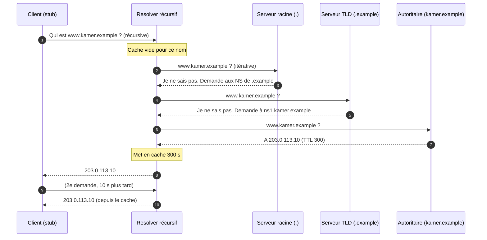

# DNS : les fondamentaux pour un DevOps

## Pourquoi ce cours ?

« C'est toujours le DNS. » Cette plaisanterie d'ingénieurs est presque une statistique : une grande part des
incidents de production (service injoignable, certificat qui ne se délivre pas, pod qui ne trouve pas sa base)
a une cause DNS. Le DNS est la **colle** entre vos noms (`api.kamer.example`) et vos adresses IP, et il change
beaucoup plus souvent que les adresses elles-mêmes (déploiements, bascules, CDN, Kubernetes).

> Ce cours ne revient pas sur les bases de `dig` vues au [cours réseau du module 02](../../02-linux-intermediaire/cours/03-reseaux-base.md) : il va plus loin, jusqu'à Kubernetes.

## 1. La résolution complète

Un nom est lu **de droite à gauche** : `www.kamer.example.` (le point final est la **racine**).

```text
.                      ← racine (13 « root servers » logiques a à m)
└── example            ← TLD (domaine de premier niveau : .com, .fr, .cm…)
    └── kamer          ← domaine, géré par une zone « autoritaire »
        └── www        ← enregistrement
```

Trois acteurs :

| Acteur | Rôle |
|---|---|
| **Resolver stub** | Petit client de la machine (`systemd-resolved`, 127.0.0.53). Il pose la question. |
| **Resolver récursif** | Serveur (FAI, 1.1.1.1, 8.8.8.8, CoreDNS) qui fait **tout le travail** et met en cache. |
| **Serveur autoritaire** | Détient la vérité sur une zone (Route 53, Cloudflare, BIND). Ne résout que ses propres zones. |

### Récursion vs itération

- **Requête récursive** : le client dit « donne-moi la réponse finale ». Le resolver s'en charge.
- **Requête itérative** : le serveur répond « je ne sais pas, mais va voir chez celui-ci » (un *referral*). C'est ce que fait le resolver auprès de la racine, du TLD, etc.



> 📌 **À retenir** : le client ne parle **jamais** aux serveurs racine. Seul le resolver récursif le fait, et seulement quand son cache est vide ou expiré.

## 2. Les types d'enregistrements et leur usage en DevOps

| Type | Contenu | Quand l'utiliser |
|---|---|---|
| **A** | Nom → IPv4 | Pointer `api.kamer.example` vers un load balancer ou une IP publique |
| **AAAA** | Nom → IPv6 | Idem en IPv6 (à ne pas oublier : un AAAA cassé provoque des lenteurs étranges) |
| **CNAME** | Nom → autre nom (alias) | Pointer vers un CDN (`d123.cloudfront.net`), un load balancer cloud, `www` → site principal |
| **MX** | Serveur de messagerie + priorité | Réception des e-mails du domaine |
| **TXT** | Texte libre | **SPF**, **DKIM**, **DMARC** (anti-usurpation d'e-mail) ; preuve de propriété du domaine ; défi **ACME DNS-01** de Let's Encrypt |
| **SRV** | Service : priorité, poids, port, cible | Découverte de service : Kubernetes (ports nommés), SIP, LDAP, `_etcd-server._tcp` |
| **NS** | Serveurs autoritaires de la zone | Délégation d'un sous-domaine (`dev.kamer.example` géré ailleurs) |
| **SOA** | Métadonnées de la zone : serveur primaire, numéro de série, durées de rafraîchissement, TTL négatif | Un par zone ; le **numéro de série** doit augmenter à chaque modification |
| **PTR** | IP → nom (résolution inverse) | Réputation d'un serveur de messagerie, journaux lisibles |
| **CAA** | Autorités autorisées à émettre des certificats | Durcissement TLS (voir [cours TLS](04-tls-et-https.md)) |

Exemples de zone :

```text
$TTL 300
@        IN SOA  ns1.kamer.example. admin.kamer.example. ( 2025112601 3600 900 1209600 300 )
@        IN NS   ns1.kamer.example.
@        IN A    203.0.113.10
@        IN MX   10 mail.kamer.example.
@        IN TXT  "v=spf1 mx -all"
www      IN CNAME kamer.example.
api      IN A    203.0.113.20
api      IN AAAA 2001:db8::20
_sip._tcp IN SRV 10 60 5060 sip1.kamer.example.
```

> 💡 **Conseil** : dans le SOA, le dernier champ est le **TTL négatif** : durée pendant laquelle une réponse « ce nom n'existe pas » (NXDOMAIN) est mise en cache. Créer un enregistrement juste après l'avoir demandé peut donc rester « invisible » un moment.

## 3. TTL, cache et propagation

Le **TTL** (*Time To Live*) est la durée en secondes pendant laquelle une réponse peut être gardée en cache.

```bash
dig api.kamer.example +noall +answer
# api.kamer.example.  287  IN  A  203.0.113.20     ← 287 s restantes dans le cache du resolver
```

Le TTL **décroît** à chaque requête sur un resolver qui cache. S'il remonte à sa valeur d'origine, le resolver est allé rechercher l'information.

| Idée reçue | Réalité |
|---|---|
| « La propagation DNS prend 24-48 h » | Il n'y a pas de « propagation » : il y a des **caches qui expirent**. Au pire, un changement est visible après l'expiration du TTL **précédent**. |
| « Je baisse le TTL au moment de migrer » | Trop tard : les caches gardent l'**ancien** TTL. Baissez-le **plusieurs TTL à l'avance**. |

Procédure de migration propre :

```text
J-2 : TTL 86400 → 300      (on attend 86400 s pour que les anciens caches expirent)
J   : on change l'enregistrement ; tout bascule en ≤ 5 minutes
J+1 : on remonte le TTL à 3600 ou plus (moins de charge, plus de résilience)
```

> ⚠️ **Attention** : certains clients **ignorent le TTL** (JVM avec `networkaddress.cache.ttl` infini, bibliothèques anciennes, applications qui résolvent une seule fois au démarrage). Après une bascule DNS, un redémarrage peut être nécessaire.

## 4. Le DNS dans Kubernetes

Chaque cluster embarque un serveur DNS interne, **CoreDNS**, qui sert la zone `cluster.local`.

```text
<service>.<namespace>.svc.cluster.local
   │          │
   │          └─ espace de noms
   └─ nom du Service
```

| Cible | Nom DNS | Réponse |
|---|---|---|
| Service ordinaire (ClusterIP) | `db.prod.svc.cluster.local` | **Une** IP virtuelle (le ClusterIP) |
| Service **headless** (`clusterIP: None`) | `db.prod.svc.cluster.local` | **Les IP de tous les pods** (plusieurs enregistrements A) |
| Pod d'un StatefulSet | `db-0.db.prod.svc.cluster.local` | L'IP du pod précis `db-0` |
| Port nommé | `_http._tcp.web.prod.svc.cluster.local` | Enregistrement **SRV** |

```yaml
# Service headless : chaque pod est directement adressable
apiVersion: v1
kind: Service
metadata:
  name: db
  namespace: prod
spec:
  clusterIP: None
  selector:
    app: db
  ports:
    - port: 5432
```

### Le fichier `/etc/resolv.conf` d'un pod

```text
search prod.svc.cluster.local svc.cluster.local cluster.local
nameserver 10.96.0.10
options ndots:5
```

- `search` : domaines ajoutés automatiquement aux noms **courts** (`db` → `db.prod.svc.cluster.local`).
- `nameserver` : l'IP du Service `kube-dns` (CoreDNS).
- **`ndots:5`** : un nom contenant **moins de 5 points** est d'abord essayé avec chaque suffixe `search`. Pour `api.exemple.com` (2 points), le pod envoie d'abord 3-4 requêtes inutiles (`api.exemple.com.prod.svc.cluster.local`…) avant la bonne.

> 💡 **Conseil** : en production, utilisez un **nom absolu avec point final** (`api.exemple.com.`) pour les appels externes très fréquents, ou ajustez `ndots` via `dnsConfig`. C'est une cause classique de latence et de saturation de CoreDNS.

```bash
kubectl run dnsutils --rm -it --image=registry.k8s.io/e2e-test-images/jessie-dnsutils:1.3 -- bash
# dans le pod :
cat /etc/resolv.conf
nslookup kubernetes.default
dig +short db.prod.svc.cluster.local
```

```bash
kubectl -n kube-system get pods -l k8s-app=kube-dns
kubectl -n kube-system logs -l k8s-app=kube-dns --tail=20
kubectl -n kube-system get configmap coredns -o yaml     # le Corefile
```

## 5. Les outils

```bash
dig kamer.example                       # requête complète
dig +short A kamer.example              # réponse seule
dig @1.1.1.1 kamer.example              # interroger un resolver précis
dig @ns1.kamer.example kamer.example    # interroger directement l'AUTORITAIRE (vérité)
dig +noall +answer +ttlid kamer.example
dig -x 203.0.113.10                     # résolution inverse
dig NS kamer.example +short
dig SOA kamer.example +short
dig TXT kamer.example +short
dig +trace www.kamer.example            # refait toute la résolution depuis la racine

nslookup kamer.example 1.1.1.1          # alternative (portable, Windows)
host -t MX kamer.example                # sortie concise
resolvectl query kamer.example          # via systemd-resolved (cache, DNSSEC, interface)
resolvectl status
resolvectl flush-caches                 # vider le cache local
getent hosts kamer.example              # ce que voient réellement les applications
```

> 📌 **À retenir** : `dig` **ignore** `/etc/hosts` et `nsswitch.conf` ; il interroge directement un serveur DNS. `getent hosts` et `ping` suivent la chaîne complète du système. Un nom qui marche avec l'un et pas l'autre est un indice précieux.

### Sortie annotée de `dig +trace`

```bash
dig +trace www.kamer.example
```

```text
.                    518400 IN NS  a.root-servers.net.      ┐ 1. On demande à la racine :
.                    518400 IN NS  b.root-servers.net.      ┘    liste des serveurs racine
;; Received 525 bytes from 127.0.0.53#53(127.0.0.53) in 2 ms

example.             172800 IN NS  a.nic.example.           ┐ 2. La racine répond par une
example.             172800 IN NS  b.nic.example.           ┘    DÉLÉGATION vers le TLD
;; Received 800 bytes from 198.41.0.4#53(a.root-servers.net) in 25 ms

kamer.example.       86400  IN NS  ns1.kamer.example.       ┐ 3. Le TLD délègue à
kamer.example.       86400  IN NS  ns2.kamer.example.       ┘    l'autoritaire du domaine
;; Received 300 bytes from 192.0.2.53#53(a.nic.example) in 30 ms

www.kamer.example.   300    IN A   203.0.113.10             ← 4. RÉPONSE FINALE, TTL 300
;; Received 70 bytes from 203.0.113.53#53(ns1.kamer.example) in 18 ms
```

Lisez chaque bloc : la **question** reste la même, mais le serveur interrogé change à chaque étape (champ `from …`).

Dans une réponse `dig` normale, les **flags** comptent : `qr` (réponse), `aa` (réponse **autoritaire**), `rd` (récursion demandée), `ra` (récursion disponible). Le statut est `NOERROR`, `NXDOMAIN` (n'existe pas) ou `SERVFAIL` (le resolver n'a pas réussi, souvent un problème DNSSEC ou d'autoritaire injoignable).

## 6. Erreurs fréquentes en production

### CNAME à l'apex

Un `CNAME` **ne peut pas coexister** avec un autre enregistrement sur le même nom. Or l'apex (`kamer.example`) porte déjà `SOA`, `NS`, `MX`… Un CNAME à l'apex est donc **interdit** par la norme et casse la messagerie.

```text
❌ kamer.example.  CNAME  mon-lb.cloud.example.
✅ Utiliser un ALIAS / ANAME / « CNAME flattening » (Route 53, Cloudflare) : le fournisseur aplatit en A à la volée
✅ Ou : A direct vers l'IP, et CNAME seulement sur www
```

### Mauvais TTL

- **Trop long** (86400) lors d'une bascule : on ne peut plus revenir en arrière rapidement.
- **Trop court** (5 s) en permanence : charge inutile, latence, dépendance accrue au DNS. 60-300 s pour les enregistrements qui changent, 3600+ pour le reste.

### Split-horizon (DNS à vue partagée)

Le même nom renvoie **des réponses différentes** selon l'origine (interne ou Internet) : `db.kamer.example` → `10.0.1.5` en interne, rien (ou autre chose) en externe.

```text
 Poste interne ──► resolver interne ──► 10.0.1.5
 Internet      ──► DNS public       ──► (NXDOMAIN)
```

Utile pour l'accès privé, mais source de confusion : « ça marche depuis le bureau, pas depuis la maison/le VPN ». Toujours demander **depuis où** on teste, et **quel resolver** répond (`dig` + `resolvectl status`).

### Autres pièges

- **Oubli du point final** dans une zone : `www CNAME kamer.example` (sans point) devient `kamer.example.kamer.example.`.
- **Numéro de série SOA** non incrémenté : les secondaires ne se mettent pas à jour.
- **Délégation NS incohérente** entre le registrar et la zone (« lame delegation »).
- **Cache négatif** (NXDOMAIN) qui masque un enregistrement tout juste créé.
- **`/etc/hosts` oublié** sur un serveur : il surcharge le DNS à votre insu.
- **DNSSEC** mal renouvelé : `SERVFAIL` pour les resolvers validants.

## Résumé

- Le **resolver récursif** interroge racine → TLD → autoritaire (itération) et **met en cache** ; le client ne fait qu'une requête récursive.
- Choisissez le bon type : **A/AAAA** (adresses), **CNAME** (alias, pas à l'apex), **TXT** (SPF/DKIM, ACME), **SRV** (service + port), **NS/SOA** (zone), **MX** (mail).
- Il n'y a pas de « propagation » : seuls les **TTL** comptent ; baissez-les **avant** une migration.
- Kubernetes : CoreDNS, `svc.cluster.local`, services **headless**, `ndots:5`.
- `dig` interroge le DNS ; `getent hosts` reflète ce que voient les applications.

## Pour aller plus loin

- RFC 1034/1035 (DNS), RFC 2308 (cache négatif), RFC 8767 (servir des données périmées).
- DNSSEC (`dig +dnssec`), DNS over TLS/HTTPS, EDNS Client Subnet.
- Documentation CoreDNS : <https://coredns.io/manual/toc/>.
- Atelier associé : [Atelier 01 — Résolution DNS](../ateliers/atelier-01-dns-resolution.md).
- Cours suivant : [Ports et sockets](02-ports-et-sockets.md).
