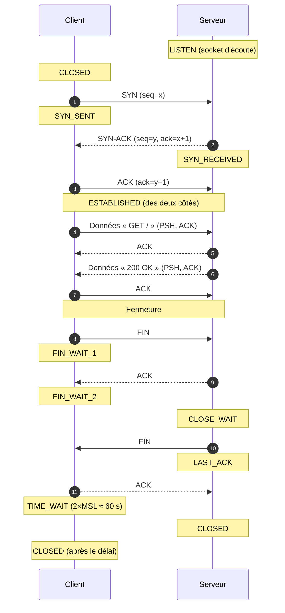

# Ports, sockets et états TCP

## Pourquoi ce cours ?

« Le service est démarré mais on ne peut pas s'y connecter. » « Le serveur a 60 000 connexions en `TIME_WAIT`. »
« Mon pod écoute mais le Service ne route rien. » Toutes ces phrases se résolvent en comprenant **ce qu'est une connexion**,
**qui écoute où**, et **dans quel état** se trouve chaque socket. C'est le langage commun entre Linux, Docker et Kubernetes.

## 1. Les ports

Un **port** (16 bits, 0 à 65535) identifie un **service** sur une machine : l'IP désigne la machine, le port désigne l'application.

| Plage | Nom | Exemples |
|---|---|---|
| 0 – 1023 | **Bien connus** (*well-known*), réservés ; il faut être root (ou `CAP_NET_BIND_SERVICE`) pour écouter | 22 SSH, 53 DNS, 80 HTTP, 443 HTTPS |
| 1024 – 49151 | **Enregistrés** | 3306 MySQL, 5432 PostgreSQL, 6379 Redis, 6443 API Kubernetes, 8080 |
| 49152 – 65535 | **Éphémères / dynamiques** : attribués au côté **client** | Port source d'une connexion sortante |

Sous Linux, la plage éphémère réelle est configurable :

```bash
sysctl net.ipv4.ip_local_port_range      # 32768 60999 par défaut
```

> ⚠️ **Attention** : cette plage fixe le nombre maximal de connexions **simultanées vers une même destination** (~28 000 ici). Un service qui ouvre énormément de connexions courtes vers un seul backend peut épuiser les ports éphémères.

## 2. Le socket et son tuple

Une connexion est identifiée de façon **unique** par un **5-uplet** :

```text
( protocole,  IP source,  port source,  IP destination,  port destination )
  TCP         10.0.0.7    51234         203.0.113.10     443
```

Conséquence : **plusieurs clients** peuvent se connecter au même `203.0.113.10:443` en même temps, car leurs tuples diffèrent par l'IP ou le port source. Le serveur n'a qu'**un seul port** à l'écoute, mais un socket **par connexion**.

```text
Serveur : socket d'écoute 0.0.0.0:443 (LISTEN)
   ├─ connexion A : 10.0.0.7:51234  ↔ 203.0.113.10:443
   ├─ connexion B : 10.0.0.7:51235  ↔ 203.0.113.10:443
   └─ connexion C : 198.51.100.4:40000 ↔ 203.0.113.10:443
```

Un processus manipule un socket via un **descripteur de fichier** (rappel : « tout est fichier »). Le noyau garde pour chacun des tampons d'émission et de réception.

```bash
ls -l /proc/$(pgrep -o nginx)/fd | grep socket
```

**TCP** (connecté, fiable, ordonné) et **UDP** (sans connexion, sans garantie) ont chacun leur espace de ports : `53/tcp` et `53/udp` sont distincts.

## 3. Le handshake TCP et les états



### Signification opérationnelle des états

| État | Signification | Que faire si on en voit **beaucoup** ? |
|---|---|---|
| `LISTEN` | Un programme attend des connexions | Normal : c'est ce qu'on cherche pour vérifier qu'un service écoute |
| `SYN_SENT` | Le client attend le SYN-ACK | Beaucoup = destination **injoignable ou filtrée** (pare-feu qui jette les paquets) |
| `SYN_RECV` | Le serveur a reçu un SYN, attend l'ACK | Beaucoup = **attaque SYN flood** ou serveur saturé (file `backlog` pleine) |
| `ESTABLISHED` | Connexion active | Compter les connexions par client pour détecter un abus |
| `FIN_WAIT_1/2` | On a demandé la fermeture, on attend l'autre côté | Le pair ne ferme pas son côté |
| `CLOSE_WAIT` | Le pair a fermé, **notre application n'a pas fermé le socket** | ⚠️ **Fuite de sockets dans l'application** : elle oublie de faire `close()`. Seul un correctif du code ou un redémarrage règle le problème |
| `TIME_WAIT` | Le côté qui a fermé **en premier** attend ~60 s pour absorber les paquets retardataires | Normal sur un client/proxy qui ferme beaucoup. Problématique seulement si l'on **épuise les ports éphémères** |
| `LAST_ACK` | On attend l'ACK final | Rare ; si bloqué, perte réseau |

> 📌 **À retenir** : `CLOSE_WAIT` est un **bug applicatif** (jamais un problème réseau) ; `TIME_WAIT` est un **comportement normal du protocole**. Ne « réglez » pas `TIME_WAIT` en abaissant des timers à l'aveugle : privilégiez les connexions persistantes (*keep-alive*, *pooling*).

```bash
ss -tan | awk 'NR>1 {c[$1]++} END {for (e in c) print c[e], e}' | sort -nr    # répartition des états
ss -tan state time-wait | wc -l
ss -tan state close-wait
```

Côté noyau, deux files existent pour un socket en écoute : la file des connexions **en cours de handshake** (SYN backlog) et celle des connexions **prêtes à être acceptées** par l'application (`accept queue`, bornée par `net.core.somaxconn`). Si la seconde déborde (application trop lente), le noyau **jette** des connexions : `nstat -az | grep -i listen` montre `ListenOverflows`.

## 4. Où écoute-t-on ? Le *bind*

Quand un programme appelle `bind()`, il choisit une **adresse locale** et un port :

| Adresse de bind | Signification | Accessible depuis |
|---|---|---|
| `127.0.0.1` | Boucle locale uniquement | La **machine elle-même** |
| `0.0.0.0` (IPv4) / `::` (IPv6) | **Toutes** les interfaces | Partout où une route mène (réseau local, Internet…) |
| `10.0.0.7` (IP précise) | Une seule interface | Le réseau portant cette IP |

```bash
ss -tlnp
# LISTEN 0 4096 127.0.0.1:5432  0.0.0.0:*   users:(("postgres",pid=900,fd=5))   ← local seulement
# LISTEN 0 128  0.0.0.0:22      0.0.0.0:*   users:(("sshd",pid=812,fd=3))      ← ouvert à tous
# LISTEN 0 511  *:80            *:*         users:(("nginx",pid=1020,fd=6))    ← * = toutes
```

> ⚠️ **Attention (sécurité)** : une base de données, Redis ou un tableau de bord qui écoute sur `0.0.0.0` **sans pare-feu ni authentification** est l'une des premières causes de fuites de données. Règle : *tout ce qui n'a pas besoin d'être joint de l'extérieur écoute sur `127.0.0.1` (ou une IP privée)*.

> 💡 **Conseil** : dans un conteneur, c'est l'inverse : une application qui écoute sur `127.0.0.1` n'est **pas joignable** par le Service ou par `docker -p`, car la « boucle locale » du conteneur n'est pas celle de l'hôte. Dans un conteneur, écoutez sur `0.0.0.0`.

## 5. Les ports dans Kubernetes

Cinq notions voisines que l'on confond souvent :

| Champ | Où | Signification |
|---|---|---|
| **containerPort** | Spec du pod | Port sur lequel le **processus** écoute dans le conteneur (surtout documentaire : n'ouvre rien) |
| **targetPort** | Spec du Service | Port du **pod** vers lequel le Service redirige |
| **port** | Spec du Service | Port **du Service** (sur son ClusterIP), celui qu'appellent les clients |
| **nodePort** | Service `NodePort` | Port ouvert sur **chaque nœud** (30000-32767 par défaut) |
| **hostPort** | Spec du pod | Lie le port du conteneur à un port du **nœud** ; à éviter (limite la planification) |

```text
Client externe ──► nœud:30080 (nodePort) ──┐
Pod du cluster ──► svc-web:80 (port) ──────┼─► pod:8080 (targetPort = containerPort)
```

```yaml
apiVersion: v1
kind: Service
metadata:
  name: web
spec:
  type: NodePort
  selector:
    app: web
  ports:
    - name: http
      port: 80            # port du Service (ClusterIP:80)
      targetPort: 8080    # port du conteneur
      nodePort: 30080     # port ouvert sur chaque nœud
---
apiVersion: v1
kind: Pod
metadata:
  name: web
  labels: { app: web }
spec:
  containers:
    - name: nginx
      image: nginx:1.27
      ports:
        - containerPort: 8080
```

Diagnostic rapide quand « le Service ne répond pas » :

```bash
kubectl get svc web -o wide
kubectl get endpoints web           # vide = le sélecteur ne correspond à aucun pod prêt
kubectl describe svc web
kubectl exec -it monpod -- ss -tlnp # le pod écoute-t-il vraiment sur targetPort, sur 0.0.0.0 ?
kubectl port-forward svc/web 8080:80
```

> 📌 **À retenir** : un **Service sans endpoints** est la première chose à vérifier. Cause usuelle : un sélecteur (`labels`) qui ne correspond pas, ou des pods non `Ready` (sonde *readiness* en échec).

## 6. Les outils

```bash
ss -tulpn                       # sockets en écoute (TCP+UDP) avec processus
ss -tan                         # toutes les connexions TCP, numérique
ss -tan state established '( dport = :443 )'
ss -s                           # résumé
ss -o state time-wait           # avec les temporisateurs
sudo lsof -i :8080              # qui utilise ce port ?
sudo lsof -iTCP -sTCP:LISTEN -nP
netstat -tulpn                  # ancien outil (paquet net-tools), équivalent à ss
nc -l 9000                      # écouter sur le port 9000 (serveur de test)
nc -zv hôte 443                 # le port répond-il ?
nc -u -zv hôte 53               # test UDP
echo test | nc hôte 9000        # envoyer du texte
cat < /dev/tcp/127.0.0.1/22     # test pur Bash, sans outil
```

| Message de `nc -zv` | Signification |
|---|---|
| `succeeded!` / `open` | Un service écoute et accepte |
| `Connection refused` | La machine répond **RST** : aucun programme n'écoute (ou rejet explicite) |
| Délai d'attente (*timed out*) | Paquets **jetés** : pare-feu / mauvaise route / machine éteinte |

## Résumé

- Un port désigne un **service** ; 3 plages : bien connus, enregistrés, **éphémères** (côté client).
- Une connexion = **5-uplet** unique ; un serveur gère un socket par connexion sur un seul port d'écoute.
- TCP : handshake à 3 temps ; `CLOSE_WAIT` = **bug applicatif**, `TIME_WAIT` = normal, `SYN_RECV` massif = attaque ou saturation.
- Le **bind** (`127.0.0.1` vs `0.0.0.0`) détermine l'exposition : c'est une décision de **sécurité**.
- Kubernetes : `containerPort` ≠ `targetPort` ≠ `port` ≠ `nodePort` ≠ `hostPort` ; vérifiez les **endpoints**.
- Outils : `ss`, `lsof`, `nc`.

## Pour aller plus loin

- `man ss`, `man 7 tcp`, `man 7 socket`, RFC 9293 (TCP).
- Options de socket : `SO_REUSEADDR`, `SO_REUSEPORT`, `TCP_NODELAY`, *keep-alive*.
- QUIC / HTTP/3 (UDP 443), SYN cookies, `conntrack` (voir [routage et NAT](03-routage-et-nat.md)).
- Atelier associé : [Atelier 02 — Ports et services](../ateliers/atelier-02-ports-et-services.md).
- Cours suivant : [Routage et NAT](03-routage-et-nat.md).
