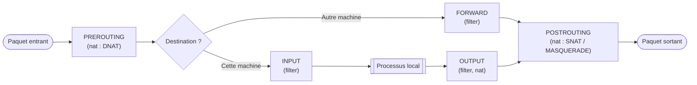
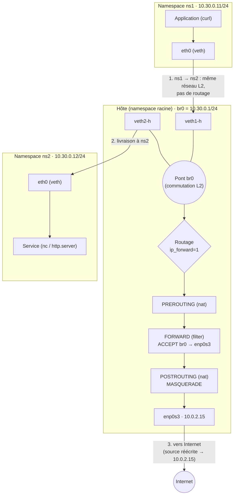

# Routage, NAT et réseaux de conteneurs

## Pourquoi ce cours ?

Un conteneur Docker a une IP `172.17.0.2` qui n'existe nulle part ailleurs ; pourtant il accède à Internet et on
peut le joindre par `-p 8080:80`. Un Service Kubernetes a une IP virtuelle qui ne correspond à **aucune interface**.
Ces « tours de magie » reposent sur trois mécanismes du noyau Linux : le **routage**, le **NAT** et le **filtrage de
paquets** (netfilter). Sans eux, impossible de comprendre pourquoi un pod ne sort pas, pourquoi une règle de
pare-feu casse Docker, ou comment `kube-proxy` fonctionne.

> Prérequis : [namespaces réseau](../../04-linux-expert/cours/02-conteneurs-namespaces.md) et [pare-feu](../../03-linux-avance/cours/04-securite-durcissement.md). Ce cours **réutilise** ces notions sans les redéfinir.

## 1. La table de routage

Pour chaque paquet **sortant** (ou transitant), le noyau choisit la route dont le préfixe est **le plus spécifique** (*longest prefix match*).

```bash
ip route
```

```text
default via 10.0.2.2 dev enp0s3 proto dhcp src 10.0.2.15 metric 100
10.0.2.0/24 dev enp0s3 proto kernel scope link src 10.0.2.15
172.17.0.0/16 dev docker0 proto kernel scope link src 172.17.0.1
192.168.50.0/24 via 10.0.2.254 dev enp0s3
```

| Ligne | Lecture |
|---|---|
| `default via 10.0.2.2` | **Route par défaut** : tout ce qui ne correspond à rien d'autre part chez la passerelle `10.0.2.2` |
| `10.0.2.0/24 dev enp0s3 scope link` | Réseau **directement connecté** : on parle en direct (ARP), sans passerelle |
| `172.17.0.0/16 dev docker0` | Réseau des conteneurs, via le pont Docker |
| `192.168.50.0/24 via 10.0.2.254` | **Route statique** : ce réseau est derrière le routeur `10.0.2.254` |

```bash
ip route get 172.17.0.5            # quelle route serait utilisée ? (très utile)
ip route get 8.8.8.8
sudo ip route add 192.168.60.0/24 via 10.0.2.254      # route statique (temporaire)
sudo ip route del 192.168.60.0/24
sudo ip route replace default via 10.0.2.1
```

Pour rendre une route **permanente** sous Ubuntu, utilisez Netplan (`routes:` dans le YAML, voir [cours réseau](../../02-linux-intermediaire/cours/03-reseaux-base.md)).

### Routage par politique : `ip rule`

Plusieurs **tables** de routage peuvent coexister ; les **règles** (`ip rule`) choisissent la table selon la source, la marque de paquet, etc.

```bash
ip rule                              # 0: from all lookup local / 32766: main / 32767: default
ip route show table all | head
sudo ip rule add from 10.0.0.0/24 table 100
sudo ip route add default via 10.0.5.1 table 100
```

Usage typique : serveurs **multi-interfaces** (éviter le routage asymétrique), VPN, CNI de Kubernetes.

## 2. Le noyau comme routeur : IP forwarding

Par défaut, un hôte Linux **jette** les paquets qui ne lui sont pas destinés. Pour qu'il les **transmette** (rôle de routeur), il faut :

```bash
sysctl net.ipv4.ip_forward             # 0 = machine simple, 1 = routeur
sudo sysctl -w net.ipv4.ip_forward=1
echo 'net.ipv4.ip_forward = 1' | sudo tee /etc/sysctl.d/90-forward.conf
```

> 📌 **À retenir** : Docker et Kubernetes activent `ip_forward`. Si une « durcisation » du noyau le remet à 0, **tout le réseau des conteneurs s'arrête** (sans erreur évidente).

## 3. Netfilter : où passent les paquets ?

**Netfilter** est le cadre du noyau qui permet d'intercepter les paquets en des points précis (*hooks*). `iptables` et `nftables` en sont les interfaces.

Les **tables** regroupent les types de règles ; les **chaînes** sont les points de passage :

| Table | Rôle | Chaînes |
|---|---|---|
| `filter` | Autoriser / refuser | INPUT, FORWARD, OUTPUT |
| `nat` | Traduire les adresses | PREROUTING, INPUT, OUTPUT, POSTROUTING |
| `mangle` | Modifier des champs (marques, TOS) | toutes |
| `raw` | Exempter du suivi de connexion | PREROUTING, OUTPUT |



Lecture : un paquet **pour le routeur lui-même** passe par `PREROUTING → INPUT`. Un paquet **à faire suivre** passe par `PREROUTING → FORWARD → POSTROUTING`. Un paquet **émis localement** passe par `OUTPUT → POSTROUTING`.

> 💡 **Conseil** : retenez « le **DNAT** se fait **avant** le routage (PREROUTING : on change la destination *avant* de décider où l'envoyer), le **SNAT** se fait **après** (POSTROUTING : on change la source *au dernier moment*) ».

### Suivi de connexion (`conntrack`)

Pour que le NAT soit réversible (les **réponses** doivent retrouver leur chemin), le noyau mémorise chaque flux dans une table `conntrack`.

```bash
sudo apt install -y conntrack
sudo conntrack -L | head
sudo conntrack -L | wc -l
sysctl net.netfilter.nf_conntrack_max
sysctl net.netfilter.nf_conntrack_count
```

> ⚠️ **Attention** : une table `conntrack` **pleine** (`nf_conntrack: table full, dropping packet` dans `dmesg`) fait **jeter des paquets au hasard**. Symptôme classique sur un nœud Kubernetes très sollicité ou un serveur DNS.

## 4. Le NAT

Le **NAT** (*Network Address Translation*) réécrit les adresses d'un paquet pendant son passage.

| Type | Réécrit | Chaîne | Usage |
|---|---|---|---|
| **SNAT** (*Source NAT*) | L'IP **source** | POSTROUTING | Faire sortir un réseau privé vers Internet avec une IP publique fixe |
| **MASQUERADE** | L'IP source, en prenant **l'IP courante** de l'interface de sortie | POSTROUTING | Même chose quand l'IP publique est **dynamique** (DHCP) : cas de Docker |
| **DNAT** (*Destination NAT*) | L'IP / le port **destination** | PREROUTING (ou OUTPUT) | **Publier** un service : rediriger `:8080` de l'hôte vers `172.17.0.2:80` |

```text
SORTIE (MASQUERADE)                          ENTRÉE (DNAT, « port publish »)

conteneur 172.17.0.2:40000                   client 198.51.100.4:51000
   │  → 8.8.8.8:53                              │  → hôte 203.0.113.10:8080
   ▼                                            ▼
[hôte : POSTROUTING]                         [hôte : PREROUTING]
 source → 10.0.2.15:40000                     destination → 172.17.0.2:80
   ▼                                            ▼
Internet voit « 10.0.2.15 »                  conteneur voit le client d'origine
(réponse : conntrack remet 172.17.0.2)       (réponse : conntrack remet 203.0.113.10:8080)
```

### Pourquoi Docker et Kubernetes en ont besoin

- Les IP des conteneurs / pods sont **privées**, non routables sur Internet : sans MASQUERADE, les réponses ne reviendraient jamais.
- Publier un port (`-p`) ou exposer un NodePort = **DNAT** vers l'IP du conteneur/pod.
- Un Service Kubernetes (ClusterIP) est une **IP virtuelle** : `kube-proxy` crée des règles **DNAT** qui la remplacent par l'IP d'un pod choisi.

### Exemples de règles

```bash
# Faire sortir un réseau privé 10.20.0.0/24 par l'interface enp0s3
sudo iptables -t nat -A POSTROUTING -s 10.20.0.0/24 -o enp0s3 -j MASQUERADE

# Publier le port 8080 de l'hôte vers 10.20.0.2:80
sudo iptables -t nat -A PREROUTING -p tcp --dport 8080 -j DNAT --to-destination 10.20.0.2:80
sudo iptables -A FORWARD -p tcp -d 10.20.0.2 --dport 80 -j ACCEPT

sudo iptables -t nat -L -n -v --line-numbers       # lister
sudo iptables -t nat -D POSTROUTING 1              # supprimer par numéro
sudo iptables-save | head -40                      # export complet
```

Équivalent **nftables** :

```bash
sudo nft add table ip nat
sudo nft 'add chain ip nat postrouting { type nat hook postrouting priority 100 ; }'
sudo nft add rule ip nat postrouting ip saddr 10.20.0.0/24 oifname "enp0s3" masquerade
sudo nft list ruleset
```

> ⚠️ **Attention** : sur Ubuntu 24.04, `iptables` est en réalité **`iptables-nft`** (une couche de compatibilité au-dessus de nftables). Mélanger règles `iptables` et règles `nft` natives est source de confusion : choisissez un seul outil par table.

## 5. Ce que fait Docker

Au démarrage, Docker crée un **pont** `docker0` et des règles :

```bash
ip -br a show docker0
bridge link                                     # interfaces rattachées au pont
sudo iptables -t nat -S | grep -i docker
sudo iptables -S DOCKER-USER                    # chaîne réservée à VOS règles
```

Règles typiques (simplifiées) après `docker run -d -p 8080:80 nginx` :

```text
-t nat    -A POSTROUTING -s 172.17.0.0/16 ! -o docker0 -j MASQUERADE
-t nat    -A DOCKER ! -i docker0 -p tcp --dport 8080 -j DNAT --to-destination 172.17.0.2:80
-t filter -A DOCKER -d 172.17.0.2/32 ! -i docker0 -o docker0 -p tcp --dport 80 -j ACCEPT
-t filter -A FORWARD -o docker0 -j DOCKER
```

> ⚠️ **Attention** : Docker **contourne `ufw`** : un `-p 8080:80` rend le port joignable depuis Internet **même si `ufw` le bloque**, car les règles Docker passent en PREROUTING/FORWARD, avant celles d'`ufw` (INPUT). Pour restreindre, utilisez la chaîne `DOCKER-USER` ou publiez sur `127.0.0.1` (`-p 127.0.0.1:8080:80`).

## 6. Ce que fait kube-proxy

En mode `iptables` (défaut le plus courant), `kube-proxy` traduit **chaque Service** en règles :

```bash
sudo iptables -t nat -L KUBE-SERVICES -n | head
sudo iptables -t nat -S | grep -E "KUBE-SVC|KUBE-SEP" | head
```

```text
KUBE-SERVICES : cible ClusterIP 10.96.12.5:80      → saute vers KUBE-SVC-XXXX
KUBE-SVC-XXXX : équilibrage statistique            → 1/3 vers KUBE-SEP-AAA
                                                      1/2 vers KUBE-SEP-BBB
                                                      reste vers KUBE-SEP-CCC
KUBE-SEP-AAA  : DNAT vers 10.244.1.5:8080 (pod A)
```

L'équilibrage est réalisé avec le module `statistic` (`-m statistic --mode random --probability 0.33333`). Sur de grands clusters, le mode **IPVS** ou **nftables**, ou un CNI à base d'**eBPF** (Cilium), remplace ces longues chaînes.

## 7. Ponts et overlay

Un **pont** (*bridge*) Linux est un **commutateur virtuel** de niveau 2 : il relie des interfaces (veth) comme un switch relie des câbles.

```bash
sudo ip link add br0 type bridge
sudo ip link set br0 up
sudo ip link set veth-h master br0          # rattache une interface au pont
bridge link
bridge fdb show br br0                      # table MAC
```

Entre **plusieurs nœuds**, les pods doivent se joindre malgré des réseaux physiques différents. Une solution : l'**overlay**, qui **encapsule** le trafic des pods dans des paquets entre nœuds.

```text
Pod A (10.244.1.5) ───────────────────────────────► Pod B (10.244.2.7)
   │                                                      ▲
   ▼  trame d'origine encapsulée dans UDP 4789            │
[Nœud 1 192.168.1.11] ═══ VXLAN (VNI 42) ═══► [Nœud 2 192.168.1.12]
   (en-tête externe : IP nœud1 → IP nœud2)    (décapsulation)
```

**VXLAN** place une trame Ethernet dans un paquet UDP (port 4789) ; un identifiant **VNI** isole les réseaux. Flannel, Calico (mode VXLAN) et Cilium l'utilisent. Contrepartie : en-têtes supplémentaires (~50 octets), donc **MTU** réduit (ex. 1450 au lieu de 1500).

```bash
ip -d link show type vxlan
sudo ip link add vxlan42 type vxlan id 42 dstport 4789 remote 192.168.1.12 dev enp0s3
ip link show flannel.1 2>/dev/null          # sur un nœud Kubernetes avec Flannel
```

> ⚠️ **Attention** : un **MTU** mal réglé est un classique en overlay : les petites requêtes passent, les grosses réponses (téléchargement, TLS) se bloquent. Test : `ping -M do -s 1400 hôte` (interdit la fragmentation).

## 8. Le chemin d'un paquet entre deux namespaces via un pont

Scénario de l'[atelier 03](../ateliers/atelier-03-routage-nat.md) : deux namespaces `ns1` et `ns2` reliés à un pont `br0` de l'hôte ; `ns1` accède à Internet via NAT.



Deux trajets à distinguer :

1. **ns1 → ns2** : même sous-réseau `10.30.0.0/24`, le pont **commute** (couche 2). **Aucune** table iptables de routage n'intervient, sauf `FORWARD` si `br_netfilter` est activé.
2. **ns1 → Internet** : la route par défaut de `ns1` pointe vers `10.30.0.1` (le pont). Le paquet remonte dans l'hôte, passe `PREROUTING → FORWARD → POSTROUTING` où `MASQUERADE` remplace la source `10.30.0.11` par `10.0.2.15`.

## 9. Outils de diagnostic

```bash
ip route get 8.8.8.8
ip -s link show enp0s3                        # compteurs d'erreurs/pertes
ip neigh                                      # table ARP/NDP
traceroute -n 8.8.8.8                         # saut par saut (UDP par défaut)
traceroute -T -p 443 -n exemple.org           # en TCP:443 (traverse mieux les pare-feu)
tracepath -n exemple.org                      # découvre aussi le MTU
mtr -rwn -c 20 exemple.org                    # rapport : perte et latence par saut
sudo tcpdump -ni any host 10.30.0.11          # observer les paquets avant/après NAT
sudo tcpdump -ni br0 icmp
sudo iptables -t nat -L -n -v                 # compteurs : quelles règles « matchent » ?
sudo conntrack -L -s 10.30.0.11               # traductions actives
```

> 💡 **Conseil** : dans `iptables -L -v`, les **compteurs** (`pkts`, `bytes`) montrent si une règle est réellement atteinte. Rejouez votre test et regardez quels compteurs bougent : c'est la meilleure façon de comprendre un chemin de paquet.

Lecture de `mtr` : une perte qui apparaît **sur un saut intermédiaire mais pas sur les suivants** est généralement un routeur qui limite sa réponse ICMP (sans gravité). Une perte qui **persiste jusqu'à la destination** est réelle.

## Résumé

- Le noyau choisit la route au **préfixe le plus spécifique** ; `ip route get` montre la décision ; `ip_forward=1` en fait un routeur.
- **Netfilter** : `PREROUTING → (INPUT | FORWARD) → POSTROUTING`, et `OUTPUT` pour le local ; **DNAT avant** le routage, **SNAT après**.
- **MASQUERADE** (sortie des réseaux privés) et **DNAT** (publication de ports) sont au cœur de Docker et de kube-proxy ; `conntrack` rend le NAT réversible.
- Docker **contourne ufw** ; utilisez `DOCKER-USER` ou `127.0.0.1:port`.
- Pont = switch virtuel L2 ; **VXLAN** encapsule les réseaux de pods entre nœuds (attention au MTU).

## Pour aller plus loin

- `man iptables-extensions`, `man nft`, `man ip-route`, `man ip-rule`, `man bridge`.
- CNI : Flannel, Calico (BGP), Cilium (eBPF) ; `NetworkPolicy` Kubernetes.
- WireGuard, VPN et routage asymétrique ; `rp_filter`.
- Atelier associé : [Atelier 03 — Routage et NAT](../ateliers/atelier-03-routage-nat.md).
- Cours suivant : [TLS et HTTPS](04-tls-et-https.md).
