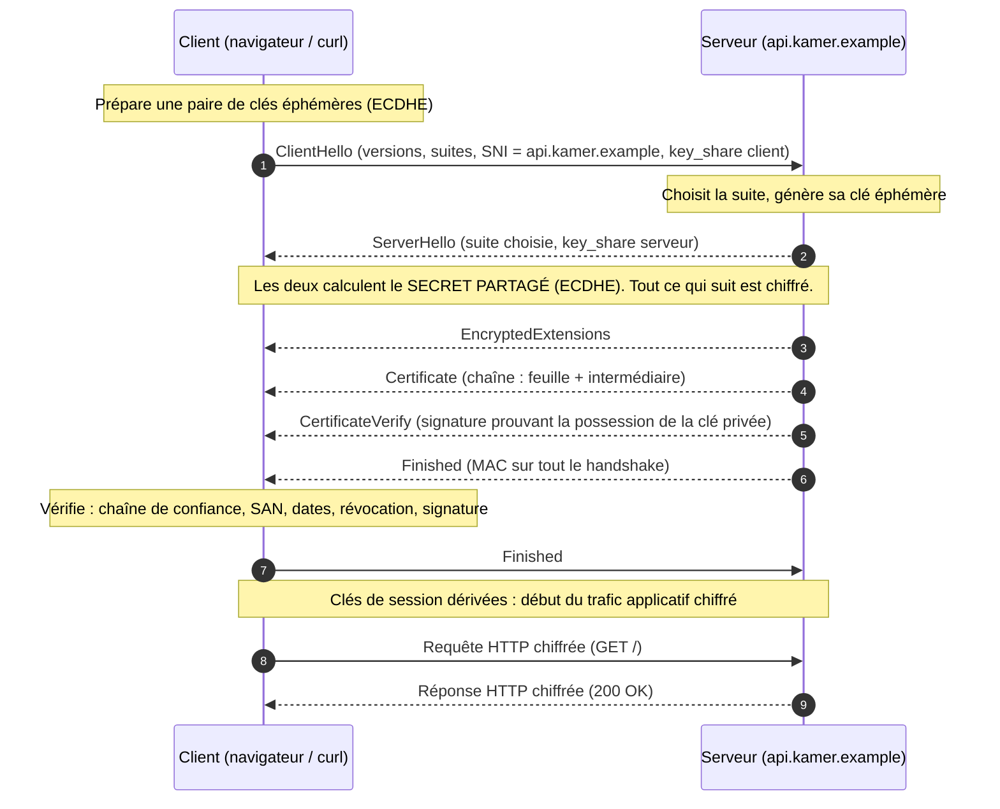
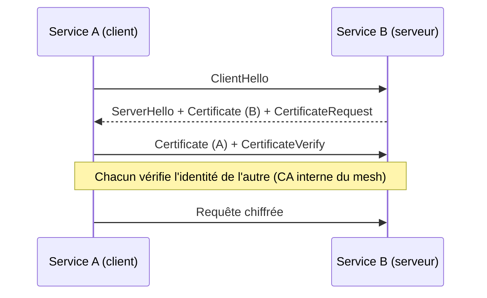

# TLS et HTTPS pour un DevOps

## Pourquoi ce cours ?

Un certificat qui expire en pleine nuit fait plus de dégâts qu'un bug : le site devient **inaccessible** pour tous, avec
un avertissement rouge que personne ne peut contourner proprement. TLS protège les échanges (HTTPS, API, base de
données, communication entre microservices) ; l'automatiser (Let's Encrypt, cert-manager) et savoir le **diagnostiquer**
est une compétence DevOps quotidienne.

TLS (*Transport Layer Security*) assure trois propriétés :

| Propriété | Signification | Mécanisme |
|---|---|---|
| **Confidentialité** | Personne ne lit le contenu | Chiffrement symétrique de la session |
| **Intégrité** | Personne ne modifie les données sans que ça se voie | Chiffrement authentifié (AEAD) |
| **Authenticité** | Vous parlez bien au vrai serveur | **Certificat** signé par une autorité reconnue |

> SSL est le prédécesseur (obsolète, vulnérable). On dit encore « certificat SSL » par habitude : il s'agit en réalité de TLS.

## 1. TLS 1.2 vs TLS 1.3

| | TLS 1.2 (2008) | TLS 1.3 (2018) |
|---|---|---|
| Allers-retours avant les données | **2 RTT** | **1 RTT** (0-RTT possible pour une reprise) |
| Échange de clés | RSA ou (EC)DHE | **(EC)DHE uniquement** → *forward secrecy* obligatoire |
| Algorithmes | Nombreux, dont des faibles (CBC, RC4, SHA-1) | Liste réduite, tous modernes (AES-GCM, ChaCha20-Poly1305) |
| Certificat serveur | Envoyé **en clair** | **Chiffré** après le ServerHello |
| Suites de chiffrement | Longues combinaisons | 5 suites seulement |

> 📌 **À retenir** : la **confidentialité persistante** (*forward secrecy*) signifie que la compromission future de la clé privée du serveur ne permet **pas** de déchiffrer le trafic enregistré dans le passé, car chaque session utilise une clé **éphémère**. TLS 1.3 l'impose.

Politique recommandée : **TLS 1.2 minimum, 1.3 de préférence** ; désactiver SSLv3, TLS 1.0 et 1.1.

## 2. Le handshake TLS 1.3



Étapes clés :

1. **ClientHello** : le client annonce ce qu'il sait faire, et envoie déjà sa moitié de l'échange de clés. Il indique le **SNI** (*Server Name Indication*) : le nom visé, indispensable quand un même IP:443 héberge plusieurs sites.
2. **ServerHello** : le serveur choisit et envoie sa moitié. À cet instant, les deux côtés peuvent calculer la clé de session.
3. **Certificate + CertificateVerify** : le serveur **prouve son identité** : il présente son certificat et signe le handshake avec sa **clé privée**.
4. **Finished** : chaque côté confirme qu'il a vu le même handshake (protection contre une altération).

En **TLS 1.2**, le même processus demande un aller-retour de plus (`ServerKeyExchange`, `ClientKeyExchange`, `ChangeCipherSpec`).

## 3. Certificats X.509

Un **certificat** lie un **nom** (ou des noms) à une **clé publique**, et est **signé** par une autorité de certification (CA).

| Champ | Contenu |
|---|---|
| **Subject** | À qui il appartient (CN historique) |
| **SAN** (*Subject Alternative Name*) | **La liste des noms valides** : `DNS:api.kamer.example`, `DNS:*.kamer.example`, `IP:…` |
| **Issuer** | Qui l'a signé |
| **Validity** | `Not Before` / `Not After` (dates) |
| **Public Key** | Clé publique (RSA 2048+ ou ECDSA P-256) |
| **Key Usage / EKU** | Usages permis (`serverAuth`, `clientAuth`) |
| **Signature** | Signature de l'émetteur |

> ⚠️ **Attention** : les clients modernes **ignorent le CN** et ne regardent que les **SAN**. Un certificat dont le nom n'est que dans le CN est refusé.

### La chaîne de confiance

```text
 Racine (CA racine)           ← intégrée dans le magasin de confiance de l'OS/navigateur
   └─ Intermédiaire (CA)      ← signée par la racine, signe les certificats finaux
        └─ Feuille (api.kamer.example)   ← celui du serveur
```

Le client reçoit **feuille + intermédiaires** ; il connaît déjà les **racines** (`/etc/ssl/certs`, paquet `ca-certificates`). Il remonte la chaîne et vérifie chaque signature jusqu'à une racine de confiance.

> 📌 **À retenir** : le serveur doit envoyer la **chaîne complète** (feuille + intermédiaires, jamais la racine). Un intermédiaire manquant fonctionne parfois (navigateurs qui le retrouvent seuls) et échoue ailleurs (`curl`, Java, Go, applications mobiles) : l'erreur typique « *unable to get local issuer certificate* ».

### Types de validation et de portée

- **DV** (*Domain Validated*) : prouve le contrôle du domaine (Let's Encrypt). Suffisant dans 99 % des cas.
- **OV/EV** : vérifications d'organisation, sans différence technique de chiffrement.
- **Wildcard** `*.kamer.example` : couvre **un seul niveau** (`a.kamer.example` oui, `a.b.kamer.example` non, apex non).

## 4. Les outils

### `openssl s_client`

```bash
# Se connecter, voir la chaîne et le protocole négocié
openssl s_client -connect exemple.org:443 -servername exemple.org </dev/null

# Afficher uniquement le certificat feuille et ses champs clés
openssl s_client -connect exemple.org:443 -servername exemple.org </dev/null 2>/dev/null \
  | openssl x509 -noout -subject -issuer -dates -ext subjectAltName

# Jours restants avant expiration
openssl s_client -connect exemple.org:443 -servername exemple.org </dev/null 2>/dev/null \
  | openssl x509 -noout -enddate
openssl x509 -checkend 259200 -noout -in cert.pem && echo "valide > 3 jours" || echo "EXPIRE dans < 3 jours"

# Forcer une version
openssl s_client -connect exemple.org:443 -tls1_2 </dev/null
openssl s_client -connect exemple.org:443 -tls1_3 </dev/null

# Voir la chaîne complète envoyée
openssl s_client -connect exemple.org:443 -servername exemple.org -showcerts </dev/null

# Inspecter un fichier
openssl x509 -in cert.pem -noout -text | head -40
openssl verify -CAfile ca.pem cert.pem
```

Dans la sortie de `s_client`, cherchez :

```text
Verify return code: 0 (ok)               ← OK ; 20 = chaîne incomplète ; 10 = expiré ; 18/19 = auto-signé
Protocol  : TLSv1.3
Cipher    : TLS_AES_256_GCM_SHA384
subject=CN = exemple.org
issuer=C = US, O = Let's Encrypt, CN = R11
```

### `curl -v`

```bash
curl -v https://exemple.org 2>&1 | grep -E "^\*|^<|^>" | head -30
curl -vI https://exemple.org              # TLS + en-têtes
curl --tlsv1.3 -I https://exemple.org
curl -k https://hôte                      # ignore la vérification (DIAGNOSTIC uniquement !)
curl --cacert ca.pem https://interne.kamer.example
curl --resolve exemple.org:443:203.0.113.10 https://exemple.org    # teste un serveur précis sans toucher au DNS
curl --cert client.pem --key client.key https://mtls.kamer.example # mTLS
```

> ⚠️ **Attention** : `curl -k` **désactive** la vérification : il sert à confirmer qu'un problème vient du certificat, **jamais** à « réparer » un script en production.

### Certificate Transparency

Toute autorité publique **journalise** les certificats émis dans des registres publics (CT logs). On peut y chercher tous les certificats émis pour son domaine (détection de certificats frauduleux, inventaire des sous-domaines) :

- <https://crt.sh/?q=kamer.example> (recherche web)
- `curl -s "https://crt.sh/?q=%25.kamer.example&output=json" | jq -r '.[].name_value' | sort -u`

### Créer un certificat de test

```bash
openssl req -x509 -newkey rsa:2048 -nodes -days 30 \
  -keyout test.key -out test.crt \
  -subj "/CN=test.kamer.local" \
  -addext "subjectAltName=DNS:test.kamer.local,DNS:localhost,IP:127.0.0.1"
openssl x509 -in test.crt -noout -subject -dates -ext subjectAltName
```

## 5. TLS dans l'écosystème DevOps

### Let's Encrypt et ACME

**Let's Encrypt** émet gratuitement des certificats DV de **90 jours** via le protocole **ACME**. Le client prouve qu'il contrôle le domaine :

| Défi | Principe | Quand l'utiliser |
|---|---|---|
| **HTTP-01** | Placer un fichier à `http://domaine/.well-known/acme-challenge/…` (port 80) | Serveur public simple |
| **DNS-01** | Créer un enregistrement TXT `_acme-challenge.domaine` | **Wildcards**, serveurs non exposés |
| **TLS-ALPN-01** | Répondre sur 443 avec un certificat spécial | Cas particuliers |

```bash
sudo apt install -y certbot
sudo certbot certonly --standalone -d api.kamer.example     # nécessite le port 80 libre
sudo certbot renew --dry-run                                 # teste le renouvellement
systemctl list-timers | grep certbot                         # renouvellement automatique
ls /etc/letsencrypt/live/api.kamer.example/                  # fullchain.pem, privkey.pem
```

> 💡 **Conseil** : utilisez **`fullchain.pem`** (feuille + intermédiaire) dans nginx (`ssl_certificate`), pas `cert.pem` : c'est la cause n°1 de « chaîne incomplète ».

### cert-manager dans Kubernetes

**cert-manager** automatise émission **et renouvellement** : on déclare ce qu'on veut, il s'occupe du reste.

```yaml
apiVersion: cert-manager.io/v1
kind: ClusterIssuer
metadata:
  name: letsencrypt-prod
spec:
  acme:
    server: https://acme-v02.api.letsencrypt.org/directory
    email: ops@kamer.example
    privateKeySecretRef:
      name: letsencrypt-account-key
    solvers:
      - http01:
          ingress:
            class: nginx
---
apiVersion: networking.k8s.io/v1
kind: Ingress
metadata:
  name: api
  annotations:
    cert-manager.io/cluster-issuer: letsencrypt-prod
spec:
  ingressClassName: nginx
  tls:
    - hosts: [api.kamer.example]
      secretName: api-tls              # cert-manager crée ce Secret
  rules:
    - host: api.kamer.example
      http:
        paths:
          - path: /
            pathType: Prefix
            backend:
              service: { name: api, port: { number: 80 } }
```

```bash
kubectl get certificate,certificaterequest,order,challenge -A
kubectl describe certificate api-tls
kubectl get secret api-tls -o jsonpath='{.data.tls\.crt}' | base64 -d | openssl x509 -noout -dates
```

Chaîne d'objets : `Certificate → CertificateRequest → Order → Challenge`. En cas d'échec, lisez **`describe challenge`** : la cause (DNS, 404 sur `.well-known`, pare-feu) y est écrite.

### Renouvellement automatique : principes

- Renouveler à **2/3 de la durée de vie** (certificat de 90 jours → à 30 jours restants).
- **Superviser l'expiration** indépendamment du renouvellement : `blackbox_exporter` (Prometheus) alerte sur `probe_ssl_earliest_cert_expiry`.
- Prévoir le **rechargement** du serveur après renouvellement (`systemctl reload nginx` via un *deploy hook*).

### mTLS et service mesh

Le **TLS mutuel** (mTLS) authentifie **les deux côtés** : le serveur demande aussi un certificat **client**.



Dans un **service mesh** (Istio, Linkerd), un *sidecar* proxy à côté de chaque pod gère le mTLS **de façon transparente** : certificats de courte durée (quelques heures) émis par une CA interne, identité fondée sur le **ServiceAccount** (SPIFFE). Les applications n'ont rien à changer.

## 6. Erreurs fréquentes

| Symptôme | Cause probable | Diagnostic |
|---|---|---|
| `certificate has expired` | Renouvellement en panne, horloge fausse | `openssl x509 -enddate` ; `timedatectl` |
| `unable to get local issuer certificate` / `Verify return code: 20` | **Chaîne incomplète** (intermédiaire non servi) | `openssl s_client -showcerts` : combien de certificats ? |
| `certificate is not valid for …` / `hostname mismatch` | Le nom demandé n'est pas dans les **SAN** (ou wildcard sur 2 niveaux) | `-ext subjectAltName` |
| Mauvais certificat renvoyé / certificat « par défaut » | **SNI absent** ou serveur virtuel mal configuré ; test fait par IP | Ajoutez `-servername` ; `curl --resolve` |
| `self-signed certificate` | CA interne non installée sur le client | `--cacert` ; installer la CA (`update-ca-certificates`) |
| `handshake failure` / `protocol version` | Aucun protocole ou suite en commun (client ancien, TLS 1.0 désactivé) | `-tls1_2`, `-tls1_3`, `nmap --script ssl-enum-ciphers` |
| Fonctionne en navigateur, pas en `curl`/Java | Chaîne incomplète, ou CA absente du magasin de l'application | idem chaîne |
| Échec ACME HTTP-01 | Port 80 fermé, redirection incorrecte, DNS pointant ailleurs | `curl -I http://domaine/.well-known/acme-challenge/x` |
| Alerte « sécurité » après migration | Certificat OK mais **contenu mixte** ou HSTS | Console du navigateur |

```bash
# Installer une CA interne sur Ubuntu
sudo cp ca-kamer.crt /usr/local/share/ca-certificates/ca-kamer.crt
sudo update-ca-certificates
```

> ⚠️ **Attention** : une **clé privée** exposée (dans Git, une image Docker, un journal) impose de **révoquer et réémettre** le certificat. Permissions `600`, propriétaire dédié, jamais dans un dépôt.

## Résumé

- TLS garantit **confidentialité, intégrité, authenticité** ; **TLS 1.3** : 1 RTT, (EC)DHE obligatoire, certificat chiffré.
- Le handshake : ClientHello (**SNI**) → ServerHello → Certificate/CertificateVerify → Finished.
- Un certificat X.509 valide **un nom (SAN)** pour **une période**, signé par une **chaîne** menant à une racine de confiance ; le serveur doit servir la **chaîne complète**.
- Outils : `openssl s_client -servername`, `openssl x509`, `curl -v`, `--resolve`, **CT logs** (`crt.sh`).
- Automatisation : **Let's Encrypt/ACME** (HTTP-01, DNS-01), **cert-manager**, supervision de l'expiration, **mTLS** par service mesh.
- Pannes classiques : expiration, chaîne incomplète, SAN, SNI, CA inconnue.

## Pour aller plus loin

- RFC 8446 (TLS 1.3), RFC 5280 (X.509), RFC 8555 (ACME).
- HSTS, OCSP stapling, ECDSA vs RSA, `testssl.sh`, SSL Labs (<https://www.ssllabs.com/ssltest/>).
- SPIFFE/SPIRE, Vault PKI, rotation de certificats internes.
- Atelier associé : le certificat expiré est un des trois défauts de l'[atelier 04 — Diagnostic complet](../ateliers/atelier-04-diagnostic-complet.md).
- Cours suivant : [Diagnostic réseau pour DevOps](05-diagnostic-reseau-devops.md).
