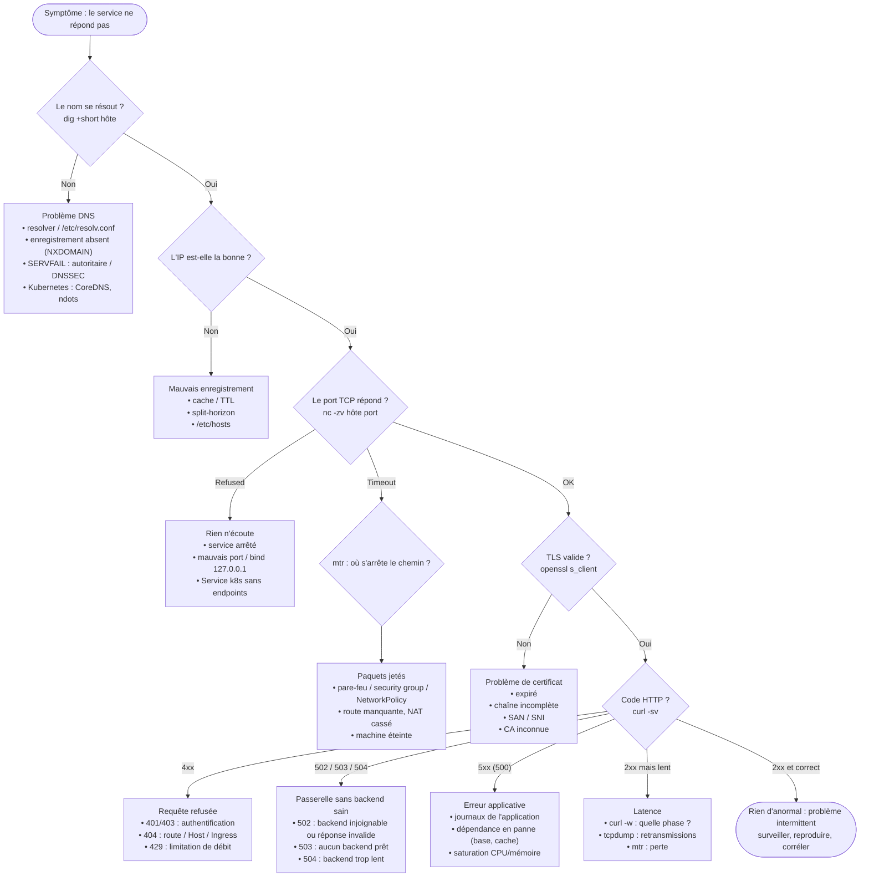

# Diagnostic réseau pour DevOps

## Pourquoi ce cours ?

En incident, la pire stratégie est d'essayer des commandes au hasard. Une **méthode** transforme « ça ne marche pas »
en une série de questions fermées dont chaque réponse élimine une zone entière du problème. Ce cours synthétise les
quatre précédents ([DNS](01-dns-fondamentaux.md), [ports](02-ports-et-sockets.md), [routage/NAT](03-routage-et-nat.md),
[TLS](04-tls-et-https.md)) en une démarche utilisable à 3 h du matin.

## 1. Choisir une méthodologie : du haut vers le bas ou l'inverse ?

| Approche | Principe | Avantage | Limite |
|---|---|---|---|
| **Bas → haut** (couche 1 → 7) | Vérifier câble, IP, route, puis ports, puis application | Rigoureuse, exhaustive | **Lente** : on teste 5 couches saines avant de trouver le défaut, souvent en haut |
| **Haut → bas** (couche 7 → 1) | Reproduire le symptôme applicatif, puis descendre jusqu'à trouver la couche en défaut | **Rapide** : dans les environnements DevOps modernes, la couche 3 est presque toujours saine ; les pannes sont **DNS, TLS, applicatives** | Peut passer à côté d'un défaut réseau bas niveau si l'on s'arrête trop tôt |
| **Diviser pour régner** | Tester au milieu (ex. connexion TCP) pour couper l'espace de recherche en deux | Efficace sur un chemin long | Demande de connaître le chemin |

**Notre choix : haut → bas, avec une checklist ordonnée par probabilité** — `DNS → connectivité TCP → TLS → HTTP → application`.

Justification :

1. **Statistiquement**, DNS, certificat et application causent la grande majorité des incidents d'une architecture en
   conteneurs ; la couche physique, elle, est gérée par le cloud ou l'hyperviseur.
2. **Chaque étape est un test rapide**, scriptable et sans effet de bord, qui donne un verdict binaire.
3. L'ordre suit le **chemin réel d'une requête** (résoudre, se connecter, négocier TLS, envoyer HTTP) : le premier test qui échoue **désigne la couche fautive**.
4. Si **tous** les tests applicatifs passent mais que le problème persiste, on **descend** vers les couches 3/2 (routage, MTU, pare-feu) avec `mtr` et `tcpdump`.

> 📌 **À retenir** : la question n'est pas « quel outil lancer ? » mais « **quelle étape de la requête échoue en premier ?** ».

## 2. La checklist : DNS → TCP → TLS → HTTP → application

```bash
# Variables pour la lisibilité
HOST=api.kamer.example
PORT=443
```

| # | Question | Commande | Résultat sain | Si ça échoue… |
|---|---|---|---|---|
| 1 | Le **nom** se résout-il ? | `dig +short $HOST` ; `getent hosts $HOST` | Une ou plusieurs IP attendues | DNS : voir [cours 01](01-dns-fondamentaux.md) |
| 2 | Quelle IP, **la bonne** ? | `dig +short $HOST` vs IP attendue ; `dig @autoritaire` | IP prévue | Mauvais enregistrement, cache, split-horizon, `/etc/hosts` |
| 3 | Le **port TCP** est-il joignable ? | `nc -zv -w3 $HOST $PORT` | `succeeded` | `refused` = rien n'écoute ; **timeout** = filtré/routé ailleurs |
| 4 | **Où** les paquets s'arrêtent-ils ? | `mtr -rwn -c10 $HOST` ; `traceroute -T -p $PORT` | Atteint la destination | Pare-feu, routage |
| 5 | **TLS** passe-t-il ? | `openssl s_client -connect $HOST:$PORT -servername $HOST </dev/null` | `Verify return code: 0 (ok)` | Certificat (date, SAN, chaîne), SNI, version |
| 6 | **HTTP** répond-il ? | `curl -sv -o /dev/null https://$HOST/` | `HTTP/2 200` | 4xx/5xx : voir applicatif |
| 7 | L'**application** est-elle saine ? | `curl https://$HOST/sante` ; journaux du service | `{"statut":"ok"}` | Bug, dépendance (base, cache), saturation |

Un **script de diagnostic** minimal reprenant ces étapes :

```bash
#!/usr/bin/env bash
# diag.sh <hôte> [port] — enchaîne DNS → TCP → TLS → HTTP et s'arrête au premier échec
set -u
HOST="${1:?Usage : $0 <hôte> [port]}"; PORT="${2:-443}"
ok()  { printf '  \033[32mOK\033[0m  %s\n' "$1"; }
ko()  { printf '  \033[31mKO\033[0m  %s\n' "$1"; exit 1; }

echo "[1] DNS"
IP=$(dig +short "$HOST" | grep -E '^[0-9.]+$' | head -1)
[[ -n "$IP" ]] && ok "$HOST → $IP" || ko "le nom ne se résout pas"

echo "[2] TCP"
nc -z -w3 "$HOST" "$PORT" && ok "port $PORT joignable" || ko "port $PORT injoignable (refusé ou filtré)"

echo "[3] TLS"
sortie=$(openssl s_client -connect "$HOST:$PORT" -servername "$HOST" </dev/null 2>&1)
grep -q "Verify return code: 0" <<<"$sortie" && ok "certificat valide" || ko "$(grep 'Verify return code' <<<"$sortie")"
echo "$sortie" | openssl x509 -noout -enddate 2>/dev/null | sed 's/^/        /'

echo "[4] HTTP"
code=$(curl -s -o /dev/null -w '%{http_code}' --max-time 10 "https://$HOST/")
[[ "$code" =~ ^[23] ]] && ok "HTTP $code" || ko "HTTP $code"
```

## 3. Les outils du diagnostic

### `curl` : le couteau suisse

```bash
curl -v https://exemple.org                      # détail DNS/TCP/TLS/HTTP
curl -sS -o /dev/null -w \
 'dns=%{time_namelookup}s  tcp=%{time_connect}s  tls=%{time_appconnect}s  ttfb=%{time_starttransfer}s  total=%{time_total}s  code=%{http_code}\n' \
 https://exemple.org                              # CHRONOMÉTRAGE par phase
curl --resolve api.kamer.example:443:10.0.1.20 https://api.kamer.example/sante   # court-circuite le DNS
curl --connect-timeout 3 --max-time 10 URL       # ne jamais attendre indéfiniment
curl -H 'Host: api.kamer.example' http://10.0.1.20/    # test par IP avec le bon Host (virtual host)
curl --retry 3 --retry-delay 1 URL
curl -I URL                                      # en-têtes seulement
curl -L URL                                      # suit les redirections
curl -x http://proxy:3128 URL                    # via un proxy
```

Le chronométrage par phase **localise** le problème :

| Phase lente | Cause probable |
|---|---|
| `dns` élevé | resolver lent, `ndots`, serveur DNS injoignable |
| `tcp` élevé | distance, perte de paquets, SYN retransmis |
| `tls` − `tcp` élevé | négociation TLS (CPU, OCSP, chaîne) |
| `ttfb` − `tls` élevé | **application lente** (base, traitement) |

### `dig`, `ss`, `nc`, `mtr` : rappels ciblés

```bash
dig +short $HOST ; dig @1.1.1.1 +short $HOST ; dig @$(dig +short NS kamer.example | head -1) $HOST   # 3 points de vue
ss -tan state syn-sent                           # connexions bloquées au SYN
ss -tlnp | grep :$PORT                           # le service écoute-t-il ICI et sur la bonne adresse ?
nc -zv -w3 $HOST $PORT
mtr -rwn -c20 $HOST
```

### `tcpdump` et `tshark` : la vérité du fil

Quand les outils de haut niveau se contredisent, **regardez les paquets**.

```bash
sudo tcpdump -ni any host 203.0.113.10 and port 443 -c 20            # capture courte
sudo tcpdump -ni any 'tcp[tcpflags] & (tcp-syn|tcp-rst) != 0' -c 20   # seulement SYN et RST
sudo tcpdump -ni any port 53 -c 10                                    # requêtes DNS
sudo tcpdump -ni any -w /tmp/capture.pcap host 10.0.1.20              # enregistrer (analyser dans Wireshark)
sudo tcpdump -ni eth0 -A -s0 'tcp port 80' | head -40                 # contenu HTTP en clair

sudo apt install -y tshark
tshark -r /tmp/capture.pcap -Y 'tls.handshake.type == 1' -T fields -e ip.dst -e tls.handshake.extensions_server_name
tshark -r /tmp/capture.pcap -q -z conv,tcp                            # statistiques des conversations
tshark -r /tmp/capture.pcap -Y 'tcp.analysis.retransmission'          # retransmissions
```

Comment **lire** une capture :

| Observation | Interprétation |
|---|---|
| `SYN` répété sans `SYN-ACK` | Paquets **jetés** (pare-feu, route, serveur éteint) |
| `SYN` puis `RST,ACK` immédiat | **Port fermé** (rien n'écoute) |
| `SYN-ACK` reçu mais pas d'`ACK` envoyé | Problème de **routage retour / filtrage côté client** |
| Handshake OK puis `RST` après la requête | L'**application** ou un proxy ferme brutalement |
| `Retransmission` nombreuses | **Perte de paquets** (réseau congestionné, MTU) |
| Grosses réponses bloquées, petites OK | **MTU / MSS** (voir overlay) |
| `TLS Alert` après `ClientHello` | Protocole/suite incompatibles ou SNI inconnu |

### `openssl` : voir [cours TLS](04-tls-et-https.md)

### Dans Kubernetes

```bash
kubectl get pods -o wide
kubectl describe pod mon-pod | tail -20
kubectl logs mon-pod --previous                    # journaux avant le dernier redémarrage
kubectl exec -it mon-pod -- sh
kubectl run net --rm -it --image=nicolaka/netshoot -- bash     # boîte à outils réseau complète (dig, curl, ss, tcpdump…)
kubectl debug -it mon-pod --image=nicolaka/netshoot --target=app     # conteneur éphémère dans le pod
kubectl get svc,endpoints,networkpolicy -n prod
kubectl -n kube-system logs -l k8s-app=kube-dns --tail=30
```

## 4. L'arbre de décision



## 5. Cas concrets

### Cas 1 : « Le pod ne peut pas joindre la base »

Symptôme : l'application, dans le pod `api-7d9`, journalise `could not connect to server: Connection timed out`.

```bash
# 1. Dans le pod : DNS ?
kubectl exec -it api-7d9 -- sh -c 'getent hosts db.prod.svc.cluster.local || echo "DNS KO"'
#   KO → CoreDNS, nom du Service/namespace (db.prod vs db.staging !), ndots

# 2. Le Service a-t-il des endpoints ?
kubectl -n prod get svc db
kubectl -n prod get endpoints db          # vide ? → sélecteur ≠ labels des pods, ou pods non Ready

# 3. Le port répond-il depuis le pod ?
kubectl exec -it api-7d9 -- sh -c 'nc -zv -w3 db.prod.svc.cluster.local 5432'
#   refused → la base écoute-t-elle sur 0.0.0.0 ? targetPort correct ?
#   timeout → NetworkPolicy ! pare-feu du nœud ?

# 4. Une NetworkPolicy bloque-t-elle ?
kubectl -n prod get networkpolicy
kubectl -n prod describe networkpolicy

# 5. La base écoute-t-elle sur la bonne interface ?
kubectl -n prod exec -it db-0 -- ss -tlnp        # 127.0.0.1:5432 = inaccessible depuis les autres pods
```

Causes fréquentes, dans l'ordre : **nom/namespace erroné**, **endpoints vides**, **NetworkPolicy**, **bind sur 127.0.0.1**, **mot de passe** (l'erreur TCP est alors différente : « authentication failed »).

### Cas 2 : « Le service renvoie 502 »

Un **502 Bad Gateway** provient d'un **intermédiaire** (nginx, Ingress, load balancer) : il a **bien reçu** la requête mais n'a pas obtenu de réponse valide du backend.

```bash
curl -sv https://api.kamer.example/ 2>&1 | grep -E "^< (HTTP|server|via)"     # qui répond 502 ? (en-tête server)

# Côté proxy : quelle erreur amont ?
kubectl -n ingress-nginx logs -l app.kubernetes.io/name=ingress-nginx --tail=30 | grep -E "502|upstream"
#  "connect() failed (111: Connection refused) while connecting to upstream"  → backend ne tourne pas / mauvais port
#  "upstream prematurely closed connection"                                   → l'application a planté / redémarre
#  "no live upstreams"                                                        → aucun pod prêt

kubectl get pods -l app=api            # CrashLoopBackOff ? Ready 0/1 ?
kubectl describe pod api-xxx | grep -A5 -i "readiness\|events"
kubectl get endpoints api              # vide ?
kubectl logs api-xxx --previous
```

| Variante | Sens | Pistes |
|---|---|---|
| **502** | Réponse invalide / connexion refusée | Backend arrêté, mauvais `targetPort`, crash pendant la requête |
| **503** | Aucun backend disponible | 0 pod *Ready*, déploiement en cours, surcharge |
| **504** | Backend trop lent | Timeout du proxy < durée de traitement, base saturée |

> 💡 **Conseil** : pendant un déploiement, des 502 brefs signalent souvent l'absence de **`readinessProbe`** (le trafic arrive avant que l'application soit prête) ou d'arrêt gracieux (`preStop` + `terminationGracePeriodSeconds`).

### Cas 3 : « Le certificat expire dans 3 jours »

```bash
# 1. Confirmer et mesurer
echo | openssl s_client -connect api.kamer.example:443 -servername api.kamer.example 2>/dev/null | openssl x509 -noout -enddate -issuer
openssl x509 -checkend $((3*24*3600)) -noout -in <(echo | openssl s_client -connect api.kamer.example:443 -servername api.kamer.example 2>/dev/null)

# 2. Pourquoi le renouvellement automatique n'a-t-il pas eu lieu ?
sudo certbot certificates                         # serveur classique
sudo certbot renew --dry-run                      # reproduit l'échec
sudo journalctl -u certbot --since "30 days ago" | tail
kubectl get certificate -A                        # cert-manager : READY ?
kubectl describe certificate api-tls              # événements
kubectl describe challenge -A                     # cause détaillée (DNS, 404, pare-feu)

# 3. Renouveler, puis RECHARGER le serveur (le fichier a changé, pas le processus)
sudo certbot renew && sudo systemctl reload nginx

# 4. Vérifier le résultat côté client
echo | openssl s_client -connect api.kamer.example:443 -servername api.kamer.example 2>/dev/null | openssl x509 -noout -enddate
```

Causes classiques : défi HTTP-01 bloqué (port 80 fermé, redirection HTTPS, DNS qui pointe ailleurs), jeton API DNS expiré
(DNS-01), limite de taux Let's Encrypt, **oubli du rechargement** du serveur, Secret Kubernetes non monté à jour.
**Prévention** : alerte à 21 jours (`probe_ssl_earliest_cert_expiry` avec `blackbox_exporter`), pas à 3.

## 6. Bonnes pratiques de diagnostic

1. **Reproduisez** avant de modifier quoi que ce soit ; notez heure, source, destination, symptôme exact.
2. **Un changement à la fois**, et notez-le (futur rapport d'incident).
3. **Testez depuis le bon endroit** : un test réussi depuis votre poste ne dit rien sur ce que voit le pod.
4. **Comparez** avec ce qui marche (autre pod, autre nœud, autre environnement).
5. **Préférez les mesures aux hypothèses** : `curl -w`, `ss`, `tcpdump`.
6. **Gardez des traces** : captures, sorties de commandes, horodatées.
7. **Documentez** la cause racine et ajoutez la **détection** correspondante (alerte, test synthétique).

> ⚠️ **Attention** : ne désactivez pas un pare-feu, ne passez pas en `curl -k`, n'ouvrez pas `0.0.0.0/0` « pour voir si ça marche » en production sans plan de retour : vous risquez de masquer la cause et de créer une faille.

## Résumé

- Méthode retenue : **haut → bas**, ordonnée par probabilité : **DNS → TCP → TLS → HTTP → application**, puis descente vers le réseau bas niveau si tout passe.
- Chaque étape = un test à verdict binaire ; **le premier échec désigne la couche fautive**.
- `curl -w` chronomètre chaque phase ; `--resolve` isole le DNS ; `tcpdump` départage les outils contradictoires.
- Lectures clés : *refused* = rien n'écoute ; *timeout* = filtré ; 502 = backend ; 503 = pas de backend prêt ; 504 = backend lent.
- Kubernetes : Service sans **endpoints**, **NetworkPolicy**, `ndots`, conteneur de debug `netshoot`.
- Un certificat se supervise **indépendamment** de son renouvellement.

## Pour aller plus loin

- Livre : *Systems Performance* (B. Gregg) ; méthode **USE** et **RED**.
- `ss -ti` (métriques TCP), `nstat`, `ethtool -S`, eBPF (`bpftrace`, `tcpretrans`), `ngrep`.
- Tests synthétiques et sondes : `blackbox_exporter`, `httpstat`, `k6`.
- Atelier associé : [Atelier 04 — Diagnostic complet](../ateliers/atelier-04-diagnostic-complet.md).
- Retour au [sommaire du module 06](../README.md).
