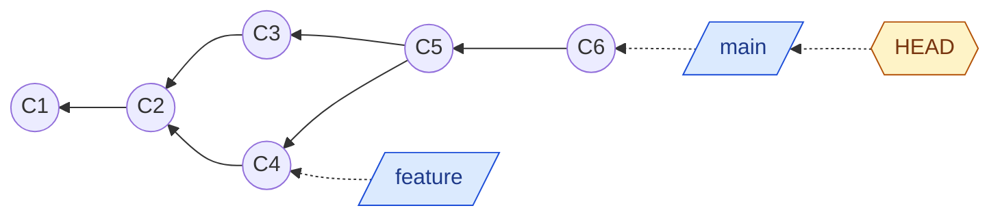
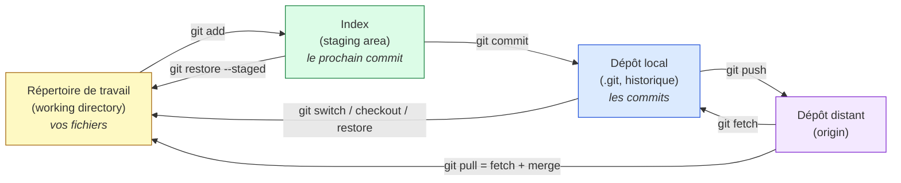

# Modéliser Git : un graphe de commits

## Pourquoi ce cours ?

La plupart des difficultés avec Git (« j'ai perdu mon commit », « pourquoi ce conflit ? », « que fait vraiment `rebase` ? »)
viennent d'un **modèle mental faux**. Git n'est pas une suite de fichiers modifiés : c'est un **graphe de commits**
sur lequel on déplace des **pointeurs**. Une fois ce modèle acquis, chaque commande devient prévisible : on peut la
**dessiner** avant de la lancer. Ce module s'appuie sur cette idée, et propose des [exercices interactifs animés](../interactif/index.html) pour la pratiquer.

> Ce cours **approfondit** le [cours Git du module 05](../../05-devops-outils/cours/01-git-workflow.md) (commandes de base, premier workflow). Vous n'avez pas à le relire, mais les commandes `add`, `commit`, `status` y sont supposées connues.

## 1. Git comme DAG

Un dépôt Git est un **DAG** (*Directed Acyclic Graph*, graphe orienté acyclique) :

- **nœuds** : les commits ;
- **arêtes** : chaque commit **pointe vers son (ou ses) parent(s)**, jamais l'inverse ;
- **acyclique** : on ne peut pas revenir sur ses pas en suivant les parents.



Lecture :

- Les flèches **pleines** vont du commit vers son **parent** (le temps coule de droite à gauche dans ce schéma).
- `C5` a **deux parents** (`C3` et `C4`) : c'est un **commit de fusion** (*merge commit*).
- `C2` est le **point de divergence** (ancêtre commun) de `C3` et `C4`.
- Les flèches **pointillées** sont des **références** (pointeurs nommés), pas des commits.

> 📌 **À retenir** : un commit **ne change jamais** une fois créé. « Modifier » l'historique (rebase, amend) signifie en réalité **créer de nouveaux commits** et déplacer un pointeur vers eux. Les anciens existent encore (voir le [reflog](04-reflog-et-recuperation.md)).

Vocabulaire :

| Terme | Sens |
|---|---|
| **Racine** | Commit sans parent (le premier) |
| **Parent / enfant** | `C2` est le parent de `C3` ; `C3` est un enfant de `C2` |
| **Ancêtre** | Tout commit atteignable en remontant les parents |
| **Fusion** | Commit à **deux parents ou plus** |
| **Atteignable depuis X** | Commit que l'on retrouve en remontant depuis X : ce que contient la branche X |

## 2. Anatomie d'un commit

Un commit est un objet qui contient **exactement** :

```bash
git cat-file -p HEAD
```

```text
tree 9f1c4e8b7a2d0c3e5f6a8b9c0d1e2f3a4b5c6d7e      ← l'état COMPLET du projet (instantané)
parent 3b18e512ba79f8a6e2c1d4f5a6b7c8d9e0f1a2b3     ← commit(s) précédent(s)
author Awa Test <awa@kamer.example> 1732612800 +0100
committer Awa Test <awa@kamer.example> 1732612800 +0100

Ajoute la vérification de l'espace disque
```

| Champ | Contenu |
|---|---|
| `tree` | Empreinte du répertoire racine : l'**instantané complet** (pas un « delta ») |
| `parent` | Empreinte du ou des parents (0 pour la racine, 2+ pour une fusion) |
| `author` | Qui a écrit la modification, et quand |
| `committer` | Qui a créé **ce commit** (diffère de l'auteur après un `rebase` ou un `cherry-pick`) |
| message | Le « pourquoi » |

### L'empreinte (SHA)

L'identité d'un commit est son **empreinte cryptographique** : le hachage de **tout son contenu** (arbre, parents, auteur, message).

- **SHA-1** (40 caractères hexadécimaux) par défaut ; **SHA-256** (64) disponible : `git init --object-format=sha256`.
- Conséquence : changer **n'importe quoi** (un caractère du message, la date, le parent) change l'empreinte. C'est pourquoi un `rebase` produit des commits aux **empreintes différentes** : ce sont de nouveaux objets.
- Conséquence aussi : l'historique est **auto-vérifiable** : l'empreinte d'un commit dépend de celle de son parent, donc de toute la chaîne.
- On abrège : `git log --oneline` affiche 7 caractères ; Git accepte tout préfixe non ambigu (`git show 3b18e51`).

```bash
echo "bonjour" | git hash-object --stdin       # empreinte d'un contenu
git rev-parse HEAD                              # empreinte complète du commit courant
git rev-parse --short HEAD
```

### Les trois types d'objets de contenu

```text
commit ──► tree (dossier racine) ──┬─► blob  README.md      (contenu d'un fichier)
                                   ├─► blob  sante.sh
                                   └─► tree  src/ ──► blob  main.py
```

- **blob** : le contenu d'un fichier (sans son nom).
- **tree** : un répertoire = liste `(mode, nom, empreinte)`.
- **commit** : un instantané + ses parents.
- **tag annoté** : un objet qui désigne un commit avec un message.

Deux fichiers au contenu identique partagent **le même blob** : Git ne stocke pas deux fois la même donnée. Les objets sont rangés dans `.git/objects/` et compressés (puis regroupés en *packfiles*).

```bash
git cat-file -t HEAD                            # commit
git cat-file -p 'HEAD^{tree}'                   # le dossier racine
find .git/objects -type f | head
git count-objects -vH
```

## 3. Les références : HEAD, branches, tags, distants

Une **référence** (*ref*) est un **fichier texte** contenant une empreinte (ou le nom d'une autre ref). C'est ce qui donne un nom lisible à un commit.

```text
.git/
├── HEAD                         ← « où suis-je ? »  : ref: refs/heads/main
└── refs/
    ├── heads/                   ← branches LOCALES
    │   ├── main                 ← contient l'empreinte du dernier commit de main
    │   └── feature
    ├── tags/                    ← étiquettes
    │   └── v1.0.0
    └── remotes/                 ← copies locales des branches DISTANTES
        └── origin/
            └── main
```

```bash
cat .git/HEAD                    # ref: refs/heads/main
cat .git/refs/heads/main         # 3b18e512...
git show-ref                     # toutes les refs
git branch -vv                   # branches et suivi
git for-each-ref --format='%(refname:short) %(objectname:short)'
```

| Référence | Emplacement | Particularité |
|---|---|---|
| **Branche** | `refs/heads/<nom>` | Pointeur **mobile** : avance à chaque nouveau commit sur cette branche |
| **Tag** | `refs/tags/<nom>` | Pointeur **fixe** : marque une version (ne bouge pas) |
| **Branche de suivi distante** | `refs/remotes/origin/<nom>` | Mise à jour **uniquement** par `fetch`/`pull`/`push` ; en lecture seule pour vous |
| **HEAD** | `.git/HEAD` | Pointe **en général vers une branche** ; indique le commit qui sera le **parent** du prochain commit |

> 📌 **À retenir** : **HEAD → branche → commit**. Quand vous committez, Git crée le commit avec pour parent le commit actuel, puis **déplace la branche courante** (et donc HEAD) vers ce nouveau commit. Rien d'autre ne bouge.

Notations de commits utiles :

| Notation | Sens |
|---|---|
| `HEAD` | Le commit courant |
| `HEAD~1` ou `HEAD~` | Le parent |
| `HEAD~3` | L'arrière-grand-père (3 niveaux, en suivant le premier parent) |
| `HEAD^2` | Le **deuxième parent** d'un commit de fusion |
| `main..feature` | Commits dans `feature` mais pas dans `main` |
| `origin/main` | La branche distante telle que connue localement |

## 4. Les trois espaces de travail

Votre travail circule entre **trois zones** locales (plus le dépôt distant) :



| Zone | Contient | Se modifie avec | Se regarde avec |
|---|---|---|---|
| **Répertoire de travail** | Vos fichiers tels que vous les éditez | Votre éditeur | `git status`, `git diff` |
| **Index** | Le **contenu proposé** pour le prochain commit | `git add`, `git restore --staged` | `git diff --staged` |
| **Dépôt** | L'historique des commits | `git commit` | `git log` |

Pourquoi un index ? Il permet de **composer** un commit (`git add -p` : choisir morceau par morceau) plutôt que de tout
enregistrer en bloc : un commit = **un changement logique**.

```bash
echo "a" > a.txt && echo "b" > b.txt
git add a.txt                    # a.txt dans l'index ; b.txt reste « non suivi »
git status -s                    # A  a.txt  /  ?? b.txt
git commit -m "Ajoute a"         # SEUL a.txt est enregistré
git status -s                    # ?? b.txt
```

Les trois niveaux de `git diff` :

```bash
git diff                         # répertoire de travail  vs  index
git diff --staged                # index                  vs  dernier commit
git diff HEAD                    # répertoire de travail  vs  dernier commit
```

> 💡 **Conseil** : en cas de doute sur ce qui va être commité, lancez `git status` puis `git diff --staged`. C'est la meilleure habitude pour éviter de livrer un fichier de débogage ou un secret.

## 5. Voir le graphe

```bash
git log --oneline --graph --all --decorate
```

```text
*   6f2a1b9 (HEAD -> main) Fusionne feature
|\
| * 4d7c0e3 (feature) Ajoute le test
* | 8a91fe2 Corrige la sauvegarde
|/
* 1b2c3d4 Initialise le projet
```

- `*` est un commit ; `|`, `/` et `\` sont les lignes de parenté ; `(HEAD -> main)` indique la branche courante.
- Créez un alias pour le retrouver : `git config --global alias.graph "log --oneline --graph --all --decorate"` puis `git graph`.

> ⚠️ **Attention** : `git commit -a` n'enregistre que les fichiers **déjà suivis** : un nouveau fichier doit d'abord passer par `git add`. Et `git add .` ajoute **tout** (fichiers temporaires, secrets…) : relisez `git status` avant de committer.

## Résumé

- Git est un **DAG de commits** immuables ; chaque commit pointe vers son/ses **parent(s)**.
- Un commit = **tree** (instantané complet) + **parents** + auteur + message ; son **SHA** dépend de tout cela.
- Les **références** sont de simples fichiers : `refs/heads` (branches mobiles), `refs/tags` (fixes), `refs/remotes` (suivi des distants), et **HEAD** (où l'on est).
- Trois espaces : **répertoire de travail → index → dépôt** (puis distant) ; `add`, `commit`, `push` les font avancer.
- « Modifier » l'historique, c'est **créer de nouveaux commits** et déplacer des pointeurs.

## Pour aller plus loin

- *Pro Git*, chapitre 10 « Git Internals » : <https://git-scm.com/book/fr/v2>.
- Commandes bas niveau : `git hash-object`, `git cat-file`, `git update-ref`, `git ls-files -s`.
- SHA-256 dans Git, commits signés (`git commit -S`).
- Faites les exercices : [Branches de base](../interactif/exercices/01-branches-de-base.html) (ouvrez le fichier dans un navigateur).
- Atelier : [Premiers commits et branches](../ateliers/atelier-01-premiers-commits-branches.md).
- Cours suivant : [Branches et checkout](02-branches-et-checkout.md).
