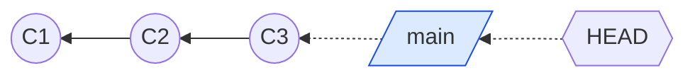
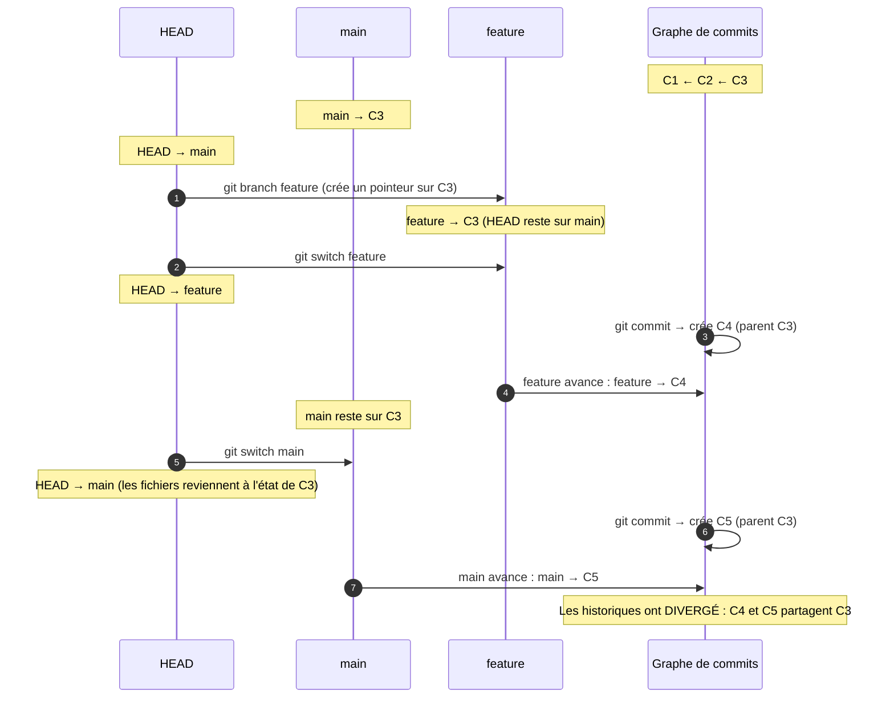
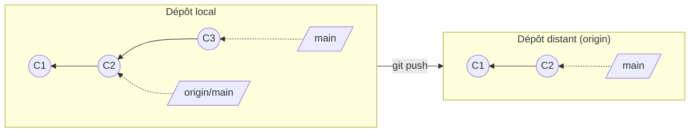
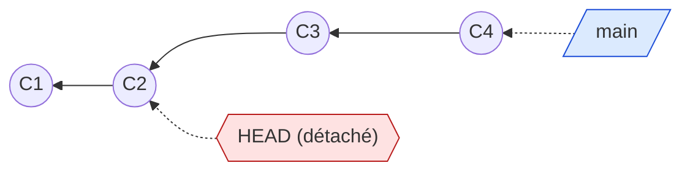
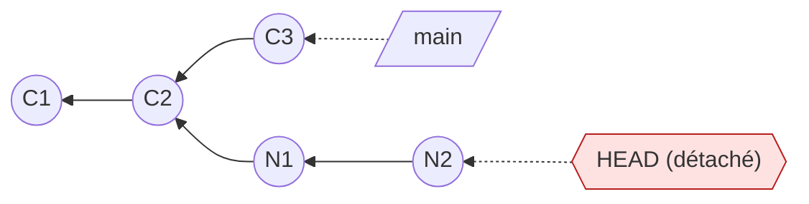

# Branches, `switch` et HEAD

## Pourquoi ce cours ?

Les branches sont la fonctionnalité qui rend Git utile en équipe : chacun travaille sans gêner les autres, puis on
rassemble. Elles sont aussi **bon marché** (un fichier de 41 octets), ce qui change les habitudes : on crée une branche pour une
correction de dix minutes. Comprendre qu'une branche n'est **qu'un pointeur** suffit à comprendre `switch`, la
*detached HEAD*, le suivi des branches distantes — et à ne plus avoir peur de supprimer une branche.

## 1. Une branche = un pointeur mobile



Rien de plus : la branche `main` **contient l'empreinte de C3**. Aucune « copie des fichiers » n'est faite à la création d'une branche.

```bash
cat .git/refs/heads/main          # une empreinte, c'est tout
git branch feature                # crée un deuxième pointeur sur le même commit : instantané et gratuit
cat .git/refs/heads/feature       # même empreinte
```

Ce qui **distingue** les branches : elles **avancent séparément**. Quand on committe, **seule la branche courante** (celle que
HEAD désigne) avance.

### Le pointeur qui se déplace au fil des commits



> 📌 **À retenir** : `git branch` **crée**, `git switch` **se déplace**. Créer une branche ne change pas l'endroit où vous êtes.

## 2. Créer, lister, renommer, supprimer

```bash
git branch                          # liste les branches locales (* = courante)
git branch -a                       # + branches de suivi distantes
git branch -vv                      # avec dernier commit et branche suivie
git branch --merged                 # branches déjà fusionnées dans la courante (supprimables)
git branch --no-merged

git branch fonctionnalite/login     # crée (sans changer de branche)
git switch -c fonctionnalite/login  # crée ET se place dessus
git switch -c correctif abc1234     # crée à partir d'un commit précis
git branch -m ancien nouveau        # renomme
git branch -m nouveau-nom           # renomme la branche courante

git branch -d fonctionnalite/login  # supprime (refuse si non fusionnée : sécurité)
git branch -D fonctionnalite/login  # supprime de force
```

> 💡 **Conseil** : nommez les branches par type et sujet, en minuscules avec des tirets : `fonctionnalite/panier-express`, `correctif/timeout-api`, `docs/readme`. Le préfixe permet de trier, de filtrer et de configurer la CI.

> ⚠️ **Attention** : supprimer une branche **ne supprime pas les commits** : seul le pointeur disparaît. Si ces commits ne sont plus atteignables depuis aucune autre référence, ils deviennent *orphelins* et seront nettoyés (`git gc`) après quelques semaines. Avec le [reflog](04-reflog-et-recuperation.md), on les retrouve.

## 3. `git switch` ou `git checkout` ?

Historiquement, `git checkout` faisait **trop de choses** : changer de branche, restaurer des fichiers, se détacher sur un commit. Git 2.23 a séparé ces rôles :

| Intention | Commande moderne | Ancienne forme |
|---|---|---|
| Changer de branche | `git switch main` | `git checkout main` |
| Créer et changer | `git switch -c nouvelle` | `git checkout -b nouvelle` |
| Revenir à la branche précédente | `git switch -` | `git checkout -` |
| Aller sur un commit (détaché) | `git switch --detach abc1234` | `git checkout abc1234` |
| Restaurer un fichier | `git restore fichier` | `git checkout -- fichier` |
| Restaurer depuis un commit | `git restore --source=abc1234 fichier` | `git checkout abc1234 -- fichier` |

> 💡 **Conseil** : préférez `switch` (branches) et `restore` (fichiers) : les commandes sont plus lisibles et plus difficiles à mal utiliser. `checkout` fonctionne toujours (et c'est ce que l'on trouve dans la majorité des tutoriels) ; l'application [interactive](../interactif/index.html) accepte les deux.

### Que fait `switch` exactement ?

1. Déplace **HEAD** vers la branche cible.
2. Met à jour l'**index** et le **répertoire de travail** pour qu'ils correspondent au commit de cette branche.

Si vous avez des **modifications non commitées** qui entrent en conflit avec le changement, Git refuse : commitez-les, ou mettez-les de côté.

```bash
git stash                           # met de côté les modifications en cours
git switch autre-branche
git switch -
git stash pop                       # les rapplique
git stash list
```

## 4. Branches distantes et suivi

Quand vous clonez, Git crée **localement** un pointeur par branche distante, en **lecture seule** : `origin/main`. Il reflète l'état du distant **au dernier échange**.



Ici `main` a **un commit d'avance** sur `origin/main` : `git push` enverra `C3` puis fera avancer `origin/main`.

```bash
git remote -v                           # liste les distants
git fetch                               # met à jour origin/* SANS toucher à vos branches locales
git fetch --prune                       # + supprime les refs de branches supprimées sur le distant
git status -sb                          # « ## main...origin/main [ahead 1] »
git log origin/main..main               # ce que j'ai en plus
git log main..origin/main               # ce que j'ai en retard

git push -u origin fonctionnalite/login   # publie et configure le SUIVI (upstream)
git push                                  # ensuite : plus besoin de préciser
git switch correctif-distant              # crée automatiquement une branche locale qui suit origin/correctif-distant
git branch -u origin/main                 # définir le suivi a posteriori
git push origin --delete fonctionnalite/login     # supprimer la branche distante
```

| Commande | Effet | Risque |
|---|---|---|
| `git fetch` | Met à jour `origin/*` | Aucun (n'affecte pas votre travail) |
| `git pull` | `fetch` **puis** `merge` (ou `rebase` avec `--rebase`) | Peut créer un commit de fusion / des conflits |
| `git push` | Envoie vos commits ; fait avancer la branche distante | Rejeté si le distant a avancé (*non fast-forward*) |

> 📌 **À retenir** : **`-u` (ou `--set-upstream`) crée un lien** entre `main` locale et `origin/main`. C'est ce lien qui permet à `git status` de dire « en avance de 2 » et à `git push` / `git pull` de fonctionner sans arguments.

> 💡 **Conseil** : préférez `git fetch` puis inspectez (`git log main..origin/main`), plutôt qu'un `git pull` à l'aveugle. Configurez `git config --global pull.rebase false` (ou `true`) pour que le comportement soit explicite.

## 5. HEAD détaché (*detached HEAD*)

D'ordinaire HEAD pointe vers une **branche** (qui pointe vers un commit). En mode **détaché**, HEAD pointe **directement vers un commit**.



### Quand cela arrive-t-il ?

```bash
git switch --detach HEAD~2        # explorer l'état passé du projet
git checkout abc1234              # (ancienne forme)
git checkout v1.0.0               # se placer sur un tag
git rebase -i HEAD~3              # pendant un rebase, HEAD est détaché temporairement
```

### Pourquoi est-ce utile ?

- **Inspecter** ou **compiler** une ancienne version sans créer de branche.
- **Bisecter** (`git bisect`) pour trouver quel commit a introduit un bug.
- **Rejouer** une version précise d'un déploiement.

### Le danger

Si vous **committez** en HEAD détaché, les nouveaux commits ne sont rattachés à **aucune branche**. Dès que vous changez de branche, plus rien ne les désigne : ils sont **orphelins** (récupérables uniquement via le reflog).



Si vous faites `git switch main` maintenant, `N1` et `N2` n'ont plus aucune référence.

### Comment en sortir ?

```bash
# Cas 1 : j'ai juste regardé, je veux revenir
git switch -                          # ou git switch main

# Cas 2 : j'ai fait des commits à conserver → leur donner une branche
git switch -c ma-correction           # crée une branche sur le commit actuel, HEAD est de nouveau rattaché

# Cas 3 : j'ai déjà changé de branche et « perdu » les commits
git reflog                            # retrouver l'empreinte
git branch sauvetage abc1234          # les rattacher
```

> ⚠️ **Attention** : Git affiche « You are in 'detached HEAD' state… » : ce n'est **pas une erreur**. Mais avant de committer, **créez une branche** (`git switch -c nom`).

## 6. Bonnes pratiques

1. **Branches courtes** : quelques jours au maximum ; plus elles vivent, plus la fusion sera douloureuse.
2. **Une branche = un sujet**.
3. Gardez `main` **déployable** (voir [workflows](05-workflows-equipe.md)).
4. **Mettez à jour** régulièrement votre branche avec `main` (`git fetch` puis `git merge origin/main` ou `git rebase origin/main`).
5. **Supprimez** les branches fusionnées (`git branch --merged`, `git fetch --prune`).
6. Sur une branche **partagée**, évitez de réécrire l'historique.

## Résumé

- Une branche est un **pointeur mobile** vers un commit ; elle avance quand on committe dessus.
- `git branch` crée ; `git switch` se déplace ; `git switch -c` fait les deux ; `restore` pour les fichiers (préférez-les à `checkout`).
- `origin/main` est une **copie locale en lecture seule** du distant ; `fetch` la met à jour, `push -u` crée le suivi.
- **HEAD détaché** : HEAD pointe un commit, pas une branche ; utile pour explorer, dangereux pour committer sans branche.
- Supprimer une branche supprime un **pointeur**, pas des commits.

## Pour aller plus loin

- `man git-switch`, `man git-branch`, `man git-restore`, `man git-stash`.
- `git worktree` : plusieurs branches checkout en parallèle dans des dossiers différents.
- `git bisect` : trouver le commit fautif avec un HEAD détaché.
- Exercice interactif : [Branches de base](../interactif/exercices/01-branches-de-base.html).
- Atelier : [Premiers commits et branches](../ateliers/atelier-01-premiers-commits-branches.md).
- Cours suivant : [Merge, rebase et cherry-pick](03-merge-rebase-cherry-pick.md).
