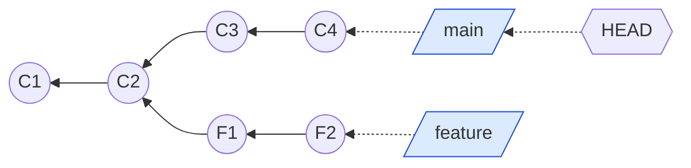
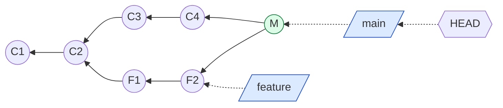
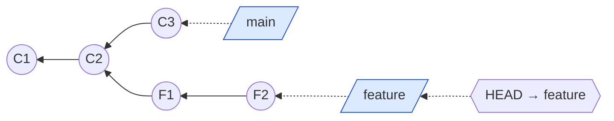
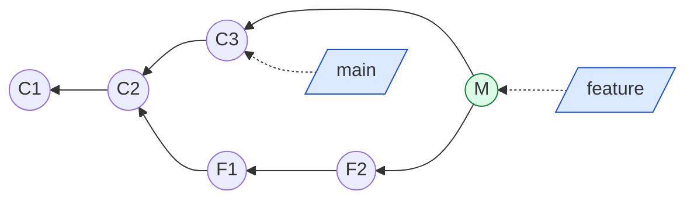
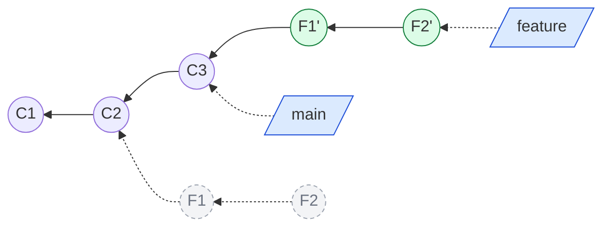
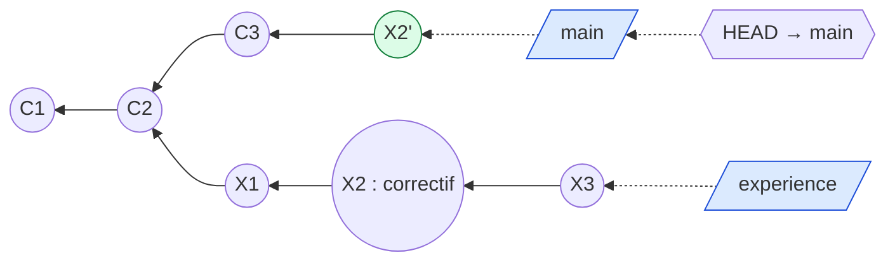

# Merge, rebase et cherry-pick

## Pourquoi ce cours ?

Tôt ou tard, deux lignes de travail doivent se rejoindre. Git propose **plusieurs façons** de le faire, avec des
conséquences différentes sur l'historique : `merge` préserve ce qui s'est passé, `rebase` le réécrit pour le rendre
lisible, `cherry-pick` prélève un seul commit. Choisir sans comprendre produit des historiques illisibles — ou pire,
des collègues dont le travail disparaît après un `push --force`. Ce cours donne le modèle pour **choisir**.

## 1. Le point de départ

Situation commune : `main` et `feature` ont **divergé** depuis `C2`.



On est sur `main` et l'on veut intégrer le travail de `feature`.

## 2. `merge` : fusionner deux historiques

### Cas 1 : le *fast-forward*

Si `main` **n'a pas bougé** depuis la création de `feature`, il n'y a rien à fusionner : Git **avance simplement le pointeur** `main`.

```text
Avant :   C1 ← C2 ← C3  (main)               Après git merge feature :
                     ↖                          C1 ← C2 ← C3 ← F1 ← F2  (main, feature)
                      F1 ← F2  (feature)
```

```bash
git switch main
git merge feature            # « Fast-forward » : aucun commit nouveau
git merge --no-ff feature    # force un commit de fusion malgré tout (garde la trace de la branche)
git merge --ff-only feature  # échoue si ce n'est pas un fast-forward : sûr pour les scripts
```

### Cas 2 : fusion à trois points (*three-way merge*)

Si `main` **a avancé aussi**, Git compare **trois** commits : les deux **pointes** et leur **ancêtre commun** (la *merge base*, ici `C2`).



`M` est un **commit de fusion** : il a **deux parents** (`C4` et `F2`). Aucun commit existant n'est modifié.

```bash
git merge-base main feature       # affiche l'ancêtre commun (C2)
git merge feature                 # produit M ; l'éditeur propose un message
git log --oneline --graph --all
```

Algorithme : pour chaque fichier, si **un seul côté** a modifié par rapport à l'ancêtre, on retient cette version ; si **les deux** ont modifié les **mêmes lignes**, c'est un **conflit**.

| Avantages du merge | Inconvénients |
|---|---|
| **Non destructif** : l'historique reste fidèle | Graphe qui se « tresse » avec de nombreuses branches |
| Sûr sur une branche partagée | Commits de fusion « bruyants » (`Merge branch 'main' into…`) |
| Facile à annuler (`git revert -m 1 M`) | |

## 3. `rebase` : rejouer ses commits ailleurs

Le **rebase** **déplace** une branche : il prend vos commits, les **rejoue un par un** au-dessus d'une autre base, en créant de **nouveaux commits** (nouveaux SHA).

### Avant / après : merge et rebase côte à côte

**Avant** (identique pour les deux) :



**Après `git merge main`** (sur `feature`) — historique fidèle, avec un commit de fusion :



**Après `git rebase main`** (sur `feature`) — historique **linéaire** ; `F1` et `F2` sont **recréés** en `F1'` et `F2'` :



Les anciens `F1` et `F2` (en pointillés gris) ne sont plus référencés par la branche, mais **existent encore** (reflog). Si `main` n'a pas bougé depuis, un `git merge feature` sur `main` fera ensuite un simple **fast-forward**.

```bash
git switch feature
git rebase main                    # rejoue F1, F2 au-dessus de main
git rebase --continue              # après avoir résolu un conflit
git rebase --abort                 # revient à l'état d'avant
git rebase --skip                  # ignore le commit courant
```

### Rebase interactif : nettoyer avant une PR

```bash
git rebase -i HEAD~4               # modifier les 4 derniers commits
```

```text
pick   a1b2c3 Ajoute la page de login
fixup  d4e5f6 Corrige une coquille
reword 7a8b9c Ajoute les tests                ← changer le message
squash 1f2e3d Ajuste les tests                ← fusionner avec le précédent (et éditer le message)
drop   9z8y7x Debug temporaire                ← supprimer
```

| Commande | Effet |
|---|---|
| `pick` | Garder tel quel |
| `reword` | Garder, changer le message |
| `edit` | S'arrêter pour modifier le contenu |
| `squash` | Fusionner avec le précédent (garde les messages) |
| `fixup` | Fusionner avec le précédent (jette le message) |
| `drop` | Supprimer le commit |
| (ordre des lignes) | Réordonner les commits |

Cas d'usage : transformer « WIP », « fix », « oups » en 2-3 commits **propres et logiques** avant de demander une revue.

```bash
git commit --fixup=a1b2c3          # prépare une correction à « absorber » dans a1b2c3
git rebase -i --autosquash main    # les réorganise et les fusionne automatiquement
git pull --rebase                  # récupère le distant en rejouant VOS commits dessus (évite un merge inutile)
```

### La règle d'or du rebase

> ⚠️ **Ne réécrivez jamais l'historique d'une branche que d'autres utilisent.** Ne rebasez que des commits **que vous seul possédez** (non publiés, ou sur votre branche personnelle).

Pourquoi ? Rebaser crée de **nouveaux SHA**. Si un collègue a déjà basé son travail sur les **anciens** commits, son historique contient désormais des commits que le vôtre ne connaît plus : Git y voit deux historiques divergents, la fusion produit des **doublons** et des conflits en cascade.

```text
Vous :     C3 ← F1' ← F2'         (après rebase, push --force)
Collègue : C2 ← F1 ← F2 ← G1      (basé sur F1, F2 « anciens »)
           → au prochain pull : F1, F2, F1', F2' tous présents + conflits
```

Si vous devez publier après un rebase d'une branche **à vous** :

```bash
git push --force-with-lease          # refuse si quelqu'un a poussé entre-temps (bien plus sûr que --force)
```

| | `merge` | `rebase` |
|---|---|---|
| Historique | Fidèle, avec fusions | Linéaire, réécrit |
| SHA des commits | Inchangés | **Nouveaux** |
| Sur branche partagée | ✅ Oui | ❌ Non |
| Avant une PR (sur sa propre branche) | Possible | ✅ Idéal pour nettoyer |
| Annuler | `revert -m 1` | `reflog` |

> 📌 **À retenir** : *rebase pour **préparer** son travail (en privé), merge pour **l'intégrer** (en public).*

## 4. `cherry-pick` : prélever un commit

`cherry-pick` **copie** un commit précis (son changement) sur la branche courante, en créant un **nouveau commit** avec un nouveau SHA.



```bash
git switch main
git cherry-pick a1b2c3             # applique le changement de X2 sur main (crée X2')
git cherry-pick a1b2c3 d4e5f6      # plusieurs commits
git cherry-pick a1b2c3..d4e5f6     # une plage (exclut a1b2c3)
git cherry-pick -x a1b2c3          # ajoute « (cherry picked from commit …) » dans le message
git cherry-pick -n a1b2c3          # applique sans committer
git cherry-pick --continue / --abort
```

Cas d'usage :

- **Rétroporter** un correctif de sécurité de `main` vers une branche de maintenance `release/1.4`.
- Récupérer **un** commit utile d'une branche expérimentale abandonnée.
- Récupérer un commit fait par erreur sur la mauvaise branche (puis le retirer de l'ancienne).

> ⚠️ **Attention** : le commit copié a un **SHA différent** : Git ne sait pas que `X2` et `X2'` sont « le même ». Si les deux branches sont fusionnées plus tard, cela peut provoquer des conflits ou des doublons. Utilisez `cherry-pick` avec parcimonie, et `-x` pour la traçabilité.

## 5. Les conflits

Un **conflit** survient quand Git ne peut pas décider seul : les deux côtés ont modifié **les mêmes lignes** (ou l'un a supprimé ce que l'autre a modifié).

### Lire un conflit

```text
<<<<<<< HEAD
echo "=== Contrôle de santé (Awa) ==="
=======
echo "### Santé du serveur (Binta) ###"
>>>>>>> fonctionnalite/titre-binta
```

| Marqueur | Signification |
|---|---|
| `<<<<<<< HEAD` | Début : ce qu'il y a **de votre côté** (la branche courante) |
| `=======` | Séparateur |
| `>>>>>>> nom` | Fin : ce qu'il y a **de l'autre côté** (la branche fusionnée) |

> ⚠️ **Attention** (rebase) : pendant un `rebase`, les rôles sont **inversés** : `HEAD` désigne la branche **sur laquelle** on rejoue (la base, par ex. `main`) et l'autre côté désigne **votre** commit en cours de rejeu. C'est source de confusion classique.

### Résoudre : la démarche

```bash
git status                         # liste « both modified »
git diff                           # voir les conflits
# 1. Éditez le fichier : gardez la bonne version (ou un mélange), SUPPRIMEZ les marqueurs
# 2. Vérifiez : le projet compile, les tests passent
git add fichier.sh                 # « marque comme résolu »
git commit                         # termine la fusion   (ou : git rebase --continue / git cherry-pick --continue)
```

```bash
git merge --abort                  # revient à l'état d'avant la fusion
git rebase --abort
git checkout --ours fichier        # garde TOTALEMENT notre version (pendant un merge) — avec git restore --ours
git checkout --theirs fichier      # garde TOTALEMENT l'autre version
git config --global merge.conflictStyle zdiff3     # montre aussi la version d'origine : conflits plus faciles à lire
git log --merge -p fichier         # commits qui ont touché ce fichier de chaque côté
```

> 💡 **Conseil** : `grep -rn '<<<<<<<\|>>>>>>>' .` avant de committer : un marqueur oublié dans un fichier de configuration est une panne classique.

Éviter les conflits : commits **petits et fréquents**, branches courtes, `git pull --rebase` régulier, et **communication** (éviter que deux personnes reformatent le même fichier).

## 6. Quel outil pour quel besoin ?

| Besoin | Outil |
|---|---|
| Intégrer une fonctionnalité terminée dans `main` | `merge` (`--no-ff` pour conserver la trace) ou *squash merge* via la PR |
| Mettre à jour ma branche avec `main` (branche privée) | `rebase main` (ou `merge main` si partagée) |
| Nettoyer mes commits avant la revue | `rebase -i` (`squash`, `fixup`, `reword`) |
| Récupérer **un** commit d'une autre branche | `cherry-pick` |
| Annuler un commit **publié** | `revert` (voir le [cours suivant](04-reflog-et-recuperation.md)) |
| Récupérer le distant sans merge superflu | `pull --rebase` |

## Résumé

- **Fast-forward** : le pointeur avance, aucun commit nouveau ; **three-way merge** : un **commit de fusion à deux parents**, calculé depuis l'ancêtre commun.
- **Rebase** : **rejoue** vos commits sur une nouvelle base → **nouveaux SHA**, historique linéaire ; `-i` pour nettoyer.
- **Règle d'or** : jamais de rebase (ni de `push --force`) sur une branche **partagée** ; sinon `--force-with-lease` sur votre propre branche.
- **Cherry-pick** : copie **un** commit (nouveau SHA) ; utile pour les rétroportages.
- **Conflits** : `<<<<<<<` / `=======` / `>>>>>>>` ; éditer, tester, `git add`, continuer ; `--abort` pour reculer.

## Pour aller plus loin

- `man git-merge`, `man git-rebase`, `man git-cherry-pick`, `git rerere` (mémorise vos résolutions).
- `git merge -s ours`, stratégies `recursive`/`ort`, `git range-diff` (comparer deux versions d'une série de commits).
- Exercices interactifs : [Merge](../interactif/exercices/02-merge.html), [Rebase](../interactif/exercices/03-rebase.html), [Cherry-pick](../interactif/exercices/04-cherry-pick.html).
- Ateliers : [Merge vs rebase](../ateliers/atelier-02-merge-vs-rebase.md), [Cherry-pick et tags](../ateliers/atelier-03-cherry-pick-et-tags.md).
- Cours suivant : [Reflog et récupération](04-reflog-et-recuperation.md).
