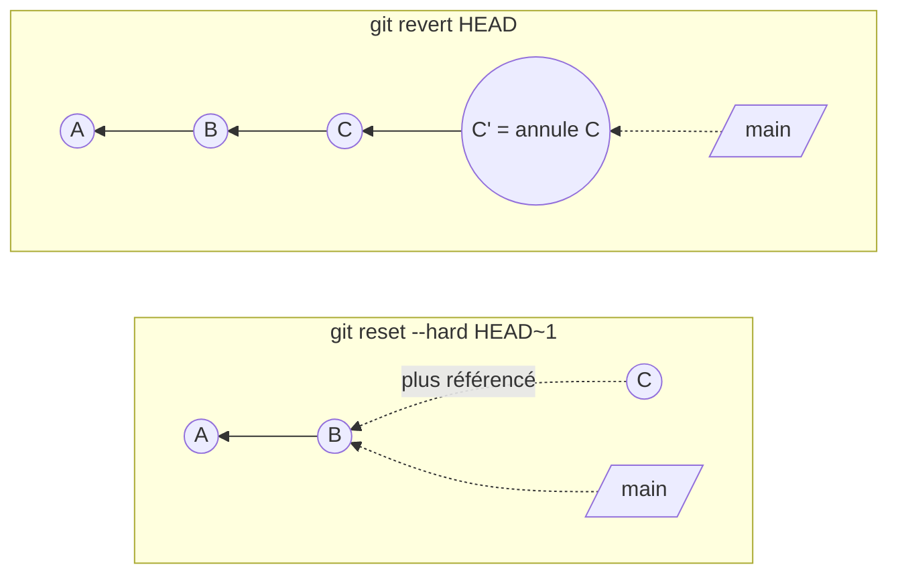
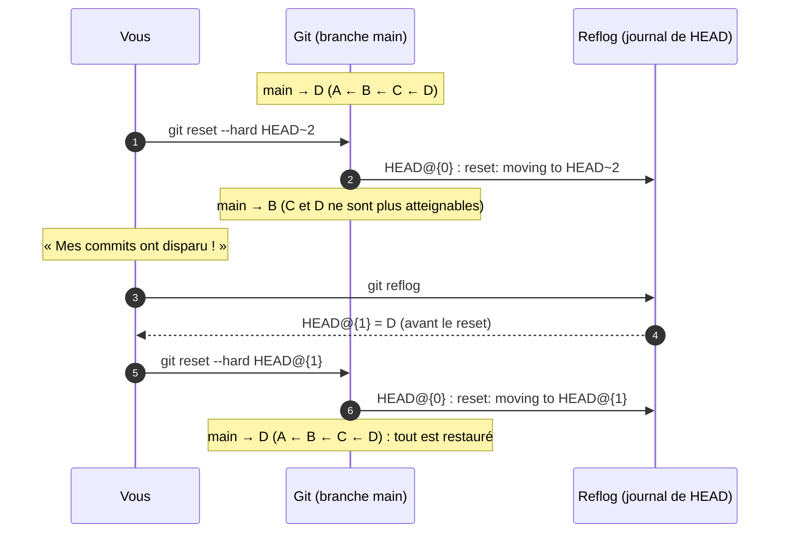

# Reflog et récupération

## Pourquoi ce cours ?

« J'ai fait un `reset --hard` et tout a disparu. » « Mon rebase a mangé trois jours de travail. » « J'ai supprimé
la mauvaise branche. » Dans l'immense majorité des cas, **rien n'est perdu** : Git garde une trace de chaque déplacement de
HEAD dans un journal local, le **reflog**. Savoir l'utiliser transforme la panique en une procédure de deux minutes. C'est aussi
ce qui autorise à **expérimenter** sans crainte.

> 📌 **À retenir** : Git **ne supprime presque jamais** de commits immédiatement. Un commit « perdu » est un commit **plus référencé** par aucune branche, mais qui existe toujours dans `.git/objects/` jusqu'au ramasse-miettes (`git gc`), généralement après **30 jours** pour les orphelins (90 jours pour les entrées du reflog atteignables).

## 1. Qu'est-ce que le reflog ?

Le **reflog** (*reference log*) est un journal **local** qui enregistre **chaque changement** de la pointe de HEAD et des branches : commit, checkout/switch, merge, rebase, reset, cherry-pick, pull…

```bash
git reflog
```

```text
6f2a1b9 (HEAD -> main) HEAD@{0}: reset: moving to HEAD~2
a91c3e0 HEAD@{1}: commit: Ajoute le déploiement
7d4b2f8 HEAD@{2}: commit: Corrige le timeout
3b18e51 HEAD@{3}: commit: Ajoute les tests
1b2c3d4 HEAD@{4}: checkout: moving from feature to main
```

- `HEAD@{n}` : « où était HEAD il y a **n** mouvements » (numéroté de récent à ancien).
- `main@{2.days.ago}`, `HEAD@{yesterday}` : références par date (`git reflog show main`).
- Chaque ligne indique **l'action** qui a déplacé le pointeur : c'est ce qui permet de retrouver l'état d'**avant** l'erreur.

Limites :

| Propriété | Détail |
|---|---|
| **Local** | Il n'est **pas** poussé : un autre clone n'a pas votre reflog |
| **Par dépôt** | Un clone neuf commence avec un reflog vide |
| **Temporaire** | Expire (90 jours par défaut ; 30 pour les entrées orphelines) : `gc.reflogExpire` |
| **Journalise les déplacements** | Pas les modifications **non commitées** (voir plus bas) |

> ⚠️ **Attention** : le reflog sauve les **commits**. Du travail **jamais commité** (modifications seulement dans le répertoire de travail) et écrasé par `git reset --hard` ou `git checkout -- .` est **perdu définitivement**. Règle : *commitez souvent, même provisoirement* (vous nettoierez avec `rebase -i`).

## 2. `reset` : trois niveaux, précisément

`git reset <commit>` **déplace la branche courante** vers `<commit>`. Ce qui diffère, c'est ce qui arrive à l'**index** et au **répertoire de travail**.

| Mode | Branche (HEAD) | Index (staging) | Répertoire de travail | Usage |
|---|---|---|---|---|
| `--soft` | ✅ déplacée | ⛔ inchangé | ⛔ inchangé | « Défaire le commit mais garder les changements **prêts à committer** » (refaire un commit) |
| `--mixed` *(défaut)* | ✅ déplacée | ✅ réinitialisé | ⛔ inchangé | « Défaire le commit **et** le `add` : garder les changements non indexés » |
| `--hard` | ✅ déplacée | ✅ réinitialisé | ✅ **réinitialisé** | « Tout revenir à ce commit » — **détruit** les modifications non commitées |

Mise en situation : on a trois commits `A ← B ← C` (HEAD sur `C`), et l'on exécute `git reset <mode> A~0`… ici, `git reset HEAD~2` (retour sur `A`) :

```text
                              SOFT                MIXED               HARD
  Branche → A                 oui                 oui                 oui
  Index contient              B+C (prêts)         état de A           état de A
  Fichiers de travail         B+C                 B+C                 état de A  ← B+C PERDUS (si non commités ailleurs)
  git status montre           « à committer »     « modifiés »        « propre »
```

```bash
git reset --soft HEAD~1            # annule le dernier commit, garde tout en staging (ex. : corriger le message ou scinder)
git reset HEAD~1                   # (mixed) annule le commit, garde les fichiers modifiés non indexés
git reset --hard HEAD~1            # annule le commit ET supprime les changements
git reset --hard origin/main       # aligne ma branche sur le distant, en jetant mon travail local
git reset fichier                  # désindexe un fichier (équivaut à git restore --staged fichier)
```

> ⚠️ **Attention** : `reset` **réécrit** la branche locale. Ne l'utilisez **pas** sur des commits déjà poussés et partagés : utilisez `revert`.

## 3. `revert` ou `reset` ?

| | `git reset` | `git revert` |
|---|---|---|
| Principe | **Déplace** la branche en arrière | **Ajoute** un commit qui défait un changement |
| Historique | **Réécrit** (les commits disparaissent de la branche) | **Conservé** (le commit fautif et son annulation sont visibles) |
| Sûr sur une branche partagée / publiée ? | ❌ Non | ✅ **Oui** |
| Cas d'usage | Corriger un travail **local**, non publié | Annuler un changement **déjà poussé** (ex. en production) |
| Se refait ? | Via `reflog` | `git revert <revert-commit>` (annuler l'annulation) |



```bash
git revert a1b2c3                  # crée un commit qui annule a1b2c3
git revert HEAD --no-edit
git revert a1b2c3..d4e5f6          # plusieurs commits
git revert -m 1 <commit-de-fusion> # annuler une fusion (en gardant le 1er parent comme « ligne principale »)
```

> 💡 **Conseil** : en production, **`revert` est votre ami** : il est rapide, traçable (« qui a annulé quoi, pourquoi ») et ne casse le clone de personne. Quand un déploiement échoue, `git revert` + push déclenche un redéploiement sûr.

## 4. Retrouver un commit « perdu »

### Scénario A : après un `reset --hard`

```bash
git log --oneline                  # A ← B ← C ← D  (HEAD sur D)
git reset --hard HEAD~2            # oups ! on voulait seulement HEAD~1 → C et D semblent perdus
git log --oneline                  # A ← B   seulement
git reflog                         # D était à HEAD@{1}
git reset --hard HEAD@{1}          # on revient exactement où l'on était
# ou, plus sûr : git branch sauvetage HEAD@{1}  (crée une branche sans toucher à l'état actuel)
```



### Scénario B : après un rebase raté

```bash
git rebase main                    # conflits, confusion, résultat inattendu
git reflog                         # cherchez la ligne « rebase (start) » : l'état d'AVANT est juste en dessous
# 3f1e2d4 HEAD@{5}: checkout: moving from main to feature     ← avant le rebase
git reset --hard HEAD@{5}          # ou : git reset --hard ORIG_HEAD
```

`ORIG_HEAD` est une référence automatique qui retient la position de HEAD **avant** une opération dangereuse (`merge`, `rebase`, `reset`) : `git reset --hard ORIG_HEAD` annule souvent la dernière opération.

### Scénario C : branche supprimée par erreur

```bash
git branch -D fonctionnalite/paiement       # « Deleted branch fonctionnalite/paiement (was 9a8b7c6). »
# → Git a affiché l'empreinte : on la réutilise directement
git branch fonctionnalite/paiement 9a8b7c6
# Si l'on a perdu l'affichage :
git reflog | grep "paiement"
git reflog --all
```

### Scénario D : commits faits en HEAD détaché, puis changement de branche

```bash
git reflog                         # repérer le dernier commit détaché
git branch recuperation abc1234
```

### Scénario E : amend ou `commit` malheureux

```bash
git commit --amend -m "mauvais message"     # on écrase le bon !
git reflog                                   # HEAD@{1} = le commit d'avant l'amend
git reset --hard HEAD@{1}
```

### Outils de recherche d'objets orphelins

```bash
git fsck --lost-found              # liste les commits « dangling » (orphelins)
git fsck --no-reflogs --lost-found # même sans reflog
git show <empreinte>               # inspecter un candidat
git log --all --oneline --graph    # n'affiche que ce qui est référencé
git stash list                     # les stashes sont aussi des commits : git stash show -p stash@{0}
```

## 5. Autres techniques de « marche arrière »

| Besoin | Commande |
|---|---|
| Annuler des modifications **non indexées** d'un fichier | `git restore fichier` (⚠️ irréversible) |
| Désindexer un fichier | `git restore --staged fichier` |
| Récupérer **un fichier** tel qu'il était dans un commit | `git restore --source=abc1234 fichier` |
| Corriger le **dernier commit** (non publié) | `git commit --amend` |
| Voir qui a changé une ligne | `git blame fichier` |
| Trouver quel commit a cassé le code | `git bisect start` / `bad` / `good` |
| Supprimer les fichiers non suivis | `git clean -n` (simulation) puis `git clean -fd` (⚠️ irréversible) |
| Se mettre à l'abri avant une opération risquée | `git branch sauvegarde` (gratuit, instantané) |

> 💡 **Conseil** : avant tout `rebase`, `reset --hard` ou résolution compliquée, tapez `git branch sauvegarde-avant-rebase`. Un pointeur ne coûte rien et vous évite d'avoir à fouiller le reflog.

## 6. Le ramasse-miettes

```bash
git gc                             # nettoie et compresse (automatique de temps en temps)
git reflog expire --expire=now --all && git gc --prune=now   # ⚠️ supprime DÉFINITIVEMENT les orphelins
git config gc.reflogExpire 180.days   # allonger la durée de conservation
```

> ⚠️ **Attention** : ne lancez la purge immédiate que pour supprimer un **secret** accidentellement commité (en plus de réécrire l'historique et de **révoquer** le secret, car il a pu être cloné).

## Résumé

- Le **reflog** journalise tous les déplacements de HEAD et des branches : il permet de revenir à n'importe quel état **récent**, localement.
- `reset --soft` (garde l'index et les fichiers), `--mixed` (garde les fichiers), `--hard` (**détruit** les modifications non commitées).
- `reset` **réécrit** (usage local) ; `revert` **ajoute** un commit d'annulation (usage sur branche partagée/production).
- Procédure d'urgence : `git reflog` → repérer l'état d'avant → `git reset --hard HEAD@{n}` (ou `git branch sauvetage <sha>`).
- Le travail **non commité** n'est pas dans le reflog : **commitez souvent**.

## Pour aller plus loin

- `man git-reflog`, `man git-reset`, `man git-revert`, `man git-fsck`, `man git-gc`.
- `git stash` avancé (`-u`, `--keep-index`), `git worktree`, `git bisect run`.
- Retirer un secret de l'historique : `git filter-repo` (et le **révoquer**).
- Ateliers : [Récupération avec reflog](../ateliers/atelier-04-recuperation-reflog.md). Exercice interactif : commande `git reset --hard <sha>` dans les [exercices](../interactif/index.html).
- Cours suivant : [Workflows d'équipe](05-workflows-equipe.md).
