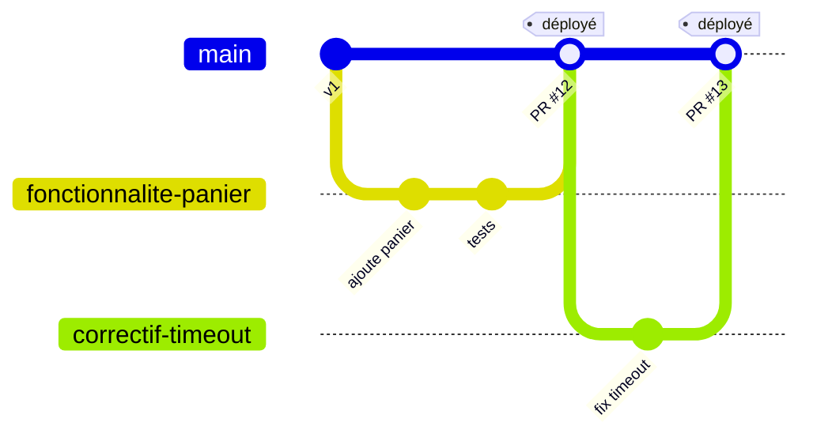
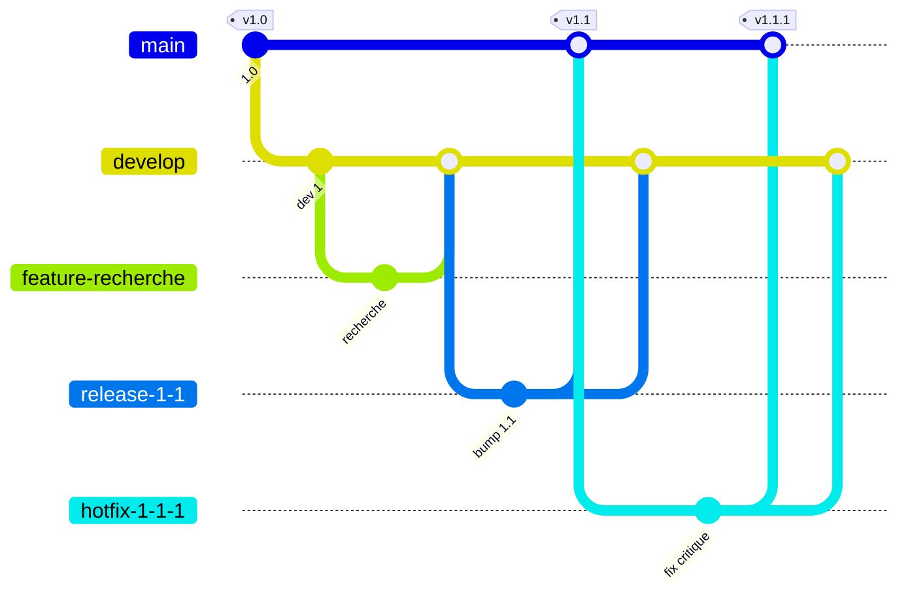
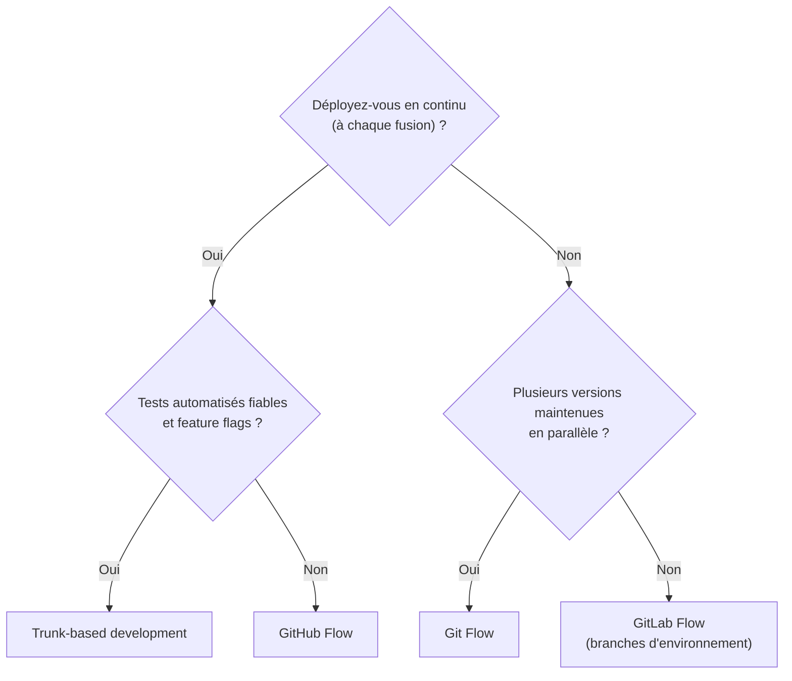
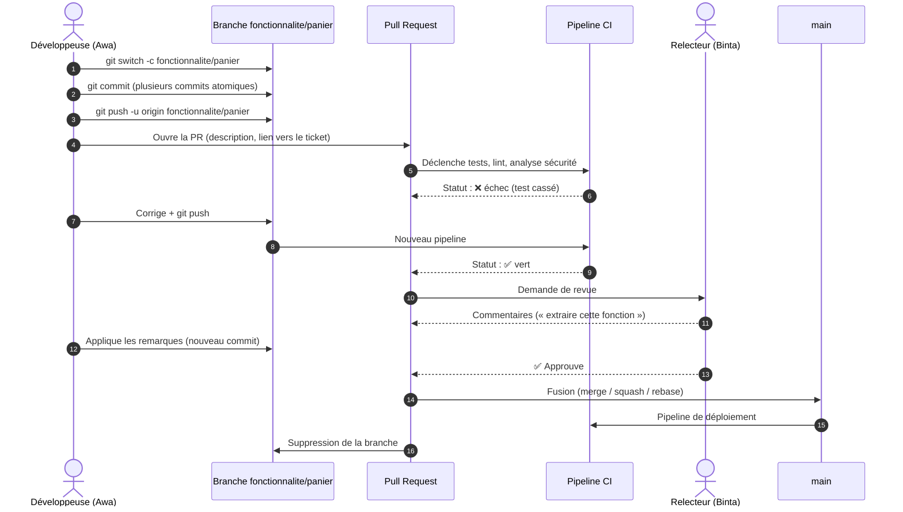
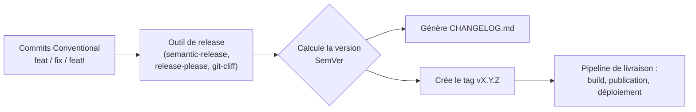

# Workflows d'équipe avec Git

## Pourquoi ce cours ?

Maîtriser les commandes ne suffit pas : **dix personnes** qui utilisent Git chacune à sa façon produisent un historique
inexploitable et des livraisons risquées. Un **workflow** est un **contrat d'équipe** : où l'on travaille, comment on
propose un changement, qui le relit, quand il part en production. Le bon choix dépend de **votre rythme de livraison** et de
**votre maturité** en tests et en automatisation (voir le [module CI/CD](../../05-devops-outils/cours/03-ci-cd-principes.md)).

## 1. Les quatre grands modèles

### GitHub Flow : simple et continu

Une seule branche durable, `main`, **toujours déployable**. Tout changement passe par une **branche courte** et une **pull request**.



Règles : (1) `main` est toujours livrable ; (2) on branche depuis `main` ; (3) on committe, on pousse, on ouvre une PR ;
(4) revue + CI verte ; (5) on fusionne ; (6) on **déploie immédiatement**.

### Git Flow : versions planifiées

Deux branches durables (`main` = production, `develop` = intégration) et des branches de support : `feature/*`, `release/*`, `hotfix/*`.



Adapté aux logiciels **livrés par versions** (applications installées, plusieurs versions maintenues en parallèle). Coûteux en
cérémonial : beaucoup de fusions croisées, branches longues.

### GitLab Flow : branches d'environnement

Reprend GitHub Flow, avec des **branches d'environnement** (`staging`, `production`) ou de **release** ; le code **progresse** de `main`
vers l'aval, jamais l'inverse. Convient quand on ne peut pas déployer à chaque merge (validation métier, fenêtres de
mise en production).

```mermaid
gitGraph
    commit id: "A"
    branch preproduction
    branch production
    checkout main
    commit id: "B"
    commit id: "C"
    checkout preproduction
    merge main id: "→ recette"
    checkout production
    merge preproduction id: "→ prod" tag: "v2.3"
    checkout main
    commit id: "D"
```

### Trunk-based development : intégration quotidienne

Tous travaillent sur **une branche principale** (le *tronc*) avec des branches **très courtes (≤ 1-2 jours)**, ou en commitant
directement. Les fonctionnalités inachevées sont cachées derrière des **feature flags**. Exige une **CI robuste** et de bons tests ; c'est le modèle
des équipes qui déploient des dizaines de fois par jour (et qui se corrèle, selon les rapports DORA, avec les meilleures performances).

## 2. Comparaison et choix

| | GitHub Flow | Git Flow | GitLab Flow | Trunk-based |
|---|---|---|---|---|
| Branches durables | `main` | `main`, `develop` | `main` + environnements | `main` (tronc) |
| Durée des branches | Jours | Jours à semaines | Jours | **Heures à 1-2 jours** |
| Rythme de livraison | Continu | Par versions | Par environnement | **Continu, très fréquent** |
| Complexité | ⭐ | ⭐⭐⭐ | ⭐⭐ | ⭐ (mais **exigeant** en CI/tests) |
| Plusieurs versions en production | ❌ | ✅ | ✅ (branches `release`) | Possible via branches de release |
| Prérequis | Revue + CI | Discipline de fusion | Pipeline multi-environnements | Tests auto, **feature flags** |
| Typique pour | SaaS, sites web, API | Logiciel packagé, mobile | Entreprises avec recette | Équipes DevOps matures |

Aide à la décision :



> 📌 **À retenir** : il n'existe pas de « meilleur » workflow ; il existe **le plus simple qui convient à votre rythme de livraison**. En cas de doute, commencez par **GitHub Flow**, et rapprochez-vous du trunk-based à mesure que vos tests et votre CI s'améliorent.

> 💡 **Conseil** : documentez le workflow retenu dans un `CONTRIBUTING.md` du dépôt : nommage des branches, format des commits, qui relit, comment fusionner.

## 3. Protection des branches

Les plateformes (GitHub, GitLab) permettent de **faire respecter** le workflow par des règles techniques sur `main` :

| Règle | Effet |
|---|---|
| **Pull request obligatoire** | Interdit les `push` directs |
| **Revues requises** (N approbations) | Au moins N relectures avant la fusion |
| **CODEOWNERS** | Relecture obligatoire par les propriétaires du dossier concerné |
| **Contrôles de statut (CI) obligatoires** | Tests, lint, analyse de sécurité **verts** |
| **Branche à jour** | Impose de rebaser/fusionner `main` avant de fusionner |
| **Historique linéaire** | Interdit les commits de fusion (impose squash ou rebase) |
| **Interdiction du force-push et de la suppression** | Protège l'historique |
| **Commits signés** | Authenticité des auteurs |
| **Résolution des commentaires** | Les fils de discussion doivent être clos |

```text
# .github/CODEOWNERS
*                 @kamer/equipe-plateforme
/infra/           @kamer/sre
/docs/            @kamer/redacteurs
*.tf              @kamer/sre @awa
```

## 4. Pull requests, merge requests et revue de code

Une **PR** (GitHub) ou **MR** (GitLab) est une **demande de fusion** : un espace de **discussion** et de **contrôle automatique** autour d'une branche.



### Les trois modes de fusion d'une PR

| Mode | Résultat dans `main` | À privilégier si… |
|---|---|---|
| **Merge commit** | Tous les commits de la branche + un commit de fusion | Vous voulez conserver l'historique détaillé de la branche |
| **Squash and merge** | **Un seul commit** résumant la PR | Les commits intermédiaires sont du bruit (« wip », « fix ») ; historique de `main` = 1 commit par PR |
| **Rebase and merge** | Les commits de la branche **rejoués** linéairement, sans commit de fusion | Commits propres, historique linéaire sans squash |

### Une bonne PR

- **Petite** (idéalement < 400 lignes) : une revue de qualité est impossible au-delà.
- **Un sujet**, une description claire : **quoi, pourquoi**, comment tester, captures si pertinent.
- La CI est **verte** avant de demander la revue.
- Le titre suit le format des commits (voir plus bas).

### Une bonne revue

- Relisez le **pourquoi** avant le **comment** ; vérifiez les cas limites, la sécurité, les tests.
- Distinguez **bloquant** (« à corriger ») et **suggestion** (« nit: »).
- Soyez **bienveillant** et factuel : on critique le code, pas la personne.
- Réponse rapide (< 1 jour ouvré) : une PR qui attend bloque le flux.

> 💡 **Conseil** : activez un *template de PR* (`.github/pull_request_template.md`) avec une checklist : tests ajoutés ? documentation ? migration ? Cela standardise la qualité sans effort.

## 5. Conventional Commits et automatisation des versions

**Conventional Commits** est une convention de message de commit **lisible par les humains et par les machines** :

```text
<type>[portée optionnelle][!]: <description>

[corps optionnel]

[pied optionnel : BREAKING CHANGE: …, Refs: #123]
```

| Type | Sens | Effet sur la version (SemVer) |
|---|---|---|
| `feat` | Nouvelle fonctionnalité | **MINEUR** (1.2.0 → 1.3.0) |
| `fix` | Correction de bug | **CORRECTIF** (1.2.0 → 1.2.1) |
| `feat!` / `BREAKING CHANGE:` | Rupture de compatibilité | **MAJEUR** (1.2.0 → 2.0.0) |
| `docs`, `style`, `refactor`, `test`, `chore`, `ci`, `build`, `perf` | Sans impact fonctionnel visible | Aucun (ou correctif pour `perf`) |

Exemples :

```text
feat(panier): ajoute le paiement par mobile money
fix(api): corrige le timeout sur /colis/{id}
feat!: remplace l'authentification par jeton par OAuth2

BREAKING CHANGE: les anciens jetons ne sont plus acceptés.
docs: précise la procédure de restauration
ci: ajoute shellcheck au pipeline
```

### Leur rôle dans la release

Parce que les messages sont structurés, des outils **automatisent** la publication :



- **Version** déduite automatiquement (plus de débat sur « 1.4.0 ou 1.3.1 ? »).
- **CHANGELOG** généré par type de changement.
- **Traçabilité** : chaque ligne de la note de version est liée à un commit.
- Validation à la source : un hook `commit-msg` ou un contrôle CI (`commitlint`) refuse les messages non conformes.

```bash
# Exemple : un hook commit-msg minimal
cat > .git/hooks/commit-msg <<'EOF'
#!/usr/bin/env bash
grep -qE '^(feat|fix|docs|style|refactor|perf|test|build|ci|chore|revert)(\([a-z0-9-]+\))?!?: .{1,72}' "$1" \
  || { echo "Message non conforme à Conventional Commits : type(portée): description" >&2; exit 1; }
EOF
chmod +x .git/hooks/commit-msg
```

## 6. Bonnes pratiques d'équipe

1. **Branches courtes**, PR petites, intégration fréquente.
2. `main` **protégée** et **toujours verte**.
3. **Commits atomiques** avec de bons messages (Conventional Commits).
4. Revue **systématique**, rapide et bienveillante.
5. **Automatisez** : tests, lint, analyse de sécurité, release.
6. **Jamais** de secrets dans l'historique ; activez l'analyse de secrets (`gitleaks`, protection native de la plateforme).
7. Résolvez les conflits **tôt** (`git pull --rebase` fréquent) plutôt que tard.
8. Documentez : `CONTRIBUTING.md`, `CODEOWNERS`, modèles de PR.
9. **Étiquetez** les versions (`git tag -a v1.2.0`) ; SemVer.
10. En cas d'erreur sur `main` : **`revert`**, jamais `push --force`.

> ⚠️ **Attention** : `git push --force` sur une branche partagée écrase le travail des autres. Si vous devez forcer sur **votre** branche de PR, utilisez `--force-with-lease`, et interdisez le force-push sur `main`.

## Résumé

- Un workflow est un **contrat d'équipe** : choisissez **le plus simple adapté à votre rythme de livraison**.
- **GitHub Flow** (continu, simple) ; **Git Flow** (versions planifiées) ; **GitLab Flow** (environnements) ; **trunk-based** (intégration quotidienne + feature flags).
- **Protégez `main`** : PR, revues, CI obligatoire, pas de force-push, `CODEOWNERS`.
- Une PR = branche courte → commits → PR → CI → revue → fusion (merge, squash ou rebase) → déploiement.
- **Conventional Commits** + SemVer = versions et changelog **automatiques**.

## Pour aller plus loin

- <https://trunkbaseddevelopment.com>, <https://www.conventionalcommits.org/fr/>, <https://semver.org/lang/fr/>.
- Outils : `semantic-release`, `release-please`, `git-cliff`, `commitlint`, `pre-commit`.
- GitHub : *rulesets*, *merge queue* ; GitLab : *merge trains*.
- Feature flags : OpenFeature, Unleash, LaunchDarkly.
- Retour au [sommaire du module 07](../README.md) et au [CI/CD du module 05](../../05-devops-outils/cours/03-ci-cd-principes.md).
