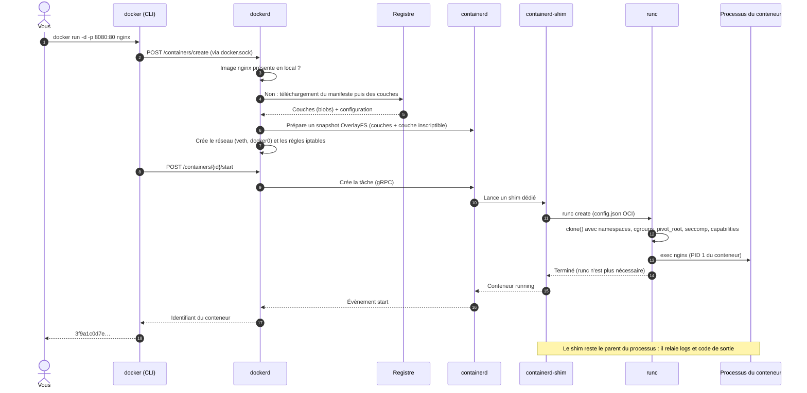
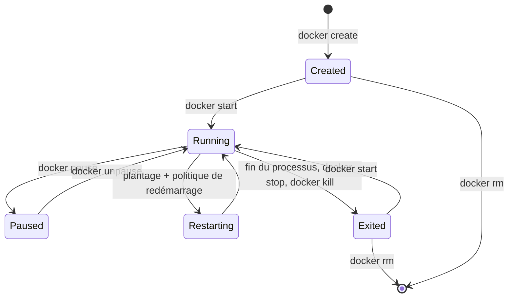

# Architecture de Docker

## Pourquoi ce cours ?

Vous avez déjà lancé des conteneurs ([module 05](../../05-devops-outils/cours/02-docker-fondamentaux.md)) et vu ce qu'ils sont
réellement : des processus Linux isolés ([module 04](../../04-linux-expert/cours/02-conteneurs-namespaces.md)). Ce cours répond à la
question suivante : **qui fait quoi** quand vous tapez `docker run` ? Connaître les composants (client, `dockerd`, `containerd`, `runc`)
permet de diagnostiquer un conteneur qui ne démarre pas, de comprendre pourquoi Kubernetes n'a pas besoin de `dockerd`
([module 09](../../09-kubernetes-approfondi/cours/01-architecture-et-composants.md)) et de sécuriser l'accès au daemon.

À la fin du cours, vous saurez : situer chaque composant, suivre le cycle de vie d'un conteneur, expliquer la différence image / conteneur et lire les traces d'un `docker run`.

## 1. Docker n'est pas une machine virtuelle

Un conteneur **n'embarque pas de noyau** : il utilise celui de l'hôte. Docker assemble trois fonctions du noyau Linux vues au module 04 :

| Fonction du noyau | Rôle pour le conteneur | Rappel |
|---|---|---|
| **Namespaces** (pid, net, mnt, uts, ipc, user, cgroup) | Limitent ce que le processus **voit** | `lsns`, `unshare` |
| **cgroups v2** | Limitent ce qu'il **consomme** (CPU, mémoire, PIDs, E/S) | `memory.max`, `cpu.max` |
| **Système de fichiers en couches** (OverlayFS, une « UnionFS ») | Lui donnent une racine `/` construite depuis une **image** | `mount -t overlay` |

À cela s'ajoutent des protections : *capabilities*, *seccomp*, *AppArmor* (voir [cours 06](06-securite-et-bonnes-pratiques.md)).

> 📌 **À retenir** : conteneur = **processus + namespaces + cgroups + racine OverlayFS + restrictions de sécurité**. Docker est l'outil qui assemble tout cela de façon reproductible.

```bash
docker run -d --name demo --memory 128m --cpus 0.5 nginx:1.27
PID=$(docker inspect -f '{{.State.Pid}}' demo)
ps -fp "$PID"                      # un processus ordinaire de l'hôte
sudo ls -l /proc/$PID/ns           # ses namespaces
cat /proc/$PID/cgroup              # son cgroup
```

## 2. Les composants

```text
 docker CLI ──REST (socket Unix)──► dockerd ──gRPC──► containerd ──► containerd-shim ──► runc ──► processus du conteneur
  (client)                          (daemon Docker)   (cycle de vie,         (un par         (crée namespaces,
                                                       images, snapshots)     conteneur)      cgroups, exec)
```

| Composant | Rôle | Remarque |
|---|---|---|
| **`docker` (CLI)** | Interface en ligne de commande : traduit vos commandes en requêtes d'API. | Un simple client. |
| **`dockerd`** | Le **daemon** : expose l'API Docker, gère images, réseaux, volumes, build (BuildKit). | Tourne en root par défaut. |
| **`containerd`** | Runtime de **haut niveau** (projet CNCF) : télécharge les images, gère les *snapshots* (couches) et le cycle de vie des conteneurs. | **Utilisé aussi directement par Kubernetes.** |
| **`containerd-shim-runc-v2`** | Petit processus « parent » de chaque conteneur : garde les flux et le code de sortie, permet de redémarrer `containerd` sans tuer les conteneurs. | |
| **`runc`** | Runtime de **bas niveau** conforme à la spécification **OCI** : `clone()`, namespaces, cgroups, `pivot_root`, seccomp, puis `exec`. | Il **s'arrête** une fois le conteneur lancé. |

Les standards qui rendent ce découpage possible :

- **OCI Image Spec** : le format d'une image (couches + manifeste + configuration) ;
- **OCI Runtime Spec** : comment lancer un conteneur depuis un dossier racine et un `config.json` ;
- **CRI** (*Container Runtime Interface*) : l'API que Kubernetes utilise pour parler à un runtime.

```bash
ps -eo pid,ppid,cmd | grep -E "dockerd|containerd|runc|shim" | grep -v grep
docker info | grep -E "Runtimes|Default Runtime|Storage Driver|Cgroup|Docker Root Dir"
sudo ctr --namespace moby containers ls      # les conteneurs vus par containerd (espace de noms « moby »)
```

> 💡 **Conseil** : `docker info` est la commande de diagnostic n°1 : version du serveur, pilote de stockage (`overlay2`), pilote de cgroup, runtime par défaut (`runc`), répertoire de données (`/var/lib/docker`).

## 3. Modèle client-serveur : comment `docker run` parle au daemon

Le CLI communique avec `dockerd` par une **API REST** exposée, par défaut, sur une **socket Unix** : `/var/run/docker.sock`.

```bash
ls -l /var/run/docker.sock           # srw-rw---- root docker
curl --unix-socket /var/run/docker.sock http://localhost/version | head -c 300; echo
curl --unix-socket /var/run/docker.sock http://localhost/containers/json | head -c 300; echo
DOCKER_HOST=ssh://etudiant@serveur docker ps    # le même CLI pilote un daemon distant via SSH
```

Conséquences :

- **Appartenir au groupe `docker` = être root** sur la machine (on peut monter `/` dans un conteneur).
- **Monter `/var/run/docker.sock` dans un conteneur** lui donne le contrôle total de l'hôte.
- Exposer l'API en **TCP 2375 sans TLS** revient à publier un accès root sur Internet. Utilisez la socket locale, SSH ou TLS mutuel (2376).

### Séquence complète d'un `docker run`



Observez ces évènements en direct :

```bash
docker events &                       # create, start, die, destroy, network connect…
docker run --rm alpine echo bonjour
kill %1
```

## 4. Cycle de vie d'un conteneur



| État | Signification | Commande |
|---|---|---|
| `created` | Configuré (réseau, couche inscriptible) mais pas démarré | `docker create` |
| `running` | Le processus principal (PID 1 du conteneur) s'exécute | `docker start`, `docker run` |
| `paused` | Processus **gelés** par le cgroup freezer (mémoire conservée) | `docker pause` / `unpause` |
| `restarting` | Redémarrage automatique en cours | `--restart` |
| `exited` | Processus terminé ; la couche inscriptible **existe encore** | `docker stop` |
| *supprimé* | Conteneur et couche inscriptible effacés | `docker rm` |

Points clés :

- **Un conteneur vit autant que son processus principal** (PID 1). Quand il se termine, le conteneur passe à `exited`.
- `docker stop` envoie **`SIGTERM`**, attend 10 secondes (`--time`), puis **`SIGKILL`**. Un PID 1 qui ignore `SIGTERM` provoque ce délai de 10 s (voir [cours 03](03-dockerfile-avance.md) : forme *exec*, `tini`).
- Un conteneur arrêté **conserve ses données** (couche inscriptible) jusqu'au `docker rm`.
- Politiques de redémarrage : `no` (défaut), `on-failure[:n]`, `always`, `unless-stopped`.

```bash
docker create --name c1 alpine sleep 300
docker ps -a --filter name=c1 --format '{{.Names}} {{.Status}}'
docker start c1 && docker pause c1 && docker ps --filter name=c1 --format '{{.Names}} {{.Status}}'
docker unpause c1 && docker stop c1
docker inspect -f '{{.State.Status}} code={{.State.ExitCode}} oom={{.State.OOMKilled}}' c1
docker rm c1
```

> ⚠️ **Attention** : le code de sortie `137` signifie `SIGKILL` (128 + 9) : arrêt forcé ou **OOM killer** (`OOMKilled=true`) ; `143` = `SIGTERM` (128 + 15), arrêt normal.

## 5. Images et conteneurs

| | **Image** | **Conteneur** |
|---|---|---|
| Nature | Modèle **immuable**, en lecture seule | **Instance** en cours d'exécution (ou arrêtée) |
| Contenu | Pile de couches + métadonnées (`ENTRYPOINT`, `ENV`, `USER`…) | L'image + **une couche inscriptible** + un état (processus, réseau) |
| Partage | Plusieurs conteneurs partagent **les mêmes couches** | Chacun a sa propre couche inscriptible |
| Analogie | Programme sur le disque | Processus |
| Identité | Digest `sha256:…` (et tags) | Identifiant et nom |

Plusieurs conteneurs issus de `nginx:1.27` ne dupliquent pas les couches : seule la couche inscriptible (copy-on-write) est propre à chacun. Détail au [cours 02](02-images-et-couches.md).

```bash
docker run -d --name a nginx:1.27 && docker run -d --name b nginx:1.27
docker ps -s                          # SIZE : taille inscriptible (virtuelle = image + inscriptible)
docker diff a                         # A = ajouté, C = modifié, D = supprimé dans la couche inscriptible
docker rm -f a b
```

## 6. Où Docker stocke ses données

```bash
sudo du -sh /var/lib/docker/*
docker system df -v | head -20       # espace utilisé : images, conteneurs, volumes, cache de build
```

| Dossier | Contenu |
|---|---|
| `/var/lib/docker/overlay2/` | Les couches (`lowerdir`, `upperdir`, `merged`) |
| `/var/lib/docker/containers/<id>/` | Configuration et **journaux JSON** du conteneur |
| `/var/lib/docker/volumes/` | Les volumes nommés |
| `/etc/docker/daemon.json` | Configuration du daemon (journaux, miroirs, pilote de cgroup…) |

> 💡 **Conseil** : les journaux JSON **croissent sans limite** par défaut. Dans `/etc/docker/daemon.json` : `{"log-driver":"local","log-opts":{"max-size":"10m","max-file":"3"}}`, puis `sudo systemctl restart docker`.

## 7. Et Kubernetes dans tout ça ?

Kubernetes ne parle **pas** à `dockerd` : depuis la version 1.24, le support direct de Docker (*dockershim*) a été retiré. Le *kubelet* dialogue avec **`containerd`** (ou CRI-O) via l'interface **CRI**. Les images Docker restent **parfaitement compatibles** : elles respectent le format OCI.

```text
Docker :      docker CLI → dockerd → containerd → runc
Kubernetes :  kubectl → API server → kubelet ──CRI──► containerd → runc        (dockerd absent)
```

Sur un nœud Kubernetes, `docker ps` ne montre donc rien : on utilise `crictl ps`. Voir le [module 09](../../09-kubernetes-approfondi/cours/01-architecture-et-composants.md).

## Résumé

- Un conteneur est un **processus** isolé par **namespaces**, limité par **cgroups**, enraciné dans un **OverlayFS** ; le noyau est **partagé**.
- Chaîne : `docker` (client) → `dockerd` (API REST, socket Unix) → `containerd` → `containerd-shim` → `runc` → processus.
- `runc` crée le conteneur puis s'efface ; le **shim** reste son parent.
- Cycle de vie : `created → running ⇄ paused → exited → supprimé` ; un conteneur vit autant que son **PID 1**.
- **Image = immuable et partagée ; conteneur = image + couche inscriptible.**
- Accès au socket Docker = **root** ; Kubernetes utilise `containerd` via CRI, pas `dockerd`.

## Pour aller plus loin

- Spécifications OCI : <https://opencontainers.org/> ; `containerd` : <https://containerd.io/>.
- `docker system events`, `ctr`, `nerdctl`, `crictl`.
- Alternatives : **Podman** (sans daemon, rootless natif), **Buildah**, **CRI-O**.
- Cours suivant : [Images et couches](02-images-et-couches.md).
- Atelier associé : [Premiers pas](../ateliers-killercoda/atelier-01-premiers-pas/intro.md).
