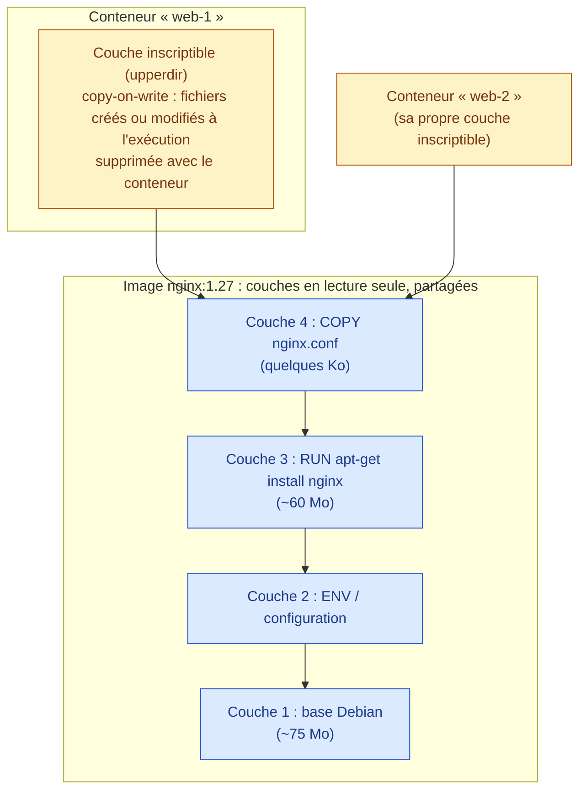
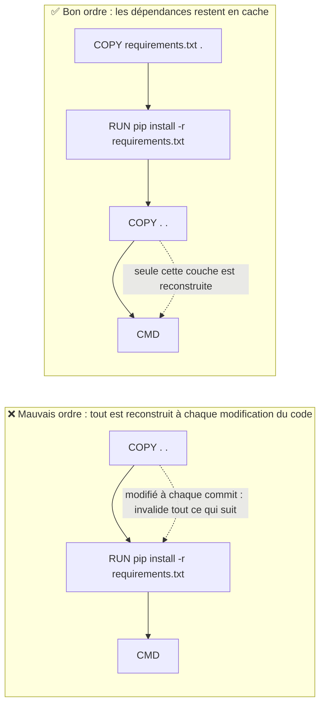

# Images et couches

## Pourquoi ce cours ?

Une image Docker de 1,2 Go qui se reconstruit en 4 minutes à chaque commit, un déploiement qui « change tout seul » parce que
`latest` a bougé, une faille dans une bibliothèque oubliée au fond d'une couche : tout cela vient d'une mauvaise compréhension
des **images**. Ce cours explique leur structure interne, le **cache de build**, la différence entre **tag** et **digest**, et comment choisir une base de taille raisonnable.

## 1. Une image est une pile de couches

Une image OCI se compose de :

- un **manifeste** : la liste des couches (par empreinte) et la configuration ;
- une **configuration** (JSON) : `ENTRYPOINT`, `CMD`, `ENV`, `USER`, historique…
- des **couches** (*layers*) : chacune est une archive `tar` compressée contenant les **différences** de fichiers par rapport à la précédente.

Au démarrage, `overlay2` **superpose** ces couches en lecture seule (`lowerdir`) et ajoute une couche **inscriptible** (`upperdir`) propre au conteneur. Le résultat fusionné (`merged`) est la racine `/` du conteneur (voir le [module 04](../../04-linux-expert/cours/02-conteneurs-namespaces.md)).



> 📌 **À retenir** : les couches sont **immuables** et **partagées** entre toutes les images et tous les conteneurs qui les utilisent. Dix conteneurs `nginx` n'occupent qu'**une seule fois** la taille de l'image, plus dix petites couches inscriptibles.

### Le copy-on-write

- **Lecture** : le noyau lit le fichier dans la première couche (en partant du haut) où il existe.
- **Modification d'un fichier de l'image** : il est d'abord **copié** dans la couche inscriptible (*copy-up*), puis modifié ; l'original reste intact en dessous.
- **Suppression** : un fichier « *whiteout* » est créé dans la couche supérieure pour **masquer** l'original (il n'est pas réellement supprimé de l'image).

> ⚠️ **Attention** : supprimer un fichier dans une couche **ultérieure** (`RUN rm gros-fichier`) **ne réduit pas** la taille de l'image : le fichier reste dans la couche précédente. Il faut le supprimer **dans la même instruction** qui l'a créé (`RUN curl … && … && rm …`) ou utiliser un build multi-stage ([cours 03](03-dockerfile-avance.md)).

```bash
docker run -d --name w nginx:1.27
docker inspect -f '{{.GraphDriver.Name}}' w
docker inspect -f '{{json .GraphDriver.Data}}' w | python3 -m json.tool | head -12   # LowerDir, UpperDir, MergedDir
docker exec w sh -c 'echo test > /tmp/nouveau && echo "# modif" >> /etc/nginx/nginx.conf'
docker diff w                                 # A /tmp/nouveau  ·  C /etc/nginx/nginx.conf
sudo ls "$(docker inspect -f '{{.GraphDriver.Data.UpperDir}}' w)"     # la couche inscriptible, sur l'hôte
docker rm -f w
```

## 2. Chaque instruction crée une couche

Dans un `Dockerfile`, les instructions qui **modifient le système de fichiers** (`RUN`, `COPY`, `ADD`) créent une couche. Les autres (`ENV`, `CMD`, `EXPOSE`, `LABEL`, `USER`, `WORKDIR`…) n'ajoutent que des **métadonnées** (couches de taille nulle).

```dockerfile
FROM python:3.12-slim              # couches de la base (plusieurs)
WORKDIR /app                       # métadonnée (et création du dossier)
COPY requirements.txt .            # couche A : un fichier
RUN pip install -r requirements.txt   # couche B : les bibliothèques (grosse)
COPY . .                           # couche C : le code
CMD ["python", "app.py"]           # métadonnée
```

```bash
docker build -t demo:1 .
docker history demo:1                          # une ligne par instruction, avec la taille de chaque couche
docker history --no-trunc --format '{{.Size}}\t{{.CreatedBy}}' demo:1 | head
```

## 3. Le cache de build

Docker réutilise une couche **si l'instruction et son contexte sont identiques** à ceux d'un build précédent. Règle essentielle : **dès qu'une couche est invalidée, toutes les suivantes le sont aussi**.

| Instruction | Condition pour réutiliser le cache |
|---|---|
| `RUN cmd` | Le **texte** de la commande est identique (Docker ne sait pas si `apt-get update` renverrait autre chose) |
| `COPY` / `ADD` | Le **contenu** (somme de contrôle) des fichiers copiés est identique |
| `ENV`, `ARG`, `WORKDIR`… | La valeur est identique |

### L'impact de l'ordre



Principe : placer **en premier ce qui change rarement** (système, dépendances) et **en dernier ce qui change souvent** (code source).

```bash
docker build -t demo:1 .          # 1er build : tout est construit
echo "# commentaire" >> app.py
docker build -t demo:1 .          # seul COPY . . est refait : « CACHED » sur les étapes précédentes
docker build --no-cache -t demo:1 .     # ignorer le cache (reconstruction complète)
docker builder prune                    # vider le cache de build
```

> 💡 **Conseil** : regroupez `apt-get update` et `apt-get install` **dans la même instruction `RUN`**, sinon un cache périmé de `update` provoquerait des installations de paquets obsolètes. Nettoyez ensuite : `&& rm -rf /var/lib/apt/lists/*`.

## 4. Tags et digests

Un **tag** (`nginx:1.27`) est une **étiquette mobile** : le propriétaire de l'image peut la **réaffecter** à un autre contenu. Un **digest** (`sha256:…`) est l'**empreinte du manifeste** : il désigne un contenu **précis et immuable**.

```text
nginx:latest                  ← mobile, change à chaque nouvelle version
nginx:1.27                    ← mobile aussi (reçoit les correctifs 1.27.x)
nginx:1.27.3                  ← plus précis, mais peut encore être republié
nginx@sha256:4f3a…9c21        ← IMMUABLE : exactement ce contenu, toujours
```

```bash
docker pull nginx:1.27
docker image ls --digests nginx
docker inspect -f '{{index .RepoDigests 0}}' nginx:1.27          # nginx@sha256:…
docker buildx imagetools inspect nginx:1.27                       # manifeste, plateformes (amd64, arm64…)
docker pull nginx@sha256:<digest-obtenu-ci-dessus>
docker run -d nginx@sha256:<digest>
```

### Le danger de `latest`

- **Non reproductible** : deux builds à une semaine d'intervalle peuvent donner deux résultats différents.
- **Retour arrière impossible** : « quelle était la version qui marchait ? ».
- **Surprises** : une rupture de compatibilité dans une nouvelle version majeure casse la production sans qu'aucun de vos fichiers ait changé.
- **Pas un « dernier » garanti** : `latest` n'est qu'un tag par défaut, rien n'oblige l'éditeur à le mettre à jour.

Bonnes pratiques :

| Contexte | Recommandation |
|---|---|
| Développement | Tag précis : `python:3.12-slim` |
| Production / CI | Tag précis **+ digest** : `python:3.12.7-slim@sha256:…` |
| Images que vous publiez | Tags de version (`1.4.2`) **et** étiquette de commit (`sha-3f9a1c0`) ; jamais seulement `latest` |
| Mises à jour | Automatisées et **relues** (Renovate, Dependabot) plutôt que subies |

> ⚠️ **Attention** : un tag peut aussi être **réécrit par un attaquant** qui compromet un compte de registre. Le digest protège : si le contenu change, l'empreinte ne correspond plus.

## 5. Inspecter une image

```bash
docker image ls                                   # images locales : tag, ID, taille
docker image ls --format 'table {{.Repository}}\t{{.Tag}}\t{{.Size}}'
docker image ls --filter dangling=true            # images sans tag (restes de builds)
docker history nginx:1.27                         # couches, instructions, tailles
docker inspect nginx:1.27 | head -60              # configuration complète
docker inspect -f '{{.Config.Entrypoint}} {{.Config.Cmd}} {{.Config.User}}' nginx:1.27
docker inspect -f '{{.RootFS.Layers}}' nginx:1.27 # empreintes des couches
docker inspect -f '{{.Config.ExposedPorts}} {{.Config.Env}}' nginx:1.27
docker save nginx:1.27 -o nginx.tar && tar tf nginx.tar | head       # l'image sous forme de tar (manifest.json, blobs/…)
docker image prune -a                             # supprime TOUTES les images non utilisées (⚠️)
```

> 💡 **Conseil** : l'outil **`dive`** (<https://github.com/wagoodman/dive>) affiche chaque couche et les fichiers qu'elle ajoute : idéal pour traquer ce qui alourdit une image.

## 6. La taille des images : quelle base choisir ?

| Base | Taille (ordre de grandeur) | Contenu | Avantages | Inconvénients |
|---|---|---|---|---|
| `ubuntu:24.04` / `debian:12` | 75-120 Mo | Système complet + `apt` | Familier, tout est disponible | Lourd, surface d'attaque large |
| `*-slim` (`python:3.12-slim`) | 50-150 Mo | Debian allégée | Bon compromis, bibliothèque `glibc` standard | Quelques outils absents |
| `alpine` | ~8 Mo | musl libc + busybox + `apk` | Très léger | **musl** ≠ glibc : incompatibilités (certaines roues Python, binaires précompilés), DNS parfois différent |
| **distroless** (Google) | 2-30 Mo | Uniquement l'app et ses bibliothèques d'exécution : **ni shell ni gestionnaire de paquets** | Surface d'attaque minimale, pas de shell pour l'attaquant | Débogage plus difficile (`:debug` fournit busybox) |
| **`scratch`** | 0 | **Image vide** | Le plus petit possible : seulement votre binaire | Binaire **statique** obligatoire, pas de certificats CA ni fuseaux horaires sauf à les copier |

À titre indicatif, pour une même application Python : `python:3.12` ≈ 1 Go, `python:3.12-slim` ≈ 130-150 Mo, `python:3.12-alpine` ≈ 50 Mo. Pour un programme Go compilé statiquement : `golang` (build) ≈ 800 Mo, `scratch` ou distroless ≈ **5-15 Mo**.

```dockerfile
# Exemple d'image minimale pour un binaire Go statique
FROM scratch
COPY --from=build /bin/app /app
ENTRYPOINT ["/app"]
```

```bash
docker image ls --format '{{.Repository}}:{{.Tag}} {{.Size}}' | grep -E 'python|alpine|debian'
```

> ⚠️ **Attention** : choisir `alpine` « parce que c'est petit » peut coûter cher en compatibilité (bibliothèque musl) et en temps de build (compilation de paquets Python natifs). `-slim` est souvent le meilleur point de départ.

## Résumé

- Une image est une **pile de couches immuables et partagées** ; le conteneur ajoute **une couche inscriptible** (copy-on-write), détruite avec lui.
- `RUN`, `COPY` et `ADD` créent des couches ; supprimer un fichier plus tard **ne réduit pas** la taille.
- Cache de build : une couche invalidée **invalide les suivantes** → dépendances d'abord, code ensuite.
- **Tag = mobile, digest = immuable** : évitez `latest`, épinglez les versions et le digest en production.
- Outils : `docker history`, `docker inspect`, `docker image ls --digests`, `dive`.
- Taille : `slim` (compromis) → `alpine` (compatibilité à vérifier) → `distroless` / `scratch` (minimal, pour les binaires statiques).

## Pour aller plus loin

- Spécification OCI Image : <https://github.com/opencontainers/image-spec>.
- `docker buildx imagetools`, `crane`, `skopeo` (manipuler des images sans daemon).
- Images distroless : <https://github.com/GoogleContainerTools/distroless> ; Chainguard Images.
- Cours suivant : [Dockerfile avancé](03-dockerfile-avance.md).
- Atelier associé : [Dockerfile multi-stage](../ateliers-killercoda/atelier-02-dockerfile-multistage/intro.md).
