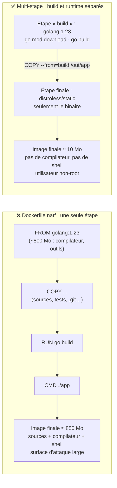

# Dockerfile avancé

## Pourquoi ce cours ?

Un Dockerfile « qui marche » n'est pas un bon Dockerfile : image de 1 Go contenant compilateur et sources, build de 5 minutes à chaque
modification, mot de passe oublié dans une couche, conteneur qui met 10 secondes à s'arrêter, processus qui tourne en root. Ce cours
présente les techniques qui séparent un Dockerfile de débutant d'un Dockerfile de production : **multi-stage**, cache maîtrisé,
**BuildKit**, gestion des signaux et du PID 1, utilisateur non-root, bases minimales.

> Prérequis : [images et couches](02-images-et-couches.md) (cache, tailles) et le [Dockerfile du module 05](../../05-devops-outils/cours/02-docker-fondamentaux.md).

## 1. Multi-stage builds : séparer construction et exécution

Pour compiler une application, il faut des outils (compilateur, en-têtes, gestionnaire de dépendances) qui n'ont **aucune utilité à l'exécution**. Un build **multi-stage** utilise plusieurs `FROM` : chaque étape est indépendante, et la **dernière** devient l'image finale. On n'y copie que les **artefacts** utiles.

```dockerfile
# syntax=docker/dockerfile:1

# ---------- Étape 1 : construction ----------
FROM golang:1.23 AS build
WORKDIR /src
COPY go.mod go.sum ./
RUN go mod download                  # couche de dépendances, mise en cache
COPY . .
RUN CGO_ENABLED=0 go build -trimpath -ldflags="-s -w" -o /out/app .

# ---------- Étape 2 : exécution ----------
FROM gcr.io/distroless/static-debian12:nonroot
COPY --from=build /out/app /app
EXPOSE 8080
ENTRYPOINT ["/app"]
```

Même principe en Python (environnement virtuel copié vers une image `slim`) :

```dockerfile
# syntax=docker/dockerfile:1
FROM python:3.12-slim AS build
RUN python -m venv /opt/venv
ENV PATH="/opt/venv/bin:$PATH"
COPY requirements.txt .
RUN pip install --no-cache-dir -r requirements.txt

FROM python:3.12-slim
COPY --from=build /opt/venv /opt/venv
ENV PATH="/opt/venv/bin:$PATH" PYTHONUNBUFFERED=1
WORKDIR /app
COPY app.py .
RUN useradd --system --uid 10001 appuser
USER appuser
CMD ["python", "app.py"]
```

Ou en Node.js :

```dockerfile
FROM node:22 AS deps
WORKDIR /app
COPY package*.json ./
RUN npm ci --omit=dev

FROM node:22-slim
WORKDIR /app
COPY --from=deps /app/node_modules ./node_modules
COPY . .
USER node
CMD ["node", "server.js"]
```

### Avant / après



Commandes utiles :

```bash
docker build --target build -t app:build .      # construire une étape précise (débogage, tests)
docker build -t app:1.0 .
docker image ls app                              # comparer les tailles
docker build --target test .                     # une étape « test » exécutée en CI, absente de l'image finale
```

> 📌 **À retenir** : tout ce qui est dans une étape précédente et **non copié** explicitement avec `COPY --from=` **disparaît** de l'image finale : sources, compilateur, caches, secrets utilisés pour le build.

## 2. Le cache : ordre des instructions et `.dockerignore`

Rappel (cours 02) : une couche invalidée invalide les suivantes. Trois règles pratiques :

1. **Copier d'abord les fichiers de dépendances**, installer, **puis** copier le code.
2. **Éviter `COPY . .` trop tôt** et trop large.
3. **Combiner** les commandes liées dans un seul `RUN`, et nettoyer dans la même instruction.

```dockerfile
# ❌ Invalide le cache à chaque modification du code
COPY . .
RUN npm ci

# ✅ Les dépendances ne sont réinstallées que si package*.json change
COPY package*.json ./
RUN npm ci
COPY . .
```

### `.dockerignore`

Le **contexte de build** (le dossier envoyé au daemon) inclut tout ce qui n'est pas ignoré. Un bon `.dockerignore` **accélère le build**, **évite d'invalider le cache** (un fichier de log modifié ne doit pas relancer `COPY . .`) et **empêche de fuiter des secrets**.

```text
# .dockerignore
.git
.gitignore
.env
*.log
node_modules
__pycache__
*.pyc
.venv
Dockerfile*
docker-compose*.yml
compose*.yaml
README.md
tests/
.idea/
.vscode/
```

```bash
docker build --progress=plain -t app . 2>&1 | grep -E "transferring context"     # taille du contexte envoyé
```

## 3. Instructions avancées

### `ARG` et `ENV`

| | `ARG` | `ENV` |
|---|---|---|
| Disponible | **À la construction** seulement | Construction **et** exécution |
| Visible dans l'image finale | Non (mais **visible dans `docker history`**) | Oui (`docker inspect`) |
| Usage | Versions, URL, paramètres de build | Configuration de l'application (`PORT`, `PYTHONUNBUFFERED`) |

```dockerfile
ARG PYTHON_VERSION=3.12
FROM python:${PYTHON_VERSION}-slim          # ARG avant FROM : utilisable dans FROM
ARG APP_VERSION=dev                         # à redéclarer après FROM pour l'utiliser dans l'étape
ENV APP_VERSION=${APP_VERSION}
LABEL org.opencontainers.image.version=${APP_VERSION}
```

```bash
docker build --build-arg PYTHON_VERSION=3.13 --build-arg APP_VERSION=1.4.2 -t app:1.4.2 .
```

> ⚠️ **Attention** : **ne transmettez jamais de secret par `ARG` ou `ENV`** : ils sont enregistrés dans les métadonnées de l'image (`docker history`, `docker inspect`). Utilisez les *secrets de build* (section 5).

### `HEALTHCHECK`

Indique à Docker comment **vérifier que l'application est réellement saine** (et non simplement « le processus tourne »).

```dockerfile
HEALTHCHECK --interval=15s --timeout=3s --start-period=10s --retries=3 \
  CMD wget -qO- http://localhost:8080/sante || exit 1
```

États : `starting` → `healthy` / `unhealthy`. Compose s'en sert pour ordonnancer le démarrage ([cours 05](05-docker-compose.md)) ; **Kubernetes ignore** `HEALTHCHECK` et utilise ses propres sondes (*probes*, [module 09](../../09-kubernetes-approfondi/cours/02-pods-et-workloads.md)).

```bash
docker ps --format 'table {{.Names}}\t{{.Status}}'          # (healthy)
docker inspect -f '{{json .State.Health}}' web | python3 -m json.tool
```

### `ENTRYPOINT` et `CMD`

| | `ENTRYPOINT` | `CMD` |
|---|---|---|
| Rôle | Le **programme** à exécuter | Les **arguments par défaut** (ou la commande par défaut) |
| Remplacement à `docker run` | Seulement avec `--entrypoint` | Tout ce qui suit le nom de l'image le remplace |

```dockerfile
ENTRYPOINT ["python", "app.py"]
CMD ["--port", "8000"]               # arguments par défaut
```

```bash
docker run app                       # python app.py --port 8000
docker run app --port 9000           # python app.py --port 9000
docker run --entrypoint sh -it app   # shell de débogage
```

### Forme *exec* ou forme *shell* : une question de signaux

| Forme | Syntaxe | Processus PID 1 | Signaux (`SIGTERM`) |
|---|---|---|---|
| **exec** (recommandée) | `CMD ["python", "app.py"]` | **Votre programme** directement | ✅ Reçus par l'application |
| **shell** | `CMD python app.py` | `/bin/sh -c "python app.py"` | ❌ Reçus par `sh`, **pas** transmis à l'application |

Avec la forme *shell*, `docker stop` n'atteint pas l'application : elle ne s'arrête pas proprement, Docker attend **10 secondes** puis la tue (`SIGKILL`, code 137) : connexions coupées, écritures perdues.

```bash
docker run -d --name t1 alpine sleep 300
time docker stop t1                  # ≈ 10 s : sleep est PID 1, sans gestionnaire de signal il ignore SIGTERM
docker run -d --init --name t2 alpine sleep 300
time docker stop t2                  # ≈ 0 s : tini est PID 1, relaie SIGTERM à sleep (voir la section 4)
docker rm -f t1 t2
```

> 💡 **Conseil** : si votre `ENTRYPOINT` est un script shell, terminez-le par **`exec "$@"`** : le shell est **remplacé** par l'application, qui devient PID 1 et reçoit les signaux.

### `USER`

Par défaut, le processus tourne en **root dans le conteneur**. Créez un utilisateur dédié et basculez dessus **après** les installations :

```dockerfile
RUN groupadd --system --gid 10001 app && useradd --system --uid 10001 --gid app --no-create-home app
COPY --chown=app:app . /app
USER 10001:10001            # UID numérique : compatible avec Kubernetes (runAsNonRoot)
```

> 📌 **À retenir** : privilégiez un **UID numérique** dans `USER` : Kubernetes (`runAsNonRoot: true`) ne peut vérifier un nom d'utilisateur symbolique.

## 4. PID 1, zombies et `tini`

Dans un conteneur, votre application est **PID 1**. Ce rôle a deux particularités sous Linux :

1. **Aucun gestionnaire de signal par défaut** : le noyau n'applique pas les actions par défaut de `SIGTERM`/`SIGINT` à PID 1. Si l'application n'installe pas de *handler*, elle **ignore** `docker stop`.
2. **Récupération des zombies** : PID 1 doit appeler `wait()` pour les orphelins ; sinon, les processus enfants terminés s'accumulent à l'état `Z` (voir le [cours processus](../../02-linux-intermediaire/cours/01-processus-services.md)).

Un mini init règle ces deux points : **`tini`** ou **`dumb-init`**.

```bash
docker run --init --rm myapp                  # Docker injecte tini comme PID 1
```

```dockerfile
# Dans l'image (Debian/Ubuntu)
RUN apt-get update && apt-get install -y --no-install-recommends tini && rm -rf /var/lib/apt/lists/*
ENTRYPOINT ["/usr/bin/tini", "--", "python", "app.py"]
# Alpine : apk add --no-cache tini  → /sbin/tini
```

```yaml
# Compose
services:
  api:
    init: true
```

## 5. BuildKit : le moteur de build moderne

**BuildKit** est le moteur par défaut depuis Docker 23. Il apporte :

- **Builds parallèles** : les étapes indépendantes d'un Dockerfile multi-stage sont construites **simultanément** ; les étapes inutiles pour la cible sont **ignorées**.
- Un **cache** plus fin (`--cache-from`, `--cache-to` pour le partager en CI) ;
- Des **montages spéciaux** (`RUN --mount=...`) : cache de paquets, secrets, SSH.
- Des builds **multi-plateformes** (`docker buildx build --platform linux/amd64,linux/arm64`).

Activer explicitement et lire la sortie détaillée :

```bash
DOCKER_BUILDKIT=1 docker build --progress=plain -t app .
docker buildx ls
```

Ajoutez en **première ligne** du Dockerfile : `# syntax=docker/dockerfile:1` pour utiliser la dernière version de la syntaxe.

### Cache mounts : ne pas retélécharger les paquets

`--mount=type=cache` conserve un **dossier de cache** entre les builds, **hors de l'image** :

```dockerfile
# syntax=docker/dockerfile:1
FROM python:3.12-slim
WORKDIR /app
COPY requirements.txt .
RUN --mount=type=cache,target=/root/.cache/pip \
    pip install -r requirements.txt

# Autres exemples
# RUN --mount=type=cache,target=/var/cache/apt,sharing=locked apt-get update && apt-get install -y gcc
# RUN --mount=type=cache,target=/go/pkg/mod go build ./...
# RUN --mount=type=cache,target=/root/.npm npm ci
```

Même si la couche `RUN` est invalidée (le fichier `requirements.txt` change), les paquets déjà téléchargés sont **réutilisés** : le build est bien plus rapide, et le cache n'alourdit pas l'image.

### Secrets de build : ne jamais les laisser dans une couche

```dockerfile
# syntax=docker/dockerfile:1
FROM node:22-slim
WORKDIR /app
COPY package*.json ./
RUN --mount=type=secret,id=npmrc,target=/root/.npmrc \
    npm ci --omit=dev
```

```bash
docker build --secret id=npmrc,src=$HOME/.npmrc -t app .
docker history app            # aucune trace du secret
```

Le secret est **monté temporairement** dans le conteneur de build (en mémoire, pas dans l'image) : il n'apparaît dans **aucune couche** ni dans `docker history`. Pour une clé SSH (dépôt privé) : `RUN --mount=type=ssh git clone git@…` avec `docker build --ssh default`.

> ⚠️ **Attention** : le « truc » `COPY secret.txt . && RUN … && rm secret.txt` **ne fonctionne pas** : le fichier reste lisible dans la couche du `COPY`. Seuls les `--mount=type=secret` sont sûrs.

## 6. Distroless et `scratch` : quand et pourquoi

| Image finale | Quand l'utiliser |
|---|---|
| `scratch` | Binaire **statique** (Go avec `CGO_ENABLED=0`, Rust `musl`) ; copiez à la main les certificats CA (`/etc/ssl/certs/ca-certificates.crt`) et `tzdata` si nécessaires |
| `distroless/static` | Même cas, avec certificats CA, `tzdata` et utilisateur `nonroot` déjà présents |
| `distroless/base`, `/cc` | Binaire lié dynamiquement (glibc) |
| `distroless/python3`, `/nodejs`, `/java` | Applications interprétées, sans shell ni gestionnaire de paquets |
| `slim` | Dès que vous avez besoin de glibc, d'outils de diagnostic ou de paquets système |

Avantages : **taille minimale**, **moins de CVE** (aucun paquet inutile), **pas de shell** (un attaquant ayant exécuté du code ne peut pas facilement « se promener »). Inconvénient : pas de `docker exec -it … sh`. Solutions : tags `:debug` (busybox inclus), `docker debug`, ou un conteneur éphémère (`docker run --pid container:web --net container:web nicolaka/netshoot`).

## 7. Bonnes pratiques : récapitulatif

| ✅ À faire | ❌ À éviter |
|---|---|
| Image de base **officielle**, **version précise** (+ digest en production) | `FROM ubuntu` / `:latest` |
| **Multi-stage** : seul l'artefact final est copié | Compilateur et sources dans l'image finale |
| Dépendances **avant** le code ; `.dockerignore` | `COPY . .` en début de fichier |
| `USER` **non-root** (UID numérique) | Processus en root |
| Forme **exec**, `tini` / `--init` | `CMD python app.py` (forme shell), PID 1 sans init |
| `--mount=type=secret` et `--mount=type=cache` | Secrets dans `ENV`/`ARG`/`COPY` |
| `HEALTHCHECK` pertinent | Aucun contrôle de santé |
| `RUN` combinés et nettoyés (`rm -rf /var/lib/apt/lists/*`) | `RUN rm` dans une couche suivante |
| `apt-get install --no-install-recommends` | Paquets « au cas où » |
| `LABEL` OCI (source, version, licence) | Image anonyme |
| Linter : `hadolint Dockerfile` ; `docker build --check` | Aucune analyse |

```bash
docker run --rm -i hadolint/hadolint < Dockerfile
docker build --check .                    # analyse statique intégrée à BuildKit
docker run --rm -it -v /var/run/docker.sock:/var/run/docker.sock wagoodman/dive app:1.0
```

## Résumé

- **Multi-stage** : une étape de construction, une étape d'exécution ; seul ce qui est copié (`COPY --from=`) subsiste.
- Cache : dépendances d'abord, code ensuite ; **`.dockerignore`** soigné (vitesse **et** sécurité).
- `ARG` (construction) ≠ `ENV` (exécution) ; **aucun secret** dans l'un ni l'autre.
- `ENTRYPOINT` = programme, `CMD` = arguments par défaut ; **forme exec** pour recevoir les signaux ; `exec "$@"` dans les scripts.
- **PID 1** : sans init, signaux ignorés et zombies : utilisez `tini` (`--init`).
- **BuildKit** : parallélisme, `--mount=type=cache`, `--mount=type=secret`.
- **Distroless / scratch** : taille et surface d'attaque minimales pour les binaires statiques ; `USER` numérique non-root toujours.

## Pour aller plus loin

- Référence Dockerfile : <https://docs.docker.com/reference/dockerfile/> ; bonnes pratiques : <https://docs.docker.com/build/building/best-practices/>.
- `docker buildx bake`, caches distants en CI (`--cache-to type=registry`), builds multi-plateformes, SBOM et provenance (`--sbom=true --provenance=true`).
- Outils : `hadolint`, `dive`, `docker scout`.
- Cours suivant : [Réseau et stockage Docker](04-reseau-et-stockage-docker.md).
- Atelier associé : [Dockerfile multi-stage](../ateliers-killercoda/atelier-02-dockerfile-multistage/intro.md).
