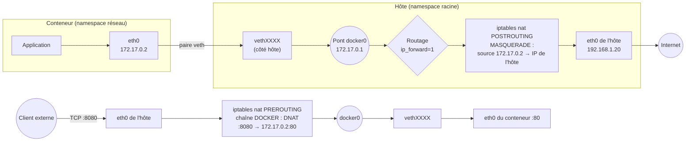

# Réseau et stockage dans Docker

## Pourquoi ce cours ?

Deux familles de pannes dominent dès qu'on déploie plusieurs conteneurs : « mon service A ne joint pas mon service B » (réseau) et
« j'ai perdu mes données en recréant le conteneur » (stockage). Les deux se comprennent à partir de ce que vous savez déjà :
le réseau d'un conteneur est un **namespace réseau relié à un pont par une paire `veth`**, publié par des règles **DNAT** ; ses données
persistantes sont **hors de la couche inscriptible**. Ce cours relie ces mécanismes aux commandes Docker.

> Prérequis : [routage et NAT](../../06-reseaux-devops/cours/03-routage-et-nat.md) et [DNS](../../06-reseaux-devops/cours/01-dns-fondamentaux.md) (module 06) ; [images et couches](02-images-et-couches.md).

## 1. Les drivers réseau

| Driver | Principe | Isolation | Usage typique |
|---|---|---|---|
| **bridge** (défaut) | Pont Linux + une paire `veth` par conteneur, NAT vers l'extérieur | Entre réseaux bridge différents | Applications sur **un seul hôte** |
| **host** | Le conteneur **partage** le namespace réseau de l'hôte (aucun NAT) | Aucune au niveau réseau | Performances maximales, outils réseau ; **les ports de l'hôte sont utilisés directement** |
| **none** | Seulement l'interface `lo` | Totale | Traitements isolés, sécurité |
| **overlay** | Réseau **VXLAN** entre **plusieurs hôtes** (Swarm) | Par réseau | Clusters Swarm (en pratique Kubernetes utilise un CNI) |
| **macvlan** | Le conteneur reçoit **sa propre adresse MAC et IP** sur le réseau physique | Aucune (visible comme une machine) | Applications qui exigent une IP du LAN (legacy) |
| **ipvlan** | Comme macvlan mais **partage la MAC** de l'hôte (L2 ou L3) | Selon le mode | Commutateurs qui limitent le nombre de MAC |

```bash
docker network ls
docker network inspect bridge | head -30
docker run --rm --network host alpine ip -br a        # voit les interfaces de l'hôte
docker run --rm --network none alpine ip -br a        # seulement lo
```

### Le réseau bridge par défaut ... et ses limites

Le réseau nommé `bridge` (pont `docker0`, `172.17.0.0/16`) fonctionne, mais :

- **pas de résolution DNS par nom** entre conteneurs (seulement par IP, qui change) ;
- tous les conteneurs « sans réseau précisé » y sont ensemble (peu d'isolation).

> 📌 **À retenir** : **créez toujours vos propres réseaux bridge** (`docker network create`) : ils apportent le **DNS interne** et l'isolation. Compose le fait automatiquement.

## 2. Réseaux personnalisés et DNS interne

```bash
docker network create --driver bridge --subnet 10.50.0.0/24 reseau-app
docker run -d --name db  --network reseau-app redis:7-alpine
docker run -d --name api --network reseau-app --network-alias backend alpine sleep 3600
docker exec api ping -c 2 db                # résolu par NOM
docker exec api ping -c 2 backend           # l'alias de api lui-même : visible des AUTRES conteneurs du réseau
docker exec api cat /etc/resolv.conf        # nameserver 127.0.0.11
docker exec api nslookup db 127.0.0.11
```

Le DNS interne fonctionne ainsi :

- Chaque conteneur d'un réseau **utilisateur** reçoit dans `/etc/resolv.conf` le serveur **`127.0.0.11`** : un **résolveur embarqué** dans le daemon, auquel Docker « branche » le namespace réseau du conteneur.
- Il répond aux noms de **conteneurs**, aux **alias** (`--network-alias`) et, avec Compose, aux **noms de services**.
- Pour tout le reste, il **relaie** vers les DNS de l'hôte (`--dns` pour forcer d'autres serveurs).
- Un conteneur sur **plusieurs réseaux** (`docker network connect`) est joignable sur chacun ; plusieurs conteneurs avec le **même alias** reçoivent un DNS **round-robin** simple.

```bash
docker network create reseau-front
docker network connect reseau-front api          # api est maintenant sur deux réseaux
docker inspect -f '{{json .NetworkSettings.Networks}}' api | python3 -m json.tool | grep -E '"IPAddress|Aliases'
docker network disconnect reseau-front api
```

> 💡 **Conseil** : pour isoler les couches d'une application, créez un réseau par segment (`front`, `back`) et ne connectez le conteneur *proxy* qu'aux deux ; la base ne rejoint que `back`. Voir [Compose](05-docker-compose.md).

### Ce qui se passe sous le capot

```bash
ip -br link | grep -E "docker0|br-|veth"                  # le pont et une veth par conteneur
bridge link                                               # veth rattachées au pont
docker exec api ip -br a                                  # eth0@ifXX : l'extrémité côté conteneur
docker exec api ip route                                  # default via 10.50.0.1 (le pont)
sudo ip netns list                                        # (les netns Docker sont dans /var/run/docker/netns)
```

## 3. Publication de ports : `-p` et DNAT

`EXPOSE 80` dans un Dockerfile est **purement documentaire** : il n'ouvre rien. C'est **`-p`** (ou `ports:` dans Compose) qui **publie** un port de l'hôte vers le conteneur, en créant :

1. une règle **DNAT** dans `iptables` (table `nat`, chaîne `DOCKER`) : `hôte:8080 → 172.17.0.2:80` ;
2. une règle d'autorisation dans la chaîne `FORWARD` (`DOCKER`) ;
3. un petit processus **`docker-proxy`** (proxy en espace utilisateur) pour les connexions locales (`localhost`) et le *hairpin*.

| Option | Effet |
|---|---|
| `-p 8080:80` | Hôte **toutes interfaces** `0.0.0.0:8080` → conteneur `:80` |
| `-p 127.0.0.1:8080:80` | **Local seulement** (recommandé pour une base de données ou un outil d'admin) |
| `-p 80` | Port d'hôte **aléatoire** (`docker port nom`) |
| `-p 8080:80/udp` | UDP |
| `-P` | Publie **tous** les ports `EXPOSE`s sur des ports aléatoires |

```bash
docker run -d --name web -p 8080:80 nginx:1.27
docker port web                                           # 80/tcp -> 0.0.0.0:8080
sudo iptables -t nat -S DOCKER | grep 8080                # -A DOCKER ! -i docker0 -p tcp --dport 8080 -j DNAT --to-destination 172.17.0.2:80
sudo iptables -S DOCKER | grep 172.17.0.2                 # règle FORWARD
ss -tlnp | grep 8080                                      # docker-proxy
```

### Le trajet d'un paquet



- **Sortie** (haut) : le paquet quitte le conteneur par `eth0 → veth → docker0`, est routé puis **masqueradé** (SNAT dynamique) à la sortie de l'hôte.
- **Entrée** (bas) : le paquet arrive sur l'hôte, **DNAT** (PREROUTING) réécrit la destination vers le conteneur **avant** la décision de routage.

> ⚠️ **Attention** : Docker **contourne `ufw`** (ses règles PREROUTING/FORWARD passent avant l'INPUT d'`ufw`) : `-p 8080:80` rend le port joignable **même si `ufw` le bloque**. Publiez sur `127.0.0.1`, ou filtrez dans la chaîne **`DOCKER-USER`** (réservée à vos règles). Voir le [cours 06](06-securite-et-bonnes-pratiques.md).

## 4. Le stockage : volumes, bind mounts, tmpfs

La couche inscriptible d'un conteneur est **éphémère** et **lente** (copy-on-write). Pour persister ou partager des données, on **monte** un stockage externe.

| Type | Syntaxe | Emplacement | Géré par | Usage |
|---|---|---|---|---|
| **Volume nommé** | `-v donnees:/var/lib/data` ou `--mount type=volume,src=donnees,dst=…` | `/var/lib/docker/volumes/donnees/_data` | **Docker** | Bases de données, données applicatives (**le défaut recommandé**) |
| **Bind mount** | `-v /chemin/hôte:/chemin/conteneur` | Un dossier **de l'hôte** de votre choix | Vous | Code source en développement, fichiers de configuration |
| **tmpfs** | `--tmpfs /tmp` ou `--mount type=tmpfs,dst=/tmp` | **Mémoire vive** de l'hôte | Noyau | Secrets temporaires, fichiers jetables, racine en lecture seule |

```bash
docker volume create donnees
docker run -d --name pg -v donnees:/var/lib/postgresql/data -e POSTGRES_PASSWORD=secret postgres:16
docker volume ls
docker volume inspect donnees                       # Mountpoint
sudo ls /var/lib/docker/volumes/donnees/_data | head
docker run --rm -v "$PWD":/work -w /work alpine ls   # bind mount du dossier courant
docker run --rm --tmpfs /tmp:rw,size=64m alpine df -h /tmp
```

`--mount` est plus explicite et **plus strict** que `-v` : avec un bind mount, `-v` **crée** silencieusement un dossier inexistant, `--mount` **échoue**.

### Cycle de vie : volume nommé ou bind mount ?

```mermaid
flowchart TB
    subgraph VOL["Volume nommé"]
        V1["docker volume create donnees<br/>(ou création implicite par -v)"] --> V2["Monté dans le conteneur<br/>-v donnees:/data"]
        V2 --> V3["docker rm -f conteneur<br/>→ le volume SURVIT"]
        V3 --> V4["Réutilisé par un nouveau conteneur"]
        V4 --> V5["docker volume rm donnees<br/>(ou docker system prune --volumes)<br/>→ données supprimées"]
    end
    subgraph BIND["Bind mount"]
        B1["Dossier existant sur l'hôte<br/>/srv/app/data"] --> B2["Monté dans le conteneur<br/>-v /srv/app/data:/data"]
        B2 --> B3["docker rm -f conteneur<br/>→ le dossier de l'hôte est INTACT"]
        B3 --> B4["Données gérées par vous :<br/>sauvegarde, droits, SELinux, chemin"]
    end
    subgraph TMP["Couche inscriptible / tmpfs"]
        T1["Écriture dans le conteneur<br/>ou --tmpfs"] --> T2["docker rm<br/>→ données PERDUES"]
    end
```



| | Volume nommé | Bind mount | Couche inscriptible |
|---|---|---|---|
| Survit à `docker rm` | ✅ | ✅ (dossier de l'hôte) | ❌ |
| Portable (même commande partout) | ✅ | ❌ dépend du chemin hôte | — |
| Pré-rempli par le contenu de l'image | ✅ (si volume **vide**) | ❌ (masque le contenu du dossier cible) | — |
| Performances | Natives | Natives (lentes sur macOS/Windows) | Plus lentes (copy-on-write) |
| Pilotes distants (NFS, cloud) | ✅ | ❌ | ❌ |

> ⚠️ **Attention** : `docker compose down -v` et `docker system prune --volumes` **suppriment les volumes** donc vos données. Sauvegardez avant (section 6).

## 5. Permissions : UID et GID

Le noyau ne connaît que des **numéros** (UID/GID). Les fichiers d'un volume appartiennent à un UID numérique ; le conteneur et l'hôte peuvent associer des noms différents au même numéro.

```bash
docker run --rm -v donnees:/data alpine sh -c 'echo x > /data/a && ls -ln /data'      # propriétaire 0 (root)
docker run --rm -u 1000:1000 -v donnees:/data alpine touch /data/b                     # Permission denied
```

### Problèmes classiques

| Situation | Cause | Remède |
|---|---|---|
| **PostgreSQL** : `initdb: could not change permissions of directory` / `data directory has wrong ownership` | Le processus tourne sous l'UID **999** (`postgres`) mais le dossier monté appartient à un autre UID | Utiliser un **volume nommé** (Docker prépare les droits) ou `chown 999:999` du dossier d'hôte ; ne **pas** monter directement un dossier racine d'un système de fichiers (`lost+found`) |
| **Nginx** : `permission denied` sur `/var/cache/nginx`, ou fichiers statiques illisibles | Nginx (UID **101** dans l'image `nginx-unprivileged`, root puis `nginx` dans l'image classique) ; fichiers de l'hôte en `600` | Rendre les fichiers lisibles (`chmod -R a+rX`), ou utiliser `--user`, ou `:ro` avec les bons droits |
| **Bind mount de développement** : fichiers créés par le conteneur appartiennent à `root` sur l'hôte | Le conteneur tourne en root | `--user "$(id -u):$(id -g)"` ; en Compose `user: "${UID}:${GID}"` |
| **SELinux** (Fedora/RHEL) : `Permission denied` malgré de bons droits | Étiquettes de sécurité | Ajouter `:z` (partagé) ou `:Z` (privé) au bind mount |

```bash
docker run --rm -u "$(id -u):$(id -g)" -v "$PWD":/work -w /work alpine touch fichier   # appartient à votre utilisateur
ls -ln fichier
```

> 💡 **Conseil** : dans le Dockerfile, créez le dossier de données **avant** `USER` et donnez-le à l'utilisateur d'exécution (`RUN mkdir /data && chown 10001 /data`) : un **volume nommé vide** hérite alors de ces droits au premier montage.

L'option **`userns-remap`** (cours 06) décale les UID du conteneur (root du conteneur → UID élevé de l'hôte), ce qui complique les bind mounts : les droits doivent correspondre aux UID **décalés**.

## 6. Sauvegarde et restauration d'un volume

Un volume n'est qu'un dossier : on le sauvegarde avec un **conteneur éphémère** qui monte à la fois le volume et un dossier de l'hôte.

```bash
# Sauvegarde : volume « donnees » → archive ./sauvegarde-donnees.tgz
docker run --rm \
  -v donnees:/source:ro \
  -v "$PWD":/backup \
  alpine tar czf /backup/sauvegarde-donnees.tgz -C /source .

# Restauration dans un volume (neuf ou existant)
docker volume create donnees-restauree
docker run --rm \
  -v donnees-restauree:/cible \
  -v "$PWD":/backup:ro \
  alpine tar xzf /backup/sauvegarde-donnees.tgz -C /cible

docker run --rm -v donnees-restauree:/data alpine ls -la /data      # vérification
```

Copie de volume à volume :

```bash
docker run --rm -v ancien:/from:ro -v nouveau:/to alpine sh -c 'cp -a /from/. /to/'
```

> ⚠️ **Attention** : pour une **base de données**, ne copiez pas les fichiers pendant qu'elle écrit (risque de sauvegarde incohérente) : utilisez l'outil du moteur (`docker exec pg pg_dump -U postgres app > app.sql`, `mysqldump`, `redis-cli --rdb`) ou arrêtez le conteneur avant la copie. Appliquez la règle **3-2-1** et **testez la restauration**.

## 7. Récapitulatif réseau et stockage

```bash
docker network ls · docker network inspect · docker network create/connect/disconnect/rm
docker volume ls · inspect · create · rm · prune
docker system df -v                         # espace occupé
docker inspect -f '{{json .Mounts}}' conteneur
```

## Résumé

- Réseaux : **bridge** (défaut), **host**, **none**, **overlay** (multi-hôtes), **macvlan/ipvlan** (IP du LAN). Préférez un **bridge personnalisé** : **DNS interne** (`127.0.0.11`), alias, isolation.
- `EXPOSE` documente ; **`-p`** crée une règle **DNAT** (+ `FORWARD`, `docker-proxy`). Publiez sur `127.0.0.1` ce qui n'est pas public : **Docker contourne ufw** (`DOCKER-USER`).
- Trajet : `eth0 → veth → docker0 → routage → MASQUERADE` en sortie ; **DNAT** en entrée.
- Stockage : **volume nommé** (géré, persistant, portable) ; **bind mount** (dossier de l'hôte) ; **tmpfs** (mémoire). La couche inscriptible est **éphémère**.
- Droits : le noyau ne voit que des **UID/GID** ; Postgres (UID 999), `--user`, `:z`/`:Z` (SELinux).
- Sauvegarde : **conteneur éphémère + `tar`** ; outils natifs (`pg_dump`) pour les bases.

## Pour aller plus loin

- Documentation réseau : <https://docs.docker.com/engine/network/> ; stockage : <https://docs.docker.com/engine/storage/>.
- Pilotes de volumes (NFS, cloud), `docker network create -d macvlan`, IPv6 (`--ipv6`), `iptables: false` dans `daemon.json`.
- Équivalent Kubernetes : [Services et réseau](../../09-kubernetes-approfondi/cours/03-services-et-reseau-kubernetes.md) et [stockage persistant](../../09-kubernetes-approfondi/cours/04-stockage-persistance.md).
- Cours suivant : [Docker Compose](05-docker-compose.md).
- Atelier associé : [Compose et réseau](../ateliers-killercoda/atelier-03-compose-reseau/intro.md).
