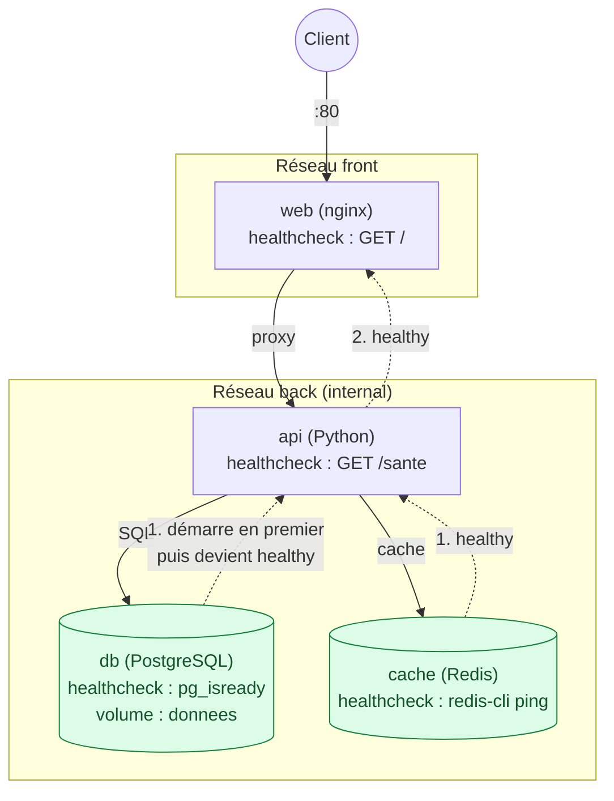

# Docker Compose

## Pourquoi ce cours ?

Une application réelle, ce sont **plusieurs conteneurs** : un serveur web, une API, une base de données, un cache. Les lancer à la main
avec une dizaine de `docker run` aux options interminables est fragile et non reproductible. **Docker Compose** décrit toute la pile dans
**un fichier YAML versionné** et la pilote avec une commande. Ce cours va au-delà du `compose.yaml` minimal :
ordonnancement correct du démarrage, profils, factorisation, surcharge par environnement, et limites qui motivent Kubernetes.

> Prérequis : [réseau et stockage Docker](04-reseau-et-stockage-docker.md) (réseaux utilisateur, volumes), [Dockerfile avancé](03-dockerfile-avance.md) (`HEALTHCHECK`).

## 1. Pourquoi Compose ?

| Sans Compose | Avec Compose |
|---|---|
| `docker network create`, `docker volume create`, 4 × `docker run -d --name … -e … -v … --network …` | `docker compose up -d` |
| Documentation dans un wiki, souvent périmée | **Le fichier est la documentation** (et il est versionné dans Git) |
| Ordre de démarrage manuel | Dépendances déclarées |
| Environnement différent d'un poste à l'autre | Reproductible : `git clone` puis `up` |

Compose est idéal pour : le **développement local**, les **tests d'intégration en CI**, les petites applications sur **une seule machine**.

## 2. Structure d'un fichier Compose

Le fichier s'appelle `compose.yaml` (ou `docker-compose.yml`, toujours accepté). Le champ `version:` est **obsolète** : ne l'écrivez plus.

```yaml
name: boutique                         # nom du projet (préfixe des réseaux, volumes, conteneurs)

services:                              # les conteneurs
  api:
    build: ./api                       # ou image: registre/api:1.4.2
    environment:
      DB_HOST: db
    networks: [back, front]
    depends_on:
      db:
        condition: service_healthy
    restart: unless-stopped

  db:
    image: postgres:16
    volumes:
      - donnees:/var/lib/postgresql/data
    networks: [back]

networks:                              # réseaux personnalisés
  front:
  back:
    internal: true                     # pas d'accès à l'extérieur

volumes:                               # volumes nommés
  donnees:

configs:                               # fichiers de configuration montés (lecture seule)
  nginx_conf:
    file: ./nginx.conf

secrets:                               # valeurs sensibles montées sous /run/secrets/
  db_password:
    file: ./secrets/db_password.txt
```

| Section | Rôle |
|---|---|
| `services` | Un service = une définition de conteneur (image ou build, ports, variables, volumes, réseaux, santé…) |
| `networks` | Réseaux bridge personnalisés. **Si omis**, Compose crée un réseau `<projet>_default` partagé par tous les services avec **DNS par nom de service** |
| `volumes` | Volumes nommés, persistants, déclarés une seule fois |
| `configs` | Fichiers de configuration non sensibles (montés en lecture seule) |
| `secrets` | Données sensibles : montées dans `/run/secrets/<nom>` (en mémoire), non visibles dans `docker inspect` |

### Services : les clés les plus utilisées

```yaml
services:
  web:
    image: nginx:1.27
    container_name: web                 # facultatif ; évitez-le (empêche la mise à l'échelle)
    ports: ["8080:80", "127.0.0.1:9090:9090"]
    expose: ["8000"]                    # documentaire entre services (inutile en pratique)
    environment: { MODE: prod }         # ou liste ["MODE=prod"]
    env_file: [.env.web]
    volumes:
      - ./site:/usr/share/nginx/html:ro
      - cache:/var/cache/nginx
    configs: [nginx_conf]
    secrets: [db_password]
    command: ["nginx", "-g", "daemon off;"]
    user: "10001:10001"
    read_only: true
    tmpfs: [/tmp]
    cap_drop: [ALL]
    init: true
    deploy:
      resources:
        limits: { cpus: "0.50", memory: 256M }
    healthcheck:
      test: ["CMD", "wget", "-qO-", "http://localhost/"]
      interval: 10s
      timeout: 3s
      retries: 5
      start_period: 10s
    restart: unless-stopped
    networks: [front]
```

## 3. `depends_on` ne suffit pas : attendre que le service soit *prêt*

`depends_on: [db]` garantit seulement que le **conteneur** `db` est **démarré** (processus lancé) : pas que **PostgreSQL accepte des connexions**. L'initialisation d'une base peut prendre plusieurs secondes : l'API démarre, échoue à se connecter, et plante.

```yaml
services:
  db:
    image: postgres:16
    environment:
      POSTGRES_PASSWORD: secret
    healthcheck:
      test: ["CMD-SHELL", "pg_isready -U postgres"]
      interval: 5s
      timeout: 3s
      retries: 10
      start_period: 10s

  api:
    build: ./api
    depends_on:
      db:
        condition: service_healthy      # attend que le healthcheck de db réussisse
      cache:
        condition: service_started      # (défaut) simplement démarré
      migration:
        condition: service_completed_successfully   # attend qu'un job ponctuel se termine avec succès
```

| `condition` | Attend que… |
|---|---|
| `service_started` | Le conteneur soit démarré (défaut) |
| `service_healthy` | Son `healthcheck` soit au vert |
| `service_completed_successfully` | Il se termine avec le code 0 (migrations, initialisation) |

> 📌 **À retenir** : `depends_on` **seul** ne garantit **jamais** la disponibilité. Associez-le à un **`healthcheck`** et `condition: service_healthy`. Et rendez de toute façon votre application **tolérante** (reconnexion avec attente croissante) : en production, une base peut redémarrer à tout moment.

### Exemple : pile 3 tiers



Ordre de démarrage : (1) `db` et `cache` en parallèle → attendent d'être **healthy** ; (2) `api` démarre, devient **healthy** ; (3) `web` démarre en dernier.

## 4. Profils, extensions et DRY

### Profils : des services optionnels

Un service avec `profiles:` **n'est pas démarré** par défaut ; on l'active à la demande.

```yaml
services:
  api: { build: ./api }
  db:  { image: postgres:16 }
  adminer:
    image: adminer
    profiles: [debug]
    ports: ["8081:8080"]
  tests:
    build: ./api
    command: pytest
    profiles: [test]
```

```bash
docker compose up -d                          # api + db seulement
docker compose --profile debug up -d          # + adminer
docker compose --profile test run --rm tests  # lance les tests, puis supprime le conteneur
COMPOSE_PROFILES=debug,test docker compose up -d
```

### Extensions `x-*` et ancres YAML : ne pas se répéter

Toute clé commençant par `x-` est **ignorée** par Compose : on y range des blocs réutilisables avec les **ancres** YAML (`&nom`, `*nom`, `<<:`).

```yaml
x-common: &common
  restart: unless-stopped
  init: true
  read_only: true
  cap_drop: [ALL]
  security_opt: ["no-new-privileges:true"]
  logging:
    driver: local
    options: { max-size: "10m", max-file: "3" }

x-healthcheck-http: &hc-http
  interval: 10s
  timeout: 3s
  retries: 5

services:
  api:
    <<: *common                      # fusion des clés communes
    image: kamer/api:1.4.2
    tmpfs: [/tmp]
    healthcheck:
      <<: *hc-http
      test: ["CMD", "wget", "-qO-", "http://localhost:8000/sante"]
  worker:
    <<: *common
    image: kamer/worker:1.4.2
    tmpfs: [/tmp]
```

## 5. Interpolation, `.env` et surcharge

### Variables

```yaml
services:
  api:
    image: kamer/api:${API_TAG:-latest}       # valeur par défaut si la variable est vide ou absente
    environment:
      DB_PASSWORD: ${DB_PASSWORD:?mot de passe obligatoire}    # erreur si absente
      ENV: ${ENVIRONNEMENT-dev}                                  # défaut seulement si NON DÉFINIE
```

| Syntaxe | Sens |
|---|---|
| `${VAR}` | Valeur de `VAR` (chaîne vide si absente, avec avertissement) |
| `${VAR:-défaut}` | `défaut` si `VAR` est **absente ou vide** |
| `${VAR-défaut}` | `défaut` si `VAR` est **absente** |
| `${VAR:?message}` | **Erreur** avec `message` si `VAR` absente ou vide |
| `$$` | Un `$` littéral |

Sources, par ordre de priorité décroissante : **variables de l'environnement du shell** > fichier `--env-file` > fichier **`.env`** (lu automatiquement à côté de `compose.yaml`) > valeurs par défaut du fichier.

```bash
cat > .env <<'EOF'
API_TAG=1.4.2
DB_PASSWORD=changeme
EOF
docker compose config                         # affiche le fichier FINAL, interpolé et validé
API_TAG=1.5.0 docker compose config | grep image    # le shell prime sur .env
```

> ⚠️ **Attention** : **ne commitez pas `.env`** (ajoutez-le à `.gitignore`) ; commitez un `.env.example` sans valeur sensible. Pour les vrais secrets, préférez la section `secrets:`.

### Surcharge : un fichier de base, des variantes

Compose fusionne **`compose.yaml` puis `compose.override.yaml`** automatiquement (ou `docker-compose.override.yml`) : idéal pour le développement.

```yaml
# compose.yaml : socle commun
services:
  api:
    image: kamer/api:${API_TAG:-1.0}
    restart: unless-stopped
```

```yaml
# compose.override.yaml : chargé AUTOMATIQUEMENT en local
services:
  api:
    build: ./api
    volumes: ["./api:/app"]
    ports: ["8000:8000"]
    environment: { DEBUG: "1" }
```

```yaml
# compose.prod.yaml : explicite
services:
  api:
    environment: { DEBUG: "0" }
    deploy: { resources: { limits: { memory: 512M } } }
```

```bash
docker compose up -d                                       # compose.yaml + compose.override.yaml
docker compose -f compose.yaml -f compose.prod.yaml up -d  # sélection explicite : l'override n'est PAS lu
docker compose -f compose.yaml -f compose.prod.yaml config # voir le résultat de la fusion
```

Règles de fusion : les **valeurs simples** du dernier fichier remplacent ; les **maps** (`environment`, `labels`) sont fusionnées clé par clé ; les **listes** (`ports`, `volumes`) sont **concaténées**. Pour inclure d'autres fichiers : `include:`.

## 6. Commandes essentielles

```bash
docker compose up -d                  # crée et démarre (réseaux, volumes, conteneurs) en arrière-plan
docker compose up -d --build          # reconstruit les images avant
docker compose up -d --scale api=3    # 3 instances (pas de container_name ni de port hôte fixe !)
docker compose ps                     # état des services, ports, santé
docker compose ps -a
docker compose logs -f api            # journaux suivis (--tail 50, --since 10m)
docker compose exec api sh            # shell dans un conteneur EN COURS
docker compose run --rm api pytest    # conteneur ÉPHÉMÈRE pour une commande ponctuelle
docker compose config                 # fichier final validé et interpolé (ajoutez -q pour valider seulement)
docker compose config --services
docker compose stop / start / restart [service]
docker compose pull                   # met à jour les images
docker compose build --no-cache api
docker compose top
docker compose events
docker compose down                   # arrête et SUPPRIME conteneurs et réseaux (les volumes sont conservés)
docker compose down -v                # ... et supprime aussi les volumes ⚠️
docker compose down --remove-orphans  # supprime les conteneurs de services retirés du fichier
docker compose cp api:/app/log.txt .  # copie depuis/vers un conteneur
docker compose watch                  # reconstruit/synchronise à chaud (section develop: watch)
```

> 💡 **Conseil** : Compose v2 est un **plugin** : la commande est `docker compose` (avec un espace). L'ancien `docker-compose` (avec tiret, Python) n'est plus maintenu.

Le nom du **projet** préfixe tout : réseau `boutique_default`, volume `boutique_donnees`, conteneur `boutique-api-1`. Changez-le avec `name:` ou `-p`/`COMPOSE_PROJECT_NAME` pour faire cohabiter plusieurs instances.

## 7. Limites de Compose et passage à Kubernetes

Compose est excellent sur **une machine**. Il ne répond pas aux besoins d'une production à l'échelle :

| Besoin | Compose | Kubernetes |
|---|---|---|
| **Plusieurs machines** | ❌ Une seule (Swarm : autre outil) | ✅ Cluster de nœuds |
| **Auto-réparation** | `restart:` redémarre un conteneur, mais pas si la machine tombe | ✅ Les pods sont replanifiés sur un autre nœud |
| **Mise à l'échelle** | `--scale` manuel, sur la même machine | ✅ `replicas`, **HPA** (automatique selon la charge) |
| **Mises à jour sans coupure** | `up -d` recrée les conteneurs (courte coupure) | ✅ **RollingUpdate** + sondes de disponibilité + rollback |
| **Découverte et équilibrage** | DNS interne simple (round-robin) | ✅ **Services**, Ingress, EndpointSlices |
| **Stockage** | Volumes locaux | ✅ PV/PVC, StorageClass, provisionnement dynamique |
| **Secrets / configuration** | Fichiers, variables | ✅ ConfigMaps, Secrets, intégrations Vault |
| **Sécurité multi-équipes** | ❌ | ✅ RBAC, NetworkPolicies, quotas, Pod Security |
| **Planification** | Aucune | ✅ Scheduler : ressources, affinités, taints |

Correspondance des concepts :

| Compose | Kubernetes |
|---|---|
| `services:` | **Deployment** (+ **Service**) |
| `image:` / `build:` | `image:` dans la spec du conteneur (le build se fait en CI) |
| `ports:` | **Service** (NodePort, LoadBalancer) / **Ingress** |
| `volumes:` (nommé) | **PersistentVolumeClaim** |
| `configs:` / `environment:` | **ConfigMap** |
| `secrets:` | **Secret** |
| `healthcheck:` | **livenessProbe / readinessProbe** |
| `depends_on` + `healthy` | **initContainers** + `readinessProbe` |
| `restart: unless-stopped` | `restartPolicy` + contrôleurs |
| `networks:` | **NetworkPolicy** (réseau plat par défaut) |
| `deploy.resources` | `resources.requests / limits` |

Outils de transition : **Kompose** (`kompose convert -f compose.yaml`) génère des manifestes Kubernetes de départ (à revoir). Voir le [module 09](../../09-kubernetes-approfondi/README.md).

## Résumé

- Compose décrit une pile multi-conteneurs dans un **fichier versionné** : `services`, `networks`, `volumes`, `configs`, `secrets`.
- **`depends_on` ne garantit pas la disponibilité** : combinez **`healthcheck`** et **`condition: service_healthy`** (ou `service_completed_successfully`).
- **Profils** pour les services optionnels, **`x-*` + ancres** pour factoriser.
- Interpolation `${VAR:-défaut}` / `${VAR:?erreur}`, `.env` (non commité), **`compose.override.yaml`** et `-f` pour varier par environnement ; `docker compose config` montre le résultat final.
- Commandes : `up -d`, `ps`, `logs -f`, `exec`, `run --rm`, `config`, `down` (**`-v` supprime les données**).
- Compose = **une machine** ; Kubernetes ajoute multi-nœuds, auto-réparation, mises à jour progressives, mise à l'échelle automatique et sécurité fine.

## Pour aller plus loin

- Spécification Compose : <https://docs.docker.com/reference/compose-file/>.
- `docker compose watch` (rechargement à chaud), `include:`, `extends:`, Compose en CI (tests d'intégration), `docker stack` (Swarm).
- Conversion vers Kubernetes : `kompose` (les formats diffèrent : relisez toujours le résultat).
- Cours suivant : [Sécurité et bonnes pratiques](06-securite-et-bonnes-pratiques.md).
- Atelier associé : [Compose et réseau](../ateliers-killercoda/atelier-03-compose-reseau/intro.md).
- Transition : [Kubernetes, architecture et composants](../../09-kubernetes-approfondi/cours/01-architecture-et-composants.md).
