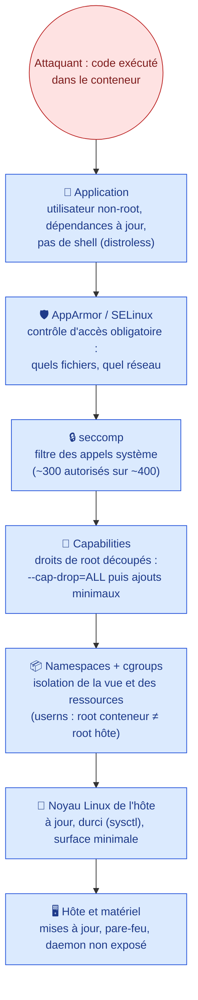

# Sécurité des conteneurs et bonnes pratiques

## Pourquoi ce cours ?

On entend souvent « c'est dans un conteneur, donc c'est isolé ». C'est **faux** : un conteneur est un processus Linux sur le **même noyau** que l'hôte
et que les autres conteneurs. Une configuration par défaut est un compromis entre sécurité et commodité ; en production, il faut la **durcir**.
Ce cours présente le modèle de menace, puis les mécanismes du noyau à votre disposition (capabilities, seccomp, AppArmor, utilisateurs, système de fichiers en lecture seule),
la gestion des secrets, la chaîne d'approvisionnement (scan, signature) et les référentiels de contrôle.

> Prérequis : [permissions](../../01-linux-fondamentaux/cours/04-utilisateurs-permissions.md), [durcissement Linux](../../03-linux-avance/cours/04-securite-durcissement.md), [namespaces et capabilities](../../04-linux-expert/cours/02-conteneurs-namespaces.md).

## 1. Modèle de menace : le conteneur n'est PAS une frontière forte

| | **Machine virtuelle** | **Conteneur** |
|---|---|---|
| Noyau | Un **par VM** (l'attaquant doit s'échapper de l'hyperviseur, surface réduite) | **Partagé** avec l'hôte (surface = tous les appels système) |
| Frontière | Matérielle (virtualisation) | Logicielle (namespaces, cgroups, filtres) |
| Évasion | Rare (failles d'hyperviseur) | Plus fréquente : faille du noyau, configuration trop permissive (`--privileged`, socket Docker, montages sensibles) |

Scénarios d'attaque à garder en tête :

1. **Application compromise** (injection de code) → l'attaquant exécute des commandes **dans** le conteneur.
2. **Évasion** vers l'hôte : noyau vulnérable, `--privileged`, `/var/run/docker.sock` monté, `CAP_SYS_ADMIN`, montage de `/` ou de `/proc`.
3. **Déplacement latéral** : vers les autres conteneurs (réseau plat), la base de données, les métadonnées du cloud (`169.254.169.254`).
4. **Chaîne d'approvisionnement** : image de base ou dépendance malveillante/vulnérable.
5. **Fuite de secrets** : mot de passe dans une couche d'image, une variable d'environnement, un dépôt Git.
6. **Déni de service** : conteneur sans limites qui épuise la mémoire/CPU de l'hôte, *fork bomb*.

> 📌 **À retenir** : la sécurité des conteneurs, c'est de la **défense en profondeur** : on suppose que l'application **sera** compromise et l'on limite **ce que l'attaquant pourra faire ensuite**.

### Les couches de défense



Chaque couche **réduit** la portée d'une compromission de la couche supérieure. Aucune n'est suffisante seule.

## 2. Capabilities Linux : découper les pouvoirs de root

Historiquement, « root » (UID 0) avait **tous** les droits. Linux les a découpés en environ 40 **capabilities** (`man 7 capabilities`) : `CAP_NET_BIND_SERVICE` (ports < 1024), `CAP_CHOWN`, `CAP_NET_RAW` (ping, paquets bruts), `CAP_SYS_ADMIN` (le « nouveau root » : mount, namespaces…), `CAP_SYS_PTRACE`, etc.

Par défaut, Docker accorde **14 capabilities** à un conteneur (même en root) : `CHOWN, DAC_OVERRIDE, FSETID, FOWNER, MKNOD, NET_RAW, SETGID, SETUID, SETFCAP, SETPCAP, NET_BIND_SERVICE, SYS_CHROOT, KILL, AUDIT_WRITE`. Docker **n'accorde pas** `SYS_ADMIN`, `NET_ADMIN`, `SYS_PTRACE` ni `SYS_MODULE` : ce sont les plus dangereuses.

Principe du **moindre privilège** : **tout retirer, puis ajouter le strict nécessaire**.

```bash
docker run --rm alpine sh -c 'apk add -q libcap >/dev/null; capsh --print | grep Current'
docker run --rm --cap-drop=ALL alpine sh -c 'chown nobody /tmp 2>&1 | head -1'        # Operation not permitted
docker run -d --name web --cap-drop=ALL --cap-add=NET_BIND_SERVICE -p 8080:80 nginx:1.27   # nginx classique exige aussi CHOWN, SETUID, SETGID…
docker run --rm --cap-drop=ALL --cap-add=CHOWN alpine chown nobody /tmp && echo "autorisé"
grep Cap /proc/self/status                           # masques de capabilities d'un processus
docker run --rm alpine grep CapEff /proc/self/status
```

> 💡 **Conseil** : procédez par essai : `--cap-drop=ALL`, regardez l'erreur (`Operation not permitted`), ajoutez la capability qui manque. Préférez **une application qui n'a pas besoin de privilèges** : écouter sur 8080 plutôt que 80 supprime `NET_BIND_SERVICE`.

À proscrire :

- `--privileged` : **toutes** les capabilities, accès à tous les périphériques, seccomp et AppArmor désactivés. C'est **équivalent à root sur l'hôte**.
- `--cap-add=SYS_ADMIN` : presque aussi dangereux.
- `--pid=host`, `--net=host`, `--ipc=host` sans nécessité.
- `-v /var/run/docker.sock:/var/run/docker.sock` : contrôle total du daemon, donc de l'hôte.
- `-v /:/hote` ou montages de `/proc`, `/sys`, `/etc`.

## 3. Seccomp, AppArmor et SELinux

### seccomp : filtrer les appels système

**seccomp-bpf** limite les **appels système** (`syscalls`) qu'un processus peut faire. Docker applique par défaut un **profil** qui **bloque une cinquantaine** d'appels dangereux ou inutiles aux conteneurs (`reboot`, `kexec_load`, `mount` hors cas permis, `init_module`, `bpf`, `ptrace` restreint, `keyctl`…).

```bash
docker info | grep -i seccomp                                 # builtin profile
docker run --rm --security-opt seccomp=unconfined alpine …    # DÉSACTIVE le filtre (à éviter)
docker run --rm --security-opt seccomp=./mon-profil.json alpine …   # profil personnalisé (liste blanche)
docker run --rm alpine sh -c 'grep Seccomp /proc/self/status'       # Seccomp: 2 (filtre actif)
```

Un profil personnalisé en **liste blanche** (`"defaultAction": "SCMP_ACT_ERRNO"` + les `syscalls` autorisés) est la forme la plus stricte ; on le construit en **traçant** l'application (`strace -c`, outils d'*audit seccomp*). Kubernetes : `securityContext.seccompProfile.type: RuntimeDefault`.

### AppArmor (Ubuntu) et SELinux (RHEL/Fedora)

Ce sont des **contrôles d'accès obligatoires** (MAC) : même un processus **root du conteneur** ne peut pas dépasser ce que la politique autorise (fichiers, réseau, capacités).

```bash
sudo aa-status | head -8                                      # profils chargés : « docker-default »
docker inspect -f '{{.AppArmorProfile}}' web                 # docker-default
docker run --rm --security-opt apparmor=docker-default alpine cat /proc/self/attr/current
docker run --rm --security-opt apparmor=unconfined alpine …  # désactive (à éviter)
# SELinux : docker run --security-opt label=type:container_t …   ·  bind mounts : :z / :Z
```

Le profil `docker-default` interdit notamment l'écriture dans `/proc/sys`, `/sys`, le montage de systèmes de fichiers et l'accès aux fichiers du noyau.

> ⚠️ **Attention** : désactiver seccomp/AppArmor « pour que ça marche » est une **dette de sécurité**. Cherchez plutôt **quel appel/accès** est refusé (`dmesg | grep -i apparmor`, `journalctl -k`) et autorisez-le précisément.

## 4. Utilisateurs : root, rootless et userns-remap

Par défaut, **root dans le conteneur = UID 0 sur l'hôte** (même si ses pouvoirs sont limités par les capabilities). En cas d'évasion, l'attaquant est root sur l'hôte.

| Mesure | Principe | Limite |
|---|---|---|
| **`USER` non-root dans l'image** | L'application n'est pas root dans le conteneur | À faire **toujours** (UID numérique) |
| **`--user 10001:10001`** | Imposé à l'exécution | |
| **`userns-remap`** | Les UID du conteneur sont **décalés** : root conteneur (0) → UID **100000+** sur l'hôte, sans privilège | Volumes et bind mounts : droits à adapter |
| **Mode rootless** | **Le daemon lui-même** et les conteneurs tournent **sans root** (`rootlesskit`, user namespace) | Quelques limites (ports < 1024, certains pilotes réseau/stockage) |
| **Podman** | Sans daemon ; rootless natif | Outil différent |

```bash
# userns-remap : /etc/docker/daemon.json
#   { "userns-remap": "default" }      puis : sudo systemctl restart docker
docker run --rm alpine id                    # uid=0(root) dans le conteneur
ps -o user,pid,cmd -C sleep                  # mais l'hôte le voit sous un UID de plage subordonnée (ex. 165536)

# Docker rootless
sudo apt install -y uidmap docker-ce-rootless-extras
dockerd-rootless-setuptool.sh install
export DOCKER_HOST=unix://$XDG_RUNTIME_DIR/docker.sock
docker info | grep -i rootless
```

> 📌 **À retenir** : **ne jamais exécuter l'application en root**. Si l'on ne peut pas toucher à l'image, `--user` et le mode **rootless** réduisent la casse d'une évasion.

## 5. Système de fichiers en lecture seule

La plupart des applications n'ont **pas besoin d'écrire** dans leur propre système de fichiers. Une racine en **lecture seule** empêche un attaquant de déposer un outil, de modifier un binaire ou de persister.

```bash
docker run -d --name web \
  --read-only \
  --tmpfs /tmp:rw,noexec,nosuid,size=64m \
  --tmpfs /var/cache/nginx --tmpfs /var/run \
  -v logs:/var/log/nginx \
  --cap-drop=ALL --cap-add=CHOWN --cap-add=SETUID --cap-add=SETGID --cap-add=NET_BIND_SERVICE \
  --security-opt no-new-privileges \
  --pids-limit 100 --memory 128m --cpus 0.5 \
  -p 127.0.0.1:8080:80 nginx:1.27
docker exec web sh -c 'touch /etc/x' 2>&1            # Read-only file system
docker exec web sh -c 'touch /tmp/ok && echo écriture tmpfs possible'
docker logs web | tail -5                            # observez les chemins où nginx veut écrire, ajoutez-les en tmpfs/volume
```

- **`--tmpfs`** : zones inscriptibles **en mémoire**, vidées à l'arrêt ; `noexec` y interdit l'exécution de binaires.
- **`--security-opt no-new-privileges`** : empêche un processus de **gagner des privilèges** (via `setuid`, `sudo`…).
- **`--pids-limit`**, `--memory`, `--cpus` : limitent les dégâts d'un *fork bomb* ou d'une fuite mémoire (rappel : cgroups).

## 6. Secrets : jamais dans l'image

Un secret placé dans une **image** (`COPY`, `ENV`, `ARG`) est **lisible par quiconque peut tirer l'image** et reste dans l'historique des couches même « supprimé ».

| Méthode | Sécurité | Commentaire |
|---|---|---|
| Secret dans le `Dockerfile` (`ENV`, `ARG`, `COPY`) | ❌ **Inacceptable** | Visible dans `docker history` / `docker inspect` |
| **Secrets de build BuildKit** (`--mount=type=secret`) | ✅ Pour le **build** | Aucune trace dans les couches ([cours 03](03-dockerfile-avance.md)) |
| **Variable d'environnement à l'exécution** (`-e`) | ⚠️ Moyen | Visible dans `docker inspect`, `/proc/<pid>/environ`, souvent journalisée par erreur, héritée par les processus enfants |
| **Fichier monté** (`/run/secrets/db_password`, Compose `secrets:`) | ✅ Bon | Pas dans `inspect` ; en mémoire (`tmpfs`) ; permissions de fichier ; l'application lit le fichier (`DB_PASSWORD_FILE`, convention des images officielles) |
| **Gestionnaire de secrets** (Vault, AWS/GCP Secrets Manager, SOPS) | ✅ **Le meilleur** | Distribution dynamique, **rotation**, audit, secrets à **courte durée de vie** |

```yaml
# Compose : secret en fichier
services:
  db:
    image: postgres:16
    environment:
      POSTGRES_PASSWORD_FILE: /run/secrets/db_password
    secrets: [db_password]
secrets:
  db_password:
    file: ./secrets/db_password.txt        # fichier exclu de Git (.gitignore)
```

```bash
docker inspect -f '{{.Config.Env}}' conteneur            # les variables d'environnement y sont en clair
docker history --no-trunc image | grep -i -E "password|token|secret"     # recherche de fuites dans les couches
```

Introduction à **Vault** (HashiCorp) : un service centralisé qui **génère à la demande** des identifiants à courte durée de vie (ex. un utilisateur de base de données valable 1 h), authentifie les applications (jetons, identité Kubernetes, AppRole) et **journalise** chaque accès. L'application demande son secret au démarrage (*Vault Agent* peut l'écrire dans un fichier) : plus aucun mot de passe statique à stocker ni à faire tourner à la main.

> ⚠️ **Attention** : si un secret a été commité ou publié (image, dépôt, journal), **considérez-le comme compromis** : révoquez-le et recréez-le. Nettoyer l'historique ne suffit pas.

## 7. Chaîne d'approvisionnement : scan et signature

### Scanner les vulnérabilités

Une image contient des centaines de paquets ; chacun peut avoir des **CVE** connues. Les scanners comparent le contenu à des bases de vulnérabilités.

```bash
# Trivy (Aqua Security) : images, dépôts, fichiers IaC
trivy image nginx:1.27
trivy image --severity HIGH,CRITICAL --ignore-unfixed --exit-code 1 kamer/api:1.4.2     # échoue en CI si critique corrigible
trivy fs --scanners vuln,secret,misconfig .                                              # code, secrets, configurations
trivy image --format cyclonedx -o sbom.json kamer/api:1.4.2                              # SBOM

# Docker Scout (intégré à Docker Desktop / CLI)
docker scout quickview kamer/api:1.4.2
docker scout cves kamer/api:1.4.2
docker scout recommendations kamer/api:1.4.2           # suggère une meilleure image de base
```

Bonnes pratiques : scanner **à chaque build** (CI) **et** régulièrement les images déployées (de nouvelles CVE apparaissent après la publication) ; **mettre à jour la base** et reconstruire ; réduire la surface (distroless, multi-stage) : moins de paquets = moins de CVE ; ne pas bloquer sur du bruit (`--ignore-unfixed`, exceptions documentées).

### Signer et vérifier les images

Un **digest** prouve l'intégrité ; une **signature** prouve **l'origine**.

```bash
# cosign (Sigstore) : signature « sans clé » (identité OIDC) ou avec une paire de clés
cosign generate-key-pair
cosign sign --key cosign.key registre.example/kamer/api@sha256:<digest>
cosign verify --key cosign.pub registre.example/kamer/api@sha256:<digest>
# En CI GitHub Actions (signature sans clé, identité du workflow) :
cosign sign registre.example/kamer/api@sha256:<digest>
cosign verify registre.example/kamer/api@sha256:<digest> \
  --certificate-identity-regexp 'https://github.com/kamer/.*' \
  --certificate-oidc-issuer https://token.actions.githubusercontent.com
# notation (Notary Project, standard CNCF) : notation sign / notation verify
```

Ensuite, imposez la vérification **à l'admission** (Kubernetes : *Kyverno*, *Sigstore policy-controller*, *Ratify*) pour qu'aucune image non signée ne tourne.

À compléter : **SBOM** (liste des composants), **provenance** (*attestations SLSA*) : `docker buildx build --sbom=true --provenance=true`.

## 8. Contrôler : CIS Docker Benchmark et docker-bench-security

Le **CIS Docker Benchmark** (Center for Internet Security) est une liste de recommandations de configuration (hôte, daemon, images, conteneurs, exécution). L'outil **docker-bench-security** les vérifie automatiquement.

```bash
git clone https://github.com/docker/docker-bench-security.git
cd docker-bench-security
sudo sh docker-bench-security.sh              # sections 1 à 7, résultat [PASS] [WARN] [INFO] [NOTE]
sudo sh docker-bench-security.sh -c container_runtime       # une section seulement
```

Exemples de contrôles : socket Docker **non exposée** en TCP, `auditd` surveillant `/var/lib/docker`, **journaux limités**, **`userns-remap`** activé, interdiction de `--privileged`, utilisateur non-root, `HEALTHCHECK` présent, pas de `latest`, **`--pids-limit`**, limites de mémoire/CPU, système de fichiers en lecture seule, **contenu de confiance** (signatures).

> 💡 **Conseil** : traitez les `[WARN]` comme une **liste de tâches** : corrigez-les par priorité (privilèges, exposition réseau, secrets), documentez les exceptions acceptées, puis rejouez le test à chaque évolution de l'hôte.

## 9. Check-list de durcissement d'un conteneur

| Contrôle | Option / pratique |
|---|---|
| Image minimale, épinglée (**digest**), scannée, signée | `FROM …@sha256:…`, Trivy/Scout, cosign |
| Utilisateur non-root | `USER 10001` / `--user` ; rootless ou `userns-remap` |
| Capabilities minimales | `--cap-drop=ALL --cap-add=…` |
| Pas de privilèges supplémentaires | `--security-opt no-new-privileges` |
| seccomp et AppArmor **actifs** | Ne jamais `unconfined` |
| Racine en lecture seule | `--read-only` + `--tmpfs` / volumes ciblés |
| Limites de ressources | `--memory`, `--cpus`, `--pids-limit` |
| Réseau minimal | Réseaux dédiés, ports publiés sur `127.0.0.1`, `internal: true` pour les bases |
| Secrets hors image | Fichiers montés / Vault ; secrets de build BuildKit |
| Journaux et surveillance | Rotation (`max-size`), Falco/audit, alertes |
| Daemon protégé | Socket Unix, **jamais** TCP sans TLS, groupe `docker` restreint |
| Mises à jour | Reconstruction régulière des images, noyau et Docker à jour |

```bash
docker run -d --name api-durci \
  --user 10001:10001 --read-only --tmpfs /tmp:rw,noexec,nosuid \
  --cap-drop=ALL --security-opt no-new-privileges \
  --pids-limit 100 --memory 256m --cpus 0.5 \
  --restart unless-stopped \
  -p 127.0.0.1:8000:8000 \
  kamer/api:1.4.2@sha256:<digest>
```

## Résumé

- Un conteneur **partage le noyau** : ce n'est **pas** une frontière aussi forte qu'une VM → **défense en profondeur**.
- **Capabilities** : `--cap-drop=ALL` puis ajouts minimaux ; jamais `--privileged`, `docker.sock`, montages de `/`.
- **seccomp** (filtre d'appels système) et **AppArmor/SELinux** (contrôle d'accès) : ne les désactivez pas.
- **Non-root** toujours ; **rootless** et **`userns-remap`** pour que root-conteneur ≠ root-hôte.
- **`--read-only` + `--tmpfs`**, `no-new-privileges`, limites de ressources.
- **Secrets** : jamais dans l'image ; secrets de build BuildKit ; fichiers montés ou **Vault** plutôt que variables d'environnement.
- **Scan** (Trivy, Scout) et **signature** (cosign, notation) ; **CIS Benchmark** et `docker-bench-security` pour contrôler.

## Pour aller plus loin

- Documentation : <https://docs.docker.com/engine/security/> ; OWASP Docker Security Cheat Sheet ; CIS Benchmarks : <https://www.cisecurity.org/benchmark/docker>.
- Détection à l'exécution : **Falco**. Bacs à sable renforcés : **gVisor**, **Kata Containers**.
- SLSA, SBOM (Syft, CycloneDX), politiques d'admission (Kyverno, OPA Gatekeeper).
- Équivalents Kubernetes : [sécurité, RBAC et NetworkPolicies](../../09-kubernetes-approfondi/cours/07-securite-rbac-et-networkpolicies.md) (`securityContext`, Pod Security Standards).
- Retour au [sommaire du module 08](../README.md).
