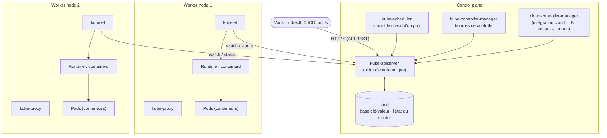
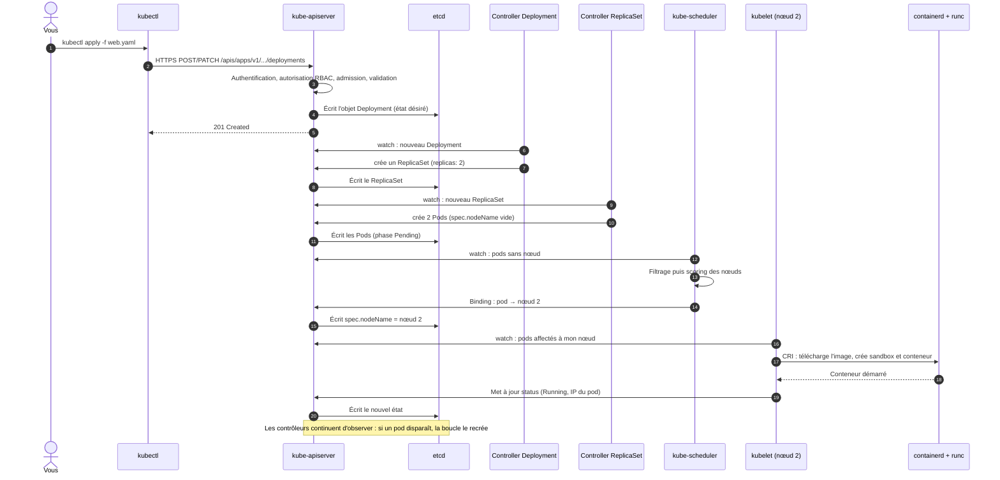

# Kubernetes : architecture et composants

## Pourquoi ce cours ?

Docker et Compose font tourner des conteneurs sur **une machine**. En production, il faut les répartir sur **plusieurs machines**,
les relancer quand l'une tombe, les mettre à jour sans coupure et les faire communiquer de façon fiable : c'est le métier d'un
**orchestrateur**. **Kubernetes** (K8s) est devenu le standard. Pour le diagnostiquer, l'exploiter et le sécuriser, il faut savoir
**quel composant fait quoi** et **ce qui se passe** quand on tape `kubectl apply`. Ce cours pose ce modèle mental ; tous les suivants s'y appuient.

> Prérequis : [architecture Docker](../../08-docker-approfondi/cours/01-architecture-docker.md) (containerd, runc, CRI), [namespaces et cgroups](../../04-linux-expert/cours/02-conteneurs-namespaces.md) et [DNS / ports / NAT](../../06-reseaux-devops/README.md).

## 1. Le principe : un état désiré et des boucles de contrôle

Kubernetes repose sur une idée simple : vous déclarez **l'état désiré** (« je veux 3 réplicas de cette application »), et des **contrôleurs** travaillent sans cesse à faire coïncider **l'état réel** avec cet état désiré.

```text
        ┌─────────────── boucle de réconciliation ───────────────┐
        ▼                                                         │
  État DÉSIRÉ (spec, stocké dans etcd) ──compare──► État RÉEL (status, observé)
        │                                                         │
        └── différence ? ──► actions (créer, supprimer, replanifier un pod) ──┘
```

C'est une approche **déclarative** : on décrit le résultat, pas les étapes. Si un nœud tombe, les pods manquants sont recréés ailleurs **sans intervention**.

## 2. Control plane et nœuds de travail

Un cluster se compose de deux familles de machines :

- le **control plane** (plan de contrôle) : le « cerveau », il décide et mémorise ;
- les **worker nodes** (nœuds de travail) : les « muscles », ils exécutent les conteneurs.



> 📌 **À retenir** : **tout passe par l'API server**. Aucun composant ne parle directement à `etcd` sauf lui, et les composants ne se parlent pas entre eux : ils lisent et écrivent des objets via l'API.

## 3. Les composants du control plane

| Composant | Rôle | Points d'attention |
|---|---|---|
| **kube-apiserver** | Expose l'**API REST** de Kubernetes. Authentifie (certificats, jetons, OIDC), **autorise** (RBAC), **valide** et **admet** (webhooks d'admission) chaque requête, puis l'écrit dans `etcd`. Seul à parler à `etcd`. Sans état : on peut en avoir plusieurs derrière un équilibreur. | Point d'entrée critique : à protéger, à surveiller |
| **etcd** | Base de données **clé-valeur distribuée** (algorithme de consensus **Raft**) : source de vérité de **tout** l'état du cluster. | **Sauvegardez-la** (`etcdctl snapshot save`). Quorum : 3 ou 5 membres. Contient les **Secrets** : chiffrez-les au repos |
| **kube-scheduler** | Observe les pods **sans nœud** et choisit un nœud (filtrage puis scoring : [cours 06](06-scheduling-et-ressources.md)). Il n'exécute rien : il **écrit** `spec.nodeName`. | |
| **kube-controller-manager** | Binaire regroupant de nombreux **contrôleurs** : Deployment, ReplicaSet, Node (détecte les nœuds morts), Job, EndpointSlice, ServiceAccount, Namespace… | Chaque contrôleur = une boucle de réconciliation |
| **cloud-controller-manager** | Contrôleurs qui parlent à l'API du **fournisseur cloud** : créer un **LoadBalancer**, supprimer un nœud disparu, attacher un volume. | Absent sur un cluster sans cloud (kubeadm « nu ») |

## 4. Les composants d'un nœud de travail

| Composant | Rôle |
|---|---|
| **kubelet** | **Agent** présent sur chaque nœud. Surveille l'API pour les pods affectés à **son** nœud, demande au runtime de les lancer (via **CRI**), exécute les **sondes** (liveness/readiness/startup), monte les volumes, **remonte l'état** (`status`) des pods et du nœud. Tourne en tant que service `systemd`, **pas** dans un conteneur. |
| **Container runtime** | Exécute réellement les conteneurs. **containerd** ou **CRI-O**, via l'interface **CRI**, puis `runc` (rappel du module 08). |
| **kube-proxy** | Implémente les **Services** sur le nœud : programme des règles `iptables`/`nftables` (ou **IPVS**) qui redirigent les IP virtuelles vers les pods ([cours 03](03-services-et-reseau-kubernetes.md)). Remplaçable par un CNI en mode eBPF (Cilium). |
| **Plugin réseau (CNI)** | Donne une IP à chaque pod et relie les nœuds (Calico, Cilium, Flannel…). Installé en *add-on*. |

### Kubernetes utilise containerd, pas dockerd

Depuis Kubernetes **1.24**, l'adaptateur *dockershim* a été retiré : le kubelet parle directement à **`containerd`** (ou CRI-O) via **CRI** (module 08, cours 01).

```text
Docker      :  docker CLI ─► dockerd ─► containerd ─► runc
Kubernetes  :  kubelet ──CRI──► containerd ─► runc          (dockerd n'intervient pas)
```

- Les **images Docker** fonctionnent à l'identique (format OCI).
- Sur un nœud, `docker ps` ne montre **rien** : utilisez **`crictl`** (`sudo crictl ps`, `crictl images`, `crictl logs`) ou `ctr -n k8s.io containers ls`.
- Le **`Dockerfile`** reste l'outil de construction ; seule l'exécution a changé.

```bash
kubectl get nodes -o wide                      # colonne CONTAINER-RUNTIME : containerd://1.7.x
sudo crictl ps                                 # conteneurs du nœud
sudo crictl pods
```

## 5. Les add-ons essentiels

Un cluster utilisable comprend aussi des **add-ons**, déployés comme des pods dans `kube-system` :

| Add-on | Fonction |
|---|---|
| **CoreDNS** | DNS interne (`service.namespace.svc.cluster.local`) |
| **CNI** (Calico, Cilium, Flannel) | Réseau des pods |
| **metrics-server** | Métriques CPU/mémoire (`kubectl top`, HPA) |
| **Ingress controller** | Routage HTTP(S) entrant |
| **CSI drivers** | Volumes persistants |

## 6. Le flux d'un `kubectl apply`

Que se passe-t-il quand vous appliquez ce manifeste ?

```yaml
apiVersion: apps/v1
kind: Deployment
metadata: { name: web }
spec:
  replicas: 2
  selector: { matchLabels: { app: web } }
  template:
    metadata: { labels: { app: web } }
    spec:
      containers:
        - name: nginx
          image: nginx:1.27
```

```bash
kubectl apply -f web.yaml
```



Résumé des acteurs :

1. **kubectl** envoie une requête HTTPS à l'**API server**.
2. L'API server **valide** et **persiste** dans **etcd**.
3. Le **contrôleur de Deployment** crée un **ReplicaSet**, qui crée des **Pods** (sans nœud).
4. Le **scheduler** les **affecte** à un nœud.
5. Le **kubelet** du nœud voit « un pod est pour moi », demande au **runtime** de le lancer, puis **rapporte** l'état.

> 💡 **Conseil** : retenez la règle de diagnostic : **un pod `Pending` sans nœud** → problème de **scheduler** (ressources, taints) ; **un pod avec nœud mais pas `Running`** → problème de **kubelet / runtime** (image introuvable, `CrashLoopBackOff`). `kubectl describe pod` et `kubectl get events` montrent exactement cette chaîne.

```bash
kubectl get pods -w &                       # observer les transitions en direct
kubectl apply -f web.yaml
kubectl get events --sort-by=.metadata.creationTimestamp | tail -15
kubectl describe pod -l app=web | sed -n '/Events/,$p'
```

Les évènements montrent : `Scheduled` (scheduler) → `Pulling`/`Pulled` (kubelet) → `Created` → `Started`.

## 7. Objets, API et `kubectl`

Tout est une **ressource** de l'API : `Pod`, `Deployment`, `Service`, `ConfigMap`… Chaque objet possède :

| Champ | Contenu |
|---|---|
| `apiVersion` / `kind` | Type et version de l'API (`apps/v1`, `Deployment`) |
| `metadata` | `name`, `namespace`, `labels`, `annotations`, `ownerReferences`… |
| `spec` | L'**état désiré** (vous l'écrivez) |
| `status` | L'**état observé** (le cluster l'écrit) |

```bash
kubectl api-resources | head -20            # types de ressources, courts noms, namespacées ou non
kubectl explain deployment.spec.strategy    # documentation intégrée, champ par champ
kubectl get deploy web -o yaml              # spec ET status
kubectl apply -f web.yaml --dry-run=server  # validation côté serveur sans création
kubectl diff -f web.yaml                    # différence avec l'état courant
kubectl get --raw /readyz?verbose | head    # état de l'API server
```

### Labels et sélecteurs : la colle de Kubernetes

Les objets sont reliés par des **étiquettes** (`labels`) et des **sélecteurs** : un Service désigne ses pods, un ReplicaSet reconnaît les siens.

```bash
kubectl get pods -l app=web
kubectl get pods --show-labels
kubectl label pod web-xyz env=test
```

## 8. Namespaces : l'isolation logique

Un **namespace** partitionne le cluster en espaces de noms **logiques** (équipes, environnements, applications). Les noms n'ont à être uniques qu'**à l'intérieur** d'un namespace.

| Namespace | Rôle |
|---|---|
| `default` | Espace par défaut (à éviter pour les vraies applications) |
| **`kube-system`** | Composants **système** : CoreDNS, kube-proxy, CNI, parfois apiserver/etcd (pods statiques) |
| **`kube-public`** | Données lisibles par **tous** (même non authentifiés) : ConfigMap `cluster-info` |
| **`kube-node-lease`** | Un objet `Lease` **par nœud** : battement de cœur du kubelet (détection des nœuds morts, léger) |

```bash
kubectl get namespaces
kubectl get pods -n kube-system
kubectl create namespace equipe-a
kubectl config set-context --current --namespace=equipe-a    # namespace par défaut du contexte
kubectl get pods -A                                          # tous les namespaces
kubectl api-resources --namespaced=false                     # ressources globales : Node, PersistentVolume, StorageClass, ClusterRole…
```

Ce que les namespaces **font** : portée des noms, point d'application des **quotas** (`ResourceQuota`), des **RBAC**, des **NetworkPolicies**, des **Pod Security Standards**. Ce qu'ils **ne font pas** : ils **n'isolent pas le réseau** par défaut (tout pod joint tout pod), ni la sécurité du noyau.

> ⚠️ **Attention** : un namespace n'est **pas** une frontière de sécurité à lui seul. Sans RBAC ni NetworkPolicies ([cours 07](07-securite-rbac-et-networkpolicies.md)), « isolation » ne veut pas dire grand-chose.

## 9. Installer et explorer un cluster

| Méthode | Usage |
|---|---|
| **kubeadm** | Cluster « standard » auto-hébergé (c'est ce qu'utilise Killercoda `kubernetes-kubeadm-1node`) |
| **kind**, **minikube**, **k3s**, **Docker Desktop** | Développement local |
| **EKS, GKE, AKS** | Control plane managé par le cloud |

```bash
kubectl cluster-info
kubectl get nodes -o wide
kubectl get pods -n kube-system -o wide
kubectl describe node <nom> | sed -n '/Capacity/,/Allocated resources/p'
```

Sur un cluster kubeadm, le control plane tourne en **pods statiques** : fichiers YAML lus directement par le kubelet.

```bash
ls /etc/kubernetes/manifests/              # kube-apiserver.yaml, etcd.yaml, kube-scheduler.yaml, kube-controller-manager.yaml
sudo crictl ps | grep -E "etcd|apiserver|scheduler|controller"
systemctl status kubelet --no-pager | head -5
```

## Résumé

- Kubernetes est **déclaratif** : vous décrivez l'état désiré, des **contrôleurs** réconcilient en boucle.
- **Control plane** : **kube-apiserver** (point d'entrée), **etcd** (état), **scheduler** (placement), **controller-manager** (boucles), **cloud-controller-manager** (intégration cloud).
- **Nœuds** : **kubelet** (agent), **runtime containerd/CRI-O** (pas `dockerd`), **kube-proxy** (Services), plugin **CNI**.
- Flux : `kubectl` → API server → etcd → contrôleurs (Deployment → ReplicaSet → Pod) → scheduler → kubelet → runtime.
- Objets : `spec` (désiré) / `status` (réel) ; **labels et sélecteurs** relient les ressources.
- **Namespaces** : isolation **logique** (`kube-system`, `kube-public`, `kube-node-lease`) ; **pas** de sécurité sans RBAC et NetworkPolicies.

## Pour aller plus loin

- Documentation : <https://kubernetes.io/fr/docs/concepts/overview/components/>.
- `etcdctl snapshot save`, haute disponibilité du control plane, certificats (`kubeadm certs check-expiration`).
- `kubectl explain`, `kubectl get --raw`, aide-mémoire `kubectl` officiel.
- Cours suivant : [Pods et workloads](02-pods-et-workloads.md).
- Atelier associé : [Premier Pod et Deployment](../ateliers-killercoda/atelier-01-premier-pod-et-deployment/intro.md).
