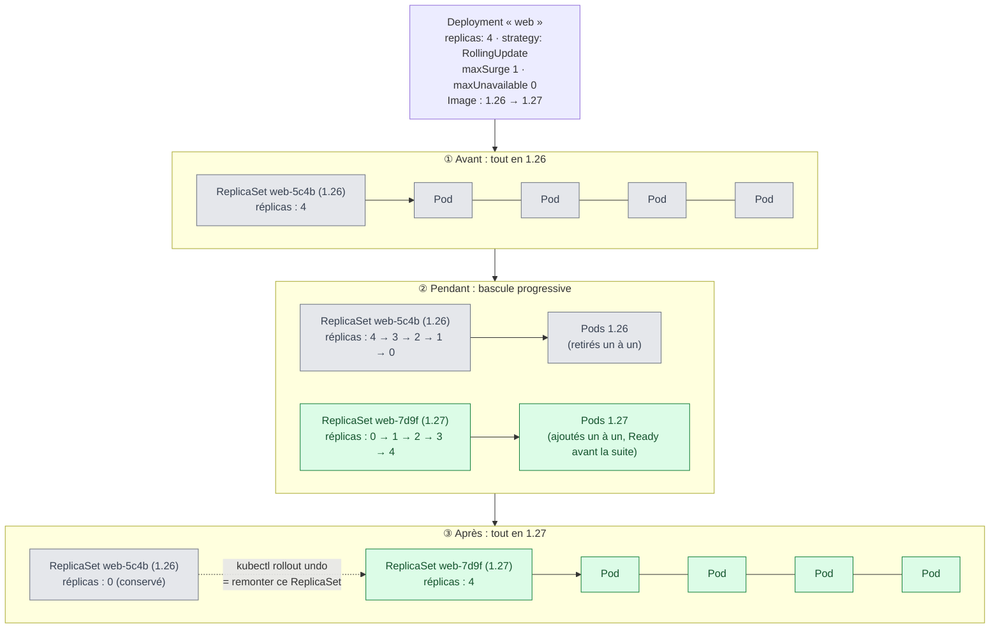

# Pods et workloads

## Pourquoi ce cours ?

On ne déploie presque jamais un pod « à la main » : on déclare un **workload** (Deployment, StatefulSet, DaemonSet, Job…) qui crée et surveille les pods pour vous. Choisir le bon
type de workload, comprendre le **cycle de vie** d'un pod et maîtriser une **mise à jour progressive** (et son retour arrière) sont les compétences quotidiennes d'un exploitant Kubernetes. Ce cours couvre la brique de base, le **Pod**, puis chaque contrôleur et son cas d'usage.

> Prérequis : [architecture et composants](01-architecture-et-composants.md), et [Docker : cycle de vie, healthcheck et PID 1](../../08-docker-approfondi/cours/03-dockerfile-avance.md).

## 1. Le Pod : l'unité atomique

Un **Pod** est le plus petit objet déployable : un groupe de **un ou plusieurs conteneurs** qui partagent :

- le **même namespace réseau** : une seule IP, ils se parlent sur `localhost` ;
- les mêmes **volumes** ;
- (optionnellement) le namespace PID et IPC ;
- le **même nœud** : ils sont toujours planifiés ensemble.

```text
┌──────────────────── Pod (IP 10.244.1.7) ────────────────────┐
│  conteneur « app » :8080     conteneur « sidecar » :9100    │   localhost partagé
│               ▲                      ▲                      │
│               └───────── volume partagé ─────────────────────┘
│  conteneur « pause » (infra) : porte les namespaces          │
└──────────────────────────────────────────────────────────────┘
```

Un conteneur **`pause`** invisible détient les namespaces partagés : c'est lui qui garde l'IP du pod si l'application redémarre.

```yaml
apiVersion: v1
kind: Pod
metadata:
  name: web
  labels: { app: web }
spec:
  containers:
    - name: nginx
      image: nginx:1.27
      ports:
        - containerPort: 80
      readinessProbe:
        httpGet: { path: /, port: 80 }
        periodSeconds: 5
      livenessProbe:
        httpGet: { path: /, port: 80 }
        initialDelaySeconds: 10
  restartPolicy: Always
```

> 📌 **À retenir** : **un pod est éphémère et remplaçable** (il n'est jamais « réparé » : on le recrée, avec une **nouvelle IP**). Ne vous fiez jamais à l'IP d'un pod : passez par un **Service** ([cours 03](03-services-et-reseau-kubernetes.md)).

### Cycle de vie : les phases

| Phase | Signification |
|---|---|
| **Pending** | Accepté par le cluster mais pas encore démarré : en attente de **placement** (scheduler) ou de **téléchargement d'image** |
| **Running** | Affecté à un nœud, au moins un conteneur est **démarré** (ou en cours de redémarrage) |
| **Succeeded** | **Tous** les conteneurs se sont terminés avec **succès** (code 0) et ne redémarreront pas (Jobs) |
| **Failed** | Tous les conteneurs terminés, **au moins un en échec** |
| **Unknown** | L'état est **inconnu** (généralement nœud injoignable) |

Les phases sont grossières. Le détail utile se lit dans `status.containerStatuses` et la colonne `STATUS` de `kubectl get pods` :

| Statut affiché | Cause fréquente |
|---|---|
| `ContainerCreating` | Image en cours de téléchargement, volume en cours de montage |
| `ImagePullBackOff` / `ErrImagePull` | Image inexistante, tag erroné, registre privé sans `imagePullSecret` |
| `CrashLoopBackOff` | Le conteneur **plante** en boucle (le kubelet attend de plus en plus longtemps entre les redémarrages : 10 s, 20 s… 5 min) |
| `CreateContainerConfigError` | ConfigMap/Secret référencé absent |
| `OOMKilled` (dans `lastState`) | Dépassement de la limite de **mémoire** |
| `Pending` + évènement `FailedScheduling` | Pas de nœud adapté (ressources, taints, affinités) |
| `Terminating` bloqué | Un *finalizer* ou un conteneur qui ignore `SIGTERM` |

```bash
kubectl get pod web -o wide
kubectl describe pod web                       # section Events : la chronologie
kubectl logs web [-c conteneur] [--previous]   # --previous : journaux avant le plantage
kubectl get pod web -o jsonpath='{.status.phase}{"\n"}{.status.containerStatuses[0].lastState}{"\n"}'
kubectl exec -it web -- sh
kubectl delete pod web --grace-period=30       # SIGTERM, attente, puis SIGKILL
```

### Arrêt propre d'un pod

À la suppression : le pod passe en `Terminating`, est **retiré des Services**, le hook **`preStop`** s'exécute, `SIGTERM` est envoyé aux conteneurs, puis `SIGKILL` après **`terminationGracePeriodSeconds`** (30 s par défaut). Votre application doit donc **gérer `SIGTERM`** (rappel PID 1, forme *exec*, module 08).

### Sondes (*probes*)

| Sonde | Question | Si elle échoue |
|---|---|---|
| **startupProbe** | L'application a-t-elle **fini de démarrer** ? | Redémarrage ; désactive les deux autres le temps du démarrage |
| **readinessProbe** | Peut-elle **recevoir du trafic** ? | Le pod est **retiré des Services** (pas de redémarrage) |
| **livenessProbe** | Est-elle **vivante** (non bloquée) ? | Le conteneur est **redémarré** |

> ⚠️ **Attention** : une `livenessProbe` trop agressive (ou qui dépend d'une base externe) peut provoquer une **cascade de redémarrages**. Elle doit tester **l'application elle-même**, pas ses dépendances.

## 2. Init containers et sidecars

### Init containers

Conteneurs qui s'exécutent **avant** les conteneurs applicatifs, **l'un après l'autre**, chacun devant se terminer avec **succès**. Usages : attendre une dépendance, appliquer des migrations, préparer des fichiers, récupérer une configuration.

```yaml
spec:
  initContainers:
    - name: attendre-db
      image: busybox:1.36
      command: ["sh", "-c", "until nc -z db 5432; do echo attente de la base; sleep 2; done"]
    - name: migrations
      image: kamer/api:1.4.2
      command: ["python", "migrate.py"]
  containers:
    - name: api
      image: kamer/api:1.4.2
```

Équivalent Kubernetes du `depends_on` de Compose ([module 08](../../08-docker-approfondi/cours/05-docker-compose.md)), mais **à chaque démarrage du pod**.

### Sidecars

Un **sidecar** est un conteneur **auxiliaire** qui tourne **pendant toute la vie** du pod : collecteur de journaux, proxy (service mesh), agent de métriques, renouvellement de certificats.

| | **Init container** | **Sidecar** |
|---|---|---|
| Moment | **Avant** l'application | **Pendant** toute la vie du pod |
| Durée | Se **termine** | Tourne en continu |
| Ordre | Séquentiel | Parallèle (ou ordonné, voir ci-dessous) |
| Exemples | Migration, attente, génération de config | Log shipper, proxy Envoy, `vault-agent` |

Historiquement, un sidecar était simplement un **second conteneur** dans `containers`, sans garantie d'ordre ni d'arrêt (problème des Jobs qui ne finissent jamais à cause du sidecar). Depuis **Kubernetes 1.29** (stable en 1.33), un **sidecar natif** se déclare comme un **init container avec `restartPolicy: Always`** : il démarre **avant** l'application, reste actif pendant sa vie et s'arrête **après** elle.

```yaml
spec:
  initContainers:
    - name: log-shipper
      image: fluent/fluent-bit:3.1
      restartPolicy: Always            # ← sidecar natif
      volumeMounts: [{ name: logs, mountPath: /var/log/app }]
  containers:
    - name: app
      image: kamer/api:1.4.2
      volumeMounts: [{ name: logs, mountPath: /var/log/app }]
  volumes:
    - name: logs
      emptyDir: {}
```

## 3. ReplicaSet et Deployment

### ReplicaSet

Un **ReplicaSet** garantit qu'**un nombre précis de pods identiques** tourne en permanence. Il identifie « ses » pods par un **sélecteur de labels**, et en recrée si besoin. On ne le manipule presque jamais directement.

### Deployment

Un **Deployment** est le workload **par défaut** pour les applications **sans état** (*stateless*). Il pilote des **ReplicaSets** et ajoute : **mises à jour progressives**, **historique de révisions** et **retour arrière**.

```text
Deployment « web »  ──gère──►  ReplicaSet web-7d9f (révision 2, image 1.27)  ──► Pod, Pod, Pod
                         └────►  ReplicaSet web-5c4b (révision 1, image 1.26, 0 réplica, conservé pour le rollback)
```

```yaml
apiVersion: apps/v1
kind: Deployment
metadata:
  name: web
spec:
  replicas: 3
  revisionHistoryLimit: 5            # nombre d'anciens ReplicaSets conservés
  selector:
    matchLabels: { app: web }        # doit correspondre aux labels du modèle de pod
  strategy:
    type: RollingUpdate
    rollingUpdate:
      maxSurge: 1                    # pods EN PLUS autorisés pendant la mise à jour
      maxUnavailable: 0              # pods indisponibles tolérés
  template:
    metadata:
      labels: { app: web }
    spec:
      containers:
        - name: nginx
          image: nginx:1.27
          readinessProbe:
            httpGet: { path: /, port: 80 }
```

### Stratégies de mise à jour

| Stratégie | Principe | Coupure ? | Usage |
|---|---|---|---|
| **RollingUpdate** (défaut) | Crée des pods de la **nouvelle** version **petit à petit** tout en supprimant les anciens, en respectant `maxSurge` / `maxUnavailable` | **Non** (si les `readinessProbe` sont correctes) | Cas général |
| **Recreate** | **Supprime tous** les anciens pods, **puis** crée les nouveaux | **Oui**, brève | Application qui ne tolère pas deux versions simultanées (schéma de base incompatible, verrou exclusif) |

`maxSurge` et `maxUnavailable` acceptent un nombre ou un pourcentage (défaut : 25 % chacun). Avec `replicas: 4`, `maxSurge: 1`, `maxUnavailable: 0` : on crée d'abord 1 pod neuf (5 au total) ; dès qu'il est **prêt**, on supprime 1 ancien ; etc. **La capacité n'est jamais réduite.**

### La hiérarchie pendant un rollout



Le Deployment **ne modifie pas** les anciens pods : il crée un **nouveau ReplicaSet** (pour la nouvelle version du `template`) et fait varier les `replicas` des deux. L'ancien ReplicaSet reste à **0** : c'est ce qui rend le **rollback** immédiat. Seule une modification de `spec.template` déclenche un rollout (pas un changement de `replicas`).

### Commandes essentielles

```bash
kubectl create deployment web --image=nginx:1.27 --replicas=3
kubectl get deploy,rs,pods -l app=web
kubectl scale deployment web --replicas=5
kubectl set image deployment/web nginx=nginx:1.27-alpine        # déclenche un rollout
kubectl rollout status deployment/web                            # attend la fin (code retour utilisable en CI)
kubectl rollout history deployment/web                           # révisions
kubectl rollout history deployment/web --revision=2
kubectl rollout undo deployment/web                              # retour à la révision précédente
kubectl rollout undo deployment/web --to-revision=1
kubectl rollout pause deployment/web && kubectl rollout resume deployment/web      # canary « manuel »
kubectl rollout restart deployment/web                           # redémarre tous les pods progressivement (nouveau template)
kubectl annotate deployment/web kubernetes.io/change-cause="passage à nginx alpine"   # message dans l'historique
kubectl get rs -l app=web                                        # les ReplicaSets : anciens et nouveaux
```

> 💡 **Conseil** : sans `readinessProbe`, Kubernetes considère un pod « prêt » dès que le conteneur démarre : le rollout peut donc retirer des pods sains au profit de pods **pas encore capables de répondre** → erreurs 502. **Définissez toujours une `readinessProbe`** pour un Deployment servi derrière un Service.

## 4. StatefulSet : identité stable et stockage propre

Pour les applications **avec état** (bases de données, files de messages, ZooKeeper, Kafka, Elasticsearch), chaque réplica doit avoir une **identité stable**. Le **StatefulSet** apporte :

| Garantie | Détail |
|---|---|
| **Noms stables et ordonnés** | `db-0`, `db-1`, `db-2` (et non des suffixes aléatoires) |
| **DNS stable** par pod | `db-0.db.prod.svc.cluster.local`, via un **Service headless** |
| **Démarrage et arrêt ordonnés** | `db-0` d'abord, puis `db-1`… (`podManagementPolicy: OrderedReady`) ; mise à jour en sens inverse |
| **Stockage propre à chaque pod** | `volumeClaimTemplates` : **un PVC par réplica**, qui **suit** le pod (même nom → même volume) |

```yaml
apiVersion: v1
kind: Service
metadata: { name: db }
spec:
  clusterIP: None                 # headless : pas d'IP virtuelle, DNS par pod
  selector: { app: db }
  ports: [{ port: 5432 }]
---
apiVersion: apps/v1
kind: StatefulSet
metadata: { name: db }
spec:
  serviceName: db                 # Service headless associé
  replicas: 3
  selector: { matchLabels: { app: db } }
  template:
    metadata: { labels: { app: db } }
    spec:
      containers:
        - name: postgres
          image: postgres:16
          env:
            - { name: POSTGRES_PASSWORD, valueFrom: { secretKeyRef: { name: db-secret, key: password } } }
            - { name: PGDATA, value: /var/lib/postgresql/data/pgdata }
          volumeMounts:
            - { name: data, mountPath: /var/lib/postgresql/data }
  volumeClaimTemplates:           # un PVC par pod : data-db-0, data-db-1, data-db-2
    - metadata: { name: data }
      spec:
        accessModes: ["ReadWriteOnce"]
        resources: { requests: { storage: 10Gi } }
```

> ⚠️ **Attention** : supprimer un StatefulSet **ne supprime pas** ses PVC (protection des données) ; supprimer un pod, lui, le fait recréer **avec le même nom et le même volume**. Le StatefulSet ne gère **pas** la réplication de la base : c'est le rôle de l'application ou d'un **opérateur** (CloudNativePG, Percona…). Voir le [cours 04](04-stockage-persistance.md).

## 5. DaemonSet : un pod par nœud

Un **DaemonSet** garantit qu'**un pod** tourne sur **chaque nœud** (ou sur un sous-ensemble). Quand un nœud rejoint le cluster, le pod y est créé automatiquement.

| Usage | Exemples |
|---|---|
| Collecte de **journaux** | Fluent Bit, Vector, Promtail |
| **Monitoring** | `node-exporter`, agents Datadog |
| **Réseau** | Plugins CNI (Calico, Cilium), `kube-proxy` |
| **Stockage** | Pilotes CSI |
| **Sécurité** | Falco |

```yaml
apiVersion: apps/v1
kind: DaemonSet
metadata: { name: node-exporter, namespace: monitoring }
spec:
  selector: { matchLabels: { app: node-exporter } }
  updateStrategy:
    type: RollingUpdate
    rollingUpdate: { maxUnavailable: 1 }
  template:
    metadata: { labels: { app: node-exporter } }
    spec:
      hostNetwork: true
      tolerations:                       # tourner aussi sur les nœuds du control plane
        - key: node-role.kubernetes.io/control-plane
          operator: Exists
          effect: NoSchedule
      containers:
        - name: node-exporter
          image: prom/node-exporter:v1.8.2
          ports: [{ containerPort: 9100, hostPort: 9100 }]
```

Pour restreindre à certains nœuds : `nodeSelector` / `affinity` ([cours 06](06-scheduling-et-ressources.md)).

## 6. Jobs et CronJobs : traitements batch

### Job : une tâche qui doit se terminer

Un **Job** crée un ou plusieurs pods et les **relance jusqu'à réussite** (code 0). Contrairement à un Deployment, les pods ne doivent **pas** tourner indéfiniment.

```yaml
apiVersion: batch/v1
kind: Job
metadata: { name: migration }
spec:
  completions: 1                     # nombre de réussites attendues
  parallelism: 1                     # pods simultanés
  backoffLimit: 4                    # tentatives avant échec définitif
  activeDeadlineSeconds: 600         # durée maximale
  ttlSecondsAfterFinished: 3600      # nettoyage automatique
  template:
    spec:
      restartPolicy: Never           # Never ou OnFailure (jamais Always dans un Job)
      containers:
        - name: migrate
          image: kamer/api:1.4.2
          command: ["python", "migrate.py"]
```

Modes : **tâche unique** (`completions: 1`), **N tâches** (`completions: 5, parallelism: 2`), **file de travail** (workers qui consomment une file), **indexé** (`completionMode: Indexed`).

### CronJob : un Job planifié

```yaml
apiVersion: batch/v1
kind: CronJob
metadata: { name: sauvegarde }
spec:
  schedule: "30 2 * * *"            # syntaxe cron (heure du contrôleur : UTC, ou spec.timeZone)
  timeZone: "Africa/Douala"
  concurrencyPolicy: Forbid          # Allow | Forbid | Replace : que faire si le précédent n'est pas terminé
  startingDeadlineSeconds: 300
  successfulJobsHistoryLimit: 3
  failedJobsHistoryLimit: 1
  jobTemplate:
    spec:
      backoffLimit: 2
      template:
        spec:
          restartPolicy: OnFailure
          containers:
            - name: backup
              image: postgres:16
              command: ["sh", "-c", "pg_dump -h db -U postgres app | gzip > /backup/app-$(date +%F).sql.gz"]
```

```bash
kubectl create job test --from=cronjob/sauvegarde      # déclenche un Job à la demande
kubectl get cronjob,job,pods
kubectl logs job/migration
```

> 💡 **Conseil** : rendez les tâches **idempotentes** (rejouables sans effet de bord) : un Job peut s'exécuter plusieurs fois (relance, panne de nœud). Pour les CronJobs, `concurrencyPolicy: Forbid` évite l'empilement si une exécution dépasse l'intervalle.

## 7. Quel workload choisir ?

| Besoin | Workload |
|---|---|
| Application web / API **sans état**, plusieurs répliques interchangeables | **Deployment** |
| Base de données, file de messages : identité stable, volume par réplica | **StatefulSet** |
| Un agent sur **chaque** nœud | **DaemonSet** |
| Traitement **ponctuel** qui doit se terminer | **Job** |
| Traitement **récurrent** | **CronJob** |
| Un seul pod de test, jamais en production | **Pod** nu |

## Résumé

- Un **Pod** = un ou plusieurs conteneurs partageant réseau (une IP) et volumes ; **éphémère**, jamais réparé, toujours recréé.
- Phases : `Pending`, `Running`, `Succeeded`, `Failed`, `Unknown` ; diagnostic fin par `describe`, `logs --previous`, statuts (`CrashLoopBackOff`, `ImagePullBackOff`, `OOMKilled`).
- **Sondes** : `startup`, **`readiness`** (retire du Service), **`liveness`** (redémarre).
- **Init containers** : avant l'application, séquentiels, terminent. **Sidecars** : pendant toute la vie du pod (natifs depuis 1.29 : `initContainers` + `restartPolicy: Always`).
- **Deployment → ReplicaSet → Pods** ; **RollingUpdate** (sans coupure, `maxSurge`/`maxUnavailable`) ou **Recreate** ; `rollout status / history / undo`.
- **StatefulSet** : noms et DNS stables, démarrage ordonné, **`volumeClaimTemplates`**. **DaemonSet** : un pod par nœud. **Job / CronJob** : batch et planifié.

## Pour aller plus loin

- <https://kubernetes.io/fr/docs/concepts/workloads/>.
- Mises à jour avancées : Argo Rollouts, Flagger (canary, blue/green), `PodDisruptionBudget`, `topologySpreadConstraints`.
- Opérateurs et CRD pour les bases de données avec état.
- Cours suivant : [Services et réseau Kubernetes](03-services-et-reseau-kubernetes.md).
- Atelier associé : [Premier Pod et Deployment](../ateliers-killercoda/atelier-01-premier-pod-et-deployment/intro.md).
