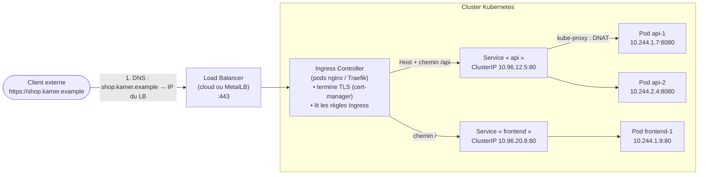

# Services et réseau dans Kubernetes

## Pourquoi ce cours ?

Les pods sont éphémères : leur IP change à chaque recréation. Comment une application joint-elle de façon fiable « la base » ou « l'API » ?
Comment un client extérieur atteint-il votre site ? Comment limiter qui peut parler à qui ? Kubernetes répond avec un **modèle réseau** précis,
des **Services** (adresse stable + équilibrage), un **DNS** interne, des **Ingress** (HTTP entrant) et des **NetworkPolicies**. Ce cours s'appuie sur ce que vous avez vu
du [DNS](../../06-reseaux-devops/cours/01-dns-fondamentaux.md), des [ports](../../06-reseaux-devops/cours/02-ports-et-sockets.md) et du [NAT / iptables](../../06-reseaux-devops/cours/03-routage-et-nat.md) (module 06).

## 1. Le modèle réseau de Kubernetes

Quatre règles fondamentales (le « contrat » que tout plugin réseau doit respecter) :

1. **Chaque pod a sa propre adresse IP**, unique dans le cluster.
2. Les **conteneurs d'un même pod** partagent cette IP et communiquent par `localhost`.
3. **Tout pod peut joindre tout autre pod** par son IP, **sans NAT** (l'IP source vue par la destination est celle du pod émetteur), quel que soit le nœud.
4. Les **agents d'un nœud** (kubelet) peuvent joindre tous les pods de ce nœud.

> 📌 **À retenir** : contrairement à Docker (un pont NAT par hôte, ports à publier avec `-p`), Kubernetes propose un **réseau plat** : pas de publication de port entre pods, pas de NAT pod-à-pod. Le **NAT** n'intervient que pour les **Services** (DNAT vers un pod) et la **sortie vers Internet** (SNAT / masquerade).

C'est un **plugin CNI** (Calico, Cilium, Flannel…) qui l'implémente, souvent avec un **overlay VXLAN** entre nœuds (voir le [cours 03 du module 06](../../06-reseaux-devops/cours/03-routage-et-nat.md)) ou du routage BGP/natif.

```bash
kubectl get pods -o wide                       # IP de chaque pod et nœud
kubectl run client --rm -it --image=busybox:1.36 -- sh
# dans le pod :  wget -qO- http://10.244.1.7:80     (IP d'un pod, joignable directement)
```

### Plages d'adresses

| Plage | Usage |
|---|---|
| **Pod CIDR** (ex. `10.244.0.0/16`) | IP des pods (un sous-réseau par nœud) |
| **Service CIDR** (ex. `10.96.0.0/12`) | IP **virtuelles** des Services (ClusterIP) |
| Réseau des nœuds | IP des machines |

## 2. Les Services : une adresse stable devant des pods changeants

Un **Service** fournit un **nom DNS** et une **IP virtuelle stable** (ClusterIP) qui **répartissent** le trafic entre les pods sélectionnés par des **labels**.

```yaml
apiVersion: v1
kind: Service
metadata: { name: web }
spec:
  selector: { app: web }          # pods ciblés (labels)
  ports:
    - name: http
      port: 80                    # port du SERVICE (ClusterIP:80)
      targetPort: 8080            # port du CONTENEUR (nom ou numéro)
      protocol: TCP
  type: ClusterIP
```

Comment cela fonctionne :

- Le **contrôleur EndpointSlice** liste les **pods prêts** (`Ready`) correspondant au sélecteur ; c'est la liste des **backends**.
- **kube-proxy** (sur **chaque** nœud) traduit la ClusterIP en l'IP d'un pod, par des règles `iptables` (**DNAT**, choix pseudo-aléatoire), `nftables` ou **IPVS**. Il n'y a **aucun processus** qui écoute sur la ClusterIP : c'est une adresse **purement virtuelle**.

```bash
kubectl get svc web
kubectl get endpointslices -l kubernetes.io/service-name=web
kubectl get endpoints web                       # vide = le sélecteur ne correspond à aucun pod PRÊT
sudo iptables -t nat -S | grep -E "KUBE-SVC|KUBE-SEP" | head      # les règles kube-proxy (voir le module 06)
```

> ⚠️ **Attention** : un Service **sans endpoints** est la première chose à vérifier quand « ça ne répond pas » : labels qui ne correspondent pas, pods non `Ready` (`readinessProbe` en échec), mauvais `targetPort`.

### Les quatre types de Service

| Type | Accessible depuis | Principe | Usage |
|---|---|---|---|
| **ClusterIP** (défaut) | **Intérieur** du cluster | IP virtuelle + DNS | Communication entre services |
| **NodePort** | Extérieur, via `IP-nœud:port` | Ouvre un **même port** (30000-32767) sur **chaque nœud**, redirigé vers le Service | Tests, environnements sans load balancer |
| **LoadBalancer** | Extérieur, via une **IP publique** | Demande au **cloud** (cloud-controller-manager) un équilibreur externe qui pointe vers les NodePorts | Exposition en production sur un cloud ; `MetalLB` en bare-metal |
| **ExternalName** | Intérieur | Simple **alias DNS** (`CNAME`) vers un nom externe ; pas de proxy | Joindre une base managée externe sous un nom interne |

Chaque type **inclut** le précédent : un `LoadBalancer` crée aussi un NodePort et un ClusterIP.

```yaml
# NodePort
spec:
  type: NodePort
  selector: { app: web }
  ports: [{ port: 80, targetPort: 8080, nodePort: 30080 }]
---
# ExternalName
apiVersion: v1
kind: Service
metadata: { name: base-externe }
spec:
  type: ExternalName
  externalName: db.exemple.managed-database.com
```

```bash
kubectl expose deployment web --port=80 --target-port=8080                 # ClusterIP
kubectl expose deployment web --type=NodePort --port=80 --name=web-np
kubectl get svc -o wide
kubectl port-forward svc/web 8080:80                                       # tunnel temporaire vers votre poste (debug)
```

Options utiles : `sessionAffinity: ClientIP` (affinité de session), `externalTrafficPolicy: Local` (conserve l'IP source du client, évite un saut), `internalTrafficPolicy`.

## 3. DNS : CoreDNS

Chaque Service reçoit un nom DNS, servi par **CoreDNS** (rappel du [cours DNS](../../06-reseaux-devops/cours/01-dns-fondamentaux.md)) :

```text
<service>.<namespace>.svc.cluster.local
   web.prod.svc.cluster.local   →  ClusterIP du Service « web » dans le namespace « prod »
```

Depuis un pod, on utilise des **noms courts** grâce aux domaines de recherche de `/etc/resolv.conf` :

```text
search prod.svc.cluster.local svc.cluster.local cluster.local
nameserver 10.96.0.10
options ndots:5
```

| Nom utilisé depuis le namespace `prod` | Résolution |
|---|---|
| `web` | Service `web` du **même** namespace |
| `web.autre` | Service `web` du namespace `autre` |
| `web.autre.svc.cluster.local` | Nom complet |

Records DNS créés : `A`/`AAAA` (ClusterIP), `SRV` (ports nommés), et **par pod** pour les StatefulSets via un Service headless.

### Services headless

Avec `clusterIP: None`, il n'y a **pas d'IP virtuelle ni d'équilibrage** : le DNS renvoie directement **les IP de tous les pods** (plusieurs enregistrements A). Usages : StatefulSets (`db-0.db.prod.svc…`), découverte des membres d'un cluster (Kafka, Elasticsearch), clients qui font leur propre répartition.

```bash
kubectl run dns --rm -it --image=registry.k8s.io/e2e-test-images/jessie-dnsutils:1.3 -- bash
# dans le pod :
nslookup web                        # ClusterIP
nslookup db                         # (headless) : une réponse par pod
dig +short SRV _http._tcp.web.default.svc.cluster.local
cat /etc/resolv.conf
```

> 💡 **Conseil** : `ndots:5` provoque jusqu'à 4 requêtes superflues pour les noms externes (`api.exemple.com`) : utilisez un **nom absolu avec point final** (`api.exemple.com.`) ou ajustez `dnsConfig` pour réduire la charge de CoreDNS.

## 4. Ingress : le routage HTTP(S) entrant

Exposer chaque application par un `LoadBalancer` coûte cher (une IP et un équilibreur chacune). Un **Ingress** décrit des **règles de routage HTTP(S)** (par nom d'hôte et chemin) ; un **Ingress Controller** (un pod avec un reverse-proxy) les applique et n'a besoin que **d'un seul** point d'entrée externe.

| Élément | Rôle |
|---|---|
| **Ingress** (ressource) | Règles déclaratives : « `shop.kamer.example/api` → Service `api` » |
| **Ingress Controller** | Implémentation : **ingress-nginx**, **Traefik**, HAProxy, Contour, Istio Gateway… À **installer** (pas fourni par défaut) |
| **IngressClass** | Choisit quel contrôleur gère l'Ingress |

```yaml
apiVersion: networking.k8s.io/v1
kind: Ingress
metadata:
  name: boutique
  annotations:
    cert-manager.io/cluster-issuer: letsencrypt-prod
    nginx.ingress.kubernetes.io/proxy-body-size: "10m"
spec:
  ingressClassName: nginx
  tls:
    - hosts: [shop.kamer.example]
      secretName: shop-tls                  # Secret du certificat (créé par cert-manager)
  rules:
    - host: shop.kamer.example
      http:
        paths:
          - path: /api
            pathType: Prefix
            backend: { service: { name: api, port: { number: 80 } } }
          - path: /
            pathType: Prefix
            backend: { service: { name: frontend, port: { number: 80 } } }
```



Chemin d'une requête : **client → DNS → Load Balancer → Ingress Controller (TLS, routage par hôte/chemin) → Service → pod** (choisi parmi les endpoints prêts).

L'**Ingress** est une API **figée** et limitée ; son successeur, la **Gateway API** (`Gateway`, `HTTPRoute`), est plus expressive (rôles séparés, TCP/gRPC, répartition de trafic) et devient le standard.

```bash
kubectl get ingressclass
kubectl get ingress
kubectl describe ingress boutique
curl -H "Host: shop.kamer.example" http://<IP-du-controller>/api        # tester sans DNS
```

## 5. NetworkPolicies : filtrer le trafic entre pods (aperçu)

Par défaut, **tous les pods se parlent** (réseau plat, aucun filtrage). Une **NetworkPolicy** restreint le trafic **entrant (Ingress)** et/ou **sortant (Egress)** des pods qu'elle sélectionne. Elle est **appliquée par le plugin CNI** (Calico, Cilium : oui ; Flannel seul : **non**).

```yaml
# Refuser tout le trafic entrant vers les pods du namespace, par défaut
apiVersion: networking.k8s.io/v1
kind: NetworkPolicy
metadata: { name: default-deny-ingress, namespace: prod }
spec:
  podSelector: {}                 # tous les pods
  policyTypes: [Ingress]          # pas de règle « ingress » = tout est refusé
```

Principes : dès qu'**au moins une** NetworkPolicy sélectionne un pod pour un sens donné, **seul ce qui est explicitement autorisé** passe ; les règles **s'additionnent** (jamais de règle « deny » explicite). Le détail (default-deny complet, règles par namespace/pod/port, DNS) est au [cours 07](07-securite-rbac-et-networkpolicies.md).

## 6. Comparaison avec le réseau Docker

| | **Docker (module 08)** | **Kubernetes** |
|---|---|---|
| Portée | **Un seul hôte** (bridge) ; multi-hôtes avec Swarm/overlay | **Cluster entier**, réseau plat |
| IP d'un conteneur | Interne au pont, NAT vers l'extérieur | **Une IP de pod routable** entre tous les nœuds, **sans NAT** |
| Découverte par nom | DNS embarqué `127.0.0.11` sur un **réseau personnalisé** (noms de conteneurs/services Compose) | **CoreDNS** : `service.namespace.svc.cluster.local` |
| Équilibrage | DNS round-robin simple | **Service** (kube-proxy, iptables/IPVS) avec **endpoints prêts** |
| Exposition | `-p hôte:conteneur` (DNAT iptables) | **NodePort**, **LoadBalancer**, **Ingress** |
| Isolation | Réseaux bridge séparés | **NetworkPolicies** (réseau ouvert par défaut) |
| Santé et trafic | `healthcheck` informatif (Compose s'en sert pour l'ordre) | **`readinessProbe`** : un pod non prêt est **retiré** des endpoints |

Transposition : un réseau Compose personnalisé avec `backend` et `redis` devient **deux Services ClusterIP** (`backend`, `redis`) dans un même namespace ; `ports: ["8000:8000"]` devient un Service **NodePort/LoadBalancer** ou un **Ingress**.

## 7. Diagnostic

```bash
kubectl get svc,endpoints,pods -o wide                         # 1. le Service a-t-il des endpoints ?
kubectl describe svc web                                       # sélecteur, ports, endpoints
kubectl get pods --show-labels                                 # les labels correspondent-ils ?
kubectl run net --rm -it --image=nicolaka/netshoot -- bash     # boîte à outils réseau dans le cluster
#   dans le pod : nslookup web ; curl -sv http://web ; curl http://10.244.1.7:8080
kubectl logs -n kube-system -l k8s-app=kube-dns --tail=20      # CoreDNS
kubectl get networkpolicy -A                                   # un filtre bloque-t-il ?
kubectl exec <pod> -- ss -tlnp                                 # l'application écoute-t-elle sur 0.0.0.0 et le bon port ?
```

| Symptôme | Cause probable |
|---|---|
| `Connection refused` via le Service | Endpoints vides ; mauvais `targetPort` ; l'application écoute sur `127.0.0.1` |
| Timeout via le Service | NetworkPolicy ; pods non prêts ; problème de CNI/kube-proxy |
| Le nom ne se résout pas | CoreDNS en échec ; mauvais namespace ; NetworkPolicy qui bloque le DNS (UDP/TCP 53) |
| 502/503 à travers l'Ingress | Aucun endpoint prêt ; mauvais port de Service |
| NodePort inaccessible de l'extérieur | Pare-feu du nœud / security group ; `externalTrafficPolicy: Local` sur un nœud sans pod |

> 💡 **Conseil** : c'est la même méthode que le [diagnostic du module 06](../../06-reseaux-devops/cours/05-diagnostic-reseau-devops.md) : **DNS → port/endpoints → TLS → HTTP → application**, mais avec `kubectl get endpoints` comme première vérification.

## Résumé

- **Réseau plat** : une IP par pod, tout pod joint tout pod **sans NAT** ; le CNI l'implémente.
- **Service** = IP virtuelle stable + DNS + équilibrage sur les **pods prêts** ; **kube-proxy** programme le DNAT (iptables/IPVS). **Vérifiez les endpoints.**
- Types : **ClusterIP** (interne), **NodePort** (port sur chaque nœud), **LoadBalancer** (IP publique via le cloud), **ExternalName** (alias DNS).
- **CoreDNS** : `service.namespace.svc.cluster.local` ; **headless** (`clusterIP: None`) = DNS vers chaque pod ; `ndots:5`.
- **Ingress** + **Ingress Controller** : routage HTTP(S) par hôte/chemin, TLS ; **Gateway API** est son successeur.
- **NetworkPolicies** : filtrage entre pods (réseau ouvert par défaut), appliqué par le **CNI**.
- Face à Docker : un réseau plat multi-nœuds, un DNS de cluster, des Services au lieu de `-p`.

## Pour aller plus loin

- <https://kubernetes.io/fr/docs/concepts/services-networking/> ; Gateway API : <https://gateway-api.sigs.k8s.io/>.
- CNI avancés : Calico (BGP), Cilium (eBPF, remplace kube-proxy), service mesh (Istio, Linkerd, mTLS : [module 06](../../06-reseaux-devops/cours/04-tls-et-https.md)).
- MetalLB (LoadBalancer en bare-metal), `externalTrafficPolicy`, `topology-aware routing`.
- Cours suivant : [Stockage et persistance](04-stockage-persistance.md).
- Atelier associé : [Service et NodePort](../ateliers-killercoda/atelier-02-service-et-nodeport/intro.md).
