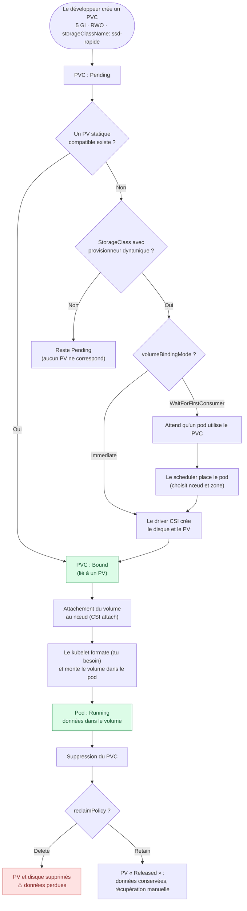

# Stockage et persistance dans Kubernetes

## Pourquoi ce cours ?

Un conteneur est éphémère, un pod aussi : quand il est recréé (souvent sur **un autre nœud**), ses fichiers disparaissent. Or une base de données, un dépôt de fichiers ou une file de messages
doivent **survivre** aux pods. Kubernetes sépare donc **qui consomme** du stockage (le développeur, via un *claim*) de **qui le fournit** (l'administrateur ou le cloud,
via un *volume* et une *classe de stockage*). Ce cours explique les volumes, le couple **PV/PVC**, le **provisionnement dynamique**, les **modes d'accès** et le lien avec les StatefulSets.

> Prérequis : [volumes Docker](../../08-docker-approfondi/cours/04-reseau-et-stockage-docker.md) (volumes nommés, bind mounts, cycle de vie) et [pods et workloads](02-pods-et-workloads.md).

## 1. Volumes éphémères et volumes persistants

Un **volume** Kubernetes est un répertoire accessible aux conteneurs d'un pod, déclaré dans `spec.volumes` et monté avec `volumeMounts`. Sa **durée de vie** dépend de son type :

| Type | Durée de vie | Exemples |
|---|---|---|
| **Éphémère, lié au pod** | Disparaît avec le **pod** | `emptyDir`, `configMap`, `secret`, `downwardAPI`, `projected`, volumes éphémères génériques |
| **Lié au nœud** | Reste sur le nœud, **pas portable** | `hostPath` (déconseillé), `local` |
| **Persistant** | Survit au pod **et** au nœud | `PersistentVolumeClaim` → `PersistentVolume` (disque cloud, NFS, Ceph…) |

### `emptyDir` : l'espace de travail du pod

Dossier **vide** créé au démarrage du pod, **partagé entre ses conteneurs**, supprimé avec le pod (il survit seulement aux **redémarrages de conteneurs**). Usages : cache, fichiers temporaires, échange entre un conteneur applicatif et un sidecar.

```yaml
apiVersion: v1
kind: Pod
metadata: { name: partage }
spec:
  containers:
    - name: producteur
      image: busybox:1.36
      command: ["sh", "-c", "while true; do date >> /data/log.txt; sleep 5; done"]
      volumeMounts: [{ name: espace, mountPath: /data }]
    - name: lecteur
      image: busybox:1.36
      command: ["sh", "-c", "tail -F /data/log.txt"]
      volumeMounts: [{ name: espace, mountPath: /data }]
  volumes:
    - name: espace
      emptyDir:
        sizeLimit: 100Mi
        # medium: Memory         # en RAM (tmpfs) : rapide, compte dans la mémoire du conteneur
```

> ⚠️ **Attention** : **`hostPath`** monte un dossier **du nœud** : le pod doit rester sur ce nœud, les droits sont délicats et c'est un **risque de sécurité** (accès au système de fichiers de l'hôte). À réserver aux agents système (DaemonSets).

## 2. PersistentVolume et PersistentVolumeClaim

Deux objets séparent les responsabilités :

| Objet | Qui le crée ? | Rôle | Portée |
|---|---|---|---|
| **PersistentVolume (PV)** | L'**administrateur** (ou le **provisionneur** automatique) | Un **morceau de stockage réel** du cluster : capacité, mode d'accès, backend (disque EBS, NFS, Ceph…) | **Global** (non namespacé) |
| **PersistentVolumeClaim (PVC)** | Le **développeur** | Une **demande** de stockage : « 10 Gio, ReadWriteOnce » | **Namespacé** |

Le pod ne référence jamais le PV : il référence un **PVC**. Kubernetes **lie** (*bind*) le PVC à un PV compatible.

```yaml
apiVersion: v1
kind: PersistentVolumeClaim
metadata: { name: donnees-app }
spec:
  accessModes: [ReadWriteOnce]
  resources:
    requests: { storage: 5Gi }
  storageClassName: standard            # classe de stockage (voir plus bas)
---
apiVersion: v1
kind: Pod
metadata: { name: app }
spec:
  containers:
    - name: app
      image: nginx:1.27
      volumeMounts: [{ name: donnees, mountPath: /usr/share/nginx/html }]
  volumes:
    - name: donnees
      persistentVolumeClaim: { claimName: donnees-app }
```

```bash
kubectl get pvc,pv
kubectl describe pvc donnees-app            # Status: Bound, Volume: pvc-xxxx, évènements
kubectl get pv -o wide
```

### Provisionnement statique et dynamique

| | **Statique** | **Dynamique** |
|---|---|---|
| Qui crée le PV ? | L'**administrateur**, à la main, à l'avance | Le **provisionneur** (driver CSI) **à la volée**, quand un PVC apparaît |
| Effort | Élevé | **Nul** pour le développeur |
| Flexibilité | Capacités fixées | Taille exacte demandée |
| Usage | Stockage existant (NFS partagé), environnements simples | **Cas normal sur un cloud** |

Exemple de PV **statique** (NFS) :

```yaml
apiVersion: v1
kind: PersistentVolume
metadata: { name: pv-nfs-01 }
spec:
  capacity: { storage: 20Gi }
  accessModes: [ReadWriteMany]
  persistentVolumeReclaimPolicy: Retain
  storageClassName: ""                  # vide : pas de provisionnement dynamique
  nfs:
    server: 10.0.0.50
    path: /exports/donnees
```

## 3. StorageClass : décrire « une sorte de stockage »

Une **StorageClass** décrit **comment provisionner dynamiquement** un type de stockage (rapide SSD, lent HDD, chiffré…). Chaque cloud et chaque pilote en fournit.

```yaml
apiVersion: storage.k8s.io/v1
kind: StorageClass
metadata:
  name: ssd-rapide
  annotations:
    storageclass.kubernetes.io/is-default-class: "false"    # « true » : classe par défaut
provisioner: ebs.csi.aws.com            # pilote CSI
parameters:                             # propres au provisionneur
  type: gp3
  encrypted: "true"
reclaimPolicy: Delete                   # Delete | Retain
allowVolumeExpansion: true              # permet d'agrandir un PVC
volumeBindingMode: WaitForFirstConsumer # Immediate | WaitForFirstConsumer
mountOptions: [noatime]
```

| Champ | Rôle |
|---|---|
| `provisioner` | Le **pilote CSI** qui crée les volumes (`ebs.csi.aws.com`, `pd.csi.storage.gke.io`, `rancher.io/local-path`, `rook-ceph.rbd.csi.ceph.com`…) |
| `parameters` | Options du pilote : type de disque, IOPS, chiffrement, zone |
| **`reclaimPolicy`** | Sort du PV quand le PVC est supprimé : **`Delete`** (le disque est **détruit**) ou **`Retain`** (conservé pour récupération manuelle) |
| **`volumeBindingMode`** | `Immediate` : crée le volume dès le PVC ; **`WaitForFirstConsumer`** : attend que le **pod soit planifié** pour créer le volume **dans la bonne zone** (évite un disque dans une zone où le pod ne peut pas tourner) |
| `allowVolumeExpansion` | Autorise `kubectl edit pvc` pour **augmenter** la taille (pas la réduire) |

```bash
kubectl get storageclass                  # « (default) » : classe utilisée si le PVC n'en précise pas
kubectl patch storageclass ssd-rapide -p '{"metadata":{"annotations":{"storageclass.kubernetes.io/is-default-class":"true"}}}'
```

> ⚠️ **Attention** : avec `reclaimPolicy: Delete` (défaut des classes dynamiques), **supprimer le PVC supprime le disque et ses données**. Pour les données précieuses : `Retain`, **et** des sauvegardes (snapshots CSI, Velero).

## 4. Modes d'accès (`accessModes`)

| Mode | Abréviation | Signification | Exemple d'usage |
|---|---|---|---|
| `ReadWriteOnce` | **RWO** | Lecture-écriture par **un seul nœud** à la fois (plusieurs pods **du même nœud** possibles) | Disque bloc (EBS, Persistent Disk) : **bases de données**, cas le plus courant |
| `ReadOnlyMany` | **ROX** | Lecture seule par **plusieurs nœuds** | Contenu statique partagé |
| `ReadWriteMany` | **RWX** | Lecture-écriture par **plusieurs nœuds** simultanément | Système de fichiers partagé (NFS, CephFS, EFS, Azure Files) |
| `ReadWriteOncePod` | **RWOP** | Lecture-écriture par **un seul pod** (stable depuis 1.29) | Garantie stricte d'exclusivité |

> 📌 **À retenir** : le mode d'accès dépend de ce que **supporte le backend** : un disque cloud est presque toujours **RWO** ; **RWX** exige un système de fichiers réseau. Demander RWX sur une classe qui ne le gère pas laisse le PVC en **`Pending`**.

Conséquence pratique : un **Deployment de 3 réplicas** qui partage un PVC **RWO** ne fonctionne bien que si les 3 pods atterrissent sur le **même nœud**. Pour des réplicas avec **données propres**, utilisez un **StatefulSet**.

### Cycle de vie d'un PVC



Phases d'un PV : `Available` → `Bound` → `Released` (PVC supprimé) → `Failed` ou supprimé.

## 5. StatefulSets et `volumeClaimTemplates`

Un StatefulSet crée **automatiquement un PVC par réplica** à partir d'un **modèle** (`volumeClaimTemplates`) : `data-db-0`, `data-db-1`… Chaque réplica a **son propre volume**, qui le **suit** à travers les redémarrages et replanifications (le pod `db-1` retrouve `data-db-1`).

```yaml
apiVersion: apps/v1
kind: StatefulSet
metadata: { name: db }
spec:
  serviceName: db
  replicas: 3
  selector: { matchLabels: { app: db } }
  template:
    metadata: { labels: { app: db } }
    spec:
      containers:
        - name: postgres
          image: postgres:16
          volumeMounts: [{ name: data, mountPath: /var/lib/postgresql/data }]
  volumeClaimTemplates:
    - metadata: { name: data }
      spec:
        accessModes: [ReadWriteOnce]
        storageClassName: ssd-rapide
        resources: { requests: { storage: 20Gi } }
```

```bash
kubectl get pvc -l app=db                    # data-db-0, data-db-1, data-db-2
kubectl delete pod db-1                      # recréé avec le même nom ET le même PVC
kubectl delete statefulset db                # les PVC SUBSISTENT (sécurité) : à supprimer explicitement
kubectl delete pvc -l app=db
```

Depuis 1.27, `persistentVolumeClaimRetentionPolicy` (`whenDeleted`, `whenScaled`: `Retain` | `Delete`) permet de nettoyer automatiquement les PVC.

## 6. Opérations courantes

```bash
# Agrandir un volume (si la classe l'autorise)
kubectl patch pvc donnees-app -p '{"spec":{"resources":{"requests":{"storage":"10Gi"}}}}'
kubectl get pvc donnees-app -w

# Instantanés (CSI) et restauration
kubectl apply -f - <<'EOF'
apiVersion: snapshot.storage.k8s.io/v1
kind: VolumeSnapshot
metadata: { name: snap-donnees }
spec:
  volumeSnapshotClassName: csi-snap
  source: { persistentVolumeClaimName: donnees-app }
EOF

# Diagnostic d'un PVC bloqué
kubectl describe pvc donnees-app | sed -n '/Events/,$p'
kubectl get events --sort-by=.lastTimestamp | tail
kubectl get pod app -o jsonpath='{.spec.volumes}'
```

| Symptôme | Cause probable |
|---|---|
| PVC `Pending` | Aucune StorageClass par défaut ; mode d'accès non supporté ; `WaitForFirstConsumer` sans pod consommateur ; quota |
| Pod `ContainerCreating` bloqué | Volume non attaché (déjà attaché à un autre nœud en RWO) ; erreur de montage |
| `Multi-Attach error` | Volume RWO encore attaché à un **autre nœud** (ancien pod en `Terminating`) |
| `permission denied` dans le volume | UID du conteneur ≠ propriétaire : `securityContext.fsGroup` / `runAsUser` |
| Données perdues après suppression | `reclaimPolicy: Delete` |

> 💡 **Conseil** : utilisez **`securityContext.fsGroup`** pour que le kubelet ajuste le groupe propriétaire du volume au montage : c'est l'équivalent Kubernetes du problème UID/GID vu avec Docker (Postgres, Nginx).

## 7. Comparaison avec les volumes Docker

| | **Docker (module 08)** | **Kubernetes** |
|---|---|---|
| Portée | **Un hôte** (`/var/lib/docker/volumes`) | **Cluster** : le volume suit le pod d'un nœud à l'autre (stockage réseau/cloud) |
| Déclaration | `-v nom:/chemin` ou `volumes:` Compose | **PVC** (demande) + **PV/StorageClass** (offre) |
| Création | À la main ou implicite | **Dynamique** par la StorageClass |
| Cycle de vie | Indépendant du conteneur ; supprimé par `docker volume rm` | Indépendant du pod ; sort réglé par **`reclaimPolicy`** |
| Bind mount | Dossier de l'hôte | `hostPath` (déconseillé) |
| tmpfs | `--tmpfs` | `emptyDir.medium: Memory` |
| Accès multiple | Plusieurs conteneurs de l'hôte | Selon **accessMode** (RWO/RWX…) et backend |
| Sauvegarde | `tar` via conteneur éphémère | Snapshots CSI, **Velero**, outils du moteur (`pg_dump`) |

> 📌 **À retenir** : un volume Docker est **local à l'hôte** ; un PVC Kubernetes est une **abstraction** qui masque le backend. C'est ce qui permet à un pod de renaître sur un autre nœud et de **retrouver ses données**.

## Résumé

- Les volumes **éphémères** (`emptyDir`, `configMap`, `secret`) vivent **avec le pod** ; **`hostPath`** lie au nœud (à éviter) ; la persistance passe par **PVC → PV**.
- **PV** = stockage réel (global) ; **PVC** = demande (namespacée) ; le pod ne référence que le PVC.
- **Statique** : PV créés à la main ; **dynamique** : la **StorageClass** + driver **CSI** crée le volume à la demande (cas normal).
- StorageClass : `provisioner`, `parameters`, **`reclaimPolicy`** (`Delete` détruit les données !), **`volumeBindingMode: WaitForFirstConsumer`**, `allowVolumeExpansion`.
- Modes d'accès : **RWO** (un nœud), **ROX**, **RWX** (réseau), **RWOP** (un pod).
- **StatefulSet + `volumeClaimTemplates`** : un PVC par réplica, qui suit le pod.
- Docker : volume local à un hôte ; Kubernetes : abstraction **cluster** déclarée par PVC.

## Pour aller plus loin

- <https://kubernetes.io/fr/docs/concepts/storage/> ; liste des pilotes CSI : <https://kubernetes-csi.github.io/docs/>.
- Snapshots CSI, clonage de volumes, **Velero** (sauvegarde), Rook/Ceph, Longhorn, OpenEBS.
- `Local Persistent Volumes`, quotas de stockage (`ResourceQuota`), `ephemeral-storage` requests/limits.
- Cours suivant : [Configuration et secrets](05-configuration-et-secrets.md).
