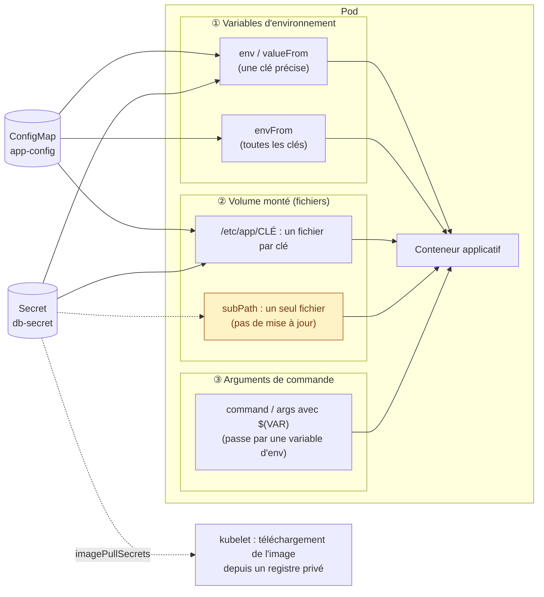

# Configuration et secrets

## Pourquoi ce cours ?

Une même image doit tourner en développement, en recette et en production **sans être reconstruite** : seule la **configuration** change (adresse de la base,
niveau de journalisation, mots de passe). C'est un principe des applications « 12 facteurs » : *la configuration vit dans l'environnement*. Kubernetes fournit deux
objets pour cela : les **ConfigMaps** (données non sensibles) et les **Secrets** (données sensibles). Mal utilisés, ils sont une source majeure de fuites : un Secret
n'est **pas chiffré** par défaut. Ce cours explique comment les consommer, les faire évoluer sans casse et les protéger.

> Prérequis : [secrets et sécurité Docker](../../08-docker-approfondi/cours/06-securite-et-bonnes-pratiques.md) (jamais de secret dans l'image), [pods et workloads](02-pods-et-workloads.md).

## 1. ConfigMaps : la configuration non sensible

Un **ConfigMap** est un ensemble de paires clé-valeur (jusqu'à 1 Mio), ou de **fichiers entiers**, stocké dans l'API.

```bash
kubectl create configmap app-config \
  --from-literal=APP_MODE=prod \
  --from-literal=LOG_LEVEL=info \
  --from-file=app.properties            # une clé « app.properties » contenant le fichier
kubectl get configmap app-config -o yaml
```

```yaml
apiVersion: v1
kind: ConfigMap
metadata: { name: app-config }
data:
  APP_MODE: "prod"
  LOG_LEVEL: "info"
  app.properties: |
    server.port=8080
    cache.ttl=300
    feature.paiement=true
```

### Les deux façons de les consommer

**1. Variables d'environnement**

```yaml
spec:
  containers:
    - name: app
      image: kamer/api:1.4.2
      env:
        - name: APP_MODE                 # une clé précise, éventuellement renommée
          valueFrom:
            configMapKeyRef: { name: app-config, key: APP_MODE }
      envFrom:                           # TOUTES les clés comme variables
        - configMapRef: { name: app-config }
```

**2. Fichiers montés (volume)**

```yaml
spec:
  containers:
    - name: app
      image: kamer/api:1.4.2
      volumeMounts:
        - name: config
          mountPath: /etc/app               # chaque clé devient un fichier dans ce dossier
          readOnly: true
  volumes:
    - name: config
      configMap:
        name: app-config
        items:                              # facultatif : choisir les clés et les noms de fichiers
          - key: app.properties
            path: application.properties
```

## 2. Secrets : les données sensibles

Un **Secret** a la même forme qu'un ConfigMap, mais est destiné aux mots de passe, jetons, clés, certificats. Il est traité avec plus de précautions : non affiché par défaut dans `kubectl describe`, protégeable par RBAC, montable en `tmpfs` (RAM) dans les pods.

```bash
kubectl create secret generic db-secret \
  --from-literal=DB_USER=app \
  --from-literal=DB_PASSWORD='S3cr3t!'
kubectl get secret db-secret -o yaml
kubectl get secret db-secret -o jsonpath='{.data.DB_PASSWORD}' | base64 -d ; echo
```

### `data` vs `stringData`

```yaml
apiVersion: v1
kind: Secret
metadata: { name: db-secret }
type: Opaque
stringData:                  # texte clair, pratique à écrire : converti en base64 à l'enregistrement
  DB_USER: app
  DB_PASSWORD: "S3cr3t!"
# data:                      # valeurs DÉJÀ encodées en base64
#   DB_USER: YXBw
```

| | `data` | `stringData` |
|---|---|---|
| Format | **base64** (vous encodez) | **Texte clair** (Kubernetes encode) |
| Relecture (`-o yaml`) | base64 | Toujours en `data` (base64) : `stringData` est **write-only** |
| Usage | Contenu binaire (certificats), génération par outil | Écriture manuelle |

Types intégrés : `Opaque` (défaut), `kubernetes.io/tls` (certificat + clé), `kubernetes.io/dockerconfigjson` (identifiants de registre → `imagePullSecrets`), `kubernetes.io/basic-auth`, `kubernetes.io/ssh-auth`, `kubernetes.io/service-account-token`.

### ⚠️ base64 n'est PAS du chiffrement

```bash
echo -n 'S3cr3t!' | base64            # UzNjcjN0IQ==
echo 'UzNjcjN0IQ==' | base64 -d       # S3cr3t!   ← n'importe qui peut décoder
```

Le **base64** est un simple **encodage** (pour transporter du binaire dans du YAML/JSON). Il n'apporte **aucune confidentialité**. Les risques réels :

| Où se trouve le secret ? | Risque | Mesure |
|---|---|---|
| **Dans `etcd`** | Stocké **en clair** (base64) par défaut : quiconque lit `etcd` ou une **sauvegarde** voit tout | **Chiffrement au repos** (`EncryptionConfiguration`, KMS du cloud) ; protéger/sauvegarder `etcd` de façon chiffrée |
| **Dans l'API** | `kubectl get secret -o yaml` par quiconque a le droit `get secrets` | **RBAC strict** : peu de personnes et de ServiceAccounts peuvent lire/lister les Secrets (**`list` secrets = tout lire**) |
| **Dans Git** | Un manifeste Secret commité = fuite, **même en base64** | Jamais en clair dans Git : voir §6 |
| **Dans les pods** | Variables d'environnement visibles par `kubectl exec ... env`, `/proc`, les journaux de crash | Préférer le **montage en fichier** ; contrôler `exec` via RBAC |
| **Dans les nœuds** | Les secrets sont montés en `tmpfs` (mémoire), mais un compromis du nœud les expose | Pod Security, isolation, nœuds dédiés |

> 📌 **À retenir** : un Secret Kubernetes **n'est pas coffre-fort** ; c'est un objet **séparé du reste de la configuration** pour pouvoir lui appliquer RBAC, chiffrement et audit. La vraie protection vient de ce qui l'entoure.

## 3. Variables d'environnement ou volume ?



| | **Variables d'environnement** | **Volume (fichiers)** |
|---|---|---|
| Simplicité | ✅ Très simple, universel (12 facteurs) | Demande de lire un fichier |
| **Mise à jour à chaud** | ❌ **Figées** au démarrage du conteneur : il faut **redémarrer le pod** | ✅ Mises à jour **propagées** (délai ~1 min, sauf `subPath`) : l'application doit relire le fichier |
| Fichiers de configuration entiers (nginx.conf, YAML) | ❌ | ✅ |
| Exposition des secrets | ⚠️ Visibles par `exec env`, `docker inspect`-équivalent, journaux de crash, héritées par les processus enfants | ✅ Fichiers à permissions (`defaultMode: 0400`), en `tmpfs`, pas dans l'environnement |
| Taille | Limite pratique | Jusqu'à 1 Mio |

> 💡 **Conseil** : pour un **secret**, préférez le **volume** (`defaultMode: 0400`) et configurez l'application pour lire un fichier (`DB_PASSWORD_FILE`, comme les images officielles Postgres/MySQL). Pour de la **configuration** simple (niveaux de log, drapeaux), des variables d'environnement suffisent.

```yaml
# Secret monté en fichier, en lecture seule, permissions strictes
spec:
  containers:
    - name: app
      image: kamer/api:1.4.2
      env:
        - name: DB_PASSWORD_FILE
          value: /etc/secret/DB_PASSWORD
      volumeMounts:
        - { name: secret, mountPath: /etc/secret, readOnly: true }
  volumes:
    - name: secret
      secret:
        secretName: db-secret
        defaultMode: 0400
```

> ⚠️ **Attention** : **`subPath`** monte **un seul fichier**, mais ce fichier **n'est jamais mis à jour** quand le ConfigMap/Secret change. Évitez-le si vous comptez sur la propagation.

## 4. Mise à jour, immutabilité et rolling updates

- Modifier un ConfigMap **ne redémarre pas** les pods qui l'utilisent. Les **variables d'environnement** gardent l'ancienne valeur ; les **volumes** se mettent à jour (avec délai), mais l'application doit **recharger** sa configuration.
- Résultat classique : « j'ai changé le ConfigMap et rien ne bouge ». Il faut **déclencher un nouveau rollout**.

Trois approches :

```bash
kubectl rollout restart deployment/app          # 1. manuel : relance progressive des pods
```

```yaml
# 2. Annotation avec une empreinte du contenu (Helm : checksum/config) : tout changement relance le rollout
spec:
  template:
    metadata:
      annotations:
        checksum/config: "{{ include (print $.Template.BasePath \"/configmap.yaml\") . | sha256sum }}"
```

```yaml
# 3. ConfigMap IMMUABLE + nom versionné : on crée app-config-v2 et on change la référence dans le Deployment
apiVersion: v1
kind: ConfigMap
metadata: { name: app-config-v2 }
immutable: true
data: { APP_MODE: prod }
```

**`immutable: true`** (ConfigMap et Secret) : le contenu **ne peut plus être modifié** (seulement supprimé et recréé). Avantages : protège contre une modification accidentelle, **améliore les performances** (le kubelet cesse de surveiller l'objet). Le **changement de nom** (`-v2`) transforme une mise à jour de configuration en une **vraie mise à jour de Deployment** : RollingUpdate progressif, historique, et `rollout undo` qui rétablit **l'ancienne configuration avec l'ancienne image**.

> 📌 **À retenir** : traitez la configuration comme du **code déployé** : versionnée, immuable, déployée par rollout. Un changement à chaud de ConfigMap, c'est une panne différée (les pods recréés plus tard auront une autre configuration que les anciens).

## 5. Sécuriser les Secrets dans le cluster

```yaml
# Chiffrement au repos dans etcd (configuration du kube-apiserver : --encryption-provider-config)
apiVersion: apiserver.config.k8s.io/v1
kind: EncryptionConfiguration
resources:
  - resources: [secrets]
    providers:
      - aescbc:                         # ou « kms » v2 : clé gérée par un KMS externe (recommandé)
          keys:
            - name: cle1
              secret: <clé de 32 octets en base64>
      - identity: {}                    # lecture des anciens secrets non chiffrés
```

```bash
# Vérifier que les secrets sont chiffrés dans etcd (doit afficher k8s:enc:aescbc:v1:…)
sudo ETCDCTL_API=3 etcdctl --cacert=/etc/kubernetes/pki/etcd/ca.crt --cert=/etc/kubernetes/pki/etcd/server.crt \
  --key=/etc/kubernetes/pki/etcd/server.key get /registry/secrets/default/db-secret | hexdump -C | head
kubectl get secrets --all-namespaces -o json | kubectl replace -f -      # ré-écrit tous les secrets avec le nouveau chiffrement

# Qui peut lire les secrets ?
kubectl auth can-i get secrets --as=system:serviceaccount:prod:app -n prod
kubectl auth can-i list secrets --as=jean -n prod
```

- **RBAC** : n'accordez `get/list/watch secrets` qu'à ce qui en a besoin, **dans un namespace précis** ([cours 07](07-securite-rbac-et-networkpolicies.md)). Évitez les `ClusterRole` qui lisent les secrets de tout le cluster.
- **Audit** : activez la journalisation d'audit de l'API pour tracer les accès aux Secrets.
- **Désactivez le montage automatique** du jeton de ServiceAccount si inutile : `automountServiceAccountToken: false`.

## 6. Gestion en production : ne jamais commiter de secret en clair

Le dépôt Git est la **source de vérité** (GitOps) : comment y mettre des secrets sans les exposer ?

| Solution | Principe | Idéal pour |
|---|---|---|
| **Sealed Secrets** (Bitnami) | Un contrôleur dans le cluster détient une **clé privée**. Vous chiffrez le Secret avec `kubeseal` en un objet **`SealedSecret`**, **sûr à commiter**, que **seul ce cluster** peut déchiffrer. | Équipes GitOps simples, sans service externe |
| **External Secrets Operator (ESO)** | Un opérateur **synchronise** des secrets depuis un **gestionnaire externe** (AWS Secrets Manager, GCP, Azure Key Vault, Vault) vers des Secrets Kubernetes. Dans Git : seulement une **référence** (`ExternalSecret`). | Entreprises avec un coffre central, rotation automatique |
| **HashiCorp Vault** | Coffre central : secrets **dynamiques** à courte durée de vie, authentification par **identité Kubernetes** (ServiceAccount), audit complet. Injection par **Vault Agent** (sidecar) ou **CSI driver**. | Exigences fortes : rotation, audit, secrets éphémères |
| **SOPS** (+ age / KMS) | Chiffre les **valeurs** dans le YAML (les clés restent lisibles) ; déchiffrement à l'application (Flux, Argo CD, `helm-secrets`) | Dépôt Git chiffré, simple |
| **Secrets Store CSI Driver** | Monte des secrets d'un coffre cloud comme **volume** (et peut les synchroniser en Secret) | Intégration directe aux coffres cloud |

```bash
# Sealed Secrets
kubectl create secret generic db-secret --from-literal=DB_PASSWORD='S3cr3t!' --dry-run=client -o yaml \
  | kubeseal --format yaml > db-sealed.yaml          # db-sealed.yaml peut être commité
kubectl apply -f db-sealed.yaml                      # le contrôleur crée le vrai Secret dans le cluster
```

```yaml
# External Secrets Operator : seule la référence est dans Git
apiVersion: external-secrets.io/v1beta1
kind: ExternalSecret
metadata: { name: db-secret }
spec:
  refreshInterval: 1h                      # resynchronisation : la rotation côté coffre est répercutée
  secretStoreRef: { name: vault-backend, kind: ClusterSecretStore }
  target: { name: db-secret }
  data:
    - secretKey: DB_PASSWORD
      remoteRef: { key: prod/db, property: password }
```

### Bonnes pratiques

1. **Aucun secret en clair dans Git** (ni en base64) : Sealed Secrets, ESO, SOPS ou Vault.
2. **Moindre privilège** : RBAC restreint sur les Secrets, un ServiceAccount par application.
3. **Chiffrement au repos** d'`etcd` (KMS) et **sauvegardes chiffrées**.
4. **Rotation régulière** et **à la demande** (en cas de fuite) ; secrets à **courte durée de vie** (Vault).
5. Montage en **fichier** plutôt qu'en variable d'environnement ; `defaultMode: 0400`.
6. Pas de secret dans l'**image**, ni dans les **arguments** de commande ni les journaux.
7. **Séparer** configuration (ConfigMap) et secrets ; un Secret par rôle (base de données, API externe).
8. Analyse automatique du dépôt : `gitleaks`, `trufflehog` en CI.

> ⚠️ **Attention** : un secret qui a **fuité** (commité, affiché dans un journal) est **compromis pour toujours** : **révoquez-le et régénérez-le**. Réécrire l'historique Git ne suffit pas.

## 7. Aperçu : autres sources de configuration

```yaml
env:
  - name: POD_NAME
    valueFrom: { fieldRef: { fieldPath: metadata.name } }          # Downward API : infos sur le pod lui-même
  - name: CPU_LIMIT
    valueFrom: { resourceFieldRef: { containerName: app, resource: limits.cpu } }
```

Autres outils : **Kustomize** (`configMapGenerator`, suffixe de hachage automatique), **Helm** (valeurs par environnement), variables d'**`ARG`** à la construction (jamais de secrets).

## Résumé

- **ConfigMap** : configuration non sensible ; **Secret** : données sensibles. Consommation par **variables d'environnement** (figées au démarrage) ou **volumes** (propagés, hors `subPath`).
- **`stringData`** (texte clair, write-only) vs **`data`** (base64). **base64 n'est pas du chiffrement** : le secret est en clair dans `etcd` sauf **chiffrement au repos** ; **RBAC** strict sur `get/list secrets`.
- Un ConfigMap modifié **ne relance pas** les pods : `rollout restart`, annotation avec empreinte, ou **ConfigMap `immutable` versionné** (`app-config-v2`) pour des **rolling updates** et rollbacks cohérents.
- Pour un secret : **fichier monté `0400`** plutôt qu'une variable d'environnement.
- En production : **jamais de secret en clair dans Git** → **Sealed Secrets**, **External Secrets Operator**, **SOPS**, **Vault** ; **rotation** ; secrets compromis = révoqués.

## Pour aller plus loin

- <https://kubernetes.io/fr/docs/concepts/configuration/> ; chiffrement des données au repos : <https://kubernetes.io/docs/tasks/administer-cluster/encrypt-data/>.
- Sealed Secrets : <https://github.com/bitnami-labs/sealed-secrets> ; External Secrets : <https://external-secrets.io/> ; Vault : <https://developer.hashicorp.com/vault>.
- Stratégies : `Reloader` (redémarre les pods quand un ConfigMap/Secret change), Kustomize `configMapGenerator`.
- Cours suivant : [Scheduling et ressources](06-scheduling-et-ressources.md).
- Atelier associé : [ConfigMap, Secret et RBAC](../ateliers-killercoda/atelier-03-configmap-secret-et-rbac/intro.md).
