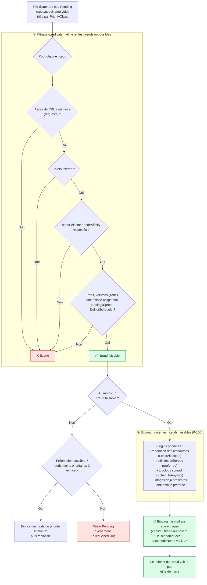

# Scheduling et gestion des ressources

## Pourquoi ce cours ?

Dans un cluster partagé, deux questions décident de la stabilité de la production : **où** chaque pod est-il placé, et **combien de ressources** a-t-il le droit de consommer ?
Sans requêtes ni limites, un pod gourmand affame ses voisins ; sans règles de placement, tous les réplicas d'une application peuvent atterrir sur le **même nœud** et tomber ensemble.
Ce cours explique le **scheduler**, les **requests/limits** et leurs conséquences (QoS, éviction, OOM), puis les outils de placement : **taints**, **affinités**, **topology spread**, **priorités**
et la **mise à l'échelle automatique**.

> Prérequis : [architecture](01-architecture-et-composants.md) (rôle du scheduler) et [cgroups](../../04-linux-expert/cours/02-conteneurs-namespaces.md) (`cpu.max`, `memory.max`) : les limites Kubernetes sont des limites **cgroup**.

## 1. Requests et limits

Chaque conteneur peut déclarer deux valeurs par ressource :

| | **`requests`** | **`limits`** |
|---|---|---|
| Sens | Quantité **garantie** (réservée) | **Plafond** à ne pas dépasser |
| Utilisé par | Le **scheduler** (placement) et le kubelet (cgroup `cpu.weight`) | Le **kubelet / noyau** (cgroup `cpu.max`, `memory.max`) |
| Si le nœud n'a pas assez | Le pod **n'est pas placé** (`Pending`) | — |

```yaml
resources:
  requests:
    cpu: "250m"          # 0,25 cœur (250 millicores)
    memory: "256Mi"
  limits:
    cpu: "500m"
    memory: "512Mi"
```

Unités : CPU en **cœurs** (`1` = 1 vCPU, `500m` = 0,5) ; mémoire en octets (`Mi`/`Gi` = puissances de 2 ; `M`/`G` = puissances de 10).

### Les limites n'ont pas le même effet pour le CPU et la mémoire

| Ressource | Type | Si la limite est dépassée |
|---|---|---|
| **CPU** | **Compressible** | Le conteneur est **ralenti** (*throttling* : quota CFS), jamais tué |
| **Mémoire** | **Non compressible** | Le noyau déclenche l'**OOM killer** : conteneur **tué** (`OOMKilled`, code 137), puis redémarré |

```bash
kubectl top pods                                  # nécessite metrics-server
kubectl top nodes
kubectl describe node <nom> | sed -n '/Allocated resources/,/Events/p'
kubectl get pod app -o jsonpath='{.status.containerStatuses[0].lastState.terminated.reason}'    # OOMKilled
cat /sys/fs/cgroup/cpu.max /sys/fs/cgroup/memory.max     # depuis le conteneur : les limites réelles
```

> 💡 **Conseil** : des **requests réalistes** sont plus importantes que les limits. Trop basses : surcharge des nœuds ; trop hautes : gaspillage de capacité. Mesurez l'usage réel (`kubectl top`, Prometheus, **VPA** en mode recommandation).

> ⚠️ **Attention** : une **limite CPU trop basse** crée du *throttling* qui dégrade la latence sans aucune erreur visible. Beaucoup d'équipes définissent les **requests CPU sans limit CPU**, mais gardent une **limit mémoire égale à la request**.

### Classes de QoS

Le kubelet classe chaque pod selon ses requests/limits ; c'est ce classement qui décide **qui est évincé en premier** quand un nœud manque de mémoire :

| QoS | Condition | Éviction |
|---|---|---|
| **Guaranteed** | **Tous** les conteneurs ont requests **=** limits (CPU **et** mémoire) | **En dernier** |
| **Burstable** | Au moins une request ou limit, sans remplir les conditions Guaranteed | Au milieu (selon l'usage au-delà des requests) |
| **BestEffort** | **Aucune** request ni limit | **En premier** |

```bash
kubectl get pod app -o jsonpath='{.status.qosClass}'
```

Pour les pods critiques (bases de données), visez **Guaranteed**.

### Namespaces : `LimitRange` et `ResourceQuota`

```yaml
apiVersion: v1
kind: LimitRange                     # valeurs par défaut et bornes par conteneur
metadata: { name: defauts, namespace: equipe-a }
spec:
  limits:
    - type: Container
      default:        { cpu: 500m, memory: 512Mi }     # limits par défaut
      defaultRequest: { cpu: 100m, memory: 128Mi }     # requests par défaut
      max:            { cpu: "2",  memory: 2Gi }
---
apiVersion: v1
kind: ResourceQuota                  # plafond GLOBAL du namespace
metadata: { name: quota, namespace: equipe-a }
spec:
  hard:
    requests.cpu: "10"
    requests.memory: 20Gi
    limits.memory: 40Gi
    pods: "50"
    persistentvolumeclaims: "10"
```

## 2. Comment le scheduler choisit un nœud

Pour chaque pod `Pending` sans nœud, le **kube-scheduler** applique deux phases : **filtrage** (quels nœuds sont **possibles** ?) puis **scoring** (quel est le **meilleur** ?), et enfin la **liaison**.



> 📌 **À retenir** : le scheduler place d'après les **`requests`**, **pas** d'après l'usage réel. Un nœud « presque vide » mais dont les requests sont déjà toutes réservées est **plein** pour le scheduler.

Diagnostic d'un pod `Pending` :

```bash
kubectl describe pod app | sed -n '/Events/,$p'
# 0/3 nodes are available: 1 Insufficient memory, 1 node(s) had untolerated taint {dedie: gpu}, 1 node(s) didn't match Pod's node affinity/selector.
kubectl get events --field-selector reason=FailedScheduling
```

## 3. Taints et tolerations : repousser les pods

Un **taint** (« souillure ») sur un **nœud** **repousse** les pods qui ne le **tolèrent** pas. C'est le nœud qui dit « n'approchez pas, sauf si… ».

```bash
kubectl taint nodes noeud-gpu dedie=gpu:NoSchedule        # poser
kubectl taint nodes noeud-gpu dedie=gpu:NoSchedule-       # retirer (le « - » final)
kubectl describe node noeud-gpu | grep Taints
```

| Effet | Comportement |
|---|---|
| **`NoSchedule`** | Les nouveaux pods **sans toleration** ne sont **pas planifiés** ici (les pods existants restent) |
| **`PreferNoSchedule`** | Le scheduler **évite** ce nœud si possible (préférence) |
| **`NoExecute`** | Comme `NoSchedule`, **et évince** les pods déjà présents sans toleration (`tolerationSeconds` pour retarder) |

```yaml
spec:
  tolerations:
    - key: "dedie"
      operator: "Equal"            # ou « Exists » (toute valeur)
      value: "gpu"
      effect: "NoSchedule"
```

Kubernetes pose lui-même des taints : `node-role.kubernetes.io/control-plane:NoSchedule` (c'est pourquoi les applications ne tournent pas sur le control plane), `node.kubernetes.io/not-ready` et `unreachable` (**`NoExecute`** : les pods d'un nœud défaillant sont évincés après `tolerationSeconds` = 300 s par défaut).

> ⚠️ **Attention** : une **toleration autorise** seulement un pod à aller sur un nœud tainté, elle ne l'**y oblige pas**. Pour **réserver** des nœuds à un usage : **taint** (repousser les autres) **+** `nodeSelector`/affinité (attirer les bons pods).

## 4. Choisir des nœuds : nodeSelector et affinités

### `nodeSelector` : l'exigence simple

```yaml
spec:
  nodeSelector:
    disktype: ssd
```

```bash
kubectl label nodes noeud-1 disktype=ssd
kubectl get nodes --show-labels
```

Labels automatiques utiles : `kubernetes.io/hostname`, `kubernetes.io/arch`, `topology.kubernetes.io/zone`, `topology.kubernetes.io/region`, `node.kubernetes.io/instance-type`.

### Node affinity : règles expressives

```yaml
spec:
  affinity:
    nodeAffinity:
      requiredDuringSchedulingIgnoredDuringExecution:      # OBLIGATOIRE (filtrage)
        nodeSelectorTerms:
          - matchExpressions:
              - { key: topology.kubernetes.io/zone, operator: In, values: [zone-a, zone-b] }
      preferredDuringSchedulingIgnoredDuringExecution:     # PRÉFÉRÉ (scoring)
        - weight: 80
          preference:
            matchExpressions:
              - { key: disktype, operator: In, values: [ssd] }
```

Opérateurs : `In`, `NotIn`, `Exists`, `DoesNotExist`, `Gt`, `Lt`. Le suffixe **`IgnoredDuringExecution`** signifie : si les labels changent après le placement, le pod **n'est pas déplacé**.

### Pod affinity et anti-affinity : par rapport aux **autres pods**

- **Affinité** : placer un pod **près** d'autres pods (cache et application sur le même nœud pour la latence).
- **Anti-affinité** : **éloigner** des pods (répartir les réplicas pour la **haute disponibilité**).

```yaml
spec:
  affinity:
    podAntiAffinity:
      requiredDuringSchedulingIgnoredDuringExecution:
        - labelSelector:
            matchLabels: { app: web }
          topologyKey: kubernetes.io/hostname           # un seul pod « web » par NŒUD
      # topologyKey: topology.kubernetes.io/zone        # un seul par ZONE
```

> 💡 **Conseil** : l'anti-affinité **obligatoire** empêche d'avoir plus de réplicas que de nœuds (les pods restent `Pending`). Préférez la version **`preferred`** ou, mieux, les **topology spread constraints**.

## 5. Topology spread constraints : répartir équitablement

Plus simple et plus flexible que l'anti-affinité : on demande que les pods soient **répartis de façon équilibrée** entre des **domaines de topologie** (nœuds, zones, régions).

```yaml
spec:
  topologySpreadConstraints:
    - maxSkew: 1                                   # écart maximal de nombre de pods entre domaines
      topologyKey: topology.kubernetes.io/zone     # domaine : la zone
      whenUnsatisfiable: DoNotSchedule             # DoNotSchedule (strict) | ScheduleAnyway (préférence)
      labelSelector:
        matchLabels: { app: web }
    - maxSkew: 1
      topologyKey: kubernetes.io/hostname
      whenUnsatisfiable: ScheduleAnyway
      labelSelector:
        matchLabels: { app: web }
```

Avec 6 réplicas et 3 zones, `maxSkew: 1` → **2 pods par zone** (écart maximal de 1). Si une zone tombe, les deux tiers de la capacité restent.

## 6. PriorityClass et préemption

Quand le cluster est plein, quels pods **passent en premier** ? Une **PriorityClass** attribue un **entier** de priorité ; les pods les plus prioritaires sont **planifiés d'abord** et peuvent **évincer** (préempter) des pods moins prioritaires pour libérer de la place.

```yaml
apiVersion: scheduling.k8s.io/v1
kind: PriorityClass
metadata: { name: critique }
value: 1000000
globalDefault: false
preemptionPolicy: PreemptLowerPriority       # ou Never : prioritaire dans la file, mais n'évince personne
description: "Services de production critiques"
---
apiVersion: v1
kind: Pod
metadata: { name: api }
spec:
  priorityClassName: critique
  containers: [{ name: api, image: nginx:1.27 }]
```

Classes système : `system-cluster-critical` (2 000 000 000) et `system-node-critical` (2 000 001 000), réservées aux composants vitaux. Ne confondez pas **priorité** (ordonnancement et préemption) et **QoS** (éviction par manque de mémoire sur un nœud).

> ⚠️ **Attention** : donner une priorité élevée à **trop** de charges annule l'effet et peut évincer des services utiles. Réservez-la au petit nombre de services réellement critiques et combinez avec des **`ResourceQuota`** par namespace.

## 7. Mise à l'échelle automatique

### HPA : Horizontal Pod Autoscaler

Ajuste le **nombre de réplicas** d'un Deployment (ou StatefulSet) selon une **métrique** (CPU, mémoire, métriques personnalisées/externes). Nécessite **metrics-server**.

```yaml
apiVersion: autoscaling/v2
kind: HorizontalPodAutoscaler
metadata: { name: web }
spec:
  scaleTargetRef: { apiVersion: apps/v1, kind: Deployment, name: web }
  minReplicas: 3
  maxReplicas: 20
  metrics:
    - type: Resource
      resource:
        name: cpu
        target: { type: Utilization, averageUtilization: 70 }     # 70 % de la REQUEST CPU
  behavior:
    scaleDown:
      stabilizationWindowSeconds: 300                              # évite le « yo-yo »
```

Formule : `réplicas désirés = ⌈ réplicas actuels × (métrique actuelle / cible) ⌉`. L'**utilisation** est calculée **par rapport aux `requests`** : **sans requests, le HPA CPU ne fonctionne pas**.

```bash
kubectl autoscale deployment web --cpu-percent=70 --min=3 --max=20
kubectl get hpa -w
kubectl run charge --rm -it --image=busybox:1.36 -- sh -c 'while true; do wget -q -O- http://web; done'
```

### VPA : Vertical Pod Autoscaler

Ajuste les **`requests` (et limits) d'un conteneur** d'après l'usage réel observé. Modes : **`Off`** (recommandations seulement : *très utile pour dimensionner*), `Initial` (à la création), **`Auto`/`Recreate`** (recrée les pods, avec interruption ; l'« in-place » arrive progressivement).

```yaml
apiVersion: autoscaling.k8s.io/v1
kind: VerticalPodAutoscaler
metadata: { name: api }
spec:
  targetRef: { apiVersion: apps/v1, kind: Deployment, name: api }
  updatePolicy: { updateMode: "Off" }          # lire : kubectl describe vpa api
```

> ⚠️ **Attention** : **ne combinez pas** HPA et VPA sur la **même métrique** (CPU/mémoire) : ils se contrarient. Usage courant : **HPA** pour les réplicas, **VPA en mode `Off`** pour **affiner les requests**.

Et si les **nœuds** manquent ? Le **Cluster Autoscaler** ou **Karpenter** ajoutent des nœuds quand des pods restent `Pending` faute de ressources, et en retirent quand ils sont sous-utilisés. **KEDA** étend le HPA à des évènements (longueur de file, etc.), jusqu'à zéro réplica.

### Autres outils de disponibilité

```yaml
apiVersion: policy/v1
kind: PodDisruptionBudget              # garde-fou pendant les opérations volontaires (drain, mises à jour de nœuds)
metadata: { name: web }
spec:
  minAvailable: 2
  selector: { matchLabels: { app: web } }
```

```bash
kubectl drain noeud-1 --ignore-daemonsets --delete-emptydir-data    # évacue un nœud en respectant les PDB
kubectl cordon noeud-1 ; kubectl uncordon noeud-1                   # (dé)marque non planifiable
```

## Résumé

- **`requests`** : réservation utilisée par le **scheduler** ; **`limits`** : plafond cgroup. **CPU** dépassé = ralentissement ; **mémoire** dépassée = **OOMKilled**.
- **QoS** : **Guaranteed** (requests = limits) > **Burstable** > **BestEffort** (évincé en premier). `LimitRange` et `ResourceQuota` encadrent un namespace.
- **Scheduler** : **filtrage** (ressources, taints, affinités) → **scoring** → **binding** ; préemption si pas de place pour un pod prioritaire.
- **Taints / tolerations** : le **nœud repousse** (`NoSchedule`, `PreferNoSchedule`, `NoExecute`). **nodeSelector / affinity** : le pod **choisit** ; **anti-affinity** et **topologySpreadConstraints** : répartir pour la haute disponibilité.
- **PriorityClass** : ordre et préemption. **HPA** : réplicas (basé sur les **requests**), **VPA** : taille des pods, **Cluster Autoscaler/Karpenter** : nœuds ; **PDB** protège pendant les opérations.

## Pour aller plus loin

- <https://kubernetes.io/fr/docs/concepts/scheduling-eviction/> ; <https://kubernetes.io/docs/tasks/run-application/horizontal-pod-autoscale/>.
- `kubectl top`, `kube-state-metrics`, **Goldilocks** (recommandations VPA), `descheduler`, profils de scheduler.
- KEDA, Karpenter, nœuds *spot*/préemptibles et taints dédiés.
- Cours suivant : [Sécurité : RBAC et NetworkPolicies](07-securite-rbac-et-networkpolicies.md).
