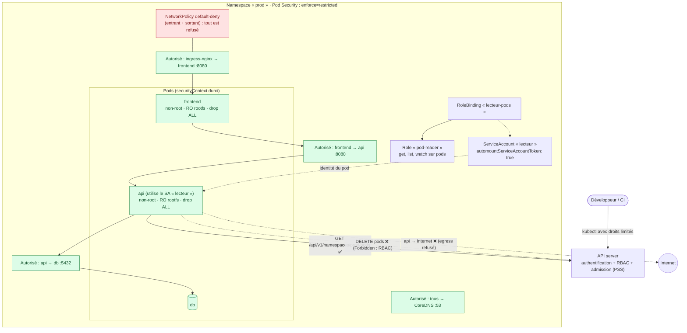

# Sécurité : RBAC, Pod Security et NetworkPolicies

## Pourquoi ce cours ?

Un cluster Kubernetes expose une **API puissante** : celui qui peut créer un pod peut, selon la configuration, lire tous les secrets, monter le disque d'un nœud ou
prendre le contrôle du cluster. La sécurité ne repose pas sur un interrupteur, mais sur **plusieurs couches** : qui peut faire quoi (RBAC), ce que les pods ont le droit
d'être (Pod Security, `securityContext`), et qui peut parler à qui (NetworkPolicies). Ce cours applique le **moindre privilège** à chacune, en reprenant ce que vous savez du
[durcissement Docker](../../08-docker-approfondi/cours/06-securite-et-bonnes-pratiques.md) (capabilities, utilisateur non-root, lecture seule).

> Prérequis : [architecture](01-architecture-et-composants.md) (chaîne authentification → autorisation → admission), [configuration et secrets](05-configuration-et-secrets.md), [permissions Linux](../../01-linux-fondamentaux/cours/04-utilisateurs-permissions.md).

## 1. Défense en profondeur

Une requête et un pod traversent plusieurs barrières ; **chacune** réduit les dégâts d'une compromission des précédentes :

| Couche | Question | Mécanisme |
|---|---|---|
| **1. Accès à l'API** | Qui êtes-vous ? Avez-vous le droit ? | **Authentification** (certificats, OIDC, jetons), **RBAC**, contrôleurs d'**admission** |
| **2. Charge de travail** | Que peut faire ce pod sur le nœud ? | **Pod Security Standards**, **`securityContext`** (non-root, capabilities, seccomp, lecture seule) |
| **3. Réseau** | Qui peut parler à ce pod ? | **NetworkPolicies**, mTLS (service mesh) |
| **4. Données** | Les secrets sont-ils protégés ? | Chiffrement d'etcd, gestion externe des secrets, RBAC sur `secrets` |
| **5. Chaîne d'approvisionnement** | L'image est-elle fiable ? | Scan (Trivy), signature (cosign), registre privé, politiques d'admission (Kyverno) |
| **6. Hôte et cluster** | Les nœuds et le control plane sont-ils protégés ? | Noeuds à jour, API non exposée, audit, CIS Kubernetes Benchmark (`kube-bench`) |
| **7. Détection** | Voit-on une attaque ? | Journaux d'audit, Falco, alertes |

## 2. RBAC : qui peut faire quoi

**RBAC** (*Role-Based Access Control*) autorise des **sujets** à effectuer des **verbes** sur des **ressources**. C'est un modèle **additif** : il n'existe **que des règles d'autorisation** (pas de « deny »). Tout est refusé par défaut.

### Les quatre objets

| Objet | Portée | Rôle |
|---|---|---|
| **Role** | **Un namespace** | Liste de permissions (règles) dans ce namespace |
| **ClusterRole** | **Tout le cluster** | Permissions sur des ressources **globales** (nodes, PV…), ou modèle réutilisable dans tout namespace |
| **RoleBinding** | **Un namespace** | **Accorde** un Role (ou un ClusterRole) à des sujets, **dans ce namespace** |
| **ClusterRoleBinding** | **Tout le cluster** | Accorde un ClusterRole à des sujets **partout** |

Sujets (*subjects*) : **User** et **Group** (identités externes : certificats, OIDC : Kubernetes ne gère pas les utilisateurs humains), **ServiceAccount** (identité d'un **pod**, objet Kubernetes).

```yaml
apiVersion: v1
kind: ServiceAccount
metadata: { name: lecteur, namespace: atelier }
---
apiVersion: rbac.authorization.k8s.io/v1
kind: Role
metadata: { name: pod-reader, namespace: atelier }
rules:
  - apiGroups: [""]                       # "" = groupe « core » (pods, services, configmaps, secrets…)
    resources: ["pods", "pods/log"]
    verbs: ["get", "list", "watch"]
---
apiVersion: rbac.authorization.k8s.io/v1
kind: RoleBinding
metadata: { name: lecteur-pods, namespace: atelier }
subjects:
  - kind: ServiceAccount
    name: lecteur
    namespace: atelier
roleRef:
  kind: Role
  name: pod-reader
  apiGroup: rbac.authorization.k8s.io
```

Verbes : `get`, `list`, `watch`, `create`, `update`, `patch`, `delete`, `deletecollection` (+ `exec`, `bind`, `escalate`, `impersonate` sur des sous-ressources spéciales). Une règle peut aussi cibler `resourceNames: ["mon-secret"]` (objet précis) ou `nonResourceURLs` (`/healthz`).

```bash
kubectl create serviceaccount lecteur -n atelier
kubectl create role pod-reader --verb=get,list,watch --resource=pods -n atelier
kubectl create rolebinding lecteur-pods --role=pod-reader --serviceaccount=atelier:lecteur -n atelier

# Tester les droits (sans se connecter)
kubectl auth can-i list pods --as=system:serviceaccount:atelier:lecteur -n atelier        # yes
kubectl auth can-i delete pods --as=system:serviceaccount:atelier:lecteur -n atelier      # no
kubectl auth can-i --list --as=system:serviceaccount:atelier:lecteur -n atelier           # tout ce qui est permis
kubectl auth can-i create deployments --as=jean --as-group=devs -n prod

# Audit : qui a accès à quoi ?
kubectl get rolebindings,clusterrolebindings -A -o wide | grep -i cluster-admin
kubectl describe clusterrole view
```

### ServiceAccounts : l'identité des pods

Chaque pod s'exécute avec un **ServiceAccount** (`default` si non précisé) et reçoit un **jeton** pour appeler l'API (jeton **projeté, à durée limitée et lié au pod** depuis la 1.22).

```yaml
spec:
  serviceAccountName: lecteur
  automountServiceAccountToken: false       # si le pod n'a PAS besoin d'appeler l'API : ne pas monter le jeton
```

> ⚠️ **Attention** : le ServiceAccount **`default`** de chaque namespace est partagé par tous les pods qui n'en précisent pas : ne lui accordez **jamais** de droits. Créez **un ServiceAccount par application**, avec uniquement ce qu'elle doit faire.

### Moindre privilège : éviter `cluster-admin`

**`cluster-admin`** (`*` sur `*`, partout) équivaut à **root sur tout le cluster**. Les erreurs classiques :

| ❌ À éviter | Pourquoi | ✅ À la place |
|---|---|---|
| `ClusterRoleBinding` vers `cluster-admin` pour une application ou « pour que ça marche » | Prise de contrôle totale en cas de compromission du pod | Un **Role** minimal dans **un namespace** |
| `verbs: ["*"]`, `resources: ["*"]` | Inclut des droits dangereux non prévus | Lister précisément verbes et ressources |
| Droit `list`/`get` sur **`secrets`** | Lit **tous** les mots de passe du namespace (`list` suffit) | Limiter à `resourceNames` précis, ou ne pas l'accorder |
| `create pods` ou `pods/exec` large | Permet d'exécuter du code dans d'autres pods ; un pod peut monter un hôte, un secret | Restreindre, associer à Pod Security `restricted` |
| `bind`/`escalate`/`impersonate`, `create rolebindings` | **Élévation de privilèges** : se donner soi-même des droits | Réservé aux administrateurs |
| `ClusterRoleBinding` au groupe `system:authenticated` / `system:unauthenticated` | Tout le monde | Jamais |

> 📌 **À retenir** : accordez au **plus petit périmètre** (namespace plutôt que cluster), aux **plus petits verbes**, sur les **ressources nommées**, au **ServiceAccount dédié**, et **revoyez** régulièrement (`kubectl get clusterrolebindings`, outils `rbac-tool`, `kubectl-who-can`, `rakkess`).

Les ClusterRoles intégrés utiles : `view` (lecture seule, hors secrets), `edit` (lecture-écriture, hors RBAC), `admin` (tout dans un namespace, RBAC inclus), `cluster-admin`.

## 3. Pod Security Standards (PSS)

Les **Pod Security Standards** définissent **trois profils** de sécurité cumulatifs pour les pods. Le contrôleur d'admission intégré **Pod Security Admission** les applique **par namespace**, par **labels** (remplace les anciennes `PodSecurityPolicy`, supprimées en 1.25).

| Profil | Niveau | Autorise | Exemples d'interdits |
|---|---|---|---|
| **`privileged`** | Aucune restriction | Tout | — (réservé aux composants système : CNI, CSI, agents) |
| **`baseline`** | Empêche les **escalades connues** : permissif, adapté à la plupart des applications | Conteneurs standards | `privileged: true`, `hostNetwork`/`hostPID`/`hostIPC`, `hostPath`, capabilities dangereuses (`SYS_ADMIN`, `NET_ADMIN`…), ports hôte |
| **`restricted`** | **Bonnes pratiques de durcissement** | Applications modernes | En plus : **`runAsNonRoot: true`** obligatoire, **`allowPrivilegeEscalation: false`**, **`capabilities.drop: [ALL]`**, **`seccompProfile`** (`RuntimeDefault`), types de volumes limités |

Trois **modes** d'application, chacun lié à un profil :

| Mode | Effet |
|---|---|
| `enforce` | Le pod non conforme est **rejeté** |
| `audit` | Autorisé, mais une entrée est ajoutée au **journal d'audit** |
| `warn` | Autorisé, mais un **avertissement** est renvoyé à l'utilisateur |

```bash
kubectl label namespace prod \
  pod-security.kubernetes.io/enforce=restricted \
  pod-security.kubernetes.io/enforce-version=latest \
  pod-security.kubernetes.io/warn=restricted \
  pod-security.kubernetes.io/audit=restricted
kubectl get ns prod --show-labels

# Tester l'effet d'un profil sans rien casser : simulation côté serveur
kubectl label --dry-run=server --overwrite ns --all pod-security.kubernetes.io/enforce=baseline
kubectl run test --image=nginx:1.27 -n prod        # rejeté : violations listées (runAsNonRoot, capabilities…)
```

Démarche progressive : commencer par **`warn` + `audit` en `restricted`** (pour mesurer), corriger les charges, **puis** `enforce`. Le namespace `kube-system` reste en `privileged`.

## 4. SecurityContext : durcir un pod et ses conteneurs

Le **`securityContext`** applique les mécanismes du noyau vus avec Docker (utilisateur, capabilities, seccomp, système de fichiers).

```yaml
apiVersion: v1
kind: Pod
metadata: { name: api-durci }
spec:
  automountServiceAccountToken: false
  securityContext:                        # niveau POD
    runAsNonRoot: true
    runAsUser: 10001
    runAsGroup: 10001
    fsGroup: 10001                        # propriétaire de groupe des volumes montés
    seccompProfile: { type: RuntimeDefault }
  containers:
    - name: api
      image: kamer/api:1.4.2@sha256:<digest>
      securityContext:                    # niveau CONTENEUR (prioritaire)
        allowPrivilegeEscalation: false   # no-new-privileges
        readOnlyRootFilesystem: true
        capabilities:
          drop: ["ALL"]
          # add: ["NET_BIND_SERVICE"]     # uniquement si indispensable
      resources:
        requests: { cpu: 100m, memory: 128Mi }
        limits:   { memory: 256Mi }
      volumeMounts:
        - { name: tmp, mountPath: /tmp }
  volumes:
    - name: tmp
      emptyDir: { medium: Memory, sizeLimit: 64Mi }      # seule zone inscriptible
```

| Champ | Équivalent Docker | Effet |
|---|---|---|
| `runAsNonRoot: true` | `USER` non-root | Kubernetes **refuse** de démarrer un conteneur dont l'UID est 0 (exige un **UID numérique** dans l'image) |
| `runAsUser` / `runAsGroup` | `--user` | UID/GID du processus |
| `readOnlyRootFilesystem: true` | `--read-only` | Racine en lecture seule ; zones inscriptibles via `emptyDir` |
| `capabilities.drop: [ALL]` | `--cap-drop=ALL` | Retire les pouvoirs de root ; ajoutez le strict nécessaire |
| `allowPrivilegeEscalation: false` | `--security-opt no-new-privileges` | Empêche de gagner des privilèges (`setuid`) |
| `privileged: true` | `--privileged` | ⚠️ **À proscrire** : accès total à l'hôte |
| `seccompProfile: RuntimeDefault` | profil seccomp par défaut | Filtre des appels système |
| `fsGroup` | `chown` du volume | Droits de groupe sur les volumes |
| `hostNetwork` / `hostPID` / `hostPath` | `--net=host`… | ⚠️ Supprime l'isolation : interdit par `baseline` |

> 💡 **Conseil** : ces réglages sont l'**exacte traduction Kubernetes** du durcissement vu au module 08. Une image construite correctement (utilisateur numérique non-root, aucun écrit hors `/tmp`) passe le profil **`restricted`** sans effort ; sinon, `kubectl apply` vous indiquera champ par champ ce qui manque.

Complément : les **politiques d'admission** (**Kyverno**, **OPA Gatekeeper**, `ValidatingAdmissionPolicy` natif) imposent des règles de l'organisation : registres autorisés, images signées, étiquettes obligatoires, requests/limits obligatoires.

## 5. NetworkPolicies : isoler le réseau

Par défaut, **tous les pods se parlent** ([cours 03](03-services-et-reseau-kubernetes.md)). Une **NetworkPolicy** restreint le trafic des pods qu'elle sélectionne, **par namespace, label et port**. Elle nécessite un **CNI qui l'applique** (Calico, Cilium ; **pas** Flannel seul).

Règles du jeu :

1. Une NetworkPolicy **sélectionne des pods** (`podSelector`) et déclare un ou plusieurs `policyTypes` : **`Ingress`** (entrant) et/ou **`Egress`** (sortant).
2. Dès qu'**au moins une** policy sélectionne un pod **pour un sens donné**, **tout ce qui n'est pas explicitement autorisé est refusé** pour ce sens.
3. Les règles **s'additionnent** (union). Il n'y a **pas de règle de refus** explicite.
4. Elles portent sur les **connexions** (suivi d'état) : la réponse à une connexion autorisée est autorisée.

### Étape 1 : *default-deny*

```yaml
apiVersion: networking.k8s.io/v1
kind: NetworkPolicy
metadata: { name: default-deny-all, namespace: prod }
spec:
  podSelector: {}                         # TOUS les pods du namespace
  policyTypes: [Ingress, Egress]          # aucune règle listée : tout est refusé, entrant et sortant
```

> ⚠️ **Attention** : avec un *deny* **egress**, même le **DNS** est bloqué : l'application ne résout plus aucun nom. Autorisez-le explicitement (étape suivante).

### Étape 2 : autoriser le strict nécessaire

```yaml
# Autoriser le DNS (CoreDNS dans kube-system) pour tous les pods
apiVersion: networking.k8s.io/v1
kind: NetworkPolicy
metadata: { name: allow-dns, namespace: prod }
spec:
  podSelector: {}
  policyTypes: [Egress]
  egress:
    - to:
        - namespaceSelector:
            matchLabels: { kubernetes.io/metadata.name: kube-system }
          podSelector:
            matchLabels: { k8s-app: kube-dns }
      ports:
        - { protocol: UDP, port: 53 }
        - { protocol: TCP, port: 53 }
---
# Le frontend peut joindre l'API ; l'API accepte le trafic du frontend et de l'Ingress Controller
apiVersion: networking.k8s.io/v1
kind: NetworkPolicy
metadata: { name: api-ingress, namespace: prod }
spec:
  podSelector: { matchLabels: { app: api } }
  policyTypes: [Ingress]
  ingress:
    - from:
        - podSelector: { matchLabels: { app: frontend } }                       # pods du MÊME namespace
        - namespaceSelector:                                                     # OU un autre namespace
            matchLabels: { kubernetes.io/metadata.name: ingress-nginx }
      ports:
        - { protocol: TCP, port: 8080 }
---
# L'API peut joindre la base de données, rien d'autre
apiVersion: networking.k8s.io/v1
kind: NetworkPolicy
metadata: { name: api-egress, namespace: prod }
spec:
  podSelector: { matchLabels: { app: api } }
  policyTypes: [Egress]
  egress:
    - to:
        - podSelector: { matchLabels: { app: db } }
      ports: [{ protocol: TCP, port: 5432 }]
```

Subtilité de syntaxe, **ET** contre **OU** dans `from`/`to` :

```yaml
- from:
    - namespaceSelector: { matchLabels: { equipe: a } }     # ① OU ② : deux ÉLÉMENTS de liste (deux « - »)
    - podSelector:       { matchLabels: { app: web } }
- from:
    - namespaceSelector: { matchLabels: { equipe: a } }     # ET : un SEUL élément, avec les deux sélecteurs
      podSelector:       { matchLabels: { app: web } }      # « pods web des namespaces équipe=a »
```

Autres éléments : `ipBlock` (`cidr: 10.0.0.0/8`, `except: […]`) pour joindre l'extérieur du cluster ; ports nommés ; `endPort` pour une plage.

```bash
kubectl get networkpolicy -n prod
kubectl describe networkpolicy api-ingress -n prod
kubectl run test --rm -it -n prod --image=busybox:1.36 --labels=app=frontend -- wget -qO- -T3 http://api:8080     # autorisé
kubectl run test --rm -it -n prod --image=busybox:1.36 --labels=app=autre    -- wget -qO- -T3 http://api:8080     # timeout : bloqué
```

> 💡 **Conseil** : une NetworkPolicy qui bloque se manifeste par un **timeout** (paquets jetés), pas par « connection refused » (voir le [diagnostic du module 06](../../06-reseaux-devops/cours/05-diagnostic-reseau-devops.md)). Procédez **namespace par namespace** : *default-deny* + DNS + flux explicites, et testez après chaque règle.

### Architecture complète : un exemple de moindre privilège



Ce que l'architecture garantit :

- **RBAC** : le ServiceAccount de l'API ne peut que **lire** les pods de **son** namespace ; une tentative de suppression est refusée (`Forbidden`).
- **PSS `restricted`** : un pod qui tournerait en root ou privilégié est **rejeté** à l'admission.
- **NetworkPolicies** : tout est refusé par défaut ; seuls **quatre flux** sont ouverts ; l'API ne sort pas sur Internet et la base n'est joignable **que** par l'API.
- Si l'application est **compromise**, l'attaquant est **non-root**, sans capabilities, en lecture seule, avec un jeton aux droits minimaux et sans route réseau vers ce qui n'est pas prévu.

## 6. Autres éléments à ne pas oublier

- **Secrets** : chiffrement au repos, RBAC strict ([cours 05](05-configuration-et-secrets.md)).
- **Images** : registre privé, **scan** (Trivy), **signature** (cosign), **épinglage par digest**, politique d'admission qui n'accepte que des images signées.
- **Isolation renforcée** : `RuntimeClass` avec **gVisor** ou **Kata Containers** pour les charges non fiables ; nœuds dédiés (taints).
- **Accès à l'API** : ne jamais l'exposer sur Internet sans contrôle ; OIDC plutôt que certificats statiques ; **audit** activé.
- **Contrôle de conformité** : **`kube-bench`** (CIS Kubernetes Benchmark), **`kubescape`**, **`kubeaudit`**, **Trivy operator**.
- **Détection** : **Falco** (comportements anormaux au niveau des appels système).
- **Mises à jour** : Kubernetes et runtime à jour (les correctifs de sécurité sortent régulièrement).

## Résumé

- Sécurité = **défense en profondeur** : accès API (authN, **RBAC**, admission), **pods** (PSS, `securityContext`), **réseau** (NetworkPolicies), **données** (secrets chiffrés), **images** (scan, signature), **hôte**.
- **RBAC** : `Role`/`RoleBinding` (namespace), `ClusterRole`/`ClusterRoleBinding` (cluster) ; additif, tout refusé par défaut ; **ServiceAccount dédié** par application ; **éviter `cluster-admin`** et `*` ; `kubectl auth can-i` pour vérifier.
- **Pod Security Standards** : `privileged` / `baseline` / **`restricted`**, appliqués par **labels de namespace** en modes `enforce` / `audit` / `warn`.
- **`securityContext`** : `runAsNonRoot`, `readOnlyRootFilesystem`, `allowPrivilegeEscalation: false`, `capabilities.drop: [ALL]`, `seccompProfile: RuntimeDefault` : la transposition du durcissement Docker.
- **NetworkPolicies** : réseau ouvert par défaut ; **default-deny** puis autorisations explicites (DNS inclus) ; règles additives ; nécessite un **CNI compatible**.

## Pour aller plus loin

- <https://kubernetes.io/fr/docs/concepts/security/> ; Pod Security Standards : <https://kubernetes.io/docs/concepts/security/pod-security-standards/>.
- Recettes de NetworkPolicies : <https://github.com/ahmetb/kubernetes-network-policy-recipes> ; éditeur visuel : <https://editor.networkpolicy.io/>.
- Outils : `kube-bench`, `kubescape`, `Kyverno`, `OPA Gatekeeper`, `Falco`, `rbac-tool`, `kubectl-who-can`.
- CKS (Certified Kubernetes Security Specialist) pour approfondir.
- Atelier associé : [ConfigMap, Secret et RBAC](../ateliers-killercoda/atelier-03-configmap-secret-et-rbac/intro.md).
- Retour au [sommaire du module 09](../README.md).
