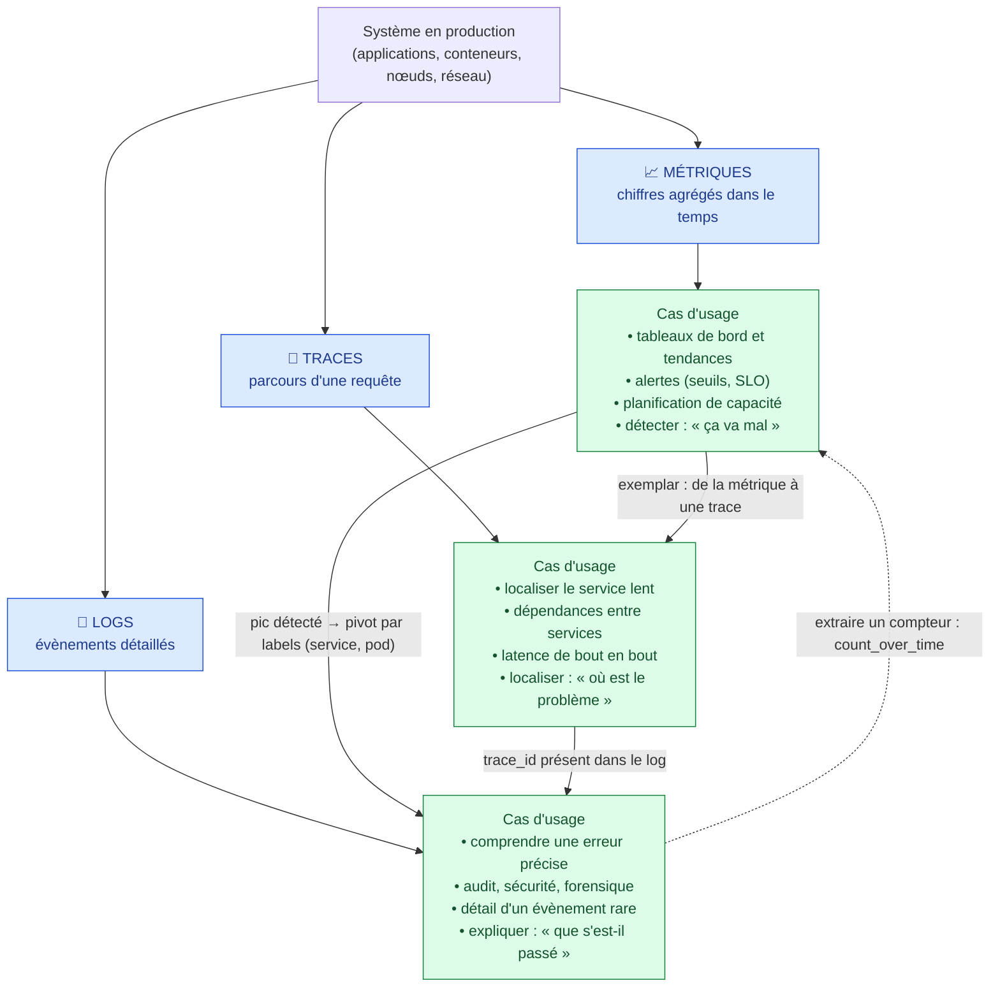

# Introduction à l'observabilité

## Pourquoi ce cours ?

Un jeudi à 14 h, les clients se plaignent : « le site est lent ». Votre application tourne, les pods sont `Running`, `systemctl status` est vert. Pourtant, quelque chose ne va pas. Comment
le **savoir avant** les clients ? Comment **comprendre** où est le problème parmi vingt services ? Sans instrumentation, on devine ; avec elle, on **mesure**. Ce module vous apprend à
observer, mesurer et alerter sur un système en production, avec les outils standards de l'écosystème cloud-native (Prometheus, Grafana, Alertmanager, Loki, OpenTelemetry).

Ce premier cours pose le vocabulaire et les méthodes : les **3 piliers**, la différence entre **monitoring** et **observabilité**, les **SLI/SLO**, les **signaux d'or** et les méthodes **RED** et **USE**, et le choix entre **pull** et **push**.

> Prérequis : vous avez vu les journaux et `journalctl` ([module 04](../../04-linux-expert/cours/03-observabilite-logs.md)), le diagnostic réseau ([module 06](../../06-reseaux-devops/cours/05-diagnostic-reseau-devops.md)), les conteneurs ([module 08](../../08-docker-approfondi/README.md)) et Kubernetes ([module 09](../../09-kubernetes-approfondi/README.md)). Ce cours **ne les répète pas** : il les mobilise.

## 1. Monitoring ou observabilité ?

| | **Monitoring** (supervision) | **Observabilité** |
|---|---|---|
| Question | « Le système va-t-il bien ? » | « **Pourquoi** ne va-t-il pas bien ? » |
| Approche | Vérifier des **questions connues à l'avance** (CPU > 80 %, disque plein, service up) | Pouvoir poser des questions **nouvelles**, imprévues, sans redéployer |
| Nature des pannes | « Inconnues connues » : on sait ce qui peut casser | « Inconnues inconnues » : des combinaisons qu'on n'avait pas prévues |
| Outil typique | Tableau de bord, alerte seuil | Corrélation métriques + logs + traces, requêtes explorables |
| Résultat | Détecter | Détecter **et diagnostiquer** |

> 📌 **À retenir** : le monitoring dit **« il y a un problème »** ; l'observabilité permet de dire **« voici pourquoi »**. Un système est *observable* quand on peut comprendre son état interne **à partir de ses sorties** (métriques, logs, traces), y compris pour des pannes jamais rencontrées.

Les systèmes distribués (microservices, Kubernetes) rendent le monitoring classique insuffisant : une requête traverse dix services, les pods naissent et meurent, les causes sont **émergentes** (une lenteur de la base de données qui provoque un timeout dans un service amont, puis une avalanche de retries). Il faut des données **riches** et **corrélables**.

## 2. Les trois piliers

| Pilier | Ce que c'est | Forme | Répond à | Coût de stockage |
|---|---|---|---|---|
| **Métriques** | Mesures **numériques agrégées** dans le temps | Séries temporelles (`http_requests_total{service="api"}` = 1027 à 14:03:15) | « Combien ? À quel rythme ? Est-ce normal ? » | **Faible** (taille indépendante du trafic) |
| **Logs** | **Évènements** textuels horodatés | Lignes ou JSON (`{"level":"error","msg":"timeout base","user":42}`) | « Que s'est-il passé, précisément ? » | **Élevé** (proportionnel au volume) |
| **Traces** | Parcours d'**une requête** à travers les services | Arbre de *spans* avec durées | « Où est passé le temps ? Quel service est en cause ? » | **Élevé** (souvent **échantillonné**) |



Le **parcours d'investigation** typique :

1. Une **alerte** (métrique) signale un taux d'erreurs élevé sur le service `paiement` ;
2. Un **dashboard** montre quand ça a commencé et quelles instances sont touchées ;
3. Les **traces** révèlent que 90 % du temps est passé dans l'appel à la base ;
4. Les **logs** de la base, filtrés par `trace_id`, montrent « too many connections ».

C'est la **corrélation** (mêmes labels, mêmes identifiants) qui fait la valeur de l'ensemble : les trois piliers ne sont pas trois outils indépendants, mais **trois vues du même système**.

> 💡 **Conseil** : commencez toujours par les **métriques** (peu coûteuses, vision globale), ajoutez les **logs structurés**, puis les **traces** pour les chemins critiques. Un quatrième signal émerge : le **profilage continu** (Pyroscope, Parca) qui montre *quelle fonction* consomme le CPU.

## 3. SLI, SLO, SLA et budget d'erreur

Pour savoir si « ça va bien », il faut définir **ce que bien veut dire**, du point de vue de l'utilisateur.

| Terme | Définition | Exemple |
|---|---|---|
| **SLI** (*Service Level Indicator*) | Une **mesure** de la qualité du service : un ratio « bons évènements / évènements valides » | Proportion de requêtes HTTP répondues en moins de 300 ms **et** sans erreur 5xx |
| **SLO** (*Service Level Objective*) | Un **objectif interne** sur un SLI, sur une période | 99,9 % des requêtes réussies sur 30 jours glissants |
| **SLA** (*Service Level Agreement*) | Un **contrat** avec le client, avec des **pénalités** | 99,5 % de disponibilité, sinon remise de 10 % sur la facture |
| **Error budget** | Le **taux d'échec toléré** : `100 % − SLO` | 0,1 % de requêtes en échec autorisées |

Le **SLA est moins exigeant que le SLO** : le SLO est votre garde-fou interne, vous voulez l'alerte **avant** de violer le contrat.

### Du SLO au budget d'erreur

| SLO | Budget d'erreur | Indisponibilité tolérée par mois (30 j) | par an |
|---|---|---|---|
| 99 % | 1 % | ≈ 7 h 12 min | ≈ 3,65 jours |
| 99,5 % | 0,5 % | ≈ 3 h 36 min | ≈ 1,8 jour |
| **99,9 %** (« trois neuf ») | 0,1 % | **≈ 43 min 12 s** | ≈ 8 h 46 min |
| 99,95 % | 0,05 % | ≈ 21 min 36 s | ≈ 4 h 23 min |
| 99,99 % (« quatre neuf ») | 0,01 % | ≈ 4 min 19 s | ≈ 52 min |

Calcul : `43 200 min (30 j) × 0,001 = 43,2 min`.

Le **budget d'erreur** transforme la fiabilité en **ressource que l'on gère** :

- **Budget restant** : on peut **livrer vite**, tenter des changements risqués.
- **Budget épuisé** : on **gèle les nouveautés** et l'on se concentre sur la fiabilité.

Cela arbitre objectivement le conflit classique entre « livrer des fonctionnalités » et « ne rien casser ».

```text
SLI (disponibilité) = requêtes réussies / requêtes totales
SLO                 = 99,9 % sur 30 jours
Budget d'erreur     = 0,1 % × 1 000 000 requêtes/jour × 30 j = 30 000 requêtes en échec tolérées
Consommation        = (échecs observés) / 30 000   → alerte si on « brûle » le budget trop vite
```

> ⚠️ **Attention** : **100 % n'est pas un objectif raisonnable** : chaque « neuf » supplémentaire coûte exponentiellement plus cher, et les dépendances (réseau de l'utilisateur, FAI) ne sont pas à 100 % de toute façon. Choisissez le SLO que **l'utilisateur perçoit**, pas le plus ambitieux.

### Alerter sur la **vitesse de consommation** du budget (*burn rate*)

Plutôt qu'alerter sur « CPU > 80 % » (une cause possible), on alerte quand le budget est consommé **trop vite**. Un *burn rate* de 1 épuise exactement le budget en 30 jours ; de 14,4, en 2 jours ; l'alerte à **burn rate 14,4 sur 1 h** (et 5 min pour confirmer) prévient d'une consommation de 2 % du budget en une heure. On la mettra en œuvre au [cours 05](05-alertmanager-alertes.md).

## 4. Les signaux d'or et les méthodes RED et USE

### Les quatre signaux d'or (*Golden Signals*, livre SRE de Google)

| Signal | Question | Exemple |
|---|---|---|
| **Latence** (*latency*) | Combien de temps prend une requête ? **Distinguer** succès et échecs (une erreur rapide fausse la moyenne) | p95 de la durée des requêtes HTTP |
| **Trafic** (*traffic*) | Quelle est la demande ? | Requêtes par seconde |
| **Erreurs** (*errors*) | Quelle part échoue (explicitement ou implicitement) ? | Taux de réponses 5xx, réponses « 200 » au contenu erroné |
| **Saturation** | À quel point le système est-il « plein » ? | Utilisation CPU/mémoire/disque, longueur de file d'attente |

### RED : pour les **services** (ce que voit l'utilisateur)

**R**ate (requêtes/s), **E**rrors (erreurs/s ou %), **D**uration (distribution des latences). Idéal pour chaque microservice, API, endpoint.

### USE : pour les **ressources** (ce que consomme l'infrastructure)

**U**tilisation (% de temps occupé), **S**aturation (travail en attente), **E**rrors (erreurs matérielles/logicielles). Pour chaque ressource : CPU, mémoire, disque, réseau (voir le [cours noyau du module 04](../../04-linux-expert/cours/01-noyau-performance.md)).

| | **RED** | **USE** |
|---|---|---|
| S'applique à | Services, requêtes | Ressources (CPU, disque, réseau…) |
| Point de vue | Utilisateur / métier | Opérateur / infrastructure |
| Exemple CPU | — | Utilisation : `% CPU` ; saturation : file d'exécution ; erreurs : — |
| Exemple API | Rate = 120 req/s ; Errors = 2 % ; Duration p95 = 340 ms | — |

> 💡 **Conseil** : **RED** (le service) pour savoir *si l'utilisateur souffre*, puis **USE** (les ressources) pour savoir *pourquoi*. Les signaux d'or sont la synthèse des deux.

## 5. Pull ou push ?

Deux manières d'acheminer les métriques vers le système de collecte :

| | **Pull** (le serveur interroge) | **Push** (l'application envoie) |
|---|---|---|
| Qui initie ? | Le **serveur de monitoring** (Prometheus) interroge `http://cible:port/metrics` | L'**application** envoie ses données (StatsD, InfluxDB, OTLP, Pushgateway) |
| Détecter une panne | **Naturel** : une cible qui ne répond pas = `up == 0` | Difficile : le silence peut signifier « arrêté » ou « rien à dire » |
| Découverte | Le serveur doit **connaître** les cibles (service discovery) | Les applications connaissent l'adresse du collecteur |
| Pare-feu / NAT | Le serveur doit **atteindre** les cibles | Les applications sortent vers le collecteur : pratique derrière un NAT |
| Débogage | Simple : `curl http://cible/metrics` dans un navigateur | Moins direct |
| Tâches éphémères | ❌ Peu adaptées (elles disparaissent avant le scrape) | ✅ Adaptées |
| Contrôle de la charge | Le serveur **maîtrise** l'intervalle | Les clients peuvent inonder le collecteur |

**Pourquoi Prometheus choisit le pull** : détection de panne gratuite (`up`), contrôle central de la fréquence et des cibles, endpoints de métriques directement **testables** à la main (`curl`), pas de configuration du collecteur dans chaque application.

**Quand le push a du sens** : pour les **jobs batch de courte durée** (script de sauvegarde, migration, tâche CronJob) qui n'existent pas assez longtemps pour être scrapés : ils poussent leur résultat vers la **Pushgateway**, que Prometheus scrape ensuite.

```bash
echo "sauvegarde_derniere_reussite_timestamp $(date +%s)" | curl --data-binary @- http://pushgateway:9091/metrics/job/sauvegarde
```

> ⚠️ **Attention** : la Pushgateway est un **cache de dernières valeurs** : elle ne supprime rien toute seule et masque l'état `up` du job. Réservez-la aux **batchs** ; n'en faites jamais un « proxy » général de métriques de services (utilisez plutôt l'**OpenTelemetry Collector**, cours 07, qui supporte le push de façon propre).

Les traces et logs, eux, sont naturellement **poussés** (OTLP, agents) : le modèle hybride est la norme.

## 6. Panorama de l'écosystème de ce module

| Besoin | Outil | Cours |
|---|---|---|
| Collecter et stocker des métriques | **Prometheus** | [02](02-prometheus-fondamentaux.md), [03](03-promql-et-metriques.md) |
| Visualiser | **Grafana** | [04](04-grafana-visualisation.md) |
| Alerter | **Alertmanager** | [05](05-alertmanager-alertes.md) |
| Collecter et chercher des logs | **Loki** | [06](06-logs-avec-loki.md) |
| Tracer, standardiser l'instrumentation | **OpenTelemetry**, Tempo/Jaeger | [07](07-traces-et-opentelemetry.md) |

```text
 Applications ──► métriques (/metrics) ──► Prometheus ──┬─► Grafana (dashboards)
      │                                                  └─► Alertmanager ─► Slack / e-mail / astreinte
      ├──► logs ───────────────────────► Loki ───────────────► Grafana (Explore, corrélation)
      └──► traces (OTLP) ──────────────► Tempo / Jaeger ─────► Grafana (traces)
```

## 7. Bonnes pratiques de départ

1. **Instrumentez ce qui compte pour l'utilisateur** d'abord (RED sur chaque service d'entrée).
2. **Définissez 1 à 3 SLO** par service critique avant de multiplier les dashboards.
3. **Alertez sur les symptômes** (erreurs, latence perçue), pas sur toutes les causes possibles.
4. **Mêmes noms de labels partout** (`service`, `namespace`, `pod`, `env`) : condition de la corrélation.
5. **Gardez la cardinalité sous contrôle** (cours 02) : jamais d'identifiant utilisateur ou d'URL complète en label.
6. **Documentez** : chaque alerte renvoie à un *runbook* (cours 05).

## Résumé

- **Monitoring** = détecter les problèmes connus ; **observabilité** = pouvoir **comprendre** des problèmes **imprévus**, à partir de **métriques, logs et traces** corrélés.
- Métriques (agrégées, peu coûteuses), logs (évènements détaillés), traces (parcours d'une requête) : trois vues complémentaires du même système.
- **SLI** (mesure) → **SLO** (objectif) → **SLA** (contrat) ; **budget d'erreur** = `100 % − SLO` ; 99,9 % = ≈ 43 min d'indisponibilité par mois ; alerter sur le **burn rate**.
- **Signaux d'or** : latence, trafic, erreurs, saturation ; **RED** pour les services, **USE** pour les ressources.
- **Pull** (Prometheus) : détection de panne native et contrôle central ; **push** (Pushgateway) : réservé aux jobs batch éphémères.

## Pour aller plus loin

- *Site Reliability Engineering* et *The Site Reliability Workbook* (Google, gratuits : <https://sre.google/books/>) ; *Observability Engineering* (Majors, Fong-Jones, Miranda).
- Méthodes : RED (Tom Wilkie), USE (Brendan Gregg : <https://www.brendangregg.com/usemethod.html>).
- Outils de SLO : **Sloth**, **Pyrra** (génèrent règles et dashboards à partir d'un SLO).
- Cours suivant : [Prometheus : fondamentaux](02-prometheus-fondamentaux.md).
