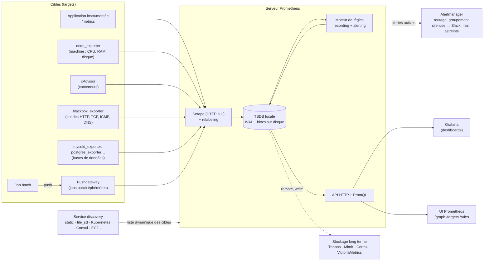

# Prometheus : fondamentaux

## Pourquoi ce cours ?

Prometheus est devenu le **standard de fait** de la collecte de métriques dans le monde conteneurisé (projet CNCF diplômé, comme Kubernetes). Il est simple à déployer (un binaire), puissant
(modèle de données dimensionnel, langage de requête PromQL), et au cœur de la plupart des piles de monitoring. Mal compris, il devient un gouffre : **cardinalité explosive**, cibles « down »
inexpliquées, disque saturé. Ce cours explique l'**architecture**, le **modèle de données**, la **configuration du scrape**, les **exporters**, le **stockage** et la **découverte de services**.

> Prérequis : [introduction à l'observabilité](01-introduction-observabilite.md) (pull vs push, RED/USE), [ports et sockets](../../06-reseaux-devops/cours/02-ports-et-sockets.md), [conteneurs Docker](../../08-docker-approfondi/cours/04-reseau-et-stockage-docker.md).

## 1. Architecture



| Composant | Rôle |
|---|---|
| **Serveur Prometheus** | Interroge les cibles (*scrape*), stocke les séries (TSDB), évalue les règles, sert l'API de requêtes |
| **Exporters** | Convertissent les métriques d'un système tiers (Linux, MySQL, matériel) en format Prometheus sur `/metrics` |
| **Bibliothèques clientes** | Instrumentent **votre code** (Go, Python, Java, Node…) |
| **Pushgateway** | Reçoit des métriques poussées par des jobs éphémères |
| **Service discovery** | Trouve automatiquement les cibles (Kubernetes, Consul, cloud) |
| **Alertmanager** | Reçoit les alertes de Prometheus, les dédoublonne, groupe, route, notifie ([cours 05](05-alertmanager-alertes.md)) |

## 2. Le modèle de données

Prometheus stocke des **séries temporelles** : une suite de valeurs horodatées, identifiée par un **nom de métrique** et un ensemble de **labels** (paires clé-valeur).

```text
http_requests_total{method="GET", handler="/api/colis", status="200", instance="10.0.1.5:8080", job="api"}  1027  @1732612815
└──────────┬───────┘ └────────────────────────────── labels ──────────────────────────────────────────┘  └valeur┘  └timestamp┘
       nom de la métrique
```

- **Série** : combinaison **unique** nom + labels. Changer **un seul** label crée une **autre série**.
- **Sample** (échantillon) : un couple **(timestamp, valeur flottante 64 bits)**.
- Le nom est en réalité le label spécial `__name__` : `http_requests_total{…}` ≡ `{__name__="http_requests_total", …}`.
- Labels ajoutés **automatiquement** au scrape : `job` (nom du groupe de cibles) et `instance` (`hôte:port`).
- Convention de nommage : `snake_case`, **unité en suffixe** (`_seconds`, `_bytes`), `_total` pour les compteurs.

### La cardinalité : le danger n°1

La **cardinalité** est le nombre de **séries distinctes**. Elle est le produit du nombre de valeurs possibles de chaque label :

```text
http_requests_total{method, handler, status, instance}
   5 méthodes × 40 routes × 8 codes × 20 instances = 32 000 séries   ← raisonnable
+ label user_id (1 000 000 de valeurs)                              = 32 milliards de séries  ← catastrophe
```

Chaque série consomme de la **mémoire** (index en RAM, ~3 Ko par série active) et du disque. Une explosion de cardinalité fait **planter** Prometheus (OOM) et ralentit toutes les requêtes.

| ✅ Labels à faible cardinalité | ❌ Labels à proscrire |
|---|---|
| `method`, `status_class`, `service`, `namespace`, `env`, `region` | `user_id`, `email`, `session_id`, `trace_id`, `request_id` |
| `handler` (route **modèle** : `/api/colis/{id}`) | URL **complète** avec identifiants (`/api/colis/48273`) |
| `pod` (acceptable : borné par la durée de vie, mais surveillez le *churn*) | Horodatages, adresses IP clientes, messages d'erreur libres |

```bash
# Mesurer sa cardinalité
curl -s localhost:9090/api/v1/status/tsdb | jq '.data.seriesCountByMetricName[:5]'    # les 5 métriques les plus coûteuses
```

```promql
count({__name__=~".+"})                          # nombre total de séries actives
topk(10, count by (__name__) ({__name__=~".+"})) # métriques les plus nombreuses
```

> 📌 **À retenir** : **les identifiants uniques ne sont jamais des labels de métriques.** Les détails par utilisateur ou par requête vont dans les **logs** et les **traces** (cours 06 et 07), pas dans les métriques.

## 3. Le scrape : `prometheus.yml`

Prometheus se configure par un fichier YAML, rechargé à chaud (`SIGHUP` ou `POST /-/reload` avec `--web.enable-lifecycle`).

```yaml
global:
  scrape_interval: 15s          # fréquence par défaut (le défaut de Prometheus est 1m)
  scrape_timeout: 10s           # doit être ≤ scrape_interval
  evaluation_interval: 15s      # fréquence d'évaluation des règles
  external_labels:              # ajoutés aux alertes et au remote_write : identifient CETTE instance
    cluster: prod-douala
    replica: prometheus-0

rule_files:
  - /etc/prometheus/rules/*.yml

alerting:
  alertmanagers:
    - static_configs:
        - targets: ["alertmanager:9093"]

scrape_configs:
  - job_name: prometheus                 # Prometheus se surveille lui-même
    static_configs:
      - targets: ["localhost:9090"]

  - job_name: node_exporter
    scrape_interval: 15s
    static_configs:
      - targets: ["10.0.1.10:9100", "10.0.1.11:9100"]
        labels:
          env: prod

  - job_name: api
    metrics_path: /metrics               # défaut
    scheme: https
    tls_config: { ca_file: /etc/prometheus/ca.pem }
    basic_auth: { username: prom, password_file: /etc/prometheus/pass }
    static_configs:
      - targets: ["api.kamer.example:443"]
```

### Ce que Prometheus ajoute à chaque scrape

| Série automatique | Signification |
|---|---|
| **`up{job, instance}`** | **1** si le scrape a réussi, **0** sinon : la base de toute alerte « cible tombée » |
| `scrape_duration_seconds` | Durée du scrape |
| `scrape_samples_scraped` | Nombre de samples reçus |
| `scrape_samples_post_metric_relabeling` | …après relabeling |

```promql
up == 0                                        # cibles actuellement injoignables
```

> 💡 **Conseil** : **15 à 30 s** est un bon intervalle. Plus court multiplie le stockage et la charge sans gain réel ; un `rate()` a besoin d'**au moins 4 samples** dans sa fenêtre (voir cours 03), donc une fenêtre de `[1m]` convient à 15 s, pas à 1 min.

### Relabeling : transformer les labels

Le **relabeling** réécrit les labels **avant** le scrape (`relabel_configs`, sur les métadonnées de découverte `__meta_*`) ou **après** (`metric_relabel_configs`, sur les séries reçues). C'est l'outil pour **filtrer** les cibles, **renommer**, **supprimer** des labels coûteux.

```yaml
scrape_configs:
  - job_name: pods
    kubernetes_sd_configs: [{ role: pod }]
    relabel_configs:
      # 1. Ne garder QUE les pods annotés prometheus.io/scrape=true
      - source_labels: [__meta_kubernetes_pod_annotation_prometheus_io_scrape]
        action: keep
        regex: "true"
      # 2. Utiliser le port et le chemin des annotations
      - source_labels: [__address__, __meta_kubernetes_pod_annotation_prometheus_io_port]
        regex: ([^:]+)(?::\d+)?;(\d+)
        replacement: $1:$2
        target_label: __address__
      # 3. Copier des métadonnées utiles en labels
      - source_labels: [__meta_kubernetes_namespace]
        target_label: namespace
      - source_labels: [__meta_kubernetes_pod_name]
        target_label: pod
    metric_relabel_configs:
      # 4. Jeter une métrique inutile et coûteuse
      - source_labels: [__name__]
        regex: "go_gc_.*|apiserver_request_duration_seconds_bucket"
        action: drop
      # 5. Supprimer un label à forte cardinalité
      - regex: "request_id"
        action: labeldrop
```

Actions courantes : `keep`, `drop`, `replace` (par défaut), `labelmap`, `labeldrop`, `labelkeep`, `hashmod`. Les labels commençant par `__` sont **supprimés** après le relabeling.

## 4. Les exporters

Un **exporter** expose sur `/metrics` les métriques d'un système qui ne parle pas Prometheus.

| Exporter | Port par défaut | Ce qu'il expose | Exemples de métriques |
|---|---|---|---|
| **node_exporter** | 9100 | La **machine** Linux (lit `/proc` et `/sys`) | `node_cpu_seconds_total`, `node_memory_MemAvailable_bytes`, `node_filesystem_avail_bytes`, `node_network_receive_bytes_total` |
| **cAdvisor** | 8080 | Les **conteneurs** (lit les cgroups) | `container_cpu_usage_seconds_total`, `container_memory_working_set_bytes` |
| **blackbox_exporter** | 9115 | **Sondes externes** : HTTP(S), TCP, ICMP, DNS ; expiration de certificat | `probe_success`, `probe_duration_seconds`, `probe_ssl_earliest_cert_expiry` |
| **mysqld_exporter** | 9104 | MySQL/MariaDB | `mysql_global_status_threads_connected`, `mysql_up` |
| **postgres_exporter** | 9187 | PostgreSQL | `pg_stat_database_*` |
| **kube-state-metrics** | 8080 | **État des objets Kubernetes** (pas des ressources) | `kube_pod_status_phase`, `kube_deployment_status_replicas_available` |
| **redis_exporter**, **nginx-prometheus-exporter**, **jmx_exporter**… | — | Un par technologie | — |

```bash
docker run -d --name node-exporter --net host --pid host -v /:/host:ro,rslave \
  prom/node-exporter:v1.8.2 --path.rootfs=/host
curl -s localhost:9100/metrics | grep -E "^node_(cpu_seconds_total|memory_MemAvailable_bytes)" | head -n 6
```

Le format texte exposé est lisible :

```text
# HELP node_memory_MemAvailable_bytes Memory information field MemAvailable_bytes.
# TYPE node_memory_MemAvailable_bytes gauge
node_memory_MemAvailable_bytes 2.516582e+09
# HELP node_cpu_seconds_total Seconds the CPUs spent in each mode.
# TYPE node_cpu_seconds_total counter
node_cpu_seconds_total{cpu="0",mode="idle"} 18273.45
node_cpu_seconds_total{cpu="0",mode="user"} 412.8
```

> ⚠️ **Attention** : **node_exporter, cAdvisor** et consorts exposent des informations sur votre infrastructure : ne les exposez **pas** sur Internet. Restreignez par pare-feu ou réseau privé ; au besoin TLS + authentification (`--web.config.file`).

Pour **votre application**, utilisez une **bibliothèque cliente** (par exemple `prometheus_client` en Python, `micrometer` en Java) qui expose un `/metrics` avec vos compteurs métier ; le détail des types est au [cours 03](03-promql-et-metriques.md).

## 5. Stockage : la TSDB

Prometheus intègre sa propre **base de séries temporelles** (TSDB), très efficace (≈ **1 à 2 octets par sample** après compression).

```text
data/
├── wal/               ← Write-Ahead Log : les données des ~2 dernières heures, pour survivre à un crash
├── chunks_head/       ← bloc « tête » en mémoire (mmap)
├── 01HXYZ…/           ← BLOCS immuables de 2 h, compactés ensuite en blocs plus gros
│   ├── chunks/ index  meta.json  tombstones
└── lock
```

1. Les échantillons arrivent dans la **tête** (mémoire) et dans le **WAL** (disque).
2. Toutes les **2 heures**, la tête est écrite en **bloc immuable** sur disque.
3. La **compaction** fusionne les petits blocs en blocs plus grands (jusqu'à 10 % de la rétention) ; elle améliore la compression et la vitesse des requêtes.
4. Les blocs **plus vieux que la rétention** sont supprimés.

| Réglage | Défaut | Rôle |
|---|---|---|
| `--storage.tsdb.retention.time` | **15d** | Durée de conservation |
| `--storage.tsdb.retention.size` | aucune | Taille maximale (supprime les plus vieux blocs) |
| `--storage.tsdb.path` | `data/` | Emplacement (à placer sur un **volume persistant**) |
| `--web.enable-lifecycle` | désactivé | Autorise `/-/reload` et `/-/quit` |

Estimation de l'espace disque : `taille ≈ rétention (s) × samples/s × ~1,5 octet`, avec `samples/s = séries actives / intervalle de scrape`. Ex. : 500 000 séries à 15 s = 33 000 samples/s ≈ 4,3 Go/jour.

### Les limites (et pourquoi on ajoute Thanos / Mimir en production)

| Limite | Conséquence | Solution |
|---|---|---|
| Stockage **local à un nœud** | Si le disque est perdu, l'historique l'est aussi ; pas de redondance native | Répliques en **paire HA** ; `remote_write` vers un stockage distant |
| **Pas de requête globale** entre plusieurs Prometheus | Une vue « tous les clusters » est impossible | **Thanos** / **Mimir** / **Cortex** : requêtes fédérées |
| **Rétention courte** (jours à semaines) en pratique | Pas de comparaison à l'année dernière | **Stockage objet** (S3) via Thanos/Mimir, **downsampling** |
| **Mise à l'échelle verticale** seulement | Cardinalité et RAM limitent un serveur | Sharding, Mimir (horizontal) |

- **Thanos** : s'ajoute à des Prometheus existants (sidecar qui téléverse les blocs vers S3, *Querier* global, *Compactor* avec downsampling).
- **Mimir** (Grafana) / **Cortex** : stockage long terme **horizontal** alimenté par `remote_write`.
- **VictoriaMetrics** : alternative compatible, très économe.

```yaml
remote_write:
  - url: https://mimir.kamer.example/api/v1/push
    queue_config: { max_samples_per_send: 5000 }
```

## 6. Service discovery : trouver les cibles automatiquement

Dans un environnement dynamique (conteneurs, autoscaling), lister les cibles à la main n'est pas viable.

| Mécanisme | Principe | Usage |
|---|---|---|
| **`static_configs`** | Liste fixe dans `prometheus.yml` | Quelques serveurs stables, tests |
| **`file_sd_configs`** | Lit des fichiers JSON/YAML **rechargés automatiquement** (écrits par Ansible, Terraform, un script…) | Intégration avec n'importe quel inventaire |
| **`kubernetes_sd_configs`** | Interroge l'**API Kubernetes** : rôles `node`, `pod`, `service`, `endpoints`, `endpointslice`, `ingress` | Clusters Kubernetes |
| `consul_sd_configs`, `ec2_sd_configs`, `dns_sd_configs`, `docker_sd_configs`… | Registres, cloud, DNS | Selon l'infrastructure |

```yaml
scrape_configs:
  - job_name: fichiers
    file_sd_configs:
      - files: ["/etc/prometheus/cibles/*.yml"]
        refresh_interval: 1m
```

```yaml
# /etc/prometheus/cibles/web.yml : peut être modifié sans redémarrer Prometheus
- targets: ["10.0.1.20:9100", "10.0.1.21:9100"]
  labels: { env: prod, equipe: web }
```

### Dans Kubernetes : l'opérateur Prometheus

Sur Kubernetes, on n'écrit presque jamais `prometheus.yml` à la main : le **Prometheus Operator** (installé par `kube-prometheus-stack`, [atelier 4](../ateliers-killercoda/atelier-04-monitoring-kubernetes/intro.md)) fournit des ressources personnalisées :

| CRD | Rôle |
|---|---|
| `Prometheus` | Déploie un serveur Prometheus (StatefulSet) |
| `ServiceMonitor` | « Scrape les pods derrière **ce Service** » (sélection par labels) |
| `PodMonitor` | Idem, directement sur des pods |
| `PrometheusRule` | Règles d'alerte et d'enregistrement |
| `Alertmanager`, `AlertmanagerConfig` | Déploiement et configuration d'Alertmanager |

```yaml
apiVersion: monitoring.coreos.com/v1
kind: ServiceMonitor
metadata:
  name: api
  labels: { release: kps }          # doit correspondre au sélecteur du Prometheus
spec:
  selector: { matchLabels: { app: api } }
  endpoints:
    - port: http-metrics
      interval: 15s
```

## 7. Interroger et opérer

```bash
# UI et API
curl -s 'localhost:9090/api/v1/query?query=up' | jq '.data.result[] | {instance: .metric.instance, up: .value[1]}'
curl -s localhost:9090/api/v1/targets | jq '.data.activeTargets[] | {job: .labels.job, health: .health, erreur: .lastError}'
curl -s localhost:9090/api/v1/rules | jq '.data.groups[].name'
curl -s localhost:9090/api/v1/status/config | jq -r .data.yaml | head
curl -X POST localhost:9090/-/reload                    # recharger la configuration (--web.enable-lifecycle)

# Vérifier la syntaxe avant de recharger
promtool check config prometheus.yml
promtool check rules alerts.yml
```

Pages utiles de l'UI : **`/targets`** (état de chaque cible et dernière erreur de scrape), **`/service-discovery`** (cibles découvertes et labels avant/après relabeling), **`/rules`**, **`/alerts`**, **`/tsdb-status`** (cardinalité).

| Symptôme dans `/targets` | Cause probable |
|---|---|
| `connection refused` | Le processus n'écoute pas, mauvais port ([module 06](../../06-reseaux-devops/cours/02-ports-et-sockets.md)) |
| `context deadline exceeded` | Timeout : cible trop lente (`scrape_timeout`) ou réseau/pare-feu qui jette les paquets |
| `server returned HTTP status 401/403` | Authentification manquante |
| `x509: certificate…` | Certificat TLS invalide ou CA inconnue ([module 06](../../06-reseaux-devops/cours/04-tls-et-https.md)) |
| Cible absente | Service discovery ou relabeling (`keep`) la filtre |

> 💡 **Conseil** : Prometheus **se scrape lui-même** (`job="prometheus"`). Surveillez `prometheus_tsdb_head_series` (cardinalité), `prometheus_target_scrape_pool_exceeded_target_limit_total` et l'espace disque : la supervision du superviseur est indispensable.

## Résumé

- **Architecture** : Prometheus **interroge** (pull) des cibles via HTTP, stocke dans une **TSDB** locale, évalue des **règles**, envoie les alertes à **Alertmanager**, sert **PromQL** à **Grafana**.
- **Modèle** : une série = **nom + labels** ; un sample = (timestamp, valeur). **La cardinalité** (nombre de séries) est le facteur de coût n°1 : **jamais d'identifiants uniques en labels**.
- **Scrape** : `scrape_configs`, `up` (1/0), `relabel_configs` (filtrer/transformer les cibles), `metric_relabel_configs` (jeter/transformer des séries).
- **Exporters** : `node_exporter` (machine), cAdvisor (conteneurs), `blackbox_exporter` (sondes), exporters de bases de données, `kube-state-metrics`.
- **TSDB** : WAL + blocs de 2 h compactés ; rétention 15 j par défaut ; **limites** (stockage local, pas de vue globale) → **Thanos / Mimir** / `remote_write` en production.
- **Service discovery** : `static_configs`, `file_sd_configs`, **Kubernetes SD** (et opérateur : `ServiceMonitor`, `PodMonitor`, `PrometheusRule`).

## Pour aller plus loin

- Documentation : <https://prometheus.io/docs/> ; exporters : <https://prometheus.io/docs/instrumenting/exporters/>.
- `promtool` (tests de règles : `promtool test rules`), fédération, `remote_read`, agent mode (`--enable-feature=agent`), OpenMetrics.
- Thanos : <https://thanos.io/> ; Mimir : <https://grafana.com/oss/mimir/>.
- Cours suivant : [PromQL et métriques](03-promql-et-metriques.md).
- Atelier associé : [Prometheus et Grafana sur Ubuntu](../ateliers-killercoda/atelier-01-prometheus-grafana-ubuntu/intro.md).
