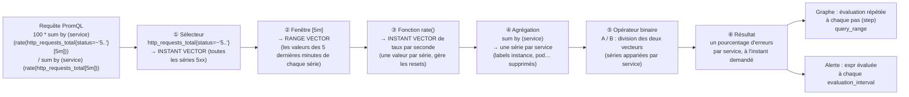

# PromQL et types de métriques

## Pourquoi ce cours ?

Collecter des métriques ne sert à rien si l'on ne sait pas les **interroger**. **PromQL** (*Prometheus Query Language*) est le langage qui transforme des millions d'échantillons bruts en réponses :
« quel est le taux d'erreurs du service `paiement` ? », « quel est le p99 de latence par route ? », « quels disques seront pleins dans 4 heures ? ». C'est aussi le langage des **alertes** et des **dashboards**.
Il est puissant mais plein de pièges (`rate` sur un gauge, fenêtre trop courte, agrégation qui supprime un label utile). Ce cours donne le modèle mental et les motifs de requêtes à connaître.

> Prérequis : [Prometheus : fondamentaux](02-prometheus-fondamentaux.md) (séries, labels, scrape). Vous pouvez tester toutes les requêtes dans l'UI (`http://localhost:9090/graph`) ou avec `curl` : voir l'[atelier 2](../ateliers-killercoda/atelier-02-promql-requetes/intro.md).

## 1. Les quatre types de métriques

Le **type** est une convention de la bibliothèque cliente (il n'est pas stocké en TSDB : c'est **vous** qui devez utiliser la bonne fonction selon le type).

| Type | Définition | Évolue… | Exemples | Fonctions typiques |
|---|---|---|---|---|
| **Counter** (compteur) | Valeur **cumulative qui ne fait qu'augmenter** (et retombe à 0 au redémarrage) | ↗ seulement | `http_requests_total`, `node_cpu_seconds_total`, `errors_total` | **`rate()`**, `increase()`, `irate()` |
| **Gauge** (jauge) | Valeur qui **monte et descend** | ↗↘ | `node_memory_MemAvailable_bytes`, `temperature_celsius`, `queue_length`, `up` | directe, `avg_over_time()`, `delta()`, `deriv()`, `predict_linear()` |
| **Histogram** | **Distribution** d'observations dans des **seaux** (*buckets*) cumulatifs ; calculable côté serveur | compteurs ↗ | `http_request_duration_seconds_bucket/_sum/_count` | **`histogram_quantile()`** |
| **Summary** | Quantiles **calculés côté client** + somme + nombre | quantiles ↗↘ | `rpc_duration_seconds{quantile="0.99"}` | lecture directe |

### Counter : on ne lit jamais la valeur brute

```text
http_requests_total   : 1027 → 1043 → 1066 → 1084 …     la valeur absolue n'a pas de sens (depuis le démarrage)
rate(...[1m])         :  1,07 req/s                      c'est le TAUX de variation qui est utile
```

### Histogram vs Summary

Un **histogram** `http_request_duration_seconds` génère trois familles de séries :

```text
http_request_duration_seconds_bucket{le="0.1"}   8400     ← nb de requêtes ≤ 0,1 s (cumulatif)
http_request_duration_seconds_bucket{le="0.5"}   9800     ← nb de requêtes ≤ 0,5 s
http_request_duration_seconds_bucket{le="1"}     9950
http_request_duration_seconds_bucket{le="+Inf"} 10000     ← total
http_request_duration_seconds_sum   1873.4                ← somme de toutes les durées
http_request_duration_seconds_count 10000                 ← nombre d'observations
```

| | **Histogram** | **Summary** |
|---|---|---|
| Quantiles calculés | **Côté serveur** (`histogram_quantile`), au choix et après coup | **Côté client**, figés à l'avance |
| **Agrégeable** entre instances | ✅ **Oui** (on additionne les buckets) | ❌ **Non** (une moyenne de p99 n'est pas un p99) |
| Précision | Dépend du choix des **buckets** (estimation par interpolation) | Précise sur l'instance |
| Coût | Une série par bucket | Quelques séries |
| Recommandation | ✅ **Par défaut** pour les latences | Cas particuliers (une seule instance, quantile exact) |

> 📌 **À retenir** : pour les **latences**, utilisez un **histogram** : seul il permet de calculer un percentile **global** sur plusieurs pods. Choisissez des buckets autour de vos SLO (ex. `0.05, 0.1, 0.3, 0.5, 1, 2.5, 5`). Les *native histograms* (Prometheus récent) suppriment ce choix manuel.

### Quel type pour quoi ?

| Je veux mesurer… | Type | Exemple |
|---|---|---|
| Un **nombre d'évènements** cumulés (requêtes, erreurs, octets) | Counter | `orders_created_total` |
| Un **état instantané** (mémoire, file, température, connexions) | Gauge | `queue_depth` |
| Une **durée / taille** dont je veux les percentiles | Histogram | `request_duration_seconds` |
| Un **état booléen** (en vie ?) | Gauge 0/1 | `up`, `backup_success` |
| Une **date** du dernier succès | Gauge (timestamp Unix) | `backup_last_success_timestamp_seconds` |

## 2. Sélecteurs

### Instant vector : une valeur par série, **à un instant**

```promql
http_requests_total                                   # toutes les séries de cette métrique
http_requests_total{job="api"}                        # filtrées par label
http_requests_total{job="api", status="200"}          # ET logique entre les matchers
```

### Opérateurs de correspondance de labels (*label matchers*)

| Opérateur | Sens | Exemple |
|---|---|---|
| `=` | Égal | `{status="500"}` |
| `!=` | Différent | `{env!="dev"}` |
| `=~` | **Correspond à la regex** (ancrée : `^…$`) | `{status=~"5.."}` · `{job=~"api\|web"}` |
| `!~` | **Ne correspond pas** à la regex | `{mode!~"idle\|iowait"}` |

```promql
http_requests_total{status=~"5.."}                    # tous les 5xx
node_filesystem_avail_bytes{fstype!~"tmpfs|overlay", mountpoint="/"}
up{job=~"node.*"} == 0                                 # cibles node tombées
```

> ⚠️ **Attention** : la regex est **entièrement ancrée** : `status=~"5"` ne correspond qu'à la valeur exacte `5`, pas à `500`. Écrivez `5..` ou `5.*`.

### Range vector : une **fenêtre** de valeurs, `[durée]`

```promql
http_requests_total{job="api"}[5m]                    # toutes les valeurs des 5 dernières minutes, pour chaque série
```

Un range vector **ne se représente pas** directement : on le passe à une **fonction** (`rate`, `increase`, `avg_over_time`…) qui renvoie un instant vector.

Décalage temporel : `offset`.

```promql
rate(http_requests_total[5m]) / rate(http_requests_total[5m] offset 1d)     # comparaison avec hier à la même heure
```

## 3. Fonctions essentielles

### `rate()`, `irate()`, `increase()` : pour les **counters**

| Fonction | Calcule | Usage |
|---|---|---|
| **`rate(c[5m])`** | **Taux moyen par seconde** sur la fenêtre (gère les remises à zéro) | **Par défaut**, dashboards et alertes |
| `irate(c[5m])` | Taux **instantané** (les **2 derniers** samples de la fenêtre) | Graphes très réactifs ; **jamais pour les alertes** (trop bruité) |
| `increase(c[1h])` | **Augmentation totale** sur la fenêtre (≈ `rate × durée`) | « Combien d'erreurs dans l'heure ? » |

```promql
rate(http_requests_total[5m])                                          # req/s, par série
sum(rate(http_requests_total[5m]))                                     # req/s total
sum by (status) (rate(http_requests_total[5m]))                        # req/s par code HTTP
increase(http_requests_total{status=~"5.."}[1h])                       # nombre de 5xx sur 1 h
```

### Agrégations

Elles **combinent plusieurs séries en une** : `sum`, `avg`, `min`, `max`, `count`, `stddev`, `topk(n, …)`, `bottomk`, `quantile(φ, …)`, `count_values`, `group`.

| Forme | Effet |
|---|---|
| `sum(x)` | Une seule série : tous les labels disparaissent |
| `sum by (service) (x)` | Garde **seulement** le label `service` |
| `sum without (instance, pod) (x)` | Garde **tous sauf** `instance` et `pod` |

```promql
sum by (service) (rate(http_requests_total[5m]))                       # trafic par service
avg by (instance) (rate(node_cpu_seconds_total{mode!="idle"}[5m]))     # CPU actif moyen par machine
topk(3, sum by (pod) (rate(container_cpu_usage_seconds_total[5m])))    # les 3 pods les plus gourmands
count by (job) (up == 1)                                               # nombre de cibles vivantes par job
max(node_filesystem_avail_bytes{mountpoint="/"}) / 1024^3              # Go libres
```

> 📌 **À retenir** : **`by`** = « je **garde** ces labels » ; **`without`** = « je **retire** ces labels ». Dans un `sum`, **toujours** décider quels labels conserver, sinon on additionne des choses sans rapport (ou l'on perd le détail utile).

### `histogram_quantile()` : percentiles de latence

```promql
histogram_quantile(0.95,
  sum by (le) (rate(http_request_duration_seconds_bucket[5m]))
)                                                       # p95 global

histogram_quantile(0.99,
  sum by (le, service) (rate(http_request_duration_seconds_bucket[5m]))
)                                                       # p99 par service
```

Trois règles : (1) appliquer `rate()` aux **buckets** ; (2) agréger avec `sum by (le, …)` — le label **`le` doit rester** ; (3) la précision dépend des buckets : un p99 entre deux buckets très éloignés est une estimation grossière.

Latence moyenne (à utiliser avec prudence : elle masque les valeurs extrêmes) :

```promql
rate(http_request_duration_seconds_sum[5m]) / rate(http_request_duration_seconds_count[5m])
```

### Fonctions sur les gauges et le temps

| Fonction | Usage |
|---|---|
| `avg_over_time(g[1h])`, `max_over_time`, `min_over_time`, `quantile_over_time` | Résumer un gauge sur une fenêtre |
| `delta(g[1h])` | Variation d'un **gauge** sur la fenêtre |
| `deriv(g[1h])` | Pente (régression linéaire), par seconde |
| **`predict_linear(g[6h], 4*3600)`** | **Prédiction** : valeur dans 4 h si la tendance se poursuit |
| `absent(x)`, `absent_over_time(x[5m])` | Vrai si la métrique **n'existe plus** (alerte « plus de données ») |
| `changes(x[1h])`, `resets(c[1h])` | Nombre de changements de valeur / de remises à zéro |
| `label_replace`, `label_join` | Manipuler les labels dans une requête |
| `clamp_min`, `clamp_max`, `round`, `ceil`, `floor`, `abs`, `sort`, `sort_desc` | Utilitaires |

```promql
avg_over_time(node_load1[1h])                                          # charge moyenne sur 1 h
predict_linear(node_filesystem_avail_bytes{mountpoint="/"}[6h], 4*3600) < 0     # le disque sera plein dans 4 h
absent(up{job="api"})                                                  # le job api n'existe plus du tout
```

### Opérateurs

Arithmétique (`+ - * / % ^`), comparaison (`== != > < >= <=`, qui **filtrent** les séries), logique (`and`, `or`, `unless`).

```promql
node_memory_MemAvailable_bytes / node_memory_MemTotal_bytes * 100                 # % de mémoire disponible
100 * (1 - avg by (instance) (rate(node_cpu_seconds_total{mode="idle"}[5m])))     # % CPU utilisé
node_filesystem_avail_bytes / node_filesystem_size_bytes < 0.10                   # disques à moins de 10 % libres
sum(rate(http_requests_total{status=~"5.."}[5m])) / sum(rate(http_requests_total[5m]))    # taux d'erreurs
```

Entre deux vecteurs, les opérations se font sur les séries aux **mêmes labels** ; pour combiner des labels différents : `on(...)`, `ignoring(...)`, `group_left` (jointures « plusieurs-à-un »).

```promql
rate(http_requests_total[5m]) * on (pod) group_left (node) kube_pod_info          # ajoute le label « node » (jointure sur pod)
```

## 4. Le chemin d'une requête



Deux modes d'exécution :

- **Requête instantanée** (`/api/v1/query`) : évaluée **à un instant** (valeur actuelle) ;
- **Requête sur plage** (`/api/v1/query_range`) : évaluée **à chaque pas** entre deux dates (c'est ce que fait un graphe Grafana).

```bash
curl -s --data-urlencode 'query=sum(rate(node_cpu_seconds_total{mode!="idle"}[5m]))' localhost:9090/api/v1/query | jq '.data.result'
curl -s localhost:9090/api/v1/query_range \
  --data-urlencode 'query=node_load1' --data-urlencode "start=$(date -d '-10 min' +%s)" \
  --data-urlencode "end=$(date +%s)" --data-urlencode 'step=30' | jq '.data.result[0].values | length'
```

## 5. Les pièges classiques

| Piège | Pourquoi c'est faux | Correction |
|---|---|---|
| **`rate()` sur un gauge** | `rate` suppose un compteur croissant : sur un gauge qui descend, il interprète une baisse comme une « remise à zéro » et donne des valeurs absurdes | `deriv()` / `delta()` pour un gauge ; `rate()` **uniquement** sur les `*_total`, `*_count`, `*_sum`, `*_bucket` |
| **Valeur brute d'un counter** | Cumulée depuis le démarrage, sans signification, retombe à 0 au redémarrage | **Toujours** `rate()` ou `increase()` |
| **Fenêtre trop courte** | `rate(x[30s])` avec un scrape à 15 s : 2 samples seulement, résultat instable ou **vide** | Fenêtre ≥ **4 × `scrape_interval`** (ex. `[1m]` à 15 s, `[5m]` pour la stabilité) |
| **`rate()` avec moins de 2 samples** | Il faut **au moins 2 points** dans la fenêtre, sinon **pas de résultat** (la série disparaît) | Allonger la fenêtre ; ne pas s'inquiéter juste après un déploiement |
| **Sauts de compteur** (*counter reset*) | Redémarrage → le compteur retombe à 0 ; une soustraction naïve donnerait une valeur négative | `rate()` et `increase()` **détectent** les remises à zéro et les compensent ; ne faites jamais `x - x offset 5m` à la main |
| **Moyenne des moyennes / des quantiles** | `avg(p99)` n'est **pas** le p99 global | `histogram_quantile` sur `sum by (le) (rate(…_bucket))` |
| **`sum` qui supprime un label utile** | `sum(rate(x[5m]))` perd `service`, puis une jointure échoue | `sum by (service, …)` |
| **`irate()` dans une alerte** | Trop volatil : alerte qui clignote | `rate()` |
| **`histogram_quantile` sans `le`** | Sans `le` après l'agrégation, le calcul est impossible (« NaN » ou vide) | `sum by (le, …)` |
| **Division par zéro / série absente** | `a / b` sans `b` → aucune ligne | `or vector(0)`, `clamp_min(b, 1)` |
| **Comparer des unités différentes** | octets vs Go, secondes vs ms | Normaliser (`/ 1024^3`) |

> ⚠️ **Attention** : dans Grafana, utilisez **`$__rate_interval`** plutôt qu'une fenêtre fixe : il s'adapte à l'intervalle de scrape et au zoom du graphe ([cours 04](04-grafana-visualisation.md)).

## 6. *Recording rules* : précalculer les requêtes coûteuses

Une requête lourde (agrégation sur des millions de séries) évaluée à chaque rafraîchissement de dashboard est inefficace. Une **recording rule** la calcule **périodiquement** et stocke le résultat comme une nouvelle série.

```yaml
groups:
  - name: http
    interval: 30s
    rules:
      - record: service:http_requests:rate5m           # convention : niveau:métrique:opération
        expr: sum by (service) (rate(http_requests_total[5m]))
      - record: service:http_errors:ratio_rate5m
        expr: |
          sum by (service) (rate(http_requests_total{status=~"5.."}[5m]))
          /
          sum by (service) (rate(http_requests_total[5m]))
```

Les dashboards et alertes utilisent alors `service:http_errors:ratio_rate5m`, rapide et cohérent.

## 7. Bonnes pratiques de nommage et de labels

| Règle | ✅ | ❌ |
|---|---|---|
| `snake_case`, préfixe = domaine | `app_orders_created_total` | `OrdersCreated` |
| **Unité de base en suffixe**, en unités SI | `request_duration_seconds`, `memory_bytes` | `latency_ms`, `memory_mb` |
| `_total` pour les compteurs | `errors_total` | `errors` |
| Ratios en 0-1, suffixe `_ratio` | `cache_hit_ratio` | `cache_hit_percent` |
| Labels **bornés et cohérents** entre services (`service`, `env`, `namespace`) | `status_class="5xx"` | `user_id`, `url` complète |
| **Un label ne doit pas dupliquer le nom** | `http_requests_total{method=…}` | `http_get_requests_total` |
| Ne pas mettre de **dimension** dans le nom | `requests_total{route="…"}` | `requests_login_total` |

> 💡 **Conseil** : explorez avec l'autocomplétion de l'UI (**Metrics explorer**) et `curl localhost:9090/api/v1/label/__name__/values | jq`. Pour comprendre une requête complexe, **construisez-la par morceaux** : sélecteur seul → avec `rate` → avec `sum by` → avec l'opérateur.

## Résumé

- **4 types** : **counter** (cumulatif → `rate`/`increase`), **gauge** (instantané), **histogram** (distribution → `histogram_quantile`, **agrégeable**), **summary** (quantiles client, non agrégeables).
- **Sélecteurs** : instant vector `m{label="x"}` ; range vector `m[5m]` ; matchers `= != =~ !~` (regex **ancrée**).
- **Fonctions clés** : `rate()` (par défaut), `irate()` (graphes), `increase()`, `histogram_quantile(φ, sum by (le) (rate(…_bucket[5m])))`, `avg_over_time`, `predict_linear`, `absent`.
- **Agrégations** : `sum/avg/max/min/count/topk` avec **`by`** (garder) ou **`without`** (retirer).
- **Pièges** : `rate` sur un gauge, valeur brute d'un counter, fenêtre < 4 scrapes, `avg` de quantiles, `histogram_quantile` sans `le`.
- **Recording rules** pour précalculer ; nommage : `snake_case`, unités SI en suffixe, `_total`, labels bornés.

## Pour aller plus loin

- Documentation PromQL : <https://prometheus.io/docs/prometheus/latest/querying/basics/> ; PromLabs *PromQL for Humans*, **PromQL Cheat Sheet**.
- Outils : `promtool query instant`, éditeurs (Grafana Explore, **PromLens**), `promtool test rules`.
- *Native histograms* (v2.40+ expérimental, stables dans Prometheus 3) ; *subqueries* `expr[1h:5m]`.
- Cours suivant : [Grafana : visualisation](04-grafana-visualisation.md).
- Atelier associé : [PromQL : requêtes](../ateliers-killercoda/atelier-02-promql-requetes/intro.md).
