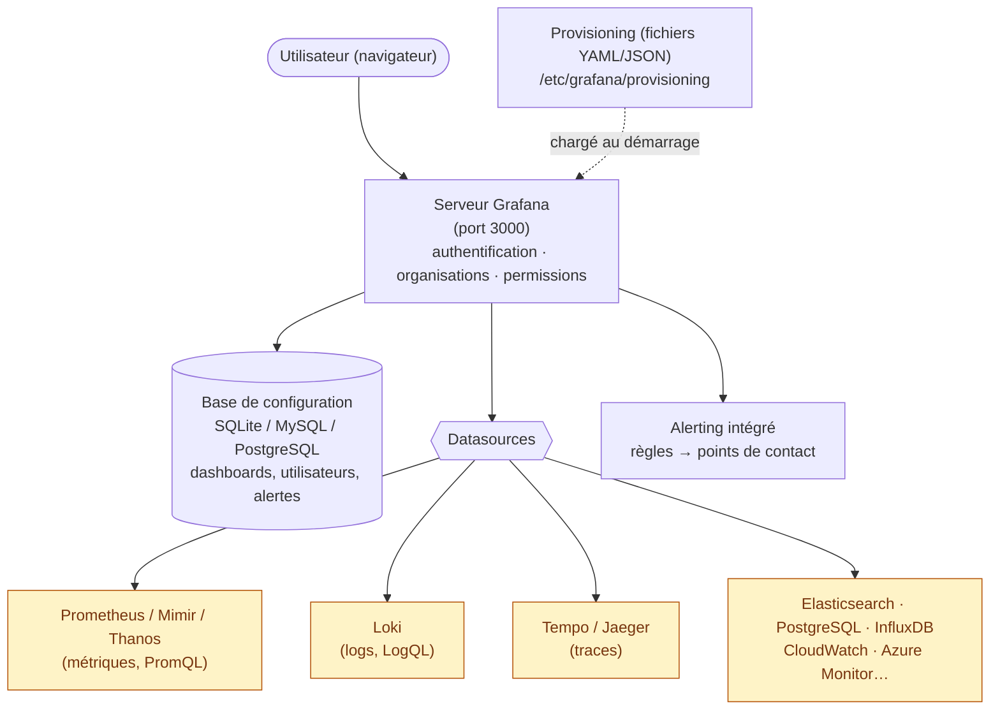
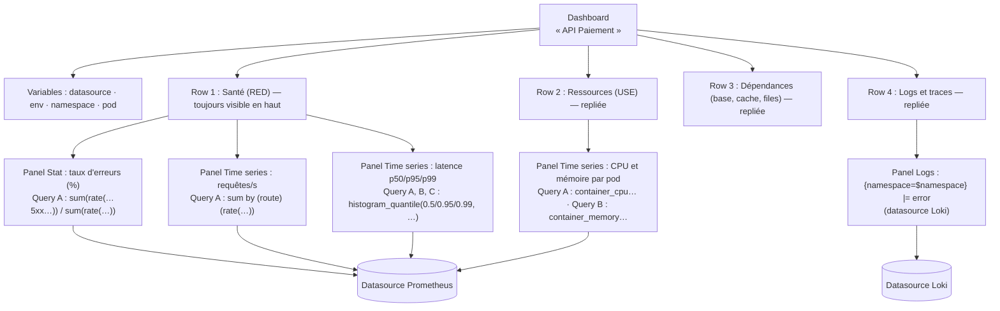

# Grafana : visualisation

## Pourquoi ce cours ?

Les métriques brutes sont illisibles. **Grafana** transforme des requêtes (PromQL, LogQL, SQL…) en **tableaux de bord** clairs, partageables et interactifs : c'est la fenêtre commune sur Prometheus,
Loki et Tempo. Un bon dashboard répond en **quelques secondes** à « est-ce que ça va ? » ; un mauvais est un mur de graphes que personne ne lit. Ce cours présente l'architecture de Grafana,
les datasources, les types de panels, les **variables** qui rendent un dashboard réutilisable, les dashboards « prêts à l'emploi », et surtout le **provisioning as code** pour les versionner.

> Prérequis : [PromQL](03-promql-et-metriques.md) (on écrit des requêtes dans chaque panel) et [Prometheus](02-prometheus-fondamentaux.md).

## 1. Architecture



| Concept | Rôle |
|---|---|
| **Datasource** | Connexion à une source de données (URL, authentification). Grafana **ne stocke pas** les métriques : il les **interroge** |
| **Dashboard** | Une page composée de panels, organisée en lignes (*rows*) ; stockée en **JSON** |
| **Panel** | Une visualisation : requête(s) + type de graphique + options |
| **Variable** | Un paramètre (liste déroulante) réutilisable dans toutes les requêtes |
| **Folder / Organisation** | Rangement et séparation des droits |
| **Alerting** | Règles et notifications intégrées (alternative à Alertmanager) |
| **Explore** | Mode d'investigation libre (requêtes ad hoc, métriques ↔ logs ↔ traces) |
| **Annotations** | Marqueurs d'évènements sur les graphes (déploiements, incidents) |

```bash
docker run -d --name grafana -p 3000:3000 grafana/grafana:11.2.0        # login par défaut : admin / admin (à changer)
```

## 2. Datasources

Configuration : *Connections → Data sources → Add*, ou par **provisioning** (section 6). On peut avoir **plusieurs datasources** et les **mélanger** dans un même dashboard (option « Mixed »).

| Datasource | Langage | Contenu |
|---|---|---|
| **Prometheus** (aussi Mimir, Thanos, VictoriaMetrics) | PromQL | Métriques |
| **Loki** | LogQL | Logs ([cours 06](06-logs-avec-loki.md)) |
| **Tempo** / Jaeger / Zipkin | TraceQL / recherche | Traces ([cours 07](07-traces-et-opentelemetry.md)) |
| **Elasticsearch / OpenSearch**, **PostgreSQL/MySQL**, **InfluxDB**, **CloudWatch** | selon le cas | Autres sources |

```yaml
# Datasource Prometheus
apiVersion: 1
datasources:
  - name: Prometheus
    uid: prometheus
    type: prometheus
    access: proxy                      # Grafana (serveur) interroge ; le navigateur ne voit pas Prometheus
    url: http://prometheus:9090
    isDefault: true
    jsonData:
      timeInterval: 15s                # = scrape_interval : sert à calculer $__rate_interval
      exemplarTraceIdDestinations:     # lien exemplar → trace
        - name: trace_id
          datasourceUid: tempo
```

> 💡 **Conseil** : le **`access: proxy`** (défaut) est le bon choix : la requête part du **serveur** Grafana, ce qui évite d'exposer Prometheus au navigateur (et les problèmes de CORS).

### Multi-datasources et corrélation

Le vrai pouvoir de Grafana est de **relier** les sources :

- **Logs → traces** : un champ `trace_id` dans un log devient un lien vers Tempo (*derived fields* de Loki) ;
- **Traces → logs** : depuis un span, ouvrir les logs du même `pod`/`trace_id` (*trace to logs*) ;
- **Métriques → traces** : un **exemplar** sur un graphe de latence renvoie à une trace représentative ;
- **Même label** (`namespace`, `pod`, `service`) dans les métriques et les logs : on bascule de l'un à l'autre en gardant le filtre.

## 3. Panels : choisir la bonne visualisation

| Panel | Usage | Exemple |
|---|---|---|
| **Time series** | **Évolution** dans le temps (le plus courant) | Requêtes/s, latence p95, CPU |
| **Stat** | **Une valeur** clé, avec couleur de seuil et mini-courbe | Taux d'erreurs actuel, uptime |
| **Gauge** / **Bar gauge** | Valeur **par rapport à un maximum** | Disque utilisé (%), jauge CPU |
| **Table** | Valeurs **détaillées**, tri, filtre | Top 10 des pods par mémoire |
| **Heatmap** | **Distribution** dans le temps (histogrammes) | Latences : la densité par bucket |
| **Logs** | Lignes de logs Loki, avec couleurs de niveau | Erreurs récentes d'un service |
| **State timeline / Status history** | **États discrets** dans le temps | Cible up/down, phase d'un pod |
| **Geomap** | Données géolocalisées | Trafic par pays |
| **Node graph / Traces** | Dépendances de services, vue d'une trace | Cartes de services |
| **Bar chart / Pie chart** | Comparaisons ponctuelles (à utiliser avec parcimonie) | Répartition par code HTTP |
| **Text** | Documentation, liens, **runbooks** | « Que faire si ce panel est rouge ? » |

Réglages qui font la qualité d'un panel :

- **Unité** correcte (`bytes`, `seconds`, `percent (0-1)`, `reqps`) : Grafana formate automatiquement ;
- **Seuils** colorés (vert / orange / rouge) alignés sur les **SLO** ;
- **Légende** lisible : `{{service}}` plutôt que le nom brut complet ;
- **Titre** explicite **avec l'unité et le sens** (« Taux d'erreurs 5xx (%) ») ;
- **Axe Y** fixe (0–100 %) quand la valeur est bornée, pour éviter des variations trompeuses.

```promql
# Panel « Latence p95 par service » (unité : seconds, légende {{service}})
histogram_quantile(0.95, sum by (le, service) (rate(http_request_duration_seconds_bucket{namespace="$namespace"}[$__rate_interval])))
```

> ⚠️ **Attention** : `rate(...[5m])` fixe dans un dashboard est un piège : selon le zoom, la fenêtre peut être plus courte que 4 scrapes ou masquer les pics. Utilisez **`$__rate_interval`**, qui vaut `max(4 × intervalle de scrape, pas du graphique)`.

## 4. Variables et templating

Une **variable** est une liste déroulante en haut du dashboard, utilisable dans toutes les requêtes avec `$nom` ou `${nom}`. Un seul dashboard peut ainsi servir **tous les services, tous les namespaces, tous les clusters**.

| Type | Exemple |
|---|---|
| **Query** | Valeurs issues d'une requête : `label_values(up, job)`, `label_values(kube_pod_info{namespace="$namespace"}, pod)` |
| **Custom** | Liste fixe : `prod,staging,dev` |
| **Interval** | Pas de temps : `1m,5m,15m` |
| **Datasource** | Choisir la datasource (plusieurs Prometheus) |
| **Constant / Text box / Ad hoc filters** | Valeur fixe, saisie libre, filtres libres sur les labels |

```text
Variable « namespace »  (Query, datasource Prometheus)
   label_values(kube_pod_info, namespace)              ← liste des namespaces, avec « Multi-value » et « Include All »

Variable « pod »        (dépend de « namespace »)
   label_values(kube_pod_info{namespace=~"$namespace"}, pod)

Requête d'un panel :
   sum by (pod) (rate(container_cpu_usage_seconds_total{namespace=~"$namespace", pod=~"$pod"}[$__rate_interval]))
```

Variables **chaînées** : le choix de `namespace` filtre la liste de `pod`. Avec *Multi-value* et *Include All*, utilisez l'opérateur **regex** `=~` (jamais `=`).

Variables globales utiles : `$__interval`, `$__rate_interval`, `$__range`, `$__from`/`$__to`, `$__dashboard`.

## 5. Dashboards « prêts à l'emploi »

Le site **<https://grafana.com/grafana/dashboards/>** héberge des milliers de dashboards communautaires, importables par **ID** (*Dashboards → New → Import*).

| ID | Nom | Source de données | Usage |
|---|---|---|---|
| **1860** | **Node Exporter Full** | `node_exporter` | La référence pour une machine Linux : CPU, mémoire, disque, réseau |
| **315** | Kubernetes cluster monitoring (via Prometheus) | cAdvisor, kube-state-metrics | Vue d'ensemble d'un cluster (ancien mais classique) |
| **15757** | Kubernetes / Views / Global | kube-prometheus-stack | Vue globale moderne d'un cluster |
| **13639** | Logs / App (Loki) | Loki | Logs et volumétrie |
| **893** / **14282** | Docker / cAdvisor | cAdvisor | Conteneurs Docker |
| **3662** | Prometheus 2.0 Overview | Prometheus | Santé du serveur Prometheus lui-même |

```bash
# Import par l'API : récupérer le JSON puis l'envoyer en fournissant la datasource attendue
curl -s https://grafana.com/api/dashboards/1860/revisions/latest/download -o node-exporter-full.json
jq -n --slurpfile d node-exporter-full.json \
  '{dashboard: $d[0], overwrite: true, inputs: [{name: "DS_PROMETHEUS", type: "datasource", pluginId: "prometheus", value: "Prometheus"}]}' \
  | curl -s -u admin:admin -H 'Content-Type: application/json' -X POST localhost:3000/api/dashboards/import -d @-
```

> ⚠️ **Attention** : un dashboard communautaire **n'est pas adapté à vos labels** : vérifiez que ses requêtes correspondent à vos noms de métriques et de labels (`job`, `instance`). Il sert de **point de départ à adapter**, pas de solution clé en main. Évitez aussi de le modifier en place : **copiez-le** (Save as) pour garder vos changements.

## 6. Provisioning « as code » : versionner ses dashboards

Créer des dashboards à la main dans l'interface est fragile (non reproductible, non relu, perdu avec la base). Le **provisioning** charge datasources, dashboards et alertes **depuis des fichiers**, versionnés dans Git :

```text
/etc/grafana/provisioning/
├── datasources/prometheus.yml           ← datasources (YAML)
├── dashboards/dashboards.yml            ← indique OÙ trouver les dashboards JSON
├── alerting/                            ← règles, points de contact, politiques de notification
└── plugins/
/var/lib/grafana/dashboards/
├── node-exporter.json                   ← dashboards (JSON)
└── api-service.json
```

```yaml
# /etc/grafana/provisioning/datasources/prometheus.yml
apiVersion: 1
datasources:
  - name: Prometheus
    uid: prometheus
    type: prometheus
    access: proxy
    url: http://prometheus:9090
    isDefault: true
    editable: false                  # empêche la modification depuis l'interface (la source de vérité = Git)
```

```yaml
# /etc/grafana/provisioning/dashboards/dashboards.yml
apiVersion: 1
providers:
  - name: fichiers
    folder: Infrastructure
    type: file
    disableDeletion: true
    allowUiUpdates: false
    updateIntervalSeconds: 30
    options:
      path: /var/lib/grafana/dashboards
      foldersFromFilesStructure: true
```

```yaml
# docker-compose : monter les fichiers
services:
  grafana:
    image: grafana/grafana:11.2.0
    ports: ["3000:3000"]
    environment:
      GF_SECURITY_ADMIN_PASSWORD__FILE: /run/secrets/grafana_admin
    volumes:
      - ./grafana/provisioning:/etc/grafana/provisioning:ro
      - ./grafana/dashboards:/var/lib/grafana/dashboards:ro
      - grafana-data:/var/lib/grafana
```

Sur **Kubernetes**, les dashboards sont des **ConfigMaps** étiquetées (`grafana_dashboard: "1"`) détectées par un *sidecar* : c'est ce que fait `kube-prometheus-stack`. Pour les générer en code : **Grafonnet** (Jsonnet), **Grafana Foundation SDK**, **Terraform** (provider Grafana), ou l'opérateur Grafana.

> 📌 **À retenir** : **dashboards, datasources et alertes sont de la configuration** : mettez-les dans Git, revue de code comprise. Exportez le JSON (*Share → Export*, avec « Export for sharing externally ») puis réimportez-le par provisioning.

## 7. Bonnes pratiques de conception

### Un dashboard par service, avec une hiérarchie de *drill-down*



Structure : **dashboard → rows → panels → requêtes (queries)**. Chaque panel peut contenir plusieurs requêtes (A, B, C…) et leur appliquer des **transformations** (jointure, renommage, filtre) avant l'affichage.

### Navigation en entonnoir (*drill-down*)

1. **Vue d'ensemble** (tous services) : feux rouges/verts par service, SLO.
2. **Vue du service** (RED + dépendances) : atteint par un lien depuis la vue globale (*data links*).
3. **Vue de l'instance / du pod** : CPU, mémoire, redémarrages, logs.
4. **Explore** : investigation libre, puis traces et logs corrélés.

### Règles pratiques

| ✅ À faire | ❌ À éviter |
|---|---|
| **Répondre à une question** par dashboard (« Ce service va-t-il bien ? ») | Un « méga-dashboard » de 80 panels |
| **RED en haut**, ressources en dessous | Des graphes de CPU sans contexte de trafic |
| Titres, **unités**, seuils alignés sur les SLO | Un graphe sans unité ni titre explicite |
| **Variables** pour réutiliser (`$namespace`, `$service`) | Un dashboard dupliqué par environnement |
| **Peu de séries par graphe** (≤ 10) ; `topk` pour le reste | 200 courbes illisibles |
| Liens (*data links*), **runbooks** dans un panel Text, annotations de déploiement | Un dashboard sans moyen de creuser |
| **Versionner** (provisioning, Git) | Éditer en production sans trace |
| Rafraîchissement raisonnable (30 s - 1 min) | 5 s partout (charge inutile sur Prometheus) |

> 💡 **Conseil** : testez votre dashboard avec **quelqu'un d'autre** pendant un incident simulé : s'il ne trouve pas la cause en 5 minutes, le dashboard est à revoir. Un dashboard est un **outil de décision**, pas une exposition.

## 8. Alerting intégré à Grafana

Grafana propose son propre moteur d'alerte (**Grafana Alerting**) : règles évaluées sur n'importe quelle datasource, avec *contact points* (Slack, e-mail, webhook…) et *notification policies* (équivalent du routage d'Alertmanager). Il permet d'alerter sur **plusieurs sources** (métriques **et** logs). Pour des alertes purement Prometheus, on préfère généralement des **règles Prometheus + Alertmanager** ([cours 05](05-alertmanager-alertes.md)), versionnées avec le reste de la configuration et indépendantes de Grafana.

## Résumé

- **Grafana** interroge des **datasources** (Prometheus, Loki, Tempo…) ; il ne stocke pas les données de monitoring. Dashboards = JSON ; panels = requêtes + visualisation.
- Bon **type de panel** selon le besoin : time series (évolution), stat/gauge (valeur clé), table, heatmap (distributions), logs, state timeline.
- **Variables** (`label_values(...)`, chaînées, multi-valeurs) rendent un dashboard réutilisable ; **`$__rate_interval`** évite les fenêtres `rate` mal choisies.
- **Dashboards communautaires** : Node Exporter Full (**1860**), Kubernetes (**315**, **15757**) : à adapter à vos labels.
- **Provisioning as code** : datasources en YAML, dashboards en JSON, versionnés dans Git (`editable: false`).
- Conception : **un dashboard par service**, RED puis USE, **drill-down** global → service → pod → Explore, peu de séries, titres/unités/seuils soignés.

## Pour aller plus loin

- Documentation : <https://grafana.com/docs/grafana/latest/> ; provisioning : <https://grafana.com/docs/grafana/latest/administration/provisioning/>.
- **Grafonnet**, **Terraform provider Grafana**, **Grafana Operator**, dashboards « as code » ; *library panels*, *playlists*, *public dashboards*.
- Alerting Grafana vs Alertmanager ; *Grafana OnCall*, *Incident* ; **Grafana Mimir/Loki/Tempo** (la pile LGTM).
- Cours suivant : [Alertmanager et alertes](05-alertmanager-alertes.md).
- Atelier associé : [Prometheus et Grafana sur Ubuntu](../ateliers-killercoda/atelier-01-prometheus-grafana-ubuntu/intro.md).
