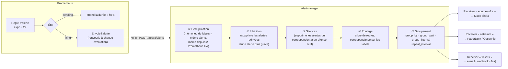

# Alertmanager et stratégie d'alerte

## Pourquoi ce cours ?

Un dashboard ne réveille personne la nuit : c'est l'**alerte** qui prévient les humains quand il faut agir. Mal conçues, les alertes sont pires que pas d'alertes : trop nombreuses, elles sont
ignorées (*alert fatigue*), trop rares ou mal placées, elles laissent passer les pannes. Prometheus **évalue** des règles ; **Alertmanager** s'occupe de tout le reste : dédoublonner, grouper,
router vers la bonne équipe, temporiser, faire taire pendant une maintenance. Ce cours couvre la syntaxe des règles, la configuration d'Alertmanager et — surtout — la **philosophie** qui rend
une alerte utile.

> Prérequis : [PromQL](03-promql-et-metriques.md) (une règle est une expression PromQL) et les [SLO du cours 01](01-introduction-observabilite.md). Pratique : [atelier 3](../ateliers-killercoda/atelier-03-alertes-avec-alertmanager/intro.md).

## 1. Deux acteurs, deux responsabilités

| | **Prometheus** | **Alertmanager** |
|---|---|---|
| Rôle | **Détecter** : évalue les règles d'alerte à intervalle régulier | **Notifier** : traite les alertes reçues |
| Décide | « Cette condition est-elle vraie ? Depuis combien de temps ? » | « À qui l'envoyer ? Faut-il grouper ? Est-ce silencé ? Déjà notifié ? » |
| Ne sait pas | Envoyer un e-mail | Évaluer une métrique |

Cette séparation permet d'avoir **plusieurs Prometheus** (HA, un par cluster) qui envoient leurs alertes à un **seul Alertmanager** (ou un cluster d'Alertmanager) : celui-ci **déduplique**.

## 2. Règles d'alerte Prometheus

```yaml
# /etc/prometheus/rules/alertes-infra.yml
groups:
  - name: infra
    interval: 30s                      # fréquence d'évaluation du groupe (défaut : evaluation_interval)
    rules:
      - alert: HighCPUUsage
        expr: 100 * (1 - avg by (instance) (rate(node_cpu_seconds_total{mode="idle"}[5m]))) > 80
        for: 5m
        labels:
          severity: warning
          team: infra
        annotations:
          summary: "CPU élevé sur {{ $labels.instance }}"
          description: "Utilisation CPU à {{ $value | printf \"%.1f\" }} % depuis plus de 5 minutes."
          runbook_url: https://wiki.kamer.example/runbooks/high-cpu
```

| Champ | Rôle |
|---|---|
| **`alert`** | Nom de l'alerte (devient le label `alertname`) |
| **`expr`** | Expression PromQL : **toute série retournée** est une alerte potentielle (une par jeu de labels) |
| **`for`** | La condition doit rester **vraie en continu** pendant cette durée avant de passer à `firing` |
| **`labels`** | Étiquettes ajoutées : **servent au routage** (`severity`, `team`, `service`) |
| **`annotations`** | Texte **informatif** (résumé, description, `runbook_url`), modèle Go avec `{{ $labels.x }}` et `{{ $value }}` |
| `keep_firing_for` | Garde l'alerte active un moment après que la condition redevient fausse (anti-clignotement) |

### Les états d'une alerte

```text
inactive ──(expr vraie)──► pending ──(vraie pendant « for »)──► firing ──► envoyée à Alertmanager
    ▲                         │                                    │
    └──(expr redevient fausse)┘            (expr fausse) ──────────┴──► resolved (notification de résolution)
```

- **pending** : la condition est vraie mais la durée `for` n'est pas atteinte (pas encore de notification) ;
- **firing** : l'alerte est active et est envoyée à Alertmanager, **renvoyée à chaque évaluation** (c'est Alertmanager qui limite les notifications) ;
- une alerte **sans `for`** passe immédiatement à firing : un pic d'une seconde déclenche une notification.

### Exemples concrets

```yaml
groups:
  - name: exemples
    rules:
      # 1. CPU > 80 % pendant 5 minutes
      - alert: HighCPUUsage
        expr: 100 * (1 - avg by (instance) (rate(node_cpu_seconds_total{mode="idle"}[5m]))) > 80
        for: 5m
        labels: { severity: warning }
        annotations: { summary: "CPU > 80 % sur {{ $labels.instance }}" }

      # 2. Disque > 90 % utilisé (hors systèmes de fichiers virtuels)
      - alert: DiskAlmostFull
        expr: |
          100 * (1 - node_filesystem_avail_bytes{fstype!~"tmpfs|overlay|squashfs"}
                     / node_filesystem_size_bytes{fstype!~"tmpfs|overlay|squashfs"}) > 90
        for: 10m
        labels: { severity: critical }
        annotations: { summary: "{{ $labels.mountpoint }} à {{ $value | printf \"%.0f\" }} % sur {{ $labels.instance }}" }

      # 3. Disque plein DANS 4 heures (prédictif : bien plus utile que « plein maintenant »)
      - alert: DiskWillFillIn4Hours
        expr: predict_linear(node_filesystem_avail_bytes{fstype!~"tmpfs|overlay"}[6h], 4*3600) < 0
        for: 30m
        labels: { severity: warning }

      # 4. Cible injoignable
      - alert: TargetDown
        expr: up == 0
        for: 3m
        labels: { severity: critical }
        annotations: { summary: "{{ $labels.job }}/{{ $labels.instance }} ne répond plus" }

      # 5. Pod Kubernetes redémarré plus de 3 fois en 10 minutes
      - alert: PodRestartingFrequently
        expr: increase(kube_pod_container_status_restarts_total[10m]) > 3
        labels: { severity: warning }
        annotations: { summary: "{{ $labels.namespace }}/{{ $labels.pod }} a redémarré {{ $value }} fois en 10 min" }

      # 6. Pod en CrashLoopBackOff
      - alert: PodCrashLooping
        expr: kube_pod_container_status_waiting_reason{reason="CrashLoopBackOff"} == 1
        for: 5m
        labels: { severity: critical }

      # 7. Certificat TLS qui expire dans moins de 14 jours (blackbox_exporter)
      - alert: CertificateExpiringSoon
        expr: (probe_ssl_earliest_cert_expiry - time()) / 86400 < 14
        labels: { severity: warning }

      # 8. Taux d'erreurs HTTP > 5 % (symptôme côté utilisateur)
      - alert: HighErrorRate
        expr: sum by (service) (rate(http_requests_total{status=~"5.."}[5m])) / sum by (service) (rate(http_requests_total[5m])) > 0.05
        for: 5m
        labels: { severity: critical }
```

Validation avant déploiement :

```bash
promtool check rules alertes-infra.yml
promtool test rules tests-alertes.yml          # tests unitaires de règles avec des séries simulées
curl -X POST localhost:9090/-/reload
curl -s localhost:9090/api/v1/rules | jq '.data.groups[].rules[] | {alert: .name, etat: .state}'
curl -s localhost:9090/api/v1/alerts | jq '.data.alerts[] | {alertname: .labels.alertname, etat: .state}'
```

### Alerter sur le budget d'erreur : le *burn rate* multi-fenêtres

Plutôt que sur des causes (CPU), alertez sur le **rythme de consommation du budget d'erreur** (cours 01). Pour un SLO de 99,9 % (budget 0,1 %) :

```yaml
- alert: ErrorBudgetBurnRateFast                        # brûle 2 % du budget en 1 h : page immédiate
  expr: |
    (   sum(rate(http_requests_total{status=~"5.."}[1h])) / sum(rate(http_requests_total[1h])) ) > (14.4 * 0.001)
    and
    (   sum(rate(http_requests_total{status=~"5.."}[5m])) / sum(rate(http_requests_total[5m])) ) > (14.4 * 0.001)
  labels: { severity: critical }
- alert: ErrorBudgetBurnRateSlow                        # brûle 5 % en 6 h : ticket
  expr: |
    (   sum(rate(http_requests_total{status=~"5.."}[6h])) / sum(rate(http_requests_total[6h])) ) > (6 * 0.001)
    and
    (   sum(rate(http_requests_total{status=~"5.."}[30m])) / sum(rate(http_requests_total[30m])) ) > (6 * 0.001)
  labels: { severity: warning }
```

La **fenêtre longue** détecte une consommation significative, la **fenêtre courte** confirme qu'elle est **toujours en cours** (évite d'alerter après la fin du problème).

## 3. Alertmanager : architecture et chemin d'une alerte



Le traitement est **séquentiel** : une alerte est d'abord dédupliquée, puis éventuellement **inhibée** ou **silencée** (alors **aucune** notification), puis **routée**, puis **groupée**, puis **envoyée**.

### Configuration : `alertmanager.yml`

```yaml
global:
  resolve_timeout: 5m
  smtp_smarthost: smtp.kamer.example:587
  smtp_from: alertes@kamer.example
  slack_api_url_file: /etc/alertmanager/slack-url        # secret dans un fichier, pas dans le YAML

route:                                   # racine de l'arbre de routage
  receiver: equipe-infra                 # receiver par défaut (si aucune sous-route ne correspond)
  group_by: [alertname, cluster, service]
  group_wait: 30s                        # délai avant le 1er envoi d'un nouveau groupe (laisse arriver les alertes liées)
  group_interval: 5m                     # délai avant d'envoyer les NOUVELLES alertes d'un groupe déjà notifié
  repeat_interval: 4h                    # délai avant de RE-notifier une alerte toujours active
  routes:
    - matchers: [severity="critical"]
      receiver: astreinte
      group_wait: 10s
      repeat_interval: 1h
      continue: false                    # true : continue d'évaluer les routes suivantes
    - matchers: [team="base-de-donnees"]
      receiver: equipe-bdd
    - matchers: [severity="warning"]
      receiver: tickets
      repeat_interval: 12h

inhibit_rules:
  - source_matchers: [severity="critical"]     # si cette alerte est active…
    target_matchers: [severity="warning"]      # …alors on supprime celles-ci…
    equal: [alertname, instance]               # …sur le même alertname et la même instance
  - source_matchers: [alertname="NodeDown"]    # si le nœud est tombé, inutile de notifier tout ce qui tourne dessus
    target_matchers: [alertname=~"Pod.*|HighCPU.*"]
    equal: [node]

receivers:
  - name: equipe-infra
    slack_configs:
      - channel: "#infra-alertes"
        send_resolved: true
        title: '[{{ .Status | toUpper }}] {{ .CommonLabels.alertname }}'
        text: >-
          {{ range .Alerts }}*{{ .Annotations.summary }}*
          {{ .Annotations.description }}
          <{{ .Annotations.runbook_url }}|Runbook>{{ end }}
  - name: astreinte
    pagerduty_configs:
      - routing_key_file: /etc/alertmanager/pagerduty-key
        severity: '{{ .CommonLabels.severity }}'
  - name: tickets
    email_configs:
      - to: ops@kamer.example
        send_resolved: false
  - name: equipe-bdd
    webhook_configs:
      - url: http://webhook-receiver:5001/alertes          # n'importe quel service HTTP (Jira, bot…)
        send_resolved: true
```

### Les quatre mécanismes à maîtriser

| Mécanisme | Rôle | Exemple |
|---|---|---|
| **Routage** (`route`/`routes`) | Arbre où chaque alerte descend selon ses **labels** (`matchers`) jusqu'au **receiver** | `severity="critical"` → astreinte ; `team="bdd"` → équipe BDD |
| **Groupement** (`group_by`) | **Regroupe** les alertes similaires en **une seule notification** : 50 pods en échec = 1 message | `group_by: [alertname, cluster]` |
| **Inhibition** (`inhibit_rules`) | Une alerte **grave** supprime les alertes **conséquences** | « Nœud tombé » inhibe « pod inaccessible » sur ce nœud |
| **Silences** | Faire taire des alertes **temporairement** (maintenance), par `matchers`, avec auteur et commentaire | Silence de 2 h sur `instance="db-01"` pendant une mise à jour |

```bash
# amtool : le CLI d'Alertmanager
amtool --alertmanager.url=http://localhost:9093 config routes                      # affiche l'arbre de routage
amtool config routes test --config.file=alertmanager.yml severity=critical team=infra   # quel receiver ?
amtool check-config alertmanager.yml
amtool alert                                                                        # alertes actives
amtool silence add alertname=HighCPUUsage instance=web-01:9100 --duration=2h --author="awa" --comment="mise à jour noyau"
amtool silence query
amtool silence expire <id>
```

> 📌 **À retenir** : **`group_wait`** = combien attendre avant le **premier** message d'un groupe ; **`group_interval`** = combien attendre avant d'envoyer les **nouveautés** ; **`repeat_interval`** = combien attendre avant de **rappeler** une alerte inchangée. Ajuster ces trois valeurs est le levier principal contre le bruit.

### Receivers et canaux

| Canal | Usage | Remarque |
|---|---|---|
| **E-mail** | Tickets, avertissements non urgents | Facilement ignoré |
| **Slack / Teams / Mattermost** | Information d'équipe, **non critique** | Utile mais bruyant |
| **PagerDuty / Opsgenie / VictorOps** | **Astreinte** : réveille quelqu'un | Réservé aux alertes **critiques** |
| **Webhook** | N'importe quoi : création de ticket Jira, bot, automatisation (*auto-remédiation*) | Le plus flexible |
| Télécopie… SMS (via passerelle), Telegram, Discord | Selon le contexte | |

Les notifications peuvent aussi envoyer un message de **résolution** (`send_resolved: true`).

## 4. Éviter le bruit et la *alert fatigue*

La **fatigue d'alerte** : trop d'alertes, dont beaucoup sans action nécessaire → les humains les ignorent → une vraie panne passe inaperçue. Les symptômes : canal Slack rempli d'alertes muettes, astreinte réveillée pour rien, habitude de « silencer et dormir ».

### Les principes d'une bonne alerte

1. **Actionnable** : quelqu'un doit pouvoir **faire quelque chose**, maintenant. Sinon, ce n'est pas une alerte (c'est un graphe ou un ticket).
2. **Symptôme avant cause** : alertez sur ce que l'**utilisateur ressent** (erreurs, latence, indisponibilité) plutôt que sur chaque cause possible (CPU, mémoire). Les causes se **diagnostiquent** sur les dashboards.
3. **Urgence = sévérité** : une alerte qui réveille quelqu'un doit nécessiter une **action immédiate**.
4. **Documentée** : `runbook_url` dans les annotations.
5. **Revue régulière** : chaque alerte qui a sonné sans action est **corrigée ou supprimée**.

### Les leviers techniques

| Levier | Effet |
|---|---|
| **`for`** (durée de confirmation) | Ignore les pics brefs : un CPU à 95 % pendant 10 s n'est pas un incident |
| **Fenêtres de `rate`** plus larges | Lisse les fluctuations |
| **`keep_firing_for`** | Évite le « clignotement » (firing → resolved → firing) |
| **Groupement** | 1 notification pour N alertes liées |
| **Inhibition** | Supprime les alertes dérivées d'une panne plus grave |
| **Silences** | Maintenances planifiées |
| **`repeat_interval` adapté** | Ne pas harceler pour une alerte déjà connue |
| **Alertes sur le SLO** (burn rate) | Remplacent des dizaines d'alertes de seuil |

### Hiérarchiser les sévérités

| Sévérité | Signification | Canal | Délai de réaction |
|---|---|---|---|
| **critical** (*page*) | Impact utilisateur **en cours ou imminent**, action **immédiate** | Astreinte (PagerDuty), 24/7 | Minutes |
| **warning** | Dégradation, risque à moyen terme, **à traiter pendant les heures ouvrées** | Ticket / Slack | Heures à jours |
| **info** | Information, **aucune action requise** | Dashboard, journal | — |

> ⚠️ **Attention** : **ne mettez pas tout en `critical`**. Si l'astreinte est réveillée trois fois par semaine pour des alertes sans impact, elle finira par couper son téléphone. La **règle d'or** : une alerte qui réveille quelqu'un doit être **urgente, importante et actionnable**.

### Un runbook, c'est quoi ?

Un **runbook** est une page courte associée à une alerte : *Que signifie cette alerte ? Quel est l'impact ? Comment diagnostiquer ? Comment résoudre ? Qui escalader ?* Il doit être accessible **depuis l'alerte** (`runbook_url`).

```text
Runbook : HighCPUUsage
1. Impact : latence accrue des services sur la machine.
2. Vérifier : dashboard Node Exporter (1860), top des processus (`ssh … top`), déploiement récent ?
3. Actions : redémarrer le service fautif ; sinon augmenter les ressources ; si boucle infinie, rollback.
4. Escalade : équipe plateforme #infra si non résolu en 30 min.
```

## 5. Alertmanager en haute disponibilité

Plusieurs instances d'Alertmanager forment un **cluster** (protocole *gossip*, `--cluster.peer`) qui **partage** les notifications déjà envoyées et les silences : on évite les doublons. **Chaque** Prometheus envoie ses alertes à **toutes** les instances.

```yaml
alerting:
  alertmanagers:
    - static_configs:
        - targets: ["am-0:9093", "am-1:9093", "am-2:9093"]
```

> 💡 **Conseil** : ajoutez une alerte « **chien de garde** » (*Watchdog / DeadMansSwitch*) qui est **toujours active** (`expr: vector(1)`) et envoyée à un service externe (healthchecks.io, Dead Man's Snitch) : si ce signal **s'arrête**, c'est la **chaîne d'alerte elle-même** qui est en panne.

## Résumé

- **Prometheus** détecte (règles `alert`/`expr`/`for`/`labels`/`annotations`) ; **Alertmanager** notifie (déduplication → inhibition → silences → routage → groupement → envoi).
- États : `inactive` → `pending` → `firing` ; **`for`** évite les faux positifs ; `keep_firing_for` évite le clignotement.
- **Routage** par labels, **groupement** (`group_by`, `group_wait`, `group_interval`, `repeat_interval`), **inhibition**, **silences** (`amtool`).
- Notifications : e-mail, Slack, **PagerDuty** (astreinte), webhook ; `send_resolved`.
- **Éviter l'alert fatigue** : alertes **actionnables**, sur les **symptômes**, sévérités hiérarchisées (`critical` = réveil), **runbook** dans les annotations, revues régulières, **burn rate** sur le SLO.
- Vérifiez : `promtool check rules`, `amtool check-config`, alerte **Watchdog**.

## Pour aller plus loin

- <https://prometheus.io/docs/alerting/latest/overview/> ; *My Philosophy on Alerting* (Rob Ewaschuk, Google).
- Alerting multi-fenêtres : *Alerting on SLOs* (SRE Workbook, chapitre 5) ; **Sloth**, **Pyrra**.
- Tests : `promtool test rules` ; outils : **Karma** (tableau de bord d'Alertmanager), **alertmanager-webhook** vers Jira/ChatOps ; **Alertmanager Config** de l'opérateur (`AlertmanagerConfig`).
- Cours suivant : [Logs avec Loki](06-logs-avec-loki.md).
- Atelier associé : [Alertes avec Alertmanager](../ateliers-killercoda/atelier-03-alertes-avec-alertmanager/intro.md).
