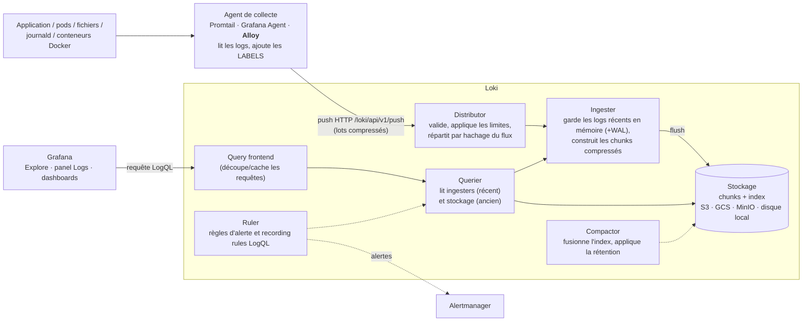
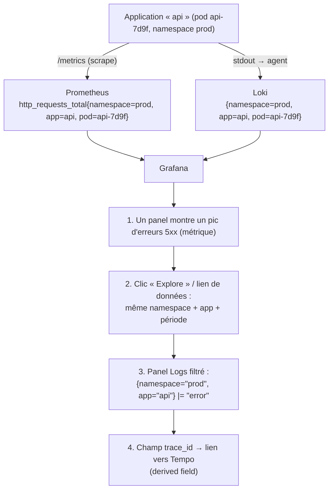

# Logs avec Loki

## Pourquoi ce cours ?

Les métriques disent **qu'il y a un problème** ; les logs disent **ce qui s'est passé**. Au [module 04](../../04-linux-expert/cours/03-observabilite-logs.md) vous avez centralisé des journaux avec `rsyslog` ;
dans un cluster Kubernetes avec des centaines de pods éphémères, il faut un système conçu pour ça. **Grafana Loki** est inspiré de Prometheus : il **indexe uniquement des labels**, pas
le contenu des lignes, ce qui le rend **beaucoup moins coûteux** qu'une pile ELK à volume égal, et il s'intègre naturellement à Grafana. Ce cours couvre son architecture, la collecte
(Promtail, Alloy), le langage **LogQL**, la corrélation avec les métriques et les bonnes pratiques.

> Prérequis : [Prometheus](02-prometheus-fondamentaux.md) (labels, cardinalité), [Grafana](04-grafana-visualisation.md), [journaux Linux](../../04-linux-expert/cours/03-observabilite-logs.md), [logs Docker](../../08-docker-approfondi/cours/01-architecture-docker.md) et [pods Kubernetes](../../09-kubernetes-approfondi/cours/02-pods-et-workloads.md) (`kubectl logs`).

## 1. Pourquoi Loki ? « Prometheus pour les logs »

| | **Loki** | **Elasticsearch (ELK/EFK)** |
|---|---|---|
| **Ce qui est indexé** | **Seulement les labels** (métadonnées : `app`, `namespace`, `pod`) | **Tout le texte** (index inversé plein texte) |
| Contenu des lignes | Stocké **compressé** en blocs (*chunks*), **non indexé** | Indexé : recherche instantanée sur n'importe quel mot |
| Coût (stockage, RAM, CPU) | **Faible** : index minuscule | **Élevé** : l'index peut dépasser les données |
| Recherche | Par **labels** puis **filtre** (force brute parallèle) sur le contenu | Recherche plein texte très rapide, agrégations riches |
| Mise à l'échelle | Simple (stockage objet : S3, GCS, MinIO) | Plus complexe (shards, JVM) |
| Intégration Grafana | **Native**, mêmes labels que Prometheus | Datasource supplémentaire |
| Point fort | **Corréler** logs ↔ métriques par les labels ; peu cher | Recherche plein texte, analytique avancée |

> 📌 **À retenir** : Loki fait le pari que **99 % des recherches de logs** commencent par « les logs de **ce** service, dans **cette** période » (sélection par labels, très sélective), puis filtrent un motif. L'indexation intégrale est un luxe coûteux dont on n'a **pas** besoin dans ce cas.

Corollaire : une requête **sans label sélectif** (`{}` sur tout le cluster pendant 7 jours) est lente et coûteuse. On **réduit d'abord par labels et période**.

## 2. Architecture



| Composant | Rôle |
|---|---|
| **Distributor** | Point d'entrée en écriture : valide les flux, applique les limites, **répartit** par hachage des labels vers les ingesters |
| **Ingester** | Garde les données **récentes en mémoire** (avec un WAL pour la sécurité), construit des **chunks compressés** et les écrit dans le stockage |
| **Querier** | Exécute les requêtes LogQL en lisant ingesters (récent) et stockage (ancien) |
| **Query frontend** | Découpe les grosses requêtes en sous-requêtes parallèles et met en **cache** |
| **Compactor** | Fusionne les fichiers d'index et applique la **rétention** |
| **Ruler** | Évalue des **règles d'alerte** basées sur des requêtes LogQL |
| **Stockage** | **Chunks** (le contenu) et **index** (labels → chunks), en objet (S3/GCS/MinIO) ou sur disque (mode simple) |

**Modes de déploiement** : *monolithique* (`-target=all`, un seul binaire : tests et petits volumes), *simple scalable* (lecture/écriture/backend), *microservices* (chaque composant séparé). Le **flux** (*stream*) est l'unité de base : l'ensemble des lignes partageant **exactement le même jeu de labels**.

```text
{namespace="prod", app="api", pod="api-7d9f", level="error"}  ← un FLUX = un jeu de labels unique
   ├─ 2025-11-24T14:03:15Z  "timeout vers la base"
   └─ 2025-11-24T14:03:17Z  "connexion refusée"
```

## 3. Les agents de collecte

| Agent | État | Remarque |
|---|---|---|
| **Promtail** | **En fin de vie** (maintenance seulement, remplacé par Alloy) | Simple : lit des fichiers, `journald`, Docker/K8s ; **très présent dans les installations existantes** |
| **Grafana Agent** | **Fin de vie** (remplacé par Alloy) | Ancien agent unifié (métriques, logs, traces) |
| **Grafana Alloy** | **Actuel** (« nouvelle génération ») | Distribution Grafana du **Collecteur OpenTelemetry** : logs, métriques, traces, profils ; configuration en langage *River/Alloy* |
| Fluent Bit / Fluentd, Vector, OpenTelemetry Collector | Alternatives | Sorties Loki disponibles |
| **Driver Docker Loki** | Plugin | Envoie les logs de conteneurs Docker directement |

> 💡 **Conseil** : pour un **nouveau** déploiement, partez sur **Alloy** (ou l'OpenTelemetry Collector). Les concepts (découverte, étiquetage, envoi) sont identiques à Promtail, que vous croiserez encore souvent.

### Configuration Promtail (exemple Docker / fichiers)

```yaml
server: { http_listen_port: 9080 }
positions: { filename: /tmp/positions.yaml }        # mémorise où l'agent en est dans chaque fichier
clients:
  - url: http://loki:3100/loki/api/v1/push

scrape_configs:
  - job_name: fichiers-systeme
    static_configs:
      - targets: [localhost]
        labels:
          job: varlogs
          host: web-01
          __path__: /var/log/*.log

  - job_name: kubernetes-pods
    kubernetes_sd_configs: [{ role: pod }]
    pipeline_stages:
      - cri: {}                                     # décode le format des logs conteneur (containerd)
      - json:                                       # extrait des champs d'un log JSON
          expressions: { level: level, trace_id: trace_id }
      - labels: { level: }                          # promeut « level » en label (faible cardinalité !)
      - drop:
          expression: ".*healthcheck.*"             # jette le bruit à la source
    relabel_configs:
      - source_labels: [__meta_kubernetes_namespace]
        target_label: namespace
      - source_labels: [__meta_kubernetes_pod_label_app]
        target_label: app
      - source_labels: [__meta_kubernetes_pod_name]
        target_label: pod
```

Le même principe de **relabeling** que Prometheus s'applique : **les labels sont décidés à la collecte**. Des labels cohérents avec ceux des métriques (`namespace`, `pod`, `app`) permettent la corrélation (section 5).

## 4. LogQL

**LogQL** ressemble à PromQL et se compose de **deux familles** de requêtes : les **requêtes de logs** (renvoient des lignes) et les **requêtes de métriques** (renvoient des nombres calculés à partir des logs).

### Sélecteur de flux (obligatoire) : `{labels}`

```logql
{app="api"}                                       # tous les logs de l'application api
{namespace="prod", app="api"}                     # plusieurs labels (ET)
{namespace=~"prod|staging", app!="debug"}         # regex et exclusion
{job="varlogs", host=~"web-.*"}
```

Les opérateurs sont les mêmes que PromQL : `=`, `!=`, `=~`, `!~`. **Un sélecteur doit contenir au moins un matcher qui ne correspond pas à la chaîne vide** (impossible de faire `{}` seul).

### Filtres de ligne : le pipeline

| Opérateur | Sens | Exemple |
|---|---|---|
| `\|=` | La ligne **contient** la chaîne | `{app="api"} \|= "timeout"` |
| `!=` | La ligne **ne contient pas** | `… != "healthcheck"` |
| `\|~` | Correspond à la **regex** | `… \|~ "error\|fatal"` |
| `!~` | Ne correspond **pas** à la regex | `… !~ "GET /sante"` |

```logql
{namespace="prod", app="api"} |= "error" != "healthcheck"            # erreurs, sans le bruit des sondes
{app="api"} |~ "(?i)timeout|refused"                                   # (?i) : insensible à la casse
```

> 💡 **Conseil** : placez les filtres **les plus sélectifs en premier** (`|=` sur une chaîne littérale est bien plus rapide qu'une regex) : Loki lit les chunks en force brute.

### Parseurs : transformer une ligne en champs

| Parseur | Pour | Exemple |
|---|---|---|
| `\| json` | Logs **JSON** | `{app="api"} \| json \| level="error" and duration > 1s` |
| `\| logfmt` | Format `clé=valeur` | `\| logfmt \| status >= 500` |
| `\| pattern "<ip> - <_> <method> <path>"` | Lignes à structure fixe (simple) | `\| pattern "<ip> <_> <_> [<_>] \"<method> <path> <_>\" <status> <size>"` |
| `\| regexp "(?P<code>\\d{3})"` | Extraction par regex nommée | |
| `\| line_format "{{.level}} {{.msg}}"` | **Reformater** la ligne affichée | |
| `\| label_format`, `\| keep`, `\| drop` | Manipuler les labels extraits | |

```logql
{namespace="prod", app="api"} | json | level="error" | line_format "{{.ts}} {{.msg}} (trace={{.trace_id}})"
{app="nginx"} | pattern `<ip> - - [<_>] "<method> <path> <_>" <status> <size>` | status >= 500
```

Les champs extraits sont **temporaires** (pas des labels indexés) : ils servent à filtrer et agréger **pendant** la requête.

### Requêtes de métriques : des logs aux nombres

| Fonction | Rôle |
|---|---|
| `rate(sélecteur [5m])` | **Lignes par seconde** |
| `count_over_time(sélecteur [5m])` | **Nombre de lignes** dans la fenêtre |
| `bytes_rate`, `bytes_over_time` | Volume en octets |
| `sum`, `avg`, `max`, `topk` … **`by` / `without`** | Agrégations comme PromQL |
| `unwrap` + `sum_over_time`, `avg_over_time`, `quantile_over_time` | Agréger une **valeur numérique extraite** du log (durée, taille) |

```logql
sum by (app) (rate({namespace="prod"} |= "error" [5m]))                    # erreurs/s par application
sum by (level) (count_over_time({app="api"} | json [1m]))                    # volume par niveau de log
topk(5, sum by (pod) (rate({namespace="prod"} |= "exception" [5m])))        # les 5 pods les plus bruyants
quantile_over_time(0.95, {app="api"} | json | unwrap duration_ms [5m]) by (route)    # p95 de latence extraite des logs
```

Ces requêtes donnent aussi des **graphes** et des **alertes** (règles Loki Ruler → Alertmanager) :

```yaml
groups:
  - name: logs
    rules:
      - alert: TauxElevéDErreursLogs
        expr: sum by (app) (rate({namespace="prod"} |= "level=error" [5m])) > 1
        for: 5m
        labels: { severity: warning }
```

## 5. Corréler logs et métriques dans Grafana

La **corrélation** repose sur des **labels communs** (`namespace`, `app`, `pod`, `instance`) : la même **identité** côté métriques et côté logs.



Mises en œuvre dans Grafana :

- **Même dashboard** : un panel métriques (Prometheus) **et** un panel Logs (Loki) sous les mêmes variables `$namespace` / `$app` ;
- **Explore en vue partagée** (*split*) : métriques à gauche, logs à droite, **période synchronisée** ;
- **Liens de données** (*data links*) d'un panel de métriques vers Explore Loki avec les labels pré-remplis ;
- **Derived fields** (datasource Loki) : transformer un champ du log (`trace_id=([0-9a-f]+)`) en **lien vers une trace** (Tempo) ([cours 07](07-traces-et-opentelemetry.md)) ;
- **Panel Logs** avec **contexte** : voir les lignes avant/après une ligne précise.

> 📌 **À retenir** : la corrélation ne coûte **rien** si vous avez **pensé les labels dès le départ** : mêmes noms (`namespace`, `pod`, `app`, `env`), mêmes valeurs. Une incohérence de noms (`service` d'un côté, `app` de l'autre) casse le pivot.

## 6. Bonnes pratiques

### Labels : peu nombreux, peu variables

Comme pour Prometheus, **chaque combinaison de labels crée un flux** : trop de flux = trop de petits *chunks*, ingestion lente, requêtes lentes, coûts élevés.

| ✅ Labels adaptés (faible cardinalité) | ❌ À mettre **dans le contenu**, pas en label |
|---|---|
| `namespace`, `app`, `env`, `cluster`, `job`, `host`, `level` (peu de valeurs) | `user_id`, `request_id`, `trace_id`, `ip_client`, URL complète, message d'erreur |
| `pod` (acceptable : borné) | Tout ce qui a **des milliers de valeurs** |

Règle pratique : **moins de 10-15 labels**, et un flux typique doit rester **actif longtemps** (pas des milliers de flux de quelques secondes). Les valeurs à forte cardinalité se **filtrent à la requête** (`|= "user_id=42"`), elles ne s'indexent pas. Loki 3 propose les **métadonnées structurées** (*structured metadata*) pour y rattacher un `trace_id` **sans** créer de flux.

### Format structuré : JSON ou logfmt

```text
✅ {"ts":"2025-11-24T14:03:15Z","level":"error","service":"api","trace_id":"4bf92f35…","msg":"timeout base","duration_ms":5003}
✅ ts=2025-11-24T14:03:15Z level=error service=api trace_id=4bf92f35 msg="timeout base" duration_ms=5003
❌ [14:03:15] ERREUR!! le truc a planté sur la base (très long) ...
```

Un log **structuré** se filtre (`| json | level="error"`), s'agrège (`unwrap duration_ms`) et se **corrèle** (`trace_id`). Chaque ligne = **un évènement**, avec un **horodatage UTC**, un **niveau**, un **identifiant de corrélation** ; **aucun secret ni donnée personnelle**.

### Autres règles

| Sujet | Recommandation |
|---|---|
| **Rétention** | Définir par flux/tenant (`retention_period`, `limits_config`), appliquée par le **compactor** ; 7 à 30 jours en général pour les logs bruts |
| **Volume** | Supprimer le bruit **à la source** (`drop` : healthchecks, niveaux `debug` en production) |
| **Limites** | `ingestion_rate_mb`, `max_streams_per_user`, `max_label_names_per_series` protègent le cluster |
| **Stockage** | Objet (S3/MinIO) en production ; disque local seulement pour tester |
| **Multi-locataire** | `X-Scope-OrgID` pour isoler des équipes |
| **Requêtes** | Toujours un sélecteur **sélectif** + plage de temps **courte** ; filtres littéraux avant les regex |
| **Sécurité** | Les logs contiennent des données sensibles : RBAC Grafana, TLS vers Loki |

> ⚠️ **Attention** : un log peut contenir des **mots de passe, jetons ou données personnelles** (RGPD) : filtrez à la source (`replace`, `drop`) et **ne journalisez jamais** les secrets. Une fois ingérées, les données sont difficiles à purger.

## 7. Démarrage rapide

```bash
docker run -d --name loki -p 3100:3100 grafana/loki:3.2.0
curl -s localhost:3100/ready                                                       # « ready »
# Envoyer un log à la main
curl -s -X POST localhost:3100/loki/api/v1/push -H 'Content-Type: application/json' \
  -d '{"streams":[{"stream":{"app":"demo","level":"error"},"values":[["'"$(date +%s)000000000"'","timeout vers la base"]]}]}'
# L'interroger
curl -s -G localhost:3100/loki/api/v1/query_range --data-urlencode 'query={app="demo"} |= "timeout"' | jq '.data.result'
logcli query '{app="demo"}' --addr=http://localhost:3100                             # le CLI de Loki
```

## Résumé

- **Loki** n'indexe que les **labels** (pas le texte) : peu coûteux, simple, **corrélable** avec Prometheus via les mêmes labels.
- **Architecture** : agent → **distributor** → **ingester** → stockage objet (chunks + index) ; **querier** / query-frontend pour lire ; compactor (rétention), ruler (alertes).
- **Agents** : **Promtail** (fin de vie, encore répandu) → **Alloy** (actuel, basé sur l'OpenTelemetry Collector).
- **LogQL** : sélecteur `{app="x"}` + filtres (`|=`, `!=`, `|~`, `!~`) + parseurs (`| json`, `| logfmt`, `| pattern`) ; requêtes de métriques (`rate`, `count_over_time`, `sum by`, `unwrap`).
- **Corrélation** dans Grafana : labels communs, Explore partagé, *derived fields* → traces.
- **Bonnes pratiques** : labels **peu cardinalisés**, logs **structurés (JSON)** avec `trace_id`, supprimer le bruit à la source, **rétention** définie, **jamais de secrets**.

## Pour aller plus loin

- Documentation : <https://grafana.com/docs/loki/latest/> ; LogQL : <https://grafana.com/docs/loki/latest/query/>.
- **Alloy** : <https://grafana.com/docs/alloy/> ; `logcli` ; règles Loki Ruler ; métadonnées structurées (Loki 3).
- Alternatives : **Elasticsearch/OpenSearch**, **VictoriaLogs**, **ClickHouse** (SigNoz).
- Cours suivant : [Traces et OpenTelemetry](07-traces-et-opentelemetry.md).
