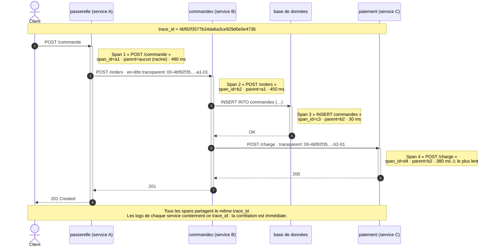
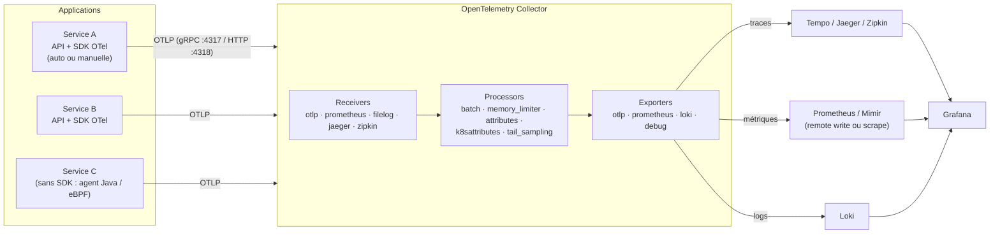
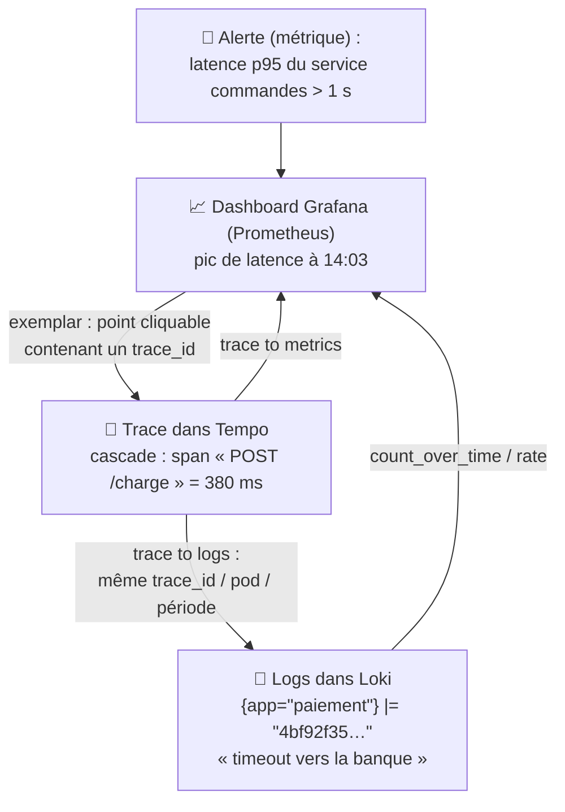

# Traces distribuées et OpenTelemetry

## Pourquoi ce cours ?

Une requête utilisateur traverse aujourd'hui une passerelle, un service d'authentification, un service de commande, une base de données et un service de paiement. Quand elle est lente,
les métriques disent « la latence a augmenté » ; les logs de chaque service racontent chacun leur histoire ; mais **aucun ne dit où la requête a perdu ses 4 secondes**. La **trace distribuée**
reconstitue le **parcours complet** d'une requête avec le temps passé à chaque étape. **OpenTelemetry** (OTel) est le **standard ouvert** (projet CNCF, deuxième plus actif après Kubernetes) pour
produire et acheminer métriques, logs **et** traces, indépendamment du fournisseur. Ce cours conclut le module : il relie les **trois piliers**.

> Prérequis : [introduction à l'observabilité](01-introduction-observabilite.md), [Loki](06-logs-avec-loki.md) (`trace_id` dans les logs), [Grafana](04-grafana-visualisation.md), [en-têtes HTTP et DNS/TLS](../../06-reseaux-devops/README.md) et [Kubernetes](../../09-kubernetes-approfondi/README.md) (déploiement du Collector en DaemonSet/Deployment).

## 1. Les concepts

| Concept | Définition |
|---|---|
| **Trace** | Le **parcours complet** d'une requête à travers tous les services : un **arbre de spans** identifié par un **`trace_id`** (128 bits) |
| **Span** | **Une opération** dans la trace (un appel HTTP, une requête SQL, une fonction) : nom, début, **durée**, statut, attributs, lien vers son parent |
| **Span racine** | Le premier span (pas de parent), créé à l'entrée du système |
| **Span context** | Les identifiants **propagés** d'un service à l'autre : `trace_id`, `span_id`, drapeaux d'échantillonnage, `tracestate` |
| **Attributs** (*attributes*) | Paires clé-valeur sur un span : `http.request.method=GET`, `db.system=postgresql`, `user.tier=gold` |
| **Évènements** (*events*) / **Liens** (*links*) | Jalons horodatés dans un span (exception…) / références vers d'autres traces (traitement asynchrone) |
| **Baggage** | Données **métier** propagées avec la requête à tous les services (ex. `tenant=acme`) |
| **Statut** | `Unset`, `Ok`, `Error` |

### Exemple : une requête traversant 3 microservices



La vue en **cascade** (*waterfall*) d'un outil de traces :

```text
POST /commande            ████████████████████████████████████████  480 ms   (service gateway)
  └ POST /orders            ██████████████████████████████████████  450 ms   (service commandes)
      ├ INSERT commandes      ███                                    30 ms   (base de données)
      └ POST /charge          ███████████████████████████████       380 ms   (service paiement)  ← goulot
```

Lecture : le temps de la requête est dominé par **`POST /charge`**. Sans trace, on aurait soupçonné la base ou la passerelle.

## 2. La propagation de contexte (W3C Trace Context)

Pour que les spans de services différents appartiennent à **la même trace**, le **contexte** doit voyager **avec la requête** : c'est la **propagation**. Le standard **W3C Trace Context** définit deux en-têtes HTTP :

```text
traceparent: 00-4bf92f3577b34da6a3ce929d0e0e4736-00f067aa0ba902b7-01
             │  │                                │                │
             │  │                                │                └─ drapeaux : 01 = échantillonné (sampled)
             │  │                                └─ span_id du span PARENT (16 hex = 64 bits)
             │  └─ trace_id (32 hex = 128 bits)
             └─ version
tracestate: vendor1=valeur,vendor2=autre          ← données propres aux fournisseurs (facultatif)
baggage:    tenant=acme,tier=gold                  ← contexte métier (en-tête W3C Baggage)
```

Mécanisme :

1. Le **service A** démarre une trace (ou reprend celle de l'en-tête reçu) et crée son span ;
2. Avant d'appeler B, l'**instrumentation injecte** `traceparent` dans la requête (HTTP, gRPC, message Kafka…) ;
3. **B extrait** `traceparent`, crée un **span enfant** avec le même `trace_id` et pour parent le `span_id` reçu ;
4. Et ainsi de suite.

> ⚠️ **Attention** : la propagation **casse** si un composant intermédiaire **supprime les en-têtes** (certains proxys, passerelles, files de messages mal configurées) ou si un service n'est **pas instrumenté** : la trace est alors **coupée** en deux (spans orphelins). Vérifiez que **chaque maillon** propage `traceparent`, y compris les appels asynchrones (ajoutez le contexte aux messages).

Anciens formats : **B3** (Zipkin), **Jaeger** (`uber-trace-id`) : OTel sait les lire/écrire pour la migration.

## 3. OpenTelemetry : le standard d'instrumentation

**OpenTelemetry** est un ensemble de **spécifications, API, SDK, outils et du Collector**, indépendant des fournisseurs. Il fusionne OpenTracing et OpenCensus. Il traite **traces, métriques et logs** avec un modèle commun et un protocole unique : **OTLP**.



| Élément | Rôle |
|---|---|
| **API** | Interface stable que le **code** appelle (`tracer.start_span(...)`), sans dépendre d'un fournisseur |
| **SDK** | Implémentation : échantillonnage, traitement, **export** (OTLP) |
| **Instrumentation** | Bibliothèques qui créent les spans pour HTTP, gRPC, SQL, Kafka… (`opentelemetry-instrumentation-*`) |
| **OTLP** | Le protocole : gRPC (4317) ou HTTP/protobuf (4318) |
| **Collector** | Binaire **indépendant** qui reçoit, traite et exporte la télémétrie |
| **Conventions sémantiques** | Noms standards des attributs (`http.request.method`, `db.system`, `service.name`…) |

### Auto-instrumentation et instrumentation manuelle

| | **Automatique** | **Manuelle** |
|---|---|---|
| Principe | Un **agent** ou une bibliothèque s'attache à l'application et instrumente les frameworks courants **sans toucher au code** | On **écrit** des spans dans le code métier |
| Mise en œuvre | Java : `-javaagent:opentelemetry-javaagent.jar` ; Python : `opentelemetry-instrument python app.py` ; Node : `--require @opentelemetry/auto-instrumentations-node/register` ; .NET, Go (eBPF) ; **Opérateur OTel** sur Kubernetes (annotation `instrumentation.opentelemetry.io/inject-python`) | API OTel dans le code |
| Couvre | HTTP entrant/sortant, bases de données, files, clients RPC | **Logique métier** (« calcul du prix », « validation du panier ») |
| Effort | **Très faible** | Moyen |
| Usage | **Point de départ** : 80 % de la valeur | Compléter pour les chemins critiques |

```bash
# Python : auto-instrumentation sans modifier le code
pip install opentelemetry-distro opentelemetry-exporter-otlp
opentelemetry-bootstrap -a install                      # installe les instrumentations des bibliothèques détectées
export OTEL_SERVICE_NAME=commandes
export OTEL_EXPORTER_OTLP_ENDPOINT=http://otel-collector:4317
export OTEL_TRACES_SAMPLER=parentbased_traceidratio
export OTEL_TRACES_SAMPLER_ARG=0.1                      # 10 % des traces
opentelemetry-instrument python app.py
```

```python
# Instrumentation manuelle : un span métier + attributs
from opentelemetry import trace
tracer = trace.get_tracer("commandes")

def calculer_prix(panier):
    with tracer.start_as_current_span("calculer_prix") as span:
        span.set_attribute("panier.nb_articles", len(panier))
        try:
            prix = appliquer_remises(panier)
            span.set_attribute("panier.total", prix)
            return prix
        except Exception as e:
            span.record_exception(e)
            span.set_status(trace.Status(trace.StatusCode.ERROR))
            raise
```

> 📌 **À retenir** : commencez par l'**auto-instrumentation** (gain immédiat, aucun changement de code), puis **ajoutez des spans manuels** uniquement sur ce qui compte pour votre métier. Évitez de créer un span pour chaque petite fonction : le bruit noie le signal.

### Le Collector : la pièce maîtresse

Le **Collector** découple les applications des backends : elles envoient **toujours en OTLP** vers le Collector, qui s'occupe du reste (changer de backend = modifier le Collector, pas 50 services).

```yaml
# otel-collector.yaml
receivers:
  otlp:
    protocols:
      grpc: { endpoint: 0.0.0.0:4317 }
      http: { endpoint: 0.0.0.0:4318 }

processors:
  memory_limiter: { check_interval: 1s, limit_mib: 512 }     # protège le Collector
  batch: { timeout: 5s, send_batch_size: 8192 }              # regroupe avant envoi (efficacité)
  k8sattributes: {}                                          # ajoute namespace, pod, déploiement aux données
  resource:
    attributes: [{ key: deployment.environment, value: prod, action: upsert }]

exporters:
  otlp/tempo: { endpoint: tempo:4317, tls: { insecure: true } }
  prometheus: { endpoint: 0.0.0.0:8889 }                     # expose des métriques que Prometheus scrape
  loki: { endpoint: http://loki:3100/loki/api/v1/push }
  debug: { verbosity: basic }

service:
  pipelines:
    traces:  { receivers: [otlp], processors: [memory_limiter, k8sattributes, batch], exporters: [otlp/tempo] }
    metrics: { receivers: [otlp], processors: [memory_limiter, batch], exporters: [prometheus] }
    logs:    { receivers: [otlp], processors: [memory_limiter, batch], exporters: [loki] }
```

Déploiement sur Kubernetes : **DaemonSet** (un Collector par nœud : « agent ») et/ou **Deployment** (« gateway » central, pour l'échantillonnage *tail*). Distribution Grafana : **Alloy**. Distribution OTel : `otel/opentelemetry-collector-contrib`.

## 4. Les backends de traces

| Backend | Caractéristiques |
|---|---|
| **Jaeger** | Historique (Uber, CNCF) ; interface de recherche et de comparaison de traces ; v2 construit **sur le Collector OTel** ; stockage Elasticsearch/Cassandra/OpenSearch |
| **Grafana Tempo** | **Stockage objet** (S3/GCS) très économique, **pas d'index** lourd (recherche par `trace_id`, et par attributs avec **TraceQL**) ; intégration **native à Grafana** (logs, métriques) |
| **Zipkin** | Plus ancien (Twitter), simple ; formats B3 |
| **SaaS** (Honeycomb, Datadog, New Relic, Dynatrace) | Gérés ; OTLP accepté |
| **SigNoz**, **Uptrace**, **OpenObserve** | Piles tout-en-un open source |

```text
TraceQL (Tempo) :  { resource.service.name = "paiement" && span.http.response.status_code >= 500 && duration > 1s }
```

## 5. Corréler métriques, logs et traces



| Mécanisme | Principe | Mise en œuvre |
|---|---|---|
| **`trace_id` dans les logs** | Chaque ligne de log inclut le `trace_id` (et `span_id`) de la requête en cours | Les SDK OTel l'ajoutent aux logs ; format JSON `{"trace_id":"4bf92f35…","msg":…}` |
| **Exemplars** | Un **échantillon de métrique** (ex. un bucket d'histogramme) **annoté d'un `trace_id`** : « cette valeur de 1,2 s vient de **cette** trace » | Prometheus `--enable-feature=exemplar-storage`, format OpenMetrics, SDK qui les produisent ; Grafana les affiche en points sur le graphe |
| **Trace → logs** | Depuis un span, ouvrir les logs filtrés par `trace_id`/`pod` | Option *Trace to logs* de la datasource Tempo |
| **Logs → trace** | Le `trace_id` d'une ligne devient un **lien** | *Derived fields* de la datasource Loki |
| **Trace → métriques** | Depuis un service, voir ses métriques RED | *Trace to metrics*, métriques de spans (`spanmetrics` du Collector, Tempo *metrics-generator*) |
| **Attributs de ressource communs** | `service.name`, `k8s.namespace.name`, `k8s.pod.name` identiques partout | Convention OTel + `k8sattributes` |

> 💡 **Conseil** : les **métriques de spans** (RED générées automatiquement à partir des traces par `spanmetrics` ou le *metrics-generator* de Tempo) donnent gratuitement taux/erreurs/durée **par service et par route**, sans instrumenter de métriques à la main.

## 6. Échantillonnage (*sampling*)

Tracer **toutes** les requêtes d'un système à fort trafic est trop coûteux (réseau, stockage, CPU). On **échantillonne** : on ne conserve qu'une partie des traces.

| | **Head-based** (en tête) | **Tail-based** (en queue) |
|---|---|---|
| **Quand décide-t-on ?** | **Au début** de la trace (au premier span), **avant** de savoir comment elle se termine | **À la fin**, quand la trace est **complète**, selon son contenu |
| Critères | Probabilité (ex. 10 %), `ParentBased` (suivre la décision du parent) | **Erreurs**, **latence élevée**, attributs, service concerné : « garder 100 % des traces en erreur ou > 2 s, 5 % du reste » |
| Où ? | Dans le **SDK** (`TraceIdRatioBased`) | Dans le **Collector** (`tail_sampling` processor) ou Tempo |
| Coût / complexité | **Faible**, sans état | **Plus élevé** : il faut **bufferiser** tous les spans d'une trace jusqu'à sa fin ; tous les spans d'une trace doivent arriver au **même Collector** (équilibrage par `trace_id`) |
| Avantage | Simple, peu cher | **Garde les traces intéressantes** (erreurs, lentes) |
| Inconvénient | Peut **jeter** la trace de l'erreur rare | Consomme mémoire et réseau |

```yaml
# Collector gateway : échantillonnage tail
processors:
  tail_sampling:
    decision_wait: 10s                       # attente de la fin de la trace
    policies:
      - { name: erreurs,   type: status_code,  status_code: { status_codes: [ERROR] } }
      - { name: lentes,    type: latency,      latency: { threshold_ms: 1000 } }
      - { name: echantillon, type: probabilistic, probabilistic: { sampling_percentage: 5 } }
```

> 📌 **À retenir** : le **head sampling** (ex. 10 %) est le point de départ simple ; passez au **tail sampling** quand vous voulez **toujours conserver les erreurs et les requêtes lentes**. Dans tous les cas, utilisez **`ParentBased`** : si le parent a décidé de tracer, **tous** les services en aval suivent (sinon, traces trouées).

## 7. Bonnes pratiques

1. **Conventions sémantiques OTel** : `service.name` (obligatoire, stable), `service.version`, `deployment.environment`, `http.request.method`, `http.response.status_code`, `db.system`, `url.template`… Les nommer de façon **standard** permet aux outils (dashboards, métriques de spans) de fonctionner sans configuration.
2. **Ne pas tout tracer** : instrumentez d'abord les **chemins critiques** (parcours d'achat, API publiques) ; évitez les spans pour chaque fonction interne.
3. **Cardinalité des attributs** : les attributs de span peuvent être riches (`user.id` est acceptable en trace), mais **les noms de span doivent être de faible cardinalité** (`GET /orders/{id}`, **pas** `GET /orders/48273`).
4. **Pas de données sensibles** dans les attributs (mots de passe, jetons, données personnelles) : filtrez dans le Collector (`attributes` processor).
5. **Définir ce qui est critique** : liste des **parcours utilisateur** et des **dépendances** à tracer à 100 %, et ce qui peut être échantillonné.
6. **Propager partout** : HTTP, gRPC, **messages asynchrones** (ajouter `traceparent` aux en-têtes Kafka/AMQP).
7. **Collector comme couche d'abstraction** : les applications parlent OTLP au Collector ; **changer de backend** ne touche pas le code.
8. **Mettre `trace_id` dans les logs** dès le premier jour : c'est le pont le plus rentable entre les piliers.
9. **Limiter l'impact** : `batch`, `memory_limiter`, échantillonnage ; mesurer le surcoût de l'instrumentation (généralement < 5 % de CPU).
10. **Versionner** la configuration du Collector, comme le reste (GitOps).

| ✅ À faire | ❌ À éviter |
|---|---|
| `service.name` explicite et stable | `unknown_service` |
| Nom de span = **modèle de route** | Nom de span avec identifiants |
| Auto-instrumentation + spans métier ciblés | Un span par ligne de code |
| `ParentBased` + tail sampling pour erreurs/lenteurs | Échantillonnage indépendant par service (traces trouées) |
| `trace_id` dans les logs et exemplars | Trois outils sans lien entre eux |

## Conclusion du module : les trois piliers réunis

```text
  Alerte (Alertmanager, SLO) ──► Dashboard (Prometheus + Grafana : QUOI et QUAND)
                                      │  exemplar
                                      ▼
                              Trace (Tempo/Jaeger : OÙ)
                                      │  trace_id
                                      ▼
                              Logs (Loki : POURQUOI)
```

Vous disposez maintenant de la chaîne complète pour **observer, mesurer et alerter** sur un système en production : de l'infrastructure Linux ([module 04](../../04-linux-expert/README.md)) aux conteneurs ([08](../../08-docker-approfondi/README.md)) et à Kubernetes ([09](../../09-kubernetes-approfondi/README.md)).

## Résumé

- Une **trace** est l'arbre des **spans** d'une requête (même `trace_id`) ; un **span** = une opération avec durée, statut, attributs ; le **span context** se **propage** de service en service.
- **W3C Trace Context** : en-tête `traceparent: 00-<trace_id>-<span_id>-<flags>` ; la propagation **casse** si un maillon supprime l'en-tête ou n'est pas instrumenté.
- **OpenTelemetry** : standard ouvert (API, SDK, **OTLP**, **Collector** receivers → processors → exporters) pour **traces, métriques et logs** ; **auto-instrumentation** d'abord, spans manuels sur le métier.
- **Backends** : **Tempo** (stockage objet, TraceQL, intégré à Grafana), **Jaeger**, **Zipkin**.
- **Corrélation** : `trace_id` dans les logs, **exemplars** (métrique → trace), *trace to logs*, *derived fields*, `service.name` et labels communs.
- **Échantillonnage** : **head** (simple, probabiliste, dans le SDK) vs **tail** (garde erreurs et lenteurs, dans le Collector, plus coûteux) ; toujours `ParentBased`.
- **Bonnes pratiques** : conventions sémantiques, noms de span à faible cardinalité, pas de secrets, ne pas tout tracer, Collector comme couche d'abstraction.

## Pour aller plus loin

- Documentation : <https://opentelemetry.io/docs/> ; conventions sémantiques : <https://opentelemetry.io/docs/specs/semconv/> ; W3C : <https://www.w3.org/TR/trace-context/>.
- **Tempo** : <https://grafana.com/docs/tempo/latest/> ; **Jaeger** : <https://www.jaegertracing.io/> ; **OpenTelemetry Operator** (Kubernetes).
- Profilage continu (Pyroscope, Parca), eBPF (Beyla, Pixie), RUM (observabilité côté navigateur).
- Retour au [sommaire du module 10](../README.md).
- Atelier de mise en pratique : [monitoring Kubernetes](../ateliers-killercoda/atelier-04-monitoring-kubernetes/intro.md) (la pile de métriques ; les traces se testent ensuite avec Tempo + Collector).
