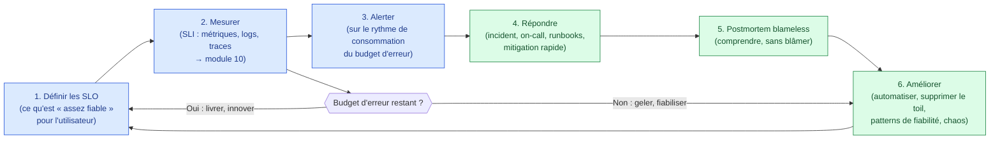

# Introduction au SRE (Site Reliability Engineering)

## Pourquoi ce cours ?

Vous savez maintenant déployer, conteneuriser, orchestrer et observer. Reste la question qui sépare un système qui *fonctionne* d'un système **fiable** : *quelle fiabilité vise-t-on, qui la
garantit, et que fait-on quand elle se dégrade ?* Le **SRE** (*Site Reliability Engineering*) répond par des **pratiques d'ingénierie** : objectifs mesurables, budget d'erreur, gestion d'incident,
automatisation, apprentissage par les pannes. Ce module est **différent des précédents** : il ne porte pas sur un outil, mais sur une **façon de travailler**. Il mobilise tout ce qui précède, en
particulier le [module 10 (observabilité)](../../10-monitoring-observabilite/README.md).

Ce cours présente l'origine du SRE, ses principes, son rôle dans une organisation et les erreurs classiques des débutants.

> Prérequis : les modules 01 à 10, surtout [introduction à l'observabilité](../../10-monitoring-observabilite/cours/01-introduction-observabilite.md) (SLI/SLO, signaux d'or) et [Alertmanager](../../10-monitoring-observabilite/cours/05-alertmanager-alertes.md).

## 1. D'où vient le SRE ?

Vers 2003, **Google** doit exploiter des services à une échelle inédite. Plutôt que d'embaucher des armées d'administrateurs système, Ben Treynor Sloss (alors responsable de l'exploitation) crée une équipe
composée d'**ingénieurs logiciels** à qui l'on confie l'exploitation : *« le SRE, c'est ce qui arrive quand on demande à des ingénieurs logiciels de concevoir une équipe d'exploitation »*. Le principe :
**traiter l'exploitation comme un problème de logiciel** — on écrit du code pour ne plus faire à la main ce que la machine peut faire.

Le livre *Site Reliability Engineering* (2016, gratuit sur <https://sre.google/books/>) a diffusé la pratique ; aujourd'hui des équipes SRE existent dans de nombreuses entreprises, avec des adaptations.

## 2. SRE, DevOps, Ops : quelles différences ?

| | **Ops traditionnel** | **DevOps** | **SRE** |
|---|---|---|---|
| Nature | Équipe d'exploitation séparée | **Culture** et ensemble de pratiques (collaboration dev/ops, CI/CD, automatisation) | **Implémentation concrète** de principes de fiabilité avec des rôles et des métriques |
| Objectif | Stabilité (« ne rien changer ») | Livrer vite et bien | **Fiabilité mesurée** *et* vélocité, arbitrées par des chiffres |
| Moyen | Procédures manuelles | Collaboration, automatisation | **SLO, budget d'erreur**, limitation du toil, ingénierie |
| Conflit dev/ops | Structurel | Atténué par la culture | **Arbitré objectivement** par le budget d'erreur |
| Profil | Administrateur système | Variable | Ingénieur logiciel + compétences systèmes |

Une formule connue : **« class SRE implements interface DevOps »** : DevOps dit *quoi* (supprimer les silos, automatiser, mesurer, apprendre) ; le SRE propose un *comment* précis.

> 📌 **À retenir** : le SRE n'est pas « un DevOps avec un autre titre ». Sa marque de fabrique est de **chiffrer la fiabilité** (SLO) et d'utiliser ce chiffre pour **décider** : livrer ou geler, investir en fiabilité ou en fonctionnalités.

## 3. Les principes fondamentaux

### 3.1 Embrace risk : accepter le risque

Viser 100 % de fiabilité est **un mauvais objectif** : coût exponentiel, vitesse de livraison à zéro, et l'utilisateur ne perçoit pas la différence entre 99,99 % et 99,999 % (son réseau, son téléphone sont moins fiables que cela). On choisit une **fiabilité cible**, et on **dépense** la marge restante (le *budget d'erreur*) pour innover.

| SLO | Indisponibilité tolérée / 30 jours |
|---|---|
| 99 % | ≈ 7 h 12 min |
| 99,9 % | ≈ 43 min |
| 99,99 % | ≈ 4 min 19 s |

### 3.2 SLO et budget d'erreur : le contrat interne

Un **SLO** (objectif de niveau de service) définit « assez fiable ». Le **budget d'erreur** (`100 % − SLO`) est la quantité de défaillance **acceptable**. Tant qu'il reste du budget, on livre ; s'il est épuisé, on se concentre sur la fiabilité. C'est l'objet du [cours 02](02-slo-sli-error-budget.md).

### 3.3 Le toil : le travail à éliminer

Le **toil** est le travail d'exploitation **manuel, répétitif, automatisable, tactique, sans valeur durable et qui croît avec le service**. Règle de Google : un SRE ne consacre **pas plus de 50 %** de son temps au toil ; le reste est de l'**ingénierie** (automatisation, outils, amélioration de la fiabilité). Voir le [cours 05](05-runbooks-et-automatisation.md).

### 3.4 L'automatisation

Ce qui est répété doit être **codé** : déploiements, remédiations, provisionnement, tests. L'automatisation n'est pas seulement un gain de temps : elle **rend le comportement reproductible et vérifiable** et supprime l'erreur humaine.

### 3.5 La culture « sans blâme » (*blameless*)

Les pannes sont **inévitables** dans les systèmes complexes. On les traite comme des **occasions d'apprendre** : on cherche les **faiblesses du système**, jamais un coupable. C'est la condition pour que les gens signalent les problèmes plutôt que de les cacher. Voir le [cours 04](04-postmortem-blameless.md).

### 3.6 Autres principes

| Principe | Idée |
|---|---|
| **Simplicité** | Chaque ligne de code et chaque composant est un risque : moins de systèmes = moins de pannes |
| **Surveillance utile** | Alerter sur ce qui exige une action humaine ; le reste sur des dashboards ([module 10](../../10-monitoring-observabilite/cours/05-alertmanager-alertes.md)) |
| **Gestion du changement** | La majorité des pannes vient d'un changement : déploiements progressifs, retour arrière rapide, automatisation des contrôles |
| **Réponse aux incidents** | Rôles clairs, communication structurée, apprentissage ([cours 03](03-gestion-incident-et-oncall.md)) |
| **Planification de capacité** | Anticiper la demande plutôt que subir la saturation |
| **Fiabilité dès la conception** | Timeouts, retries, circuit breakers ([cours 07](07-patterns-fiabilite.md)) ; résilience testée par le chaos ([cours 06](06-chaos-engineering.md)) |

## 4. Le cycle SRE

Le cycle est **continu** : chaque incident alimente le postmortem, qui produit des actions, qui améliorent le système, qui modifient ce que l'on mesure.

## 5. Le rôle du SRE dans une organisation

Le SRE se situe **entre le développement et l'exploitation**, avec des responsabilités partagées :

| | **Équipe de développement** | **SRE** |
|---|---|---|
| Écrit | Le code applicatif, les fonctionnalités | Les outils, l'automatisation, les contrôles de fiabilité |
| Possède | Le service (`you build it`) | Les pratiques de fiabilité, les plateformes partagées |
| En astreinte | Selon le modèle (souvent partagée) | Souvent, avec escalade vers les développeurs |
| Décide | Des fonctionnalités | **Avec** l'équipe, de l'équilibre fonctionnalités/fiabilité (budget) |

Modèles courants :

- **Embedded SRE** : un SRE au sein d'une équipe produit ;
- **Équipe SRE centrale** qui prend en charge les services critiques selon des critères (un service doit atteindre un niveau de maturité pour être « adopté ») ;
- **Platform / enablement** : l'équipe fournit une plateforme (CI/CD, observabilité, Kubernetes) et du conseil ; les équipes produit sont autonomes ;
- **Consulting** : intervention ponctuelle pour améliorer un service.

> 💡 **Conseil** : un SRE n'« hérite » pas de tout service instable. Un accord clair (*production readiness review*) précise ce que l'équipe produit doit fournir (SLO, runbooks, supervision) avant que le SRE prenne en charge un service.

## 6. Erreurs classiques des débutants

| Erreur | Pourquoi c'est un piège | À la place |
|---|---|---|
| **Viser 100 %** ou « cinq neuf » par principe | Coût et rigidité sans bénéfice perçu | Choisir un SLO **issu de l'attente utilisateur** |
| **SLO sur des métriques internes** (CPU, mémoire) | L'utilisateur ne perçoit pas le CPU | SLI **côté utilisateur** : disponibilité, latence, erreurs |
| **Trop de SLO** | Dilue l'attention | 1 à 3 SLO par service critique |
| **Alerter sur tout** | *Alert fatigue*, vraies alertes ignorées | Alertes actionnables, sur le symptôme et le *burn rate* |
| **Tout automatiser d'un coup** | Automatiser un processus mal compris fige l'erreur | Documenter (runbook), répéter, puis automatiser ce qui est fréquent et sûr |
| **Chercher un coupable** | Culture de la peur, informations cachées | Postmortem **blameless** |
| **Confondre SRE et « équipe qui répare »** | Le SRE devient un service de dépannage (toil à plein temps) | Plafonner le toil à 50 %, rendre le travail d'ingénierie prioritaire |
| **Ignorer le budget d'erreur** | Le SLO devient un affichage décoratif | Une **politique** écrite de décision (gel de release) |
| **Copier Google** tel quel | Mêmes outils ≠ même contexte | Adapter à sa taille et à sa maturité |
| **Ne pas mesurer** | Impossible d'améliorer ce qu'on ne mesure pas | Instrumenter d'abord ([module 10](../../10-monitoring-observabilite/README.md)) |

## 7. Par où commencer ?

1. **Choisir un service critique** et décrire son **parcours utilisateur** principal.
2. **Définir un SLI** simple (disponibilité des requêtes) et le **mesurer** ([atelier 1](../ateliers-killercoda/atelier-01-definir-slo-et-error-budget/intro.md)).
3. **Fixer un SLO** modeste et calculer le **budget d'erreur**.
4. **Écrire un runbook** pour l'alerte la plus fréquente.
5. **Instaurer le postmortem** après chaque incident significatif ([atelier 2](../ateliers-killercoda/atelier-02-postmortem-blameless/intro.md)).
6. **Mesurer le toil** pendant un mois et automatiser le n°1.
7. **Tester la résilience** par de petites expériences de chaos ([atelier 3](../ateliers-killercoda/atelier-03-chaos-engineering-basique/intro.md)).

> ⚠️ **Attention** : le SRE se **vit plus qu'il ne s'apprend**. Les cours donnent le vocabulaire et les méthodes ; la compétence vient de la pratique répétée en conditions réelles (incidents, astreintes, postmortems).

## Résumé

- Le **SRE** naît chez Google : exploiter les systèmes avec des **ingénieurs logiciels**, en traitant l'exploitation comme un problème de logiciel.
- **DevOps** = culture et pratiques ; **SRE** = mise en œuvre concrète centrée sur des **SLO chiffrés** et un **budget d'erreur** qui arbitre fiabilité vs vitesse.
- Principes : **accepter le risque**, **SLO / budget d'erreur**, limiter le **toil (< 50 %)**, **automatiser**, culture **blameless**, simplicité, gestion du changement.
- Cycle : **SLO → mesurer → alerter → répondre → postmortem → améliorer**, en boucle.
- Le SRE est **entre dev et ops** (embedded, central, plateforme, conseil).
- Erreurs : viser 100 %, SLO sur le CPU, alertes en excès, chercher un coupable, ignorer le budget.

## Pour aller plus loin

- *Site Reliability Engineering* et *The Site Reliability Workbook* (Google) : <https://sre.google/books/> ; *Seeking SRE* (David Blank-Edelman).
- Production Readiness Review, *Service Level Objectives* (Alex Hidalgo), Sloth et Pyrra pour les SLO as code.
- Cours suivant : [SLO, SLI et error budget](02-slo-sli-error-budget.md).
