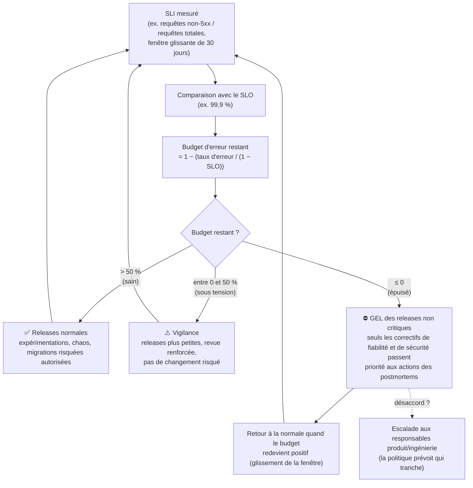

# SLI, SLO et budget d'erreur

## Pourquoi ce cours ?

« Le service doit être fiable. » Cette phrase ne veut rien dire tant qu'on ne dit pas **combien**, **mesuré comment** et **sur quelle période**. Les SLI et les SLO transforment la fiabilité en **chiffres
discutables**, et le **budget d'erreur** transforme ces chiffres en **décisions** : livrer cette fonctionnalité maintenant ou d'abord consolider ? C'est le cœur de la pratique SRE. Ce cours vous apprend à
définir de bons indicateurs, à fixer des objectifs réalistes, à calculer et à consommer un budget d'erreur, et à **mesurer un SLO avec Prometheus** (module 10).

> Prérequis : [introduction au SRE](01-introduction-sre.md) et [observabilité (SLI/SLO)](../../10-monitoring-observabilite/cours/01-introduction-observabilite.md) ; [PromQL](../../10-monitoring-observabilite/cours/03-promql-et-metriques.md). Pratique : [atelier 1](../ateliers-killercoda/atelier-01-definir-slo-et-error-budget/intro.md).

## 1. SLI : mesurer ce que vit l'utilisateur

Un **SLI** (*Service Level Indicator*) est une **mesure quantitative** d'un aspect du service. La forme la plus utile est un **ratio** :

```text
SLI = évènements « bons » / évènements « valides »      (exprimé en %, entre 0 et 100 %)
```

Avantage du ratio : il est **borné**, comparable entre services, et s'agrège facilement.

| Catégorie | Question | SLI typique (ratio bons / valides) |
|---|---|---|
| **Disponibilité** | Le service répond-il correctement ? | Requêtes **sans erreur serveur** (non-5xx) / requêtes totales |
| **Latence** | Répond-il assez vite ? | Requêtes **plus rapides que 300 ms** / requêtes totales |
| **Qualité** | La réponse est-elle complète/correcte ? | Réponses non dégradées / réponses totales |
| **Fraîcheur** (pipelines, données) | Les données sont-elles à jour ? | Données de moins de 5 min / enregistrements |
| **Débit / exactitude** (traitements batch) | Les traitements réussissent-ils ? | Tâches réussies / tâches lancées |
| **Durabilité** (stockage) | Les données sont-elles conservées ? | Objets lisibles / objets écrits |

Les **signaux d'or** du [module 10](../../10-monitoring-observabilite/cours/01-introduction-observabilite.md) (latence, trafic, erreurs, saturation) sont la source de la plupart des SLI. Une **saturation** (CPU, disque) est rarement un bon SLI utilisateur : c'est un **signal de cause**, utile en diagnostic mais pas en objectif.

### Bons critères pour un SLI

1. **Mesure l'expérience de l'utilisateur** (pas un détail interne) ;
2. **Mesurable** de façon fiable, **là où l'utilisateur est le plus proche** (répartiteur de charge, passerelle, ou même client) ;
3. **Sensible** : il bouge quand l'utilisateur souffre ;
4. **Simple à expliquer** ;
5. **Basé sur des évènements** quand c'est possible (« 98 % des requêtes sont réussies ») plutôt que sur le temps (« 99 % des minutes sont OK »), car les évènements reflètent le **poids réel** du trafic.

> ⚠️ **Attention** : n'incluez pas dans le dénominateur des évènements **non valides** (ex. requêtes 4xx causées par le client). Définissez explicitement ce qui compte comme **valide** et ce qui compte comme **bon**.

## 2. SLO : fixer un objectif réaliste

Un **SLO** (*Service Level Objective*) est une **cible** sur un SLI, **sur une période** :

```text
SLO : « 99,9 % des requêtes HTTP réussissent (non-5xx), mesurées sur 30 jours glissants »
        └ SLI : requêtes non-5xx / requêtes totales
                                  └ objectif : 99,9 %    └ fenêtre : 30 jours
```

### SLO ou SLA ?

| | **SLO** | **SLA** |
|---|---|---|
| Nature | Objectif **interne** | **Contrat** avec le client |
| Conséquence en cas de non-respect | Réaction de l'équipe (gel, priorité fiabilité) | **Pénalités** financières ou juridiques |
| Niveau | **Plus ambitieux** | **Moins ambitieux** (marge de sécurité) |
| Exemple | 99,95 % | 99,5 % |

Le SLO doit être **plus strict** que le SLA : on veut être alerté **avant** de violer le contrat.

### Comment choisir la valeur ?

1. **Partir de l'historique** : quelle fiabilité a-t-on **réellement** ? Un SLO ne doit pas être fixé au-dessus de ce que vos **dépendances** permettent (un service qui repose sur un fournisseur à 99,9 % ne peut pas promettre 99,99 %).
2. **Demander aux utilisateurs/produit** : à partir de quel niveau se plaignent-ils ?
3. **Commencer modestement** et **resserrer** ensuite ; réviser chaque trimestre.
4. **Éviter la précision illusoire** : 99,9 % ou 99,95 %, rarement 99,973 %.
5. **Un SLO réaliste est parfois à moins de 100 %** : la fiabilité parfaite n'est ni atteignable ni utile.

Plusieurs fenêtres existent : **glissante** (`30d` : toujours les 30 derniers jours, simple à communiquer) ou **calendaire** (le mois en cours : correspond aux cycles de décision). Les SLO de latence utilisent souvent **plusieurs seuils** (ex. 90 % < 200 ms **et** 99 % < 1 s).

## 3. Le budget d'erreur

```text
Budget d'erreur = 100 % − SLO
```

C'est la **quantité de défaillance tolérée** sur la période. Pour un SLO de **99,9 % sur 30 jours** :

| Mesure | Calcul | Résultat |
|---|---|---|
| Budget (ratio) | 100 % − 99,9 % | **0,1 %** |
| En **temps** d'indisponibilité totale | 30 j × 24 h × 60 min × 0,001 = 43 200 min × 0,001 | **43,2 minutes** |
| En **requêtes** (1 000 000 requêtes/jour) | 30 000 000 × 0,001 | **30 000 requêtes en échec** |

### Table de conversion (30 jours)

| SLO | Budget | Indisponibilité tolérée |
|---|---|---|
| 99 % | 1 % | 7 h 12 min |
| 99,5 % | 0,5 % | 3 h 36 min |
| **99,9 %** | 0,1 % | **43 min 12 s** |
| 99,95 % | 0,05 % | 21 min 36 s |
| 99,99 % | 0,01 % | 4 min 19 s |
| 99,999 % | 0,001 % | 26 s |

### Consommation du budget

Chaque évènement « mauvais » **consomme** du budget : un incident de 20 minutes complètes à 100 % d'erreur consomme 20 / 43,2 ≈ **46 %** du budget mensuel d'un SLO à 99,9 %.

```text
Consommation du budget = taux d'erreur observé / budget autorisé
Budget restant         = 1 − consommation

Exemple : SLO 99,9 %, disponibilité mesurée sur 30 j = 99,95 %
   taux d'erreur observé = 0,05 %     budget autorisé = 0,1 %
   consommation = 0,05 / 0,1 = 50 %   →   budget restant = 50 % ≈ 21,6 min
Exemple : disponibilité mesurée = 99,85 %
   consommation = 0,15 / 0,1 = 150 %  →   budget restant = −50 % : SLO violé
```

> 💡 **Conseil** : le budget n'est **pas une cible à économiser** : un budget jamais consommé signifie qu'on est **trop prudent** (SLO trop laxiste ou livraison trop lente). Il est fait pour être **dépensé** : déploiements, expérimentations, chaos engineering ([cours 06](06-chaos-engineering.md)).

### Le *burn rate* (vitesse de consommation)

Le **burn rate** compare le taux d'erreur actuel au taux d'erreur **autorisé** : `burn rate = taux d'erreur / budget`. Un burn rate de **1** épuise exactement le budget à la fin de la fenêtre ; de **14,4** l'épuise en 2 jours. On alerte sur des burn rates élevés **sur plusieurs fenêtres** ([module 10, alertes](../../10-monitoring-observabilite/cours/05-alertmanager-alertes.md)).

| Alerte | Burn rate | Fenêtre longue / courte | Budget consommé | Action |
|---|---|---|---|---|
| Page (urgent) | **14,4** | 1 h / 5 min | 2 % en 1 h | Réveiller quelqu'un |
| Page | **6** | 6 h / 30 min | 5 % en 6 h | Réveiller quelqu'un |
| Ticket | **1** | 3 j / 6 h | 10 % en 3 j | Traiter en journée |

## 4. Politique de budget d'erreur : la décision

Le budget n'a de valeur que s'il **déclenche des décisions** écrites **et acceptées d'avance** par les équipes produit et SRE : une **politique de budget d'erreur**.



Éléments d'une bonne politique (à rédiger et signer) :

| Élément | Exemple |
|---|---|
| **Seuils et actions** | Budget épuisé → **gel** des déploiements de fonctionnalités ; correctifs de fiabilité et sécurité autorisés |
| **Exceptions** | Correctif de sécurité critique, obligation légale |
| **Durée du gel** | Jusqu'à ce que le budget redevienne positif, ou jusqu'à ce que les actions de postmortem prioritaires soient livrées |
| **Responsabilités** | Qui constate, qui annonce, qui peut déroger |
| **Pannes extérieures** | Une panne d'un fournisseur hors de votre contrôle peut être **exclue** du budget (à décider d'avance, avec prudence) |
| **Révision** | Réexamen trimestriel des SLO et de la politique |

> 📌 **À retenir** : sans politique, un SLO est un **tableau de bord**. Avec une politique, il devient un **mécanisme de décision** qui évite les débats subjectifs « on livre ? » en s'appuyant sur un fait : *« il nous reste 12 % de budget ce mois-ci »*.

## 5. Mesurer un SLO avec Prometheus

On suppose un compteur `http_requests_total{code="200|500…"}` exposé par l'application ou le répartiteur de charge ([module 10, cours 03](../../10-monitoring-observabilite/cours/03-promql-et-metriques.md)).

### SLI de disponibilité

```promql
# Ratio de requêtes réussies sur 30 jours (SLI)
sum(increase(http_requests_total{code!~"5.."}[30d]))
/
sum(increase(http_requests_total[30d]))
```

`increase()` (compteur) donne l'augmentation sur la fenêtre ; le ratio est le **SLI**. Sur une longue fenêtre, c'est coûteux : on utilise des **recording rules** par fenêtres courtes, puis on les agrège.

```yaml
groups:
  - name: slo-disponibilite
    rules:
      # Ratio d'erreurs sur différentes fenêtres (précalculés)
      - record: slo:error_ratio:rate5m
        expr: sum(rate(http_requests_total{code=~"5.."}[5m])) / sum(rate(http_requests_total[5m]))
      - record: slo:error_ratio:rate1h
        expr: sum(rate(http_requests_total{code=~"5.."}[1h])) / sum(rate(http_requests_total[1h]))
      - record: slo:error_ratio:rate30d
        expr: sum(rate(http_requests_total{code=~"5.."}[30d])) / sum(rate(http_requests_total[30d]))

      # SLI et budget restant (SLO = 99,9 % → budget = 0,001)
      - record: slo:sli_availability:ratio_30d
        expr: 1 - slo:error_ratio:rate30d
      - record: slo:error_budget_remaining:ratio_30d
        expr: 1 - (slo:error_ratio:rate30d / (1 - 0.999))
```

Lecture : si `slo:error_budget_remaining:ratio_30d` vaut **0,5**, il reste 50 % du budget ; **0** : épuisé ; **négatif** : SLO violé.

### SLI de latence (avec un histogramme)

```promql
# Part des requêtes plus rapides que 300 ms (bucket le="0.3")
sum(rate(http_request_duration_seconds_bucket{le="0.3"}[5m]))
/
sum(rate(http_request_duration_seconds_count[5m]))
```

> ⚠️ **Attention** : le seuil doit correspondre à une **limite de bucket** de l'histogramme (`le="0.3"`) : choisissez vos buckets en fonction de vos SLO ([module 10](../../10-monitoring-observabilite/cours/03-promql-et-metriques.md)).

### Alerte sur le burn rate

```yaml
- alert: ErrorBudgetBurn
  expr: slo:error_ratio:rate1h > (14.4 * 0.001) and slo:error_ratio:rate5m > (14.4 * 0.001)
  labels: { severity: critical }
  annotations:
    summary: "Le budget d'erreur brûle 14 fois trop vite"
    runbook_url: https://wiki.kamer.example/runbooks/error-budget-burn
```

### Tests de règles et SLO as code

Les règles se testent hors-ligne avec **`promtool test rules`** (séries simulées, valeurs attendues) : c'est la méthode de l'[atelier 1](../ateliers-killercoda/atelier-01-definir-slo-et-error-budget/intro.md). Des outils comme **Sloth** et **Pyrra** génèrent règles, alertes et dashboards à partir d'une description de SLO (`slo.yml`) :

```yaml
# Exemple de description de SLO (style Sloth)
version: prometheus/v1
service: api
slos:
  - name: disponibilite
    objective: 99.9
    sli:
      events:
        error_query: sum(rate(http_requests_total{code=~"5.."}[{{.window}}]))
        total_query: sum(rate(http_requests_total[{{.window}}]))
    alerting:
      name: ApiDisponibilite
      labels: { team: plateforme }
```

## 6. Pièges et bonnes pratiques

| Piège | Remède |
|---|---|
| SLO sur la mauvaise métrique (CPU) | SLI **côté utilisateur** |
| SLO trop ambitieux (« cinq neuf ») | Partir de l'historique et des dépendances |
| Dénominateur mal défini (4xx comptés comme erreurs) | Définir « valide » et « bon » |
| **Moyenne** de latence | Utiliser des **percentiles** ou une part « sous un seuil » |
| Un seul SLO global pour des parcours très différents | Un SLO par **parcours critique** (connexion, paiement) |
| Pas de politique associée | Rédiger et faire signer la politique de budget |
| Mesure faite **depuis le serveur** seulement | Compléter par des **sondes externes** (`blackbox_exporter`) ou du *real user monitoring* |
| Budget jamais consommé | Resserrer le SLO ou livrer plus vite |
| SLO jamais révisé | Revue trimestrielle |

## Résumé

- **SLI** = ratio **évènements bons / évènements valides**, du point de vue de l'utilisateur (disponibilité, latence, qualité…).
- **SLO** = objectif sur un SLI **et une fenêtre** (ex. 99,9 % sur 30 j) ; **plus strict** que le **SLA** (contrat).
- **Budget d'erreur** = `100 % − SLO` : 99,9 % sur 30 j ≈ **43,2 min** ; consommation = `taux d'erreur observé / budget`.
- **Politique** de budget : releases normales si le budget est sain ; **gel** s'il est épuisé ; exceptions et responsabilités écrites.
- **Prometheus** : ratio `sum(increase(...{code!~"5.."}[30d])) / sum(increase(...[30d]))`, recording rules, alertes de **burn rate**, tests `promtool test rules`.

## Pour aller plus loin

- *Implementing SLOs* (SRE Workbook, ch. 2), *Alerting on SLOs* (ch. 5) : <https://sre.google/workbook/table-of-contents/>.
- **Sloth** (<https://sloth.dev>), **Pyrra**, OpenSLO (<https://openslo.com>).
- Cours suivant : [Gestion d'incident et astreinte](03-gestion-incident-et-oncall.md).
- Atelier associé : [Définir un SLO et un error budget](../ateliers-killercoda/atelier-01-definir-slo-et-error-budget/intro.md).
