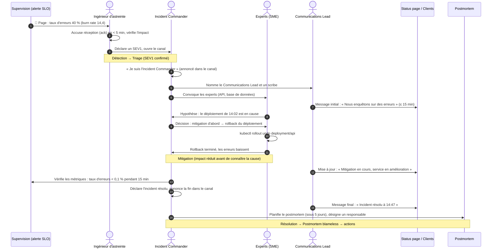

# Gestion d'incident et astreinte (on-call)

## Pourquoi ce cours ?

Une panne importante à 2 h du matin n'est pas un problème technique seulement : c'est un problème d'**organisation** sous stress. Qui décide ? Qui communique avec les clients ? Combien de personnes
modifient la production en même temps, sans se parler ? Les équipes qui gèrent bien les incidents ne sont pas celles qui ont les meilleurs héros, mais celles qui ont un **processus clair**, des **rôles définis** et
une astreinte **soutenable**. Ce cours présente le cycle de vie d'un incident, les rôles, les niveaux de sévérité, l'organisation de l'astreinte, la communication et les bonnes pratiques d'outillage.

> Prérequis : [introduction au SRE](01-introduction-sre.md), [alertes (module 10)](../../10-monitoring-observabilite/cours/05-alertmanager-alertes.md) et [diagnostic réseau](../../06-reseaux-devops/cours/05-diagnostic-reseau-devops.md). Suite : [postmortem](04-postmortem-blameless.md).

## 1. Qu'est-ce qu'un incident ?

Un **incident** est un évènement **non planifié** qui **dégrade ou menace** le service rendu aux utilisateurs (ou la sécurité/les données). Distinguez :

| Terme | Sens |
|---|---|
| **Alerte** | Signal automatique : *quelque chose* dépasse un seuil. Toutes ne sont pas des incidents |
| **Incident** | Alerte confirmée avec **impact** (ou risque imminent) : on **mobilise** des personnes |
| **Problème** (*problem*) | La cause sous-jacente (peut provoquer plusieurs incidents) |
| **Changement** | Modification planifiée (déploiement) : cause fréquente d'incident |

> 📌 **À retenir** : pendant un incident, l'objectif **n'est pas de trouver la cause** mais de **rétablir le service** (*mitigation*) le plus vite possible. La cause racine se cherche **après**, au calme, dans le postmortem.

## 2. Le cycle de vie d'un incident

| Phase | Objectif | Actions typiques | Indicateurs |
|---|---|---|---|
| **1. Détection** | Savoir qu'il y a un problème | Alerte (idéalement sur le SLO), supervision synthétique, signalement client | **MTTD** (temps moyen de détection) |
| **2. Triage** | Évaluer l'**impact** et la **sévérité**, déclarer l'incident, mobiliser | Qui est touché ? Depuis quand ? Quelle sévérité ? Ouvrir un canal dédié | Délai de prise en charge (**MTTA**) |
| **3. Mitigation** | **Réduire l'impact** vite, même sans comprendre | Retour arrière (*rollback*), bascule, désactivation d'une fonctionnalité (*feature flag*), ajout de capacité, délestage | Durée de l'impact |
| **4. Résolution** | Rétablir le service **nominal** et vérifier | Correctif, validation par les métriques, levée de la mitigation provisoire | **MTTR** (temps moyen de rétablissement) |
| **5. Clôture et suivi** | Capturer ce qui s'est passé | Notes, chronologie, **postmortem**, actions | Taux d'actions réalisées |

Principe fondamental : **mitigation avant diagnostic**. Un `rollback` du dernier déploiement qui rétablit le service en 5 minutes vaut mieux qu'une heure d'analyse d'un bug.

```bash
# Réflexes de mitigation fréquents
kubectl rollout undo deployment/api                   # retour à la version précédente
kubectl scale deployment/api --replicas=10            # ajouter de la capacité
kubectl annotate ingress site nginx.ingress.kubernetes.io/server-snippet="return 503;"   # (exemple de délestage)
```

> ⚠️ **Attention** : « on a redémarré et ça marche » **n'est pas la fin** : sans compréhension, la panne reviendra. Notez ce qui a été fait (chronologie) et planifiez l'analyse.

## 3. Les rôles pendant un incident

Pour éviter le chaos (dix personnes qui tapent des commandes en même temps, personne qui informe le client), on sépare **les rôles**. Inspirés de l'*Incident Command System*, ils sont **tenus par des personnes différentes** dès que l'incident est sérieux.

| Rôle | Responsabilité | Ce qu'il **ne fait pas** |
|---|---|---|
| **Incident Commander (IC)** — « commandant d'incident » | **Coordonne** : fixe les priorités, assigne les tâches, prend les décisions, garde la vue d'ensemble, décide quand clôturer | **Ne corrige pas lui-même** (il garde la tête hors du clavier) |
| **Communications Lead (Comms)** | Informe les **parties prenantes** et les utilisateurs : mises à jour régulières, status page, support | Ne diagnostique pas |
| **Operations lead / Subject Matter Experts (SME)** | **Investiguent et agissent** sur le système (diagnostic, mitigation, correctif) | Ne décident pas seuls de la stratégie globale |
| **Scribe** (scripteur) | Tient la **chronologie** en temps réel (qui a fait quoi, quand) : matière première du postmortem | |
| **Responsables / support** (selon le cas) | Relais métier, juridique, direction, support client | |

Règles pratiques :

- **L'IC est désigné explicitement** (« je prends le rôle d'IC »). Il peut être **transmis** (relève après quelques heures) en le **disant**.
- Sur un petit incident, **une seule personne** peut cumuler IC et SME ; dès qu'il y a de l'impact significatif, **séparez**.
- L'IC n'est pas forcément le plus senior ni le plus technique : c'est celui qui **organise**.
- Tout changement sur la production est **annoncé** dans le canal avant d'être fait (« je lance le rollback de l'API »), pour éviter les actions contradictoires.

## 4. Niveaux de sévérité

Une **échelle de sévérité** unique permet de décider vite *combien mobiliser et quelle communication déclencher*. Elle dépend de l'**impact utilisateur** (pas de la difficulté technique).

| Niveau | Définition | Exemples | Réponse |
|---|---|---|---|
| **SEV1** (critique) | **Indisponibilité majeure** ou perte/corruption de données, atteinte à la sécurité ; impact sur la **majorité** des utilisateurs ou fonction vitale | Site totalement inaccessible, paiements impossibles, fuite de données | **Réponse immédiate 24/7**, IC + Comms, war room, direction informée, status page |
| **SEV2** (majeur) | **Dégradation importante** d'une fonction clé ou d'une part significative des utilisateurs, avec contournement possible | Latence ×5, un pays/une région touché, une fonctionnalité majeure en panne | Astreinte réveillée, IC, communication aux parties prenantes |
| **SEV3** (modéré) | Impact **limité** : fonction secondaire ou petit nombre d'utilisateurs | Un export lent, un tableau de bord indisponible | Traité **pendant les heures ouvrées** |
| **SEV4** (mineur) | Gêne **négligeable** ou risque futur, aucun impact utilisateur notable | Alerte de capacité à moyen terme, bug cosmétique | **Ticket**, planifié |

Critères pour classer (à documenter pour votre contexte) : proportion d'utilisateurs touchés, fonctions critiques concernées, **consommation du budget d'erreur**, perte de données ou de revenus, exposition sécurité/réglementaire, durée. **En cas de doute, classez plus haut** : on rétrograde ensuite sans regret.

```text
Impact utilisateur ? ─► Aucun ──────────────────────────────────────► SEV4 (ticket)
        │
        ├─ Limité, contournement simple ───────────────────────────► SEV3 (heures ouvrées)
        ├─ Important ou région/fonction clé ──────────────────────► SEV2 (astreinte)
        └─ Majeur / données / sécurité ───────────────────────────► SEV1 (tous les moyens)
```

## 5. Déroulé d'un incident SEV1



Le **rythme de communication** est aussi important que la technique : une mise à jour **toutes les 20-30 minutes** pour un SEV1, **même si « rien de nouveau »**, évite un flot de questions qui perturbe l'équipe technique.

## 6. Communication

### Pendant l'incident

| Canal | Usage | Règles |
|---|---|---|
| **War room** (canal Slack/Teams dédié + visio) | **Coordination technique** : une source unique de vérité | Un canal **par incident** ; **le scribe** note les faits ; pas de discussions parallèles privées |
| **Status page** | Information **externe** (clients) | Simple, factuelle, **horodatée** : ce qu'on sait, ce qu'on fait, prochaine mise à jour |
| **Canal « stakeholders »** | Information **interne** (direction, support, commerciaux) | Résumés réguliers : impact, état, prochaine échéance |

### Un bon message de mise à jour

```text
[14:25 UTC] MISE À JOUR — Incident #214 (SEV1)
IMPACT : ~40 % des requêtes de paiement échouent depuis 14:05.
ÉTAT : cause probable identifiée (déploiement 14:02) ; rollback en cours.
PROCHAINE ÉTAPE : validation du rétablissement.
PROCHAINE MISE À JOUR : 14:45 (ou avant en cas de changement).
```

Règles : **factuel** (pas de spéculation ni de promesse de délai), **impact d'abord**, **heure de la prochaine mise à jour**, langage compréhensible par des non-techniciens, **pas de nom d'individu**, ne pas communiquer de cause non confirmée.

> 💡 **Conseil** : préparez des **modèles de messages** (incident ouvert, mise à jour, résolu) à l'avance : à 3 h du matin, on n'écrit pas bien.

## 7. L'astreinte (on-call)

L'astreinte est la capacité d'**être joignable et d'agir** dans un délai donné en dehors des horaires de travail. Elle doit être **soutenable**, ou l'équipe s'épuise et la qualité de réponse s'effondre.

### Organisation

| Élément | Bonne pratique |
|---|---|
| **Rotation** | Au moins **6 à 8 personnes** pour une rotation hebdomadaire durable ; éviter qu'une personne soit seule indéfiniment |
| **Durée** | Semaines (changement le même jour/heure) ou **follow-the-sun** (équipes réparties sur plusieurs fuseaux : pas d'astreinte de nuit) |
| **Primaire / secondaire** | Un **primaire** reçoit la page ; un **secondaire** prend le relais s'il ne répond pas |
| **Escalade** | **Chaîne définie** : primaire (5 min) → secondaire (5 min) → responsable d'équipe → direction ; temporisations claires |
| **Relève** (*handoff*) | Passation écrite : incidents en cours, alertes bruyantes, changements prévus |
| **Remplacement** | Possibilité d'échanger ; congés et indisponibilités gérés à l'avance |
| **Formation** | Nouveaux en **shadowing** (observation) puis *reverse shadowing* avant d'être seul |
| **Accès et outils** | Vérifiés **avant** la prise d'astreinte (VPN, accès, runbooks) |

### La fatigue d'astreinte

Les signes : sommeil perturbé, désengagement, démissions, alertes ignorées. Mesures :

- **Objectif de volume** : en moyenne **au plus 2 incidents par période de 12 h** d'astreinte (repère du livre SRE) : au-delà, le temps manque pour traiter et apprendre.
- **Qualité des alertes** : toute alerte non actionnable est **supprimée ou corrigée** ([module 10](../../10-monitoring-observabilite/cours/05-alertmanager-alertes.md)) ; revue hebdomadaire des pages.
- **Seuils d'urgence cohérents** : on ne réveille quelqu'un que pour l'impact utilisateur (SLO).
- **Récupération** : repos compensatoire après une nuit agitée.
- **Équité** : répartir les semaines difficiles ; éviter les « héros » toujours sollicités.
- **Amélioration continue** : l'astreinte doit **se réduire** avec l'automatisation et la correction des causes.

### Compensation

L'astreinte est une **contrainte** (disponibilité, limitation de vie personnelle) : elle doit être **reconnue** (prime d'astreinte, temps de récupération, congés, ou un mix). Les règles légales de votre pays s'appliquent (durées de repos, rémunération). Une astreinte non compensée est une astreinte subie : turnover garanti.

> ⚠️ **Attention** : ne confiez pas l'astreinte à une seule personne « parce qu'elle connaît le système » : c'est le signe d'un **point de défaillance humain** à corriger par la documentation, les runbooks et la formation.

## 8. Outils (principes, pas de tutoriel)

| Besoin | Exemples | Bonnes pratiques |
|---|---|---|
| **Paging** et planification des astreintes | PagerDuty, Opsgenie, Grafana OnCall, Squadcast | Politiques d'escalade, accusé de réception, plusieurs canaux (appel, SMS, push), calendrier lisible |
| **Coordination** | Slack, Teams, visio dédiée | Un canal par incident, nom normalisé (`#inc-AAAA-MM-JJ-sujet`), épingler le résumé |
| **Status page** | Statuspage, Cachet, Instatus | Mises à jour horodatées, composants par service |
| **Gestion des incidents** | Incident.io, FireHydrant, Rootly, Jira | Automatiser : création du canal, rôles, chronologie |
| **Documentation** | Wiki, dépôt Git | Runbooks accessibles **sans** dépendre de l'infra en panne |

Quelques règles :

1. **L'outil de crise ne doit pas dépendre de ce qui tombe** : si votre chat et votre wiki sont hébergés sur la même infrastructure que le service en panne, prévoyez une **voie de secours** (téléphone, conférence externe).
2. **Automatisez le mécanique** : création du canal, convocation, chronologie (le scribe note l'essentiel).
3. **Intégrez l'alerte à son contexte** : lien vers le dashboard et le runbook dans la page.
4. **Testez le paging** régulièrement (fausse alerte planifiée).
5. **Peu d'outils, bien maîtrisés** : un outil de plus ne remplace pas un processus clair.

## 9. Bonnes pratiques et erreurs fréquentes

| ✅ Bonnes pratiques | ❌ Erreurs fréquentes |
|---|---|
| **Mitigation d'abord**, cause ensuite | Chercher la cause racine pendant que les utilisateurs souffrent |
| IC **désigné** et visible | Tout le monde agit, personne ne coordonne |
| **Scribe** : chronologie en direct | Reconstituer de mémoire le lendemain |
| Mises à jour **régulières** et factuelles | Silence prolongé ou promesses de délai |
| Rôles **séparés** dès le SEV2 | L'IC corrige aussi les problèmes techniques |
| **Rollback** facile et répété | Corriger en avant dans la panique |
| Échelle de sévérité partagée | « Pour moi c'est critique » sans critère |
| **Relève** claire ; astreinte soutenable | Un seul héros ; alertes ignorées |
| Postmortem **systématique** pour SEV1/SEV2 | Aucun apprentissage, mêmes pannes |
| **Entraînement** (jeux d'incident, [game days](06-chaos-engineering.md)) | Découvrir le processus pendant la vraie panne |

## Résumé

- Un **incident** est un évènement non planifié avec **impact utilisateur** ; le but pendant l'incident est la **mitigation** (rétablir), pas la cause.
- **Cycle** : détection → triage → **mitigation** → résolution → clôture et **postmortem**. Mesures : MTTD, MTTA, MTTR.
- **Rôles** : **Incident Commander** (coordonne, ne corrige pas), **Communications Lead**, **experts (SME)**, **scribe**.
- **Sévérité** SEV1 à SEV4 selon l'**impact utilisateur** (en cas de doute, classer plus haut).
- **Communication** : war room unique, status page, mises à jour **régulières, factuelles, datées**.
- **Astreinte** soutenable : rotation suffisante, escalade claire, relève écrite, formation (shadowing), seuil de volume, **compensation** ; alertes actionnables.
- Outils (PagerDuty, Opsgenie, Slack) : **processus d'abord** ; l'outil de crise ne doit pas dépendre du système en panne.

## Pour aller plus loin

- *Managing Incidents* et *Being On-Call* (SRE book, ch. 14 et 11) : <https://sre.google/sre-book/table-of-contents/> ; *PagerDuty Incident Response* : <https://response.pagerduty.com/>.
- *Incident Command System* (ICS), exercices *Wheel of Misfortune*, simulations d'incidents.
- Cours suivant : [Postmortem blameless](04-postmortem-blameless.md).
- Pratique : [atelier postmortem](../ateliers-killercoda/atelier-02-postmortem-blameless/intro.md).
