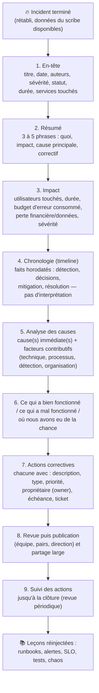

# Postmortem blameless

## Pourquoi ce cours ?

Une panne est un **cadeau coûteux** : elle révèle gratuitement une faiblesse du système que les tests n'avaient pas trouvée. Encore faut-il **l'exploiter**. Un incident dont on ne tire aucune leçon se reproduit ;
un incident où l'on cherche un coupable apprend aux équipes à **cacher** les erreurs. Le **postmortem blameless** (retour d'expérience *sans blâme*) est la pratique qui transforme les pannes en
améliorations durables. Ce cours explique la philosophie, la structure d'un bon document, la méthode des « 5 pourquoi » (et ses limites), les erreurs classiques et le suivi des actions.

> Prérequis : [gestion d'incident](03-gestion-incident-et-oncall.md) (le scribe fournit la chronologie) et [SLO](02-slo-sli-error-budget.md) (mesurer l'impact par le budget d'erreur). Pratique : [atelier 2](../ateliers-killercoda/atelier-02-postmortem-blameless/intro.md).

## 1. Pourquoi « blameless » ?

**Blameless** ne veut pas dire « sans responsabilité » : cela veut dire **« sans blâme »** — on **ne cherche pas la faute d'une personne** mais **les conditions** qui ont rendu l'erreur possible, probable ou invisible.

| Approche **avec blâme** | Approche **blameless** |
|---|---|
| « Qui a fait ça ? » | « Qu'est-ce qui a rendu cette action possible, voire raisonnable à ce moment ? » |
| Sanction ou réprimande | Amélioration du système |
| Les gens **cachent** ou minimisent | Les gens **signalent** tôt et détaillent |
| On corrige la personne (formation, avertissement) | On corrige **le système** (garde-fous, automatisation, documentation) |
| L'erreur se reproduit avec quelqu'un d'autre | La **classe** d'erreur disparaît |

Constat central : dans un système complexe, **des personnes compétentes, de bonne foi, commettent des erreurs**. Si la panne dépend d'**une seule** erreur humaine, c'est que le système n'avait **aucun garde-fou** : ce manque est la vraie cause.

```text
« L'ingénieur a supprimé la mauvaise base de données. »        ← blâme
« La commande de suppression ne distingue pas la production de la préproduction,
  n'exige pas de confirmation et le prompt du terminal est identique. »   ← blameless : le système rendait l'erreur facile
```

> 📌 **À retenir** : *« Si une erreur humaine peut causer une panne, la cause racine n'est pas l'erreur humaine : c'est l'absence de ce qui aurait dû l'empêcher, la détecter ou en limiter l'effet. »*

Conditions pour que ça fonctionne :

1. **Sécurité psychologique** : la direction **garantit** l'absence de sanction pour les erreurs de bonne foi.
2. **Honnêteté radicale** sur les faits, y compris les décisions discutables : « que pensais-tu à ce moment ? » est une question de **curiosité**, pas d'accusation.
3. **Exemplarité** : les responsables participent et reconnaissent aussi leurs décisions.
4. **Distinguer** l'erreur de bonne foi de la **négligence délibérée** ou de la malveillance (cas rares, hors du postmortem).

## 2. Quand écrire un postmortem ?

**Déclencheurs** (à définir et publier) :

- tout incident **SEV1 ou SEV2** ;
- impact utilisateur visible, **perte de données**, incident de sécurité ;
- **consommation importante du budget d'erreur** (ex. plus de 20 % en un incident) ;
- intervention manuelle **inhabituelle** ou astreinte réveillée à répétition ;
- **échec de la détection** (le client a prévenu avant la supervision) ;
- tout incident où l'équipe **a appris** quelque chose d'important (« presque-incident » inclus) ;
- demande d'un participant.

Délai : le **brouillon dans les 2 à 5 jours ouvrés** (la mémoire s'efface), la **revue** avant publication.

## 3. Postmortem, RCA et incident review : quelles différences ?

| | **Postmortem** (blameless) | **RCA** (*Root Cause Analysis*) | **Incident review** |
|---|---|---|---|
| But | **Apprendre** et améliorer le système, de façon durable | Identifier **la** cause racine d'un problème | Examiner la **gestion** de l'incident (réponse, communication) |
| Résultat | Document partagé + **actions** | Rapport de cause(s) | Retour sur le processus, parfois oral |
| Cause | **Facteurs multiples** (contributing factors) | Souvent **une** cause racine (risque de simplification) | Hors sujet : on regarde la **réponse** |
| Posture | **Sans blâme** | Variable (parfois orientée coupable) | Constructive |
| Portée | Technique, organisationnelle, détection, réponse | Technique principalement | Humaine et organisationnelle |
| Usage typique | SRE moderne | ITIL, qualité industrielle | Équipes d'exploitation |

Aujourd'hui, un bon postmortem **englobe** l'analyse des causes (sans réduire à une seule), la revue de la réponse et les actions. L'idée d'**une** cause racine est trompeuse dans les systèmes complexes : on parle plutôt de **facteurs contributifs**.

## 4. Structure d'un postmortem



### Détail des sections

| Section | Contenu | Conseil |
|---|---|---|
| **En-tête** | Titre explicite, date, **auteurs**, sévérité, statut (*brouillon / en revue / publié*) | Pas de nom de « coupable » : des **rôles** et des équipes |
| **Résumé** | 3-5 phrases lisibles par un non-spécialiste | À écrire **en dernier** |
| **Impact** | Nombre/part d'utilisateurs, durée, **budget d'erreur** consommé, coût | Chiffrer (métriques), pas « fort impact » |
| **Chronologie** | Faits **horodatés** (UTC) : *quand* et *quoi* | **Faits seulement** ; pas de jugement dans la chronologie |
| **Causes** | Cause immédiate **et** facteurs contributifs ; hypothèses écartées | Décrire le **système**, pas les personnes |
| **Détection et réponse** | Combien de temps pour détecter ? Pour mitiger ? Qu'est-ce qui a aidé/freiné ? | Mesurer MTTD / MTTR |
| **Bien / mal / chance** | Trois colonnes | « Chance » : ce qui aurait pu aggraver l'incident |
| **Actions** | Liste **SMART** avec propriétaire et échéance | Trier : *prévenir*, *détecter*, *atténuer* |
| **Annexes** | Graphes, journaux, liens (canal, dashboards) | Pour la reproductibilité |

### Chronologie : exemple

```text
Chronologie (UTC)
14:02  Déploiement v2.31 de l'API commandes terminé (pipeline CD).
14:05  Le taux d'erreurs 5xx passe de 0,1 % à 38 %. (métrique http_requests_total)
14:08  L'alerte ErrorBudgetBurn (burn rate 14,4) se déclenche ; l'astreinte est paginée.
14:11  L'astreinte accuse réception et déclare un SEV1 (canal #inc-2025-11-24).
14:15  L'IC est nommé ; la mise à jour initiale est publiée sur la status page.
14:22  Hypothèse : le déploiement de 14:02 ; les journaux montrent « pool de connexions épuisé ».
14:26  Décision de l'IC : rollback vers v2.30.
14:33  Rollback terminé ; le taux d'erreurs redescend.
14:47  Taux d'erreurs < 0,1 % depuis 15 min : incident déclaré résolu.
```

### Actions : exemple (tableau SMART)

| # | Action | Type | Priorité | Propriétaire | Échéance | Ticket |
|---|---|---|---|---|---|---|
| 1 | Ajouter un test de charge sur la taille du pool de connexions dans la CI | Prévenir | P1 | Équipe API | 2025-12-12 | SRE-412 |
| 2 | Déployer en **canary 5 %** avec analyse automatique avant le déploiement complet | Atténuer | P1 | Plateforme | 2025-12-19 | SRE-413 |
| 3 | Alerte sur la saturation du pool de connexions (avant l'erreur) | Détecter | P2 | Équipe API | 2025-12-05 | SRE-414 |
| 4 | Mettre à jour le runbook « rollback API » (commande et validations) | Réponse | P3 | Astreinte | 2025-11-30 | SRE-415 |

Une action utile est **précise, mesurable, assignée (une personne ou une équipe), datée et suivie**. « Faire plus attention » n'est **pas** une action.

## 5. La méthode des « 5 pourquoi »

Poser « pourquoi ? » de proche en proche pour remonter de **l'effet** vers des **causes plus profondes**.

```text
Problème : les paiements ont échoué pendant 30 minutes.
1. Pourquoi ? → L'API commandes renvoyait des erreurs 5xx.
2. Pourquoi ? → Son pool de connexions à la base était épuisé.
3. Pourquoi ? → La version 2.31 ouvre une connexion supplémentaire par requête sans la libérer.
4. Pourquoi cela n'a-t-il pas été détecté avant la production ? → Aucun test de charge ne couvre le pool de connexions.
5. Pourquoi l'impact a-t-il touché tous les utilisateurs d'un coup ? → Le déploiement est instantané sur 100 % des instances (pas de canary).
→ Actions : test de charge ; déploiement canary ; alerte sur la saturation du pool.
```

**Forces** : simple, accessible à tous, pousse à dépasser la première explication.

**Limites** (à connaître) :

| Limite | Conséquence | Remède |
|---|---|---|
| Suppose **une** chaîne linéaire de causes | Les pannes ont des **causes multiples** et des interactions | Dessiner un **diagramme de facteurs** (arête de poisson, cartes de causalité) |
| Dépend de **qui** pose les questions | Résultats différents, biais | Faire à plusieurs, avec des perspectives variées |
| Peut **s'arrêter** à « erreur humaine » | Retour au blâme | Interdire de s'arrêter à une personne : demander « pourquoi le système l'a-t-il permis ? » |
| Le « 5 » est arbitraire | Pas assez ou trop | Continuer tant que de **nouvelles actions** utiles apparaissent |
| Peu adapté aux défaillances **organisationnelles** | Les causes profondes sont sociales (pression, priorités) | Compléter par une discussion sur les **conditions de travail** |

> 💡 **Conseil** : à la place d'une seule chaîne, listez les **facteurs contributifs** par catégorie : *déclencheur* (le changement), *vulnérabilité latente* (le bug), *détection* (pourquoi tardive), *mitigation* (pourquoi lente), *organisation* (pression de livraison, documentation).

## 6. Publier, partager, suivre

- **Publier** dans un espace **accessible à toute l'ingénierie** (voire à toute l'entreprise) : l'apprentissage est collectif. Pour les clients, un **résumé** public peut être pertinent.
- **Relire** : au moins un pair extérieur à l'incident vérifie la clarté et l'absence de blâme.
- **Réunion de revue** (30-60 min) : présenter, discuter, **ajouter des actions**, pas défendre des positions.
- **Suivre les actions** : elles sont des **tickets** dans le backlog réel, priorisés, avec un **propriétaire** ; un point **mensuel** passe en revue les actions ouvertes. Indicateur : **taux d'actions de postmortem terminées dans les délais**.
- **Partager les leçons** : lettre d'information, présentation périodique, « incident du mois », bibliothèque de postmortems (un trésor pour l'intégration des nouveaux).
- **Capitaliser** : mettre à jour les **runbooks**, alertes, SLO, tests de non-régression, scénarios de **chaos** ([cours 06](06-chaos-engineering.md)).

## 7. Erreurs classiques

| Erreur | Effet | Correction |
|---|---|---|
| **Blâmer** (noms, « a causé », « est responsable », « négligence ») | Peur, dissimulation | Reformuler sur le système : « le système ne prévoyait pas… » |
| **S'arrêter à « erreur humaine »** | Aucune amélioration | Demander ce qui aurait empêché ou limité l'erreur |
| **Ne pas suivre les actions** | Le même incident revient | Tickets, propriétaires, revue mensuelle |
| Actions **vagues** (« être plus vigilant », « améliorer la communication ») | Rien ne change | Actions SMART et vérifiables |
| Postmortem **trop long** | Personne ne le lit | Résumé court + détails en annexes |
| Postmortem **trop vague** | Aucun apprentissage | Chronologie précise, chiffres |
| **Trop d'actions** (30) | Aucune n'est faite | Prioriser : 3 à 7 actions à fort effet |
| **Retarder l'écriture** | Mémoire perdue | Brouillon sous 5 jours |
| **Ne pas publier** | Apprentissage limité à l'équipe | Publication large |
| Rédaction par **une seule personne** | Vision partielle | Impliquer les personnes de l'incident et un relecteur |
| **Cacher** les « chances » et décisions douteuses | Risque invisible | Section « où nous avons eu de la chance » |
| Utiliser le postmortem pour l'**évaluation individuelle** | Fin de la culture blameless | Séparer strictement les deux processus |

### Reformuler sans blâme : exemples

| ❌ Avec blâme | ✅ Blameless |
|---|---|
| « Jean a déployé sans lire les alertes. » | « Le pipeline de déploiement ne vérifie pas l'état des alertes avant de lancer un déploiement. » |
| « L'équipe base de données n'a pas prévenu à temps. » | « Il n'existait pas de canal défini pour annoncer les changements de configuration de la base. » |
| « L'ingénieur a oublié de mettre à jour le certificat. » | « Le renouvellement du certificat dépendait d'un rappel manuel, sans alerte d'expiration. » |
| « C'est une erreur de débutant. » | « La documentation d'intégration ne mentionnait pas cette étape ; la revue de code n'a pas de liste de contrôle correspondante. » |

## Résumé

- **Blameless** = chercher **les faiblesses du système**, pas un coupable ; condition : sécurité psychologique et exemplarité.
- Écrire un postmortem pour tout SEV1/SEV2, perte de données, forte consommation du budget d'erreur, ou fort apprentissage ; **brouillon sous 5 jours**.
- Différence : **postmortem** (apprendre, facteurs multiples, actions), **RCA** (cause racine), **incident review** (qualité de la réponse).
- **Structure** : en-tête, résumé, **impact chiffré**, **chronologie factuelle**, causes et **facteurs contributifs**, bien/mal/chance, **actions SMART** (propriétaire, échéance), publication, suivi.
- **5 pourquoi** : simple, mais linéaire et sujet à s'arrêter à « erreur humaine » ; complétez par des facteurs contributifs.
- Erreurs : blâmer, ne pas suivre les actions, actions vagues, document trop long ou trop vague, ne pas publier.

## Pour aller plus loin

- *Postmortem Culture: Learning from Failure* (SRE book, ch. 15) ; *Blameless PostMortems and a Just Culture* (John Allspaw, Etsy) ; *The Field Guide to Understanding Human Error* (Sidney Dekker).
- Modèles : <https://github.com/dastergon/postmortem-templates> ; dépôt de postmortems publics *Postmortems* (danluu).
- Cours suivant : [Runbooks et automatisation](05-runbooks-et-automatisation.md).
- Atelier associé : [Postmortem blameless](../ateliers-killercoda/atelier-02-postmortem-blameless/intro.md).
