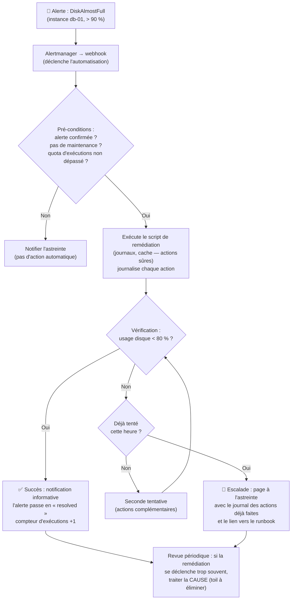

# Runbooks, toil et automatisation

## Pourquoi ce cours ?

À 3 h du matin, personne n'est au meilleur de sa forme. Un **runbook** (« mode d'emploi opérationnel ») transforme une procédure connue d'un seul expert en une **checklist exécutable par n'importe quel membre
de l'astreinte**. Et quand la même procédure est exécutée dix fois par mois, la bonne question n'est plus « où est le runbook ? » mais **« pourquoi un humain le fait-il encore ? »** : c'est la
lutte contre le **toil**, au cœur du SRE. Ce cours explique ce qu'est un bon runbook, comment décider **quand automatiser**, comment mesurer et réduire le toil, et présente quelques outils d'automatisation.

> Prérequis : [gestion d'incident](03-gestion-incident-et-oncall.md) (les runbooks vivent dans les alertes), [scripts Bash](../../03-linux-avance/cours/01-scripting-bash.md) (codes de retour, `set -euo pipefail`) et [alertes (module 10)](../../10-monitoring-observabilite/cours/05-alertmanager-alertes.md) (`runbook_url`).

## 1. Qu'est-ce qu'un runbook ?

Un **runbook** est une documentation **opérationnelle, orientée action**, associée à une situation précise (une alerte, une tâche) : *« quand X se produit, voici comment diagnostiquer et corriger »*.

### Runbook, playbook, documentation : les différences

| | **Runbook** | **Playbook** | **Documentation** (architecture, guides) |
|---|---|---|---|
| Question | **Comment** résoudre/exécuter *cette* situation ? | **Quelle stratégie** pour *ce type* d'incident (rôles, décisions, communication) ? | **Comment fonctionne** le système ? Pourquoi ? |
| Niveau | **Opérationnel** : commandes précises | **Coordination** : qui fait quoi, quand escalader | **Compréhension** |
| Lecteur | Ingénieur d'astreinte | Incident Commander, équipe | Tout le monde |
| Exemple | « Disque plein sur `db-01` : nettoyer les journaux » | « Procédure SEV1 : rôles, communication, critères de clôture » | « Schéma de la réplication PostgreSQL » |
| Durée de vie | Mis à jour **à chaque usage** | Revu à chaque trimestre | Évolue avec l'architecture |

Les termes sont parfois employés différemment selon les organisations (*playbook* chez Ansible = un script d'automatisation) : **définissez le vocabulaire** dans votre équipe.

## 2. Anatomie d'un bon runbook

Un runbook doit être **lisible en 30 secondes, utilisable en stress** : court, sans ambiguïté, avec des commandes copiables.

| Section | Contenu |
|---|---|
| **Titre et identifiant** | Nom de l'alerte exacte (`DiskAlmostFull`) pour qu'on le retrouve |
| **Propriétaire** et dernière révision | Qui le maintient ? Quand a-t-il été testé pour la dernière fois ? |
| **Description / impact** | Que signifie l'alerte ? Quel est l'impact utilisateur ? Sévérité ? |
| **Prérequis** | Accès, outils, droits nécessaires |
| **Diagnostic** | Étapes **ordonnées** pour **confirmer** et **cerner** (liens vers dashboards, requêtes, commandes) |
| **Mitigation / résolution** | Actions pas à pas, **avec les commandes exactes** |
| **Vérification** | Comment **prouver** que c'est résolu (métrique attendue, commande de contrôle) |
| **Retour arrière** | Comment **annuler** une action si elle aggrave la situation |
| **Escalade** | Qui appeler si ça ne marche pas, après combien de temps |
| **Liens** | Dashboards, postmortems précédents, documentation |

```markdown
# Runbook : DiskAlmostFull
**Propriétaire** : équipe plateforme · **Dernière révision** : 2025-11-10 · **Dernier test** : game day du 2025-10-22
**Sévérité** : critical si > 90 % pendant 10 min · **Impact** : arrêt des écritures de la base si 100 %.

## 1. Confirmer
- Dashboard : https://grafana.kamer.example/d/node-exporter?var-instance=<instance>
- `ssh <hôte> 'df -h /var && df -i /var'`

## 2. Diagnostiquer (qui consomme ?)
- `sudo du -xh /var --max-depth=2 | sort -h | tail -n 10`
- `sudo lsof +L1`            # fichiers supprimés mais encore ouverts

## 3. Corriger (du moins risqué au plus risqué)
1. `sudo journalctl --vacuum-size=500M`
2. `sudo apt clean`
3. `sudo logrotate -f /etc/logrotate.conf`
4. Si une application garde un fichier supprimé ouvert : redémarrer **ce** service (`sudo systemctl restart <service>`).

## 4. Vérifier
- `df -h /var` < 80 % ; l'alerte passe à *resolved*.

## 5. Retour arrière
- Aucune suppression irréversible n'est faite (journaux et cache seulement).

## 6. Escalader
- Pas résolu en 30 min, ou cause inconnue → équipe base de données (#db-oncall).
```

### Bonnes pratiques de rédaction

1. **Un runbook par alerte** ; l'URL est dans l'annotation `runbook_url` de l'alerte.
2. **Commandes complètes et copiables**, avec des **variables claires** (`<instance>`), jamais « vérifiez la configuration ».
3. **Ordre du moins risqué au plus risqué**.
4. **Pas de jargon non expliqué** : le lecteur peut être nouveau.
5. **Marquer les actions dangereuses** (⚠️ suppression, redémarrage de production) et exiger une **confirmation**.
6. **Testé** : un runbook jamais exécuté est probablement faux. On le **teste** lors des *game days* ([cours 06](06-chaos-engineering.md)) et on le **corrige à chaque usage** (« si tu as dû t'écarter du runbook, mets-le à jour »).
7. **Accessible quand l'infrastructure tombe** : une copie hors-ligne / dans Git, pas uniquement dans le wiki hébergé sur la production.
8. **Versionné** (Git) avec revue de code : les changements sont tracés.

> ⚠️ **Attention** : un runbook **périmé** est pire que pas de runbook : il donne une fausse confiance. Imposez une **date de dernière vérification** et un propriétaire ; supprimez les runbooks orphelins.

### Formats

| Format | Avantages | Inconvénients |
|---|---|---|
| **Markdown dans Git** | Versionné, revue, recherche, hors-ligne | Pas d'exécution |
| **Wiki** (Confluence, Notion…) | Facile à éditer, collaboratif | Peut être indisponible en cas de panne, dérive |
| **Code exécutable** (scripts, notebooks, Ansible, Rundeck) | **Exécutable**, testable, reproductible | Plus de travail initial |
| **Runbook « vivant »** (Markdown + blocs exécutables) | Documentation **et** exécution, étape par étape | Outillage dédié |

La **maturité** d'un runbook évolue : *texte* → *checklist avec commandes* → *script semi-automatique (l'humain valide)* → *automatisation complète*.

## 3. Le toil

Selon le livre SRE, le **toil** est un travail d'exploitation qui est :

| Caractéristique | Signification |
|---|---|
| **Manuel** | Un humain exécute des commandes ou clique |
| **Répétitif** | Refait régulièrement |
| **Automatisable** | Une machine pourrait le faire |
| **Tactique** | Réactif, déclenché par un évènement (alerte, ticket), pas stratégique |
| **Sans valeur durable** | Après l'avoir fait, le système n'est **pas meilleur** (à part le problème du jour) |
| **Croît linéairement avec le service** | Plus de serveurs/clients = plus de travail |

**Exemples de toil** : redémarrer manuellement un service qui plante chaque semaine, créer des comptes à la main, copier des fichiers de configuration, répondre au même ticket « réinitialiser mon mot de passe », nettoyer un disque plein.

**Ce n'est pas du toil** : une conception d'architecture, l'écriture d'un outil, un **postmortem**, la planification de capacité, un incident vraiment nouveau (résolu **une fois** pour toutes). Un travail **administratif** ou **pénible** n'est pas forcément du toil.

### La règle des 50 %

Chez Google, un SRE consacre **au plus 50 %** de son temps au toil ; le reste est de l'**ingénierie** (réduire le toil, améliorer la fiabilité). Si l'équipe dépasse cette limite, elle devient un **service de dépannage** et le système s'enlise (plus de croissance → plus de toil → plus de gens).

### Mesurer le toil

1. **Lister** les tâches récurrentes (tickets, pages, procédures manuelles).
2. **Estimer** pour chacune : fréquence × durée = temps par mois, risque d'erreur, impact.
3. **Catégoriser** : toil / ingénierie / projets / réunions.
4. **Suivre** dans le temps (tableau de bord : % de temps passé en toil par personne ou par équipe ; nombre de pages par astreinte).
5. **Classer** par **rapport coût/bénéfice** de l'automatisation.

| Tâche | Fréquence | Durée | Temps / mois | Risque d'erreur | Priorité |
|---|---|---|---|---|---|
| Nettoyage du disque de `db-01` | 4 / mois | 20 min | 80 min | Moyen | **Haute** (alerte récurrente) |
| Création d'un compte client | 30 / mois | 10 min | 300 min | Moyen | **Très haute** |
| Rotation manuelle d'un certificat | 1 / trimestre | 60 min | 20 min | **Élevé** | Haute (risque) |

### Réduire le toil

| Levier | Exemple |
|---|---|
| **Automatiser** la tâche | Script/API de création de comptes |
| **Éliminer la cause** (plutôt que traiter les symptômes) | Corriger la fuite de fichiers au lieu de nettoyer le disque |
| **Libre-service** | Portail pour que les équipes fassent seules leurs demandes |
| **Réduire la fréquence** | Mises à jour automatiques, certificats renouvelés (cert-manager) |
| **Simplifier** | Supprimer des systèmes ou des cas particuliers |
| **Rendre idempotent** | Réexécuter sans danger |

## 4. Quand automatiser un runbook ?

Automatiser a un coût (développement, tests, maintenance) : on ne le fait pas pour tout. Critères :

| Critère | Automatiser si… |
|---|---|
| **Fréquence** | La tâche est exécutée **souvent** (hebdomadaire ou plus) |
| **Risque d'erreur humaine** | Les erreurs sont **fréquentes ou graves** |
| **Complexité** | Beaucoup d'étapes ; mais **pas** si le processus est mal compris |
| **Stabilité** | Le processus est **stable** (sinon on automatise du mouvant) |
| **Temps** | Le temps cumulé dépasse le coût de l'automatisation |
| **Réversibilité / sécurité** | L'action est **sûre** ou facilement **annulable** |
| **Urgence** | Elle doit s'exécuter **plus vite** qu'un humain ne peut réagir |

Estimation rapide : **retour sur investissement** = (temps par exécution × fréquence × durée de vie) − coût de développement et de maintenance. Une tâche de 5 minutes une fois par an **ne justifie pas** 2 jours d'automatisation.

> 💡 **Conseil** : **ne pas automatiser un processus que l'on ne comprend pas ou qui est mauvais** : on ne ferait que figer l'erreur et l'exécuter plus vite. Documentez d'abord (runbook), exécutez **plusieurs fois à la main**, améliorez, **puis** automatisez.

### Niveaux d'automatisation (de plus prudent à plus autonome)

| Niveau | Description | Exemple |
|---|---|---|
| **0. Documenté** | Runbook texte, exécution manuelle | Liste de commandes dans le wiki |
| **1. Script** | Un script, lancé par un humain | `nettoyer-disque.sh` |
| **2. Assisté** | Le script propose, l'humain **valide** (bouton, `--confirm`) | Rundeck avec approbation |
| **3. Automatique avec garde-fous** | Déclenché par l'alerte, **vérifie**, limite le nombre d'actions, **escalade** si échec | Auto-remédiation (diagramme ci-dessous) |
| **4. Auto-guérison par conception** | Le système corrige sans intervention (Kubernetes redémarre un pod, autoscaling) | Liveness probe, HPA |

### Les garde-fous d'une automatisation

1. **Idempotence** : exécuter deux fois = même résultat.
2. **Limitation** (*rate limit*) : au plus N exécutions par heure (sinon boucle infernale).
3. **Pré-conditions** vérifiées (« le disque est-il vraiment plein ? »).
4. **Vérification** du résultat **après** l'action.
5. **Escalade** à un humain si échec ou si répétition.
6. **Journalisation** et **notification** de chaque action automatique.
7. **Mode simulation** (*dry-run*) et **interrupteur d'arrêt** (*kill switch*).
8. **Périmètre limité** (une action précise, sur des cibles précises) ; **moindre privilège**.

## 5. Un runbook automatisé



Une alerte qui se **remédie automatiquement tous les jours** est un signal : l'automatisation masque un **défaut de conception** à corriger.

### Exemple : script de remédiation prudent

```bash
#!/usr/bin/env bash
# remediation-disque.sh <point_de_montage> [--dry-run]
# Codes de retour : 0 = résolu, 1 = non résolu (escalade), 2 = pré-condition non remplie
set -euo pipefail

MONTAGE="${1:?Usage : $0 <point_de_montage> [--dry-run]}"
DRY="${2:-}"
SEUIL=80
LOCK=/var/lock/remediation-disque.lock
LOG=/var/log/remediation.log

log() { printf '%s [%s] %s\n' "$(date -u +%FT%TZ)" "$1" "$2" | tee -a "$LOG" >&2; }
utilisation() { df --output=pcent "$MONTAGE" | tail -n 1 | tr -dc '0-9'; }
agir() { if [[ "$DRY" == "--dry-run" ]]; then log SIMULATION "$*"; else log ACTION "$*"; "$@"; fi; }

exec 9>"$LOCK"; flock -n 9 || { log INFO "Une remédiation est déjà en cours"; exit 2; }   # une seule exécution à la fois

avant="$(utilisation)"
(( avant >= 90 )) || { log INFO "Pré-condition non remplie : ${avant} % < 90 %"; exit 2; }
log INFO "Début : $MONTAGE à ${avant} %"

agir journalctl --vacuum-size=500M      # actions sûres, dans l'ordre
agir apt-get clean
agir logrotate -f /etc/logrotate.conf

apres="$(utilisation)"
log INFO "Fin : ${apres} %"
if (( apres < SEUIL )); then exit 0; fi
log ERREUR "Toujours ${apres} % : escalade nécessaire"
exit 1
```

## 6. Outils d'automatisation

| Outil | Rôle | Remarque |
|---|---|---|
| **Scripts Bash / Python** | Automatisations simples et rapides | Mode strict, codes de retour, `shellcheck`, tests ([module 03](../../03-linux-avance/cours/01-scripting-bash.md)) |
| **Ansible** | Configuration et orchestration **idempotentes** (YAML, sans agent, via SSH) ; *playbooks*, *roles* | Excellent pour la remédiation sur un parc de machines |
| **Rundeck** (ou **Rundeck Community** / **PagerDuty Runbook Automation**) | Plateforme de **runbooks exécutables** : tâches avec droits, approbation, journal d'audit, déclenchement par API/alerte | Donne une interface contrôlée à l'astreinte et au support |
| **StackStorm, Argo Workflows, Jenkins, GitHub Actions** | Orchestration de flux d'automatisation (« if this then that » pour l'exploitation) | Selon la plateforme déjà utilisée |
| **Kubernetes** (probes, Jobs, CronJobs, HPA, opérateurs) | Auto-guérison et automatisation **native** | La meilleure automatisation est celle que la plateforme fait déjà |
| **Terraform / Pulumi** | Infrastructure as code | Reproductibilité du provisionnement |
| **ChatOps** (bots Slack) | Lancer des actions depuis le canal d'incident | Transparent : tout le monde voit l'action |

### Ansible : exemple de runbook exécutable

```yaml
# nettoyer-disque.yml — ansible-playbook -i inventaire nettoyer-disque.yml --limit db-01 --check   (--check = simulation)
- name: Libérer de l'espace disque en sécurité
  hosts: all
  become: true
  tasks:
    - name: Mesurer l'utilisation avant
      ansible.builtin.command: df --output=pcent /var
      register: avant
      changed_when: false

    - name: Réduire le journal systemd
      ansible.builtin.command: journalctl --vacuum-size=500M
      changed_when: true

    - name: Nettoyer le cache APT
      ansible.builtin.apt:
        autoclean: true
        clean: true

    - name: Vérifier que l'usage est redescendu
      ansible.builtin.shell: test "$(df --output=pcent /var | tail -n 1 | tr -dc '0-9')" -lt 80
      changed_when: false
```

### Rundeck : en bref

Rundeck expose des **jobs** (un script ou une suite d'étapes) avec : **contrôle d'accès** (qui peut lancer quoi), **options** à saisir, **journal d'exécution** (audit), **planification**, **déclenchement par webhook** (depuis Alertmanager), **notifications**. Il convient pour fournir au support ou à l'astreinte des **actions sûres, sans accès SSH direct**.

> ⚠️ **Attention** : une automatisation est un **code de production** : elle peut **aggraver** une panne (supprimer trop, redémarrer en boucle). Appliquez-lui les mêmes exigences : revue, tests, droits minimaux, journalisation, *kill switch*. Sur de grands incidents, des automatisations mal conçues ont causé des pannes massives.

## 7. Mettre en place

1. **Choisir** les 3 alertes les plus fréquentes (rapport de pages sur 30 jours).
2. **Écrire** un runbook pour chacune (si manquant), le lier dans l'annotation `runbook_url`.
3. **Exécuter** les runbooks **à la main** lors d'une vraie alerte ou d'un exercice, et les corriger.
4. **Mesurer** le toil (temps par tâche) et classer par retour sur investissement.
5. **Automatiser** le n°1 avec des garde-fous (dry-run, limitation, vérification, escalade).
6. **Revoir** régulièrement : runbooks périmés, automatisations qui se déclenchent trop souvent.

## Résumé

- Un **runbook** est un mode d'emploi **opérationnel** lié à une alerte : diagnostic, résolution, vérification, retour arrière, escalade ; **court, copiable, testé, à jour**, versionné et lié par `runbook_url`.
- **Runbook** (comment résoudre) ≠ **playbook** (stratégie/rôles) ≠ **documentation** (comprendre).
- **Toil** : manuel, répétitif, automatisable, tactique, sans valeur durable, croissant avec le service ; **règle des 50 %** ; on le **mesure** puis on le **réduit** (automatiser, éliminer la cause, libre-service).
- **Quand automatiser** : tâche fréquente, risque d'erreur, processus stable et compris, retour sur investissement positif ; **jamais** un processus mal compris.
- Une automatisation sûre : **idempotente, limitée, vérifiée, journalisée, avec escalade et dry-run**.
- Outils : scripts, **Ansible**, **Rundeck**, Kubernetes (auto-guérison), ChatOps.

## Pour aller plus loin

- *Eliminating Toil* (SRE book, ch. 5) et *Automation at Google* (ch. 7) ; *The Site Reliability Workbook*, ch. 6.
- Ansible : <https://docs.ansible.com/> ; Rundeck : <https://docs.rundeck.com/> ; *Runbook Automation* de PagerDuty.
- Revue périodique : tableau de bord du toil, « Wheel of Misfortune ».
- Cours suivant : [Chaos engineering](06-chaos-engineering.md).
