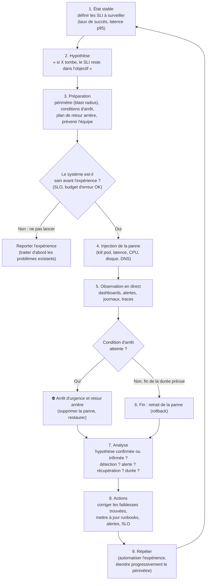

# Chaos engineering

## Pourquoi ce cours ?

Votre application est « résiliente » : trois réplicas, des sondes, un équilibreur. Mais l'avez-vous **vérifié** ? Un système complexe se comporte différemment de ce que ses concepteurs imaginent, surtout
quand une dépendance ralentit ou quand plusieurs choses tombent ensemble. Le **chaos engineering** consiste à **provoquer volontairement des pannes, de façon contrôlée**, pour découvrir les faiblesses
**avant** qu'elles ne vous tombent dessus à 3 h du matin. Ce n'est pas casser au hasard : c'est une **méthode scientifique** (hypothèse, expérience, observation) au service de la fiabilité.

> Prérequis : [SLO et budget d'erreur](02-slo-sli-error-budget.md) (le chaos se dépense dans le budget), [observabilité](../../10-monitoring-observabilite/README.md) (impossible sans mesures), [Kubernetes](../../09-kubernetes-approfondi/cours/02-pods-et-workloads.md) et [performance/cgroups](../../04-linux-expert/cours/01-noyau-performance.md). Pratique : [atelier 3](../ateliers-killercoda/atelier-03-chaos-engineering-basique/intro.md).

## 1. Définition et origine

> « Le chaos engineering est la discipline qui consiste à **expérimenter sur un système distribué** afin de renforcer la **confiance** dans sa capacité à résister à des conditions turbulentes en production. » — *Principles of Chaos Engineering*

Origine : **Netflix** (2010) migre vers le cloud (AWS) et crée **Chaos Monkey**, qui **arrête aléatoirement des instances** en production pour forcer les ingénieurs à concevoir des services tolérants à la panne ; puis la « Simian Army » (Latency Monkey, Chaos Kong : panne d'une région entière…).

| Ce que le chaos **est** | Ce que le chaos **n'est pas** |
|---|---|
| Une **expérience scientifique** contrôlée | Casser des choses au hasard |
| Vérifier une **hypothèse** de résilience | Chercher un coupable |
| Avec **observation** et **arrêt d'urgence** | Un test « pour voir » sans surveillance |
| Pour **renforcer la confiance** | Un exercice de destruction |
| Un **investissement en fiabilité** | Un remplacement des tests classiques (unitaires, charge) |

> 📌 **À retenir** : le chaos ne remplace pas les tests ; il teste ce que les tests ne couvrent pas — les **interactions** dans un système réel, les **hypothèses implicites** (« le DNS marche toujours », « cette base répond en 10 ms »).

## 2. Les principes

1. **Définir l'état stable (*steady state*)** : un indicateur mesurable du bon fonctionnement (taux de requêtes réussies, latence p95, débit de commandes) — **les SLI** de votre SLO.
2. **Formuler une hypothèse** : « *si un pod de l'API est tué, le taux de succès restera ≥ 99,9 % et la latence p95 < 300 ms* ».
3. **Introduire des évènements du monde réel** : panne d'instance, latence réseau, perte de paquets, disque plein, dépendance indisponible, DNS en échec, saturation CPU.
4. **Chercher à infirmer l'hypothèse** : une différence entre le groupe « normal » et le groupe « perturbé » révèle une **faiblesse**.
5. **Limiter le rayon d'impact (*blast radius*)** : commencer **petit** (un pod, 1 % du trafic, l'environnement de test), puis étendre.
6. **Automatiser et exécuter en continu** quand la confiance est acquise (les expériences deviennent des tests de non-régression).
7. **Prévoir l'arrêt d'urgence et le retour arrière** : un bouton, une commande, des conditions d'abandon (*abort conditions*).

### Le rayon d'impact (blast radius)

| Niveau | Périmètre | Quand |
|---|---|---|
| 1 | **Environnement de test** isolé | Premières expériences, apprentissage |
| 2 | **Préproduction** avec trafic simulé | Valider l'outillage et les hypothèses |
| 3 | **Production, 1 pod / 1 % du trafic** | Une fois l'observabilité et le retour arrière validés |
| 4 | Production, une zone / un service entier | Équipes matures, avec autorisation |

Toujours : **avertir** les parties concernées, choisir un créneau **sans autre changement** ni évènement critique, avoir **l'astreinte au courant**, et **fixer des conditions d'arrêt** (« stop si le taux d'erreurs dépasse 2 % »).

## 3. Le cycle d'une expérience



### Gabarit d'expérience (à écrire avant)

```markdown
# Expérience de chaos : suppression d'un pod de l'API commandes
- **Date / créneau** : 2025-12-02 10:00-10:30 UTC (pas de déploiement prévu) · **Responsable** : Awa · **Astreinte prévenue** : oui
- **État stable (SLI)** : taux de succès HTTP ≥ 99,9 % ; latence p95 < 300 ms ; 3 pods Ready
- **Hypothèse** : si un pod est supprimé, le service continue de répondre sans erreur visible et le pod est recréé en < 60 s
- **Injection** : `kubectl delete pod -l app=api --field-selector … (un seul pod)`
- **Périmètre** : environnement de préproduction · 1 pod sur 3
- **Conditions d'arrêt** : taux d'erreurs > 2 % pendant 1 min, ou latence p95 > 1 s
- **Retour arrière** : `kubectl scale deployment api --replicas=3`
- **Résultat** : (à remplir) · **Écarts / découvertes** : (à remplir) · **Actions** : (à remplir)
```

## 4. Types de pannes à simuler

| Type | Panne simulée | Ce qu'on vérifie | Exemples d'outils |
|---|---|---|---|
| **Instance / pod** | Arrêt d'un pod, d'un conteneur, d'une machine virtuelle | Redémarrage, équilibrage, absence de perte de requêtes, `PodDisruptionBudget`, probes | `kubectl delete pod`, Chaos Mesh `PodChaos`, Litmus `pod-delete` |
| **Réseau : latence** | Délai ajouté aux paquets (100-500 ms) | **Timeouts**, retries, effets en cascade | `tc netem delay`, Chaos Mesh `NetworkChaos` |
| **Réseau : perte / coupure** | Perte de paquets, **partition** réseau | Reprise, bascule, circuit breaker | `tc netem loss`, `iptables -j DROP`, `NetworkChaos` |
| **DNS** | Résolution qui échoue ou renvoie de mauvaises réponses | Mise en cache, repli, dépendance au DNS | Chaos Mesh `DNSChaos`, blocage du port 53 |
| **CPU** | Saturation du processeur | Autoscaling (HPA), *throttling*, latence | `stress-ng --cpu`, `StressChaos` |
| **Mémoire** | Consommation croissante | OOM killer, limites, redémarrage | `stress-ng --vm`, `StressChaos` |
| **Disque** | Disque plein, E/S lentes | Alertes de capacité, comportement d'écriture, journaux | `fallocate`, `stress-ng --hdd`, `IOChaos` |
| **Dépendance** | Base de données/API tierce indisponible ou lente | Dégradation **gracieuse**, circuit breaker, cache | Coupure par `NetworkPolicy`, *fault injection* du service mesh (Istio) |
| **Horloge** | Décalage de l'heure | Certificats, jetons, tâches planifiées | `TimeChaos` |
| **Zone / région** | Perte d'une zone de disponibilité | Redondance multi-zone, bascule | Cordon/drain de nœuds, outils cloud |
| **Processus** | Arrêt brutal (`kill -9`) | Supervision, redémarrage | `kill`, `systemctl kill` |

Exemples en ligne de commande (sur une VM **de test**) :

```bash
stress-ng --cpu 2 --timeout 60s                         # saturation CPU
stress-ng --vm 1 --vm-bytes 80% --timeout 60s           # pression mémoire
sudo tc qdisc add dev eth0 root netem delay 200ms 50ms  # +200 ms (±50 ms) de latence sortante
sudo tc qdisc add dev eth0 root netem loss 10%          # 10 % de perte de paquets
sudo tc qdisc del dev eth0 root                         # RETOUR ARRIÈRE : supprime la perturbation
sudo iptables -A OUTPUT -p tcp --dport 5432 -j DROP     # coupe l'accès à la base (retour : iptables -D …)
fallocate -l 5G /tmp/remplissage && rm /tmp/remplissage # remplir puis libérer un disque
```

> ⚠️ **Attention** : sur une machine distante, **ne perturbez jamais l'interface par laquelle vous êtes connecté** (SSH). Ajoutez des conditions (`tc filter` sur une destination précise) ou testez depuis la console. Prévoyez toujours la **commande de retour arrière** avant de lancer.

## 5. Les outils

| Outil | Type | Points forts | Remarque |
|---|---|---|---|
| **`stress-ng`**, **`tc`**, `iptables`, `kill` | Commandes Linux | Aucune installation, **idéaux pour apprendre** | Manuels, à nettoyer soi-même |
| **Chaos Mesh** (CNCF) | Kubernetes (CRD) | `PodChaos`, `NetworkChaos`, `StressChaos`, `IOChaos`, `DNSChaos`, `TimeChaos`, `HTTPChaos` ; planification (`Schedule`) et *workflows* ; interface web | Déclaratif : une expérience = un manifeste |
| **LitmusChaos** (CNCF) | Kubernetes | Catalogue d'expériences (« ChaosHub »), *probes* de validation, workflows | Orienté plateforme et processus |
| **Gremlin** | SaaS commercial | Interface simple, scénarios, sécurité (arrêt d'urgence), multi-plateforme | Payant |
| **AWS Fault Injection Service**, **Azure Chaos Studio**, **GCP** | Services cloud | Injection côté infrastructure (instances, réseau, zones) | Selon le cloud |
| **Istio** (*fault injection*), **Toxiproxy**, **Pumba** (Docker) | Réseau / proxies / conteneurs | Latence et erreurs **applicatives** au niveau du proxy | Utiles sans accès à l'hôte |
| **Chaos Monkey** | Instances (Spinnaker) | Historique de Netflix | Principalement AWS |

### Un manifeste Chaos Mesh (aperçu)

```yaml
apiVersion: chaos-mesh.org/v1alpha1
kind: PodChaos
metadata:
  name: tuer-un-pod-api
  namespace: chaos-testing
spec:
  action: pod-kill
  mode: one                       # un seul pod
  selector:
    namespaces: [prod]
    labelSelectors: { app: api }
  duration: "30s"
---
apiVersion: chaos-mesh.org/v1alpha1
kind: NetworkChaos
metadata: { name: latence-vers-db, namespace: chaos-testing }
spec:
  action: delay
  mode: all
  selector: { namespaces: [prod], labelSelectors: { app: api } }
  delay: { latency: "200ms", jitter: "50ms" }
  direction: to
  target:
    selector: { namespaces: [prod], labelSelectors: { app: db } }
    mode: all
  duration: "2m"
```

## 6. Chaos engineering et SLO

Le chaos **dépense du budget d'erreur** : une expérience qui dégrade l'expérience utilisateur en production consomme du budget.

- **Ne lancer une expérience que s'il reste du budget** (ex. > 50 %) ([cours 02](02-slo-sli-error-budget.md)) : on n'ajoute pas de turbulence à un système déjà en difficulté.
- **Prévoir** la consommation attendue (par exemple 1 % du budget mensuel) et la **surveiller**.
- **Utiliser les SLI comme état stable** : le chaos est un **test de votre SLO**.
- Les **conditions d'arrêt** sont des seuils de burn rate.
- **Budget épuisé** → **pas de chaos en production** : traiter d'abord les faiblesses connues.
- Le chaos **justifie** les investissements : « notre SLO de 99,9 % n'est tenable que si la bascule de base de données prend moins de 30 s ; l'expérience a montré 4 minutes ».

> 💡 **Conseil** : commencez par du chaos **sans risque** : en **préproduction**, ou en production sur un service **non critique**, ou avec un **petit pourcentage** de trafic. L'objectif initial est **d'apprendre le processus**, pas de prouver que la production est invincible.

## 7. Les *game days*

Un **game day** est un **exercice d'équipe** qui simule une panne ou un incident pour **entraîner les personnes autant que les systèmes** : détection, communication, runbooks, escalade, outils.

### Organiser un game day

| Étape | Contenu |
|---|---|
| **1. Objectif** | Que veut-on tester ? (un runbook, la bascule d'une base, la réponse d'astreinte, la communication) |
| **2. Scénario** | Une panne réaliste, inspirée d'un postmortem passé : « la base primaire devient injoignable » |
| **3. Rôles** | **Organisateur / maître du jeu** (injecte, chronomètre), **IC**, **Comms**, **SME** (les participants, qui ne savent **pas** ce qui va se passer), **observateurs** (notent) |
| **4. Environnement** | Préproduction, ou production avec périmètre très limité ; **règles de sécurité** claires et arrêt d'urgence |
| **5. Préparation** | Prévenir les parties prenantes, créneau dédié, canal « EXERCICE », supports (runbooks, accès) vérifiés |
| **6. Déroulé** | Injection → détection → incident (processus réel : IC, canal, communication) → mitigation → fin de l'exercice |
| **7. Débrief à chaud** | Qu'est-ce qui a marché ? Qu'est-ce qui a surpris ? Où a-t-on perdu du temps ? |
| **8. Retour d'expérience** | Mini-postmortem blameless ([cours 04](04-postmortem-blameless.md)), **actions** suivies |
| **9. Répétition** | Rejouer régulièrement (trimestriel), varier les scénarios, **rotation** des participants |

Variantes : **Wheel of Misfortune** (un SRE joue l'ingénieur d'astreinte, un autre décrit les symptômes de l'incident, sans toucher à rien), **exercice de table** (discussion sans manipulation), **chaos automatisé** en continu.

### Ce qu'un game day révèle souvent

- des **runbooks faux ou périmés** ;
- des **alertes qui ne se déclenchent pas** (ou trop tard, ou mal routées) ;
- des **accès manquants** (permissions, VPN) ;
- des **dépendances inconnues** ;
- une communication de crise **confuse** ;
- une **connaissance concentrée** chez une seule personne ;
- un retour arrière **jamais testé**.

## 8. Bonnes pratiques et pièges

| ✅ Bonnes pratiques | ❌ Pièges |
|---|---|
| **Observabilité d'abord** : sans mesures, le chaos est aveugle | Lancer sans dashboard ni alerte |
| **Hypothèse écrite** avant l'expérience | « On verra bien » |
| **Commencer petit** (blast radius minimal), puis étendre | Gros impact dès la première expérience |
| **Conditions d'arrêt** et **retour arrière testé** | Pas de plan B |
| Informer **l'équipe et l'astreinte** | Surprendre tout le monde sans prévenir |
| Respecter le **budget d'erreur** | Chaos sur un système déjà instable |
| **Documenter et suivre** les actions | Découvertes sans suite |
| **Automatiser** les expériences éprouvées (CI, planification) | Chaos ponctuel, jamais rejoué |
| Impliquer les **équipes produit** | Imposé par l'extérieur |
| Variété de pannes (latence, DNS, dépendances), pas seulement « tuer un pod » | Se limiter au cas le plus simple |

## Résumé

- **Chaos engineering** = **expérimenter** sur un système en **injectant des pannes contrôlées** pour **renforcer la confiance** dans sa résilience ; ce n'est pas de la casse aléatoire.
- **Méthode** : état stable (SLI) → **hypothèse** → injection → observation → analyse → actions ; **blast radius** limité, **conditions d'arrêt**, **retour arrière**.
- **Pannes** : pod/instance, **latence** et perte réseau, **DNS**, CPU, mémoire, disque, dépendance, horloge, zone.
- **Outils** : `stress-ng`, `tc`, `iptables` (apprentissage), **Chaos Mesh**, **LitmusChaos**, Gremlin, services cloud.
- **Lien avec les SLO** : le chaos consomme du budget d'erreur ; ne le lancer que s'il en reste.
- **Game days** : exercices d'équipe (rôles, scénario, débrief blameless, actions) pour entraîner **personnes et processus**.

## Pour aller plus loin

- *Principles of Chaos Engineering* : <https://principlesofchaos.org/> ; *Chaos Engineering* (Rosenthal & Jones, O'Reilly).
- Chaos Mesh : <https://chaos-mesh.org/> ; LitmusChaos : <https://litmuschaos.io/> ; Gremlin : <https://www.gremlin.com/>.
- *Netflix Tech Blog* sur Chaos Monkey ; *Jepsen* (tests de systèmes distribués).
- Cours suivant : [Patterns de fiabilité](07-patterns-fiabilite.md).
- Atelier associé : [Chaos engineering basique](../ateliers-killercoda/atelier-03-chaos-engineering-basique/intro.md).
