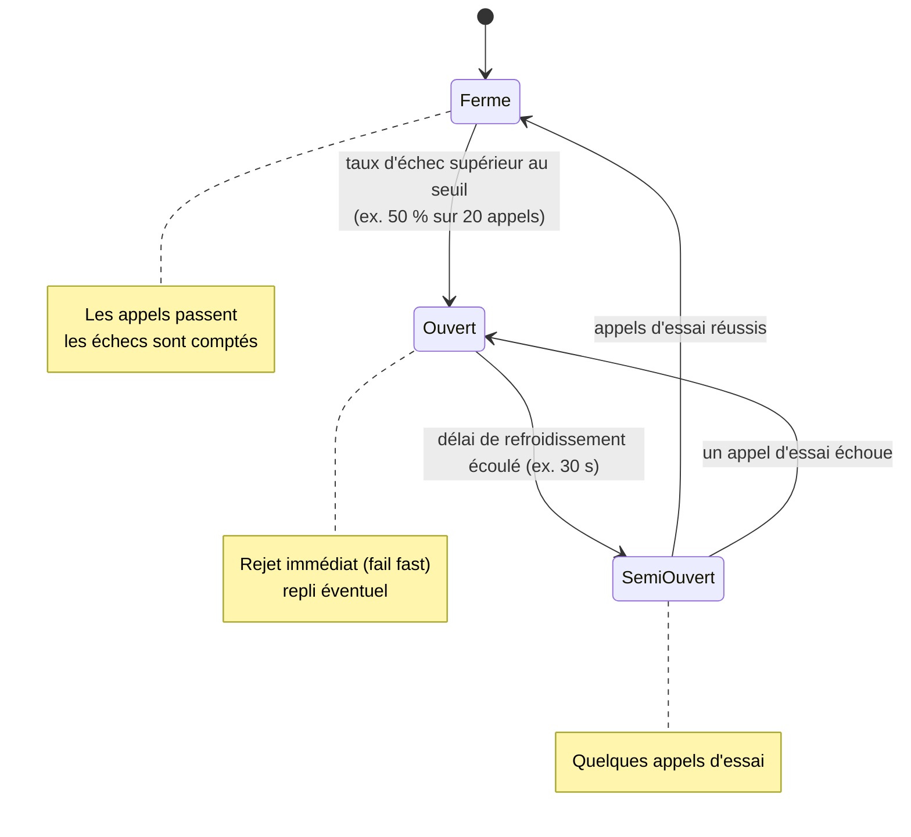
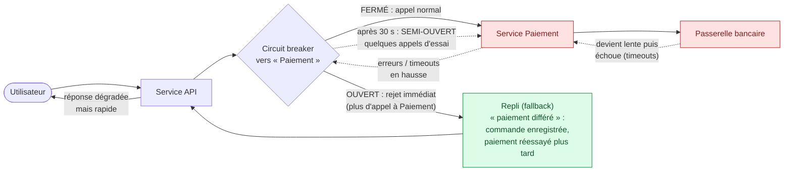

# Patterns de fiabilité

## Pourquoi ce cours ?

Dans une architecture distribuée, la panne n'est pas l'exception : c'est l'**état normal** de *quelque chose, quelque part*. Un service lent, un réseau qui perd des paquets, une base saturée sont
des **réalités quotidiennes**. Ce qui fait la différence, c'est **comment chaque appelant réagit**. Un client sans délai d'expiration attend indéfiniment et bloque ses propres ressources ;
des clients qui réessayent tous en même temps transforment un ralentissement en effondrement. Les **patterns de fiabilité** — timeouts, retries, circuit breakers, bulkheads, limitation de débit,
idempotence — sont les réflexes de conception qui empêchent une défaillance **locale** de devenir une panne **générale** (*défaillance en cascade*).

> Prérequis : [SLO](02-slo-sli-error-budget.md), [chaos engineering](06-chaos-engineering.md) (pour les tester), [réseau et ports](../../06-reseaux-devops/cours/02-ports-et-sockets.md) (états TCP, timeouts), [services Kubernetes](../../09-kubernetes-approfondi/cours/03-services-et-reseau-kubernetes.md) et [observabilité (traces)](../../10-monitoring-observabilite/cours/07-traces-et-opentelemetry.md).

## 1. La défaillance en cascade

```text
   Client ──► Service A ──► Service B ──► Base de données (lente !)
                                │
   La base ralentit : B attend ; ses threads s'accumulent ; B ne répond plus à A ;
   A accumule ses requêtes en attente ; A sature ; les clients réessayent → plus de charge → TOUT s'effondre.
```

Un seul composant lent peut mettre à genoux tout le système, **sans qu'aucun composant ne soit en panne** : c'est une **panne par saturation**. Les patterns ci-dessous ont tous pour but de **contenir** cette propagation.

| Pattern | Protège contre |
|---|---|
| **Timeout** | Attendre indéfiniment |
| **Retry** (avec backoff et jitter) | Pannes **transitoires** |
| **Circuit breaker** | S'acharner sur une dépendance en panne |
| **Bulkhead** | La contagion entre fonctions/clients |
| **Rate limiting / load shedding** | La surcharge |
| **Idempotence** | Les effets doubles des retries |
| **Dégradation gracieuse / fallback** | L'indisponibilité totale d'une fonction |

## 2. Timeouts : toujours en avoir un

> **Règle d'or** : *tout appel réseau doit avoir un délai d'expiration.* Un appel sans timeout est une **fuite de ressources en attente** : sa durée maximale est infinie.

Beaucoup de bibliothèques n'ont **aucun timeout par défaut** (ou un très long). Sans lui, une dépendance lente bloque des threads, des connexions et de la mémoire chez l'appelant.

### Types de timeouts

| Timeout | Limite… |
|---|---|
| **Connexion** (*connect*) | Le temps d'établissement de la connexion TCP/TLS |
| **Lecture / réponse** (*read*) | Le temps d'attente de la réponse |
| **Global / de requête** (*deadline*) | La durée **totale** d'une opération, retries compris |
| **Inactivité** (*idle*) | La durée d'une connexion sans activité |

### Comment les dimensionner

1. **Partir des mesures** : latence **p99** (ou p99,9) réelle de la dépendance en conditions normales (voir [PromQL, histogrammes](../../10-monitoring-observabilite/cours/03-promql-et-metriques.md)). Timeout ≈ **p99 × 2 à 3**, jamais « 30 s par défaut ».
2. **Cohérent avec le SLO** : si votre SLO de latence est 500 ms, un timeout de 10 s sur une dépendance est incohérent.
3. **Budget de temps décroissant** : le timeout d'un appel amont doit être **supérieur** à la somme de ceux de ses appels aval, retries inclus, sinon l'amont abandonne avant que l'aval ait fini.

```text
Client (timeout 3 s) ─► A (appelle B avec timeout 1 s, 2 tentatives = 2 s max) ─► B (appelle la base avec timeout 500 ms)
Bon : 3 s > 2 s > 0,5 s.      Mauvais : A a un timeout de 10 s alors que le client n'attend que 3 s : travail inutile.
```

4. **Propager l'échéance** (*deadline propagation*) : transmettre le temps restant aux services aval (gRPC le fait nativement) : inutile de travailler pour un client qui est déjà parti.
5. **Tester** : un timeout jamais déclenché en test est un timeout non validé ([chaos : latence](06-chaos-engineering.md)).

```bash
curl --connect-timeout 2 --max-time 5 https://api.kamer.example/sante    # timeouts de connexion et global
```

```python
import requests
requests.get(url, timeout=(2, 5))     # (connexion 2 s, lecture 5 s) : jamais sans timeout !
```

> ⚠️ **Attention** : un timeout **ne résout pas** le problème, il le **borne**. Il faut décider quoi faire à l'expiration : réessayer (si c'est sûr), basculer sur un repli, échouer vite avec un message clair.

## 3. Retries : réessayer avec discernement

Beaucoup de pannes sont **transitoires** (perte d'un paquet, pod en cours de redémarrage, verrou bref) : réessayer **réussit souvent**. Mais un retry mal conçu **aggrave** la panne.

### Que réessayer ?

| ✅ Réessayer | ❌ Ne pas réessayer |
|---|---|
| Erreurs réseau, timeouts, `502/503/504`, `429` (avec `Retry-After`) | Erreurs **client** : `400`, `401`, `403`, `404`, `422` (le résultat sera identique) |
| Opérations **idempotentes** | Opérations **non idempotentes** sans protection (voir section 7) |
| Erreurs signalées comme « réessayables » | Échecs de validation, erreurs métier |

### Backoff exponentiel

Attendre **de plus en plus longtemps** entre les tentatives, pour laisser le temps à la dépendance de récupérer :

```text
tentative 1 : immédiate
tentative 2 : attente 100 ms
tentative 3 : attente 200 ms
tentative 4 : attente 400 ms
tentative 5 : attente 800 ms   (plafonnée : max 10 s ; nombre de tentatives limité)
délai = min(plafond, base × 2^(n−1))
```

### Jitter : casser la synchronisation

Si 1 000 clients échouent au même instant et réessayent **après exactement 200 ms**, ils frappent tous **en même temps** : c'est la **tempête de retries** (*thundering herd*). Le **jitter** ajoute de l'**aléa** :

```text
délai = random(0, min(plafond, base × 2^n))       ← « full jitter » (recommandé)
```

```python
import random, time

def avec_retries(operation, essais=5, base=0.1, plafond=10.0):
    for n in range(essais):
        try:
            return operation()
        except ErreurTransitoire:
            if n == essais - 1:
                raise                                        # dernière tentative : on propage
            attente = random.uniform(0, min(plafond, base * 2 ** n))     # backoff exponentiel + full jitter
            time.sleep(attente)
```

### Éviter les tempêtes de retries

| Mesure | Principe |
|---|---|
| **Limiter le nombre** de tentatives | 2 à 3 suffisent souvent |
| **Budget de retries** | Au plus **10 %** du trafic peut être du retry (limite globale) |
| **Retry à un seul niveau** | Si A réessaye 3 fois, B 3 fois, C 3 fois → **27 requêtes** pour une seule : ne réessayez qu'**à la périphérie** ou avec un budget |
| **Respecter `Retry-After`** | La dépendance dit quand revenir |
| **Combiner avec un circuit breaker** | Arrêter de réessayer quand la dépendance est manifestement en panne |
| **Deadline globale** | Les retries ne dépassent jamais le timeout total |

> 📌 **À retenir** : **retry + backoff exponentiel + jitter + limite + budget** forment un tout. Un retry sans ces garde-fous est une **arme contre vous-même**.

## 4. Circuit breaker (disjoncteur)

Comme un disjoncteur électrique, il **coupe** les appels vers une dépendance qui échoue, pour **ne pas s'acharner** (et ne pas bloquer d'autres ressources), et **teste** périodiquement son retour.

### Les trois états

| État | Comportement | Transition |
|---|---|---|
| **Fermé** (*closed*) | Les appels **passent** ; le disjoncteur **compte les échecs** | Si le taux d'échec ou le nombre d'échecs dépasse un seuil → **Ouvert** |
| **Ouvert** (*open*) | Les appels sont **rejetés immédiatement** (sans appeler la dépendance), avec une erreur rapide ou un **repli** | Après un **délai de refroidissement** (*cooldown*) → **Semi-ouvert** |
| **Semi-ouvert** (*half-open*) | Laisse passer **quelques appels d'essai** | Si ça réussit → **Fermé** ; si ça échoue → **Ouvert** (nouveau refroidissement) |



### Pourquoi c'est efficace

- **Échec rapide** (*fail fast*) : l'appelant reçoit une erreur en microsecondes plutôt qu'après un timeout de plusieurs secondes → ses ressources ne sont pas bloquées.
- **Soulage la dépendance** : plus de requêtes qui l'écrasent pendant qu'elle récupère.
- **Permet une dégradation** : un **repli** (*fallback*) renvoie une valeur en cache, par défaut, ou un message dégradé.
- **Visibilité** : l'état du disjoncteur est une **métrique** précieuse (`circuit_breaker_state`).

### Une chaîne d'appels avec un circuit breaker qui s'ouvre



Sans disjoncteur, l'API attendrait chaque timeout de Paiement, ses threads s'épuiseraient, et **l'API entière** tomberait pour une panne limitée au paiement.

### Réglage

| Paramètre | Question |
|---|---|
| **Seuil d'ouverture** | À partir de quel taux d'échec ? (ex. 50 % sur une fenêtre glissante de 20 appels minimum) |
| **Fenêtre** | Combien d'appels/combien de secondes pour calculer le taux ? |
| **Délai de refroidissement** | Combien de temps avant d'essayer à nouveau ? (10 à 60 s) |
| **Appels d'essai** (semi-ouvert) | Combien de tests avant de refermer ? |
| **Ce qui compte comme échec** | Timeouts et 5xx oui ; 4xx non |
| **Repli** | Que renvoyer quand le circuit est ouvert ? |

Bibliothèques : **resilience4j** (Java), **Polly** (.NET), **gobreaker** (Go), **pybreaker** (Python), **Hystrix** (historique), ou un **service mesh** (Istio, Linkerd : *outlier detection*, retries et timeouts sans toucher au code).

## 5. Bulkhead (cloison étanche)

Comme les cloisons d'un navire, le **bulkhead** **isole** les ressources pour qu'une fuite **ne coule pas tout le bateau**. On alloue des **pools séparés** (threads, connexions, mémoire, files) par dépendance, par fonction ou par type de client.

```text
SANS bulkhead : un seul pool de 100 threads partagé
   la dépendance « rapports » devient lente → les 100 threads attendent « rapports » → le paiement, lui aussi, n'a plus de thread.

AVEC bulkhead : pool « paiement » = 60 threads ; pool « rapports » = 20 ; pool « recherche » = 20
   « rapports » sature SES 20 threads ; paiement et recherche continuent normalement.
```

| Forme d'isolation | Exemple |
|---|---|
| **Pools de threads / de connexions séparés** | Un pool de connexions à la base par fonctionnalité |
| **Files d'attente séparées** | Une file par type de tâche ou par client |
| **Quotas de ressources** | `requests/limits` Kubernetes, cgroups ([module 04](../../04-linux-expert/cours/02-conteneurs-namespaces.md)) |
| **Instances / déploiements séparés** | Service « critique » distinct du service « batch » |
| **Isolation par client** (*cell-based architecture*, « cellules ») | Un client bruyant n'impacte que sa cellule |
| **Zones de disponibilité** | Une panne de zone ne touche qu'une partie |

> 💡 **Conseil** : les **limites de ressources** de Kubernetes (`resources.limits`, `ResourceQuota`, `PodDisruptionBudget`, `topologySpreadConstraints` — [module 09, scheduling](../../09-kubernetes-approfondi/cours/06-scheduling-et-ressources.md)) sont des bulkheads au niveau de la plateforme : un pod gourmand ne doit pas affamer ses voisins.

## 6. Limitation de débit et délestage

Quand la demande dépasse la capacité, mieux vaut **refuser proprement** une partie du trafic que s'effondrer pour tout le monde.

### Rate limiting (limitation de débit)

Limite le **nombre de requêtes** par client/clé/IP sur une période : protège contre les abus, les clients bogués, les boucles de retries.

| Algorithme | Principe |
|---|---|
| **Fenêtre fixe** | Compteur par période (100 requêtes/minute) ; simple mais permet des rafales aux bords de fenêtre |
| **Fenêtre glissante** | Compte sur une fenêtre qui avance ; plus précis |
| **Seau à jetons** (*token bucket*) | Des jetons arrivent à débit constant ; chaque requête en consomme un ; permet des **rafales** bornées |
| **Seau percé** (*leaky bucket*) | Les requêtes sortent à débit constant ; lisse le trafic |
| **Limite de concurrence** | Nombre maximal de requêtes **simultanées** |

Réponse standard : **HTTP 429 Too Many Requests** avec l'en-tête **`Retry-After`** ; les clients bien conçus **respectent** cet en-tête (backoff).

```text
# nginx : 10 requêtes/s par IP, avec rafale tolérée de 20
limit_req_zone $binary_remote_addr zone=api:10m rate=10r/s;
location /api/ { limit_req zone=api burst=20 nodelay; limit_req_status 429; }
```

### Load shedding (délestage)

Quand le **service lui-même** est proche de la saturation, il **rejette** une partie des requêtes **à l'entrée** (rapidement, avec `503`) pour **préserver** les autres :

- **Rejeter tôt**, avant d'avoir dépensé des ressources ;
- **Prioriser** : conserver les requêtes **critiques** (paiement, santé) et rejeter les moins importantes (recherche, recommandations) ;
- **Basé sur la file d'attente** ou la latence : si la file dépasse un seuil, rejeter ;
- **Rejeter les requêtes déjà périmées** (le client a abandonné) ;
- **Dégradation gracieuse** : désactiver des fonctionnalités coûteuses (recommandations, images haute résolution) pour tenir la charge.

| | **Rate limiting** | **Load shedding** |
|---|---|---|
| Cible | Un **client** trop gourmand | Une **surcharge globale** |
| Critère | Quota par client | État du service (CPU, file, latence) |
| But | Équité, protection contre l'abus | **Survivre** à la surcharge |

> ⚠️ **Attention** : sans limite, **le meilleur service s'effondre** sous une charge supérieure à sa capacité (la latence explose, tout dépasse le timeout, personne n'est servi). Mieux vaut servir 80 % des requêtes bien que 100 % mal.

## 7. Idempotence : la condition des retries

Une opération est **idempotente** si l'exécuter **une ou plusieurs fois** a **le même effet** que l'exécuter une fois.

| Idempotent ✅ | Non idempotent ❌ |
|---|---|
| `GET`, `PUT` (remplacer une ressource), `DELETE` (supprimer) | `POST /paiements` (créer **un nouveau** paiement à chaque appel) |
| « Définir le statut à `payé` » | « Ajouter 10 € au solde » |
| `INSERT … ON CONFLICT DO NOTHING` | `INSERT` simple qui crée un doublon |

**Pourquoi c'est critique** : quand un appel **expire** (timeout), l'appelant **ne sait pas** si l'opération a été exécutée (la réponse s'est perdue). S'il réessaye une opération **non idempotente**, il risque un **double paiement**, une double commande.

### Clés d'idempotence

Le client génère un identifiant unique **par intention** (`Idempotency-Key: 7f3a…`) et le **joint à chaque tentative** ; le serveur mémorise le résultat pour cette clé et **renvoie le même résultat** sans réexécuter.

```http
POST /paiements HTTP/1.1
Idempotency-Key: 7f3a9c2e-5b1d-4e8a-9f60-2d1c8b7a4e55
Content-Type: application/json

{"commande": 1042, "montant": 25000, "devise": "XAF"}
```

```text
Serveur : clé inconnue → exécute, stocke (clé → résultat) ; clé connue → renvoie le résultat stocké, sans refaire.
```

Autres techniques : **identifiants naturels** (numéro de commande unique) avec contrainte `UNIQUE` en base, **versions** (verrou optimiste), **déduplication de messages** (identifiant de message), **opérations « exactly-once effect »** via une table de traitement.

> 📌 **À retenir** : **pas de retry sûr sans idempotence.** Concevez les opérations d'écriture pour qu'elles soient idempotentes, ou protégez-les par une clé d'idempotence.

## 8. Autres patterns utiles

| Pattern | Idée |
|---|---|
| **Dégradation gracieuse / fallback** | Renvoyer une version **réduite** plutôt qu'une erreur (cache, valeur par défaut, fonction désactivée) |
| **Cache** (avec *stale-while-revalidate*) | Servir une donnée légèrement périmée si la source est lente |
| **Fail fast** | Valider tôt, refuser rapidement les requêtes qui échoueront de toute façon |
| **Health checks et probes** | Retirer du trafic un nœud malade (liveness / readiness Kubernetes) |
| **Redondance / réplication** | Plusieurs instances, plusieurs zones ; pas de point de défaillance unique |
| **Déploiements progressifs** (canary, blue/green, feature flags) | Limiter l'impact d'un changement défectueux |
| **File d'attente / découplage asynchrone** | Absorber les pics ; le producteur n'attend pas le consommateur |
| **Hedged requests** (requêtes doublées) | Envoyer une 2ᵉ requête si la 1ʳᵉ tarde ; réduit la latence de queue (avec prudence) |
| **Mise en quarantaine / *shuffle sharding*** | Limiter l'impact d'un client toxique à un sous-ensemble |
| **Expiration des données et nettoyage** | Éviter l'accumulation (files, journaux, sessions) |

## 9. Assembler les patterns

L'ordre habituel autour d'un appel sortant (de l'extérieur vers l'intérieur) :

```text
Bulkhead (pool dédié) → Rate limiter (côté client) → Circuit breaker → Retry (backoff + jitter) → Timeout → appel réseau
```

| Situation | Patterns |
|---|---|
| Appel d'une API tierce lente | **Timeout** + **retry** limité + **circuit breaker** + **repli** |
| Écriture critique (paiement) | **Idempotence** + **timeout** + retry **avec clé d'idempotence** |
| Service partagé par plusieurs clients | **Rate limiting** par client + **bulkhead** |
| Pic de trafic | **Load shedding** + file d'attente + autoscaling |
| Dépendance non critique (recommandations) | **Repli** + **circuit breaker** + **timeout court** |

**Tester** ces patterns avec le [chaos engineering](06-chaos-engineering.md) : latence sur la dépendance → le timeout se déclenche-t-il ? Coupure → le circuit s'ouvre-t-il ? Surcharge → le service délaye-t-il ? Mesurer avec des métriques : taux de retries, état du circuit, requêtes rejetées, saturation des pools.

## Résumé

- Une défaillance locale devient **générale** par **propagation en cascade** (saturation, retries massifs) : les patterns la **contiennent**.
- **Timeouts** : toujours, **connexion + lecture + global**, dimensionnés sur le p99 mesuré, **cohérents** entre couches.
- **Retries** : seulement pour les erreurs **transitoires** et les opérations **idempotentes** ; **backoff exponentiel + jitter**, **limite** de tentatives, **budget** de retries.
- **Circuit breaker** : fermé → ouvert (rejet immédiat) → semi-ouvert (essais) → fermé ; échec rapide, protège la dépendance, permet un **repli**.
- **Bulkhead** : pools et quotas **séparés** pour qu'une fonction saturée n'affame pas les autres.
- **Rate limiting** (par client, `429` + `Retry-After`) et **load shedding** (survivre à la surcharge).
- **Idempotence** (clé d'idempotence) : **condition** d'un retry sûr.

## Pour aller plus loin

- *Release It!* (Michael Nygard) ; *Handling Overload* et *Addressing Cascading Failures* (SRE book, ch. 21-22) ; *Timeouts, retries and backoff with jitter* (Amazon Builders' Library).
- Bibliothèques : **resilience4j**, **Polly**, **gobreaker** ; maillage de services : **Istio**, **Linkerd** (retries, timeouts, circuit breaking déclaratifs).
- Retour au [sommaire du module 11](../README.md).
- Pratique : [chaos engineering basique](../ateliers-killercoda/atelier-03-chaos-engineering-basique/intro.md).
