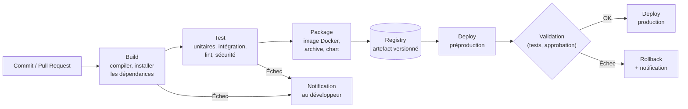

# Introduction au CI/CD

## Pourquoi ce cours ?

Sans automatisation, livrer une version ressemble à un rituel : quelqu'un construit l'application sur son poste, lance « à peu près » les tests, copie des fichiers sur un serveur et croise les doigts. Le résultat : des livraisons rares, stressantes, et des bogues découverts en production. Le **CI/CD** remplace ce rituel par une **chaîne automatisée, reproductible et visible** qui transforme chaque changement de code en logiciel testé, empaqueté et déployable. C'est le moteur de la livraison moderne : plus on livre souvent et par petits morceaux, moins chaque livraison est risquée.

> Prérequis : [Git et workflows](../../07-git-branching-interactif/README.md) (branches, merge), [Docker](../../08-docker-approfondi/README.md) (images) et notions de [Kubernetes](../../09-kubernetes-approfondi/README.md) pour la partie déploiement.

## 1. Les trois sigles : CI, CD, CD

| Terme | Signification | Ce que ça garantit | Déclenchement du déploiement |
|---|---|---|---|
| **CI** — *Continuous Integration* | Intégrer le code de tous **au moins une fois par jour** dans la branche principale, avec **build + tests automatiques** à chaque changement | La branche principale est **toujours saine** ; les conflits sont détectés tôt | — |
| **CD** — *Continuous Delivery* (livraison continue) | Tout commit validé produit un artefact **prêt à être déployé** à tout moment | On **peut** livrer en production en un clic | **Manuel** (décision humaine) |
| **CD** — *Continuous Deployment* (déploiement continu) | Tout commit validé est **déployé automatiquement** en production | On livre **à chaque** changement | **Automatique** (aucune approbation) |

Les deux « CD » se confondent facilement : **delivery** = prêt à livrer, **deployment** = livré automatiquement. Beaucoup d'équipes pratiquent la *delivery* en production (approbation humaine) et le *deployment* continu en préproduction.

> 📌 **À retenir** : le CI vérifie que le code **fonctionne ensemble** ; le CD garantit qu'il est **livrable** (voire livré). Sans tests fiables, le CD n'est qu'une façon rapide de casser la production.

### Et GitOps ?

**GitOps** est une manière de faire le CD : l'état **souhaité** de l'infrastructure et des applications est décrit **dans Git**, et un agent dans le cluster **réconcilie** en continu l'état réel avec Git (voir le [cours 8](08-gitops-et-deploiement-declaratif.md)). La CI construit et publie ; Git décrit ; l'agent déploie.

| | CI/CD « push » classique | GitOps « pull » |
|---|---|---|
| Qui déploie ? | La pipeline pousse vers le cluster (`kubectl apply`) | Un agent **dans** le cluster tire l'état depuis Git |
| Accès au cluster | La CI détient des identifiants du cluster | Aucun secret de cluster hors du cluster |
| Dérive (modification manuelle) | Non détectée | **Détectée et corrigée** |
| Audit | Journaux de la pipeline | **Historique Git** |

## 2. Le pipeline typique

Un **pipeline** est la suite d'étapes automatiques qui mène d'un commit à un déploiement.

| Étape | Rôle | Exemples |
|---|---|---|
| **Source** | Un évènement déclenche la pipeline | `push`, pull request, tag, planification |
| **Build** | Produire quelque chose d'exécutable | `npm ci && npm run build`, `docker build` |
| **Test** | Prouver que ça marche (vite, du plus rapide au plus lent) | Lint, tests unitaires, intégration, sécurité |
| **Package** | Figer **un artefact immuable** et versionné | Image conteneur, chart Helm, binaire |
| **Publish** | Stocker l'artefact dans un registre | GHCR, Docker Hub, Harbor |
| **Deploy** | Mettre en service | `kubectl`, Helm, Argo CD |
| **Verify** | Vérifier après déploiement | Tests de fumée, métriques, sondes |

### Les principes d'un bon pipeline

1. **Un seul artefact, promu d'environnement en environnement** : on construit **une fois**, on déploie la **même** image en recette puis en production (seule la configuration change). *Build once, deploy many.*
2. **Rapide** : visez moins de 10 minutes pour le retour d'information de la CI ; un pipeline lent est contourné.
3. **Fiable** : un test qui échoue au hasard (*flaky*) détruit la confiance.
4. **Reproductible** : environnement défini par du code (conteneurs, versions épinglées), pas par la machine du développeur.
5. **Visible** : l'état (vert/rouge) est affiché, l'échec est **notifié** et **corrigé immédiatement**.
6. **Pipeline as code** : la définition est versionnée avec le code (voir le [cours 2](02-pipeline-as-code-github-actions.md)).

> ⚠️ **Attention** : « ça marche sur ma machine » n'est pas une preuve. La pipeline est la **seule source de vérité** : un code qui ne passe pas la CI n'est pas fusionné, quelle que soit l'urgence.

## 3. Pourquoi livrer souvent ?

| Livrer rarement (grosses versions) | Livrer souvent (petits changements) |
|---|---|
| Beaucoup de changements par version → **difficile de trouver la cause** d'une panne | Un changement = **une cause évidente** |
| Peur de livrer, nuits et week-ends | Livrer devient banal |
| Retour arrière lourd | Retour arrière simple (annuler un petit changement) |
| Retour des utilisateurs tardif | Retour rapide, ajustement continu |

Livrer souvent n'est pas un risque supplémentaire : c'est la **réduction du risque** par la taille du lot.

## 4. Mesurer : les métriques DORA

L'équipe de recherche **DORA** (*DevOps Research and Assessment*) a identifié **quatre métriques** corrélées à la performance d'une organisation (livraison **et** stabilité).

| Métrique | Question | Niveau « élite » (ordre de grandeur) |
|---|---|---|
| **Fréquence de déploiement** (*deployment frequency*) | À quelle fréquence livre-t-on en production ? | Plusieurs fois par jour |
| **Délai de livraison** (*lead time for changes*) | Combien de temps entre le commit et la production ? | Moins d'une heure à un jour |
| **Taux d'échec des changements** (*change failure rate*) | Quelle part des déploiements provoque un incident ou un rollback ? | 0 à 15 % |
| **Temps de rétablissement** (*time to restore service*, MTTR) | En combien de temps rétablit-on le service après un incident ? | Moins d'une heure |

Les deux premières mesurent la **vitesse**, les deux autres la **stabilité**. Le résultat contre-intuitif de DORA : **les équipes les plus rapides sont aussi les plus stables**, parce que petits lots + automatisation = moins de risque.

> 💡 **Conseil** : mesurez avant d'optimiser. Les évènements de la pipeline (commit, déploiement, incident) suffisent à calculer les quatre métriques. Utilisez-les pour **repérer un goulot**, jamais pour évaluer des personnes : sinon elles seront truquées. Le lien avec la fiabilité : le [module SRE](../../11-sre-pratiques/README.md) relie la fréquence de livraison au **budget d'erreur**.

## 5. Les briques d'une chaîne CI/CD

| Brique | Rôle | Exemples |
|---|---|---|
| **Gestion de source** | Historique, revue de code | GitHub, GitLab, Bitbucket |
| **Moteur de pipeline** | Exécute les étapes | GitHub Actions, GitLab CI, Jenkins |
| **Exécuteurs (*runners*)** | Machines qui exécutent les jobs | Hébergés ou auto-hébergés |
| **Registre d'artefacts** | Stocke les artefacts | GHCR, Harbor, Nexus |
| **Outils de qualité et de sécurité** | Linters, tests, scanners | Semgrep, Trivy, SonarQube |
| **Outil de déploiement** | Applique sur l'environnement | Helm, Argo CD, Ansible |
| **Observabilité** | Vérifie le résultat | [Prometheus et Grafana](../../10-monitoring-observabilite/README.md) |

## Résumé

- **CI** : intégrer souvent, avec build et tests automatiques ; **Continuous Delivery** : toujours prêt à livrer (déclenchement manuel) ; **Continuous Deployment** : livraison automatique ; **GitOps** : Git décrit l'état voulu, un agent réconcilie.
- Un **pipeline** enchaîne source → build → test → package → publish → deploy → verify ; **build once, deploy many**.
- Livrer **souvent et par petits lots** réduit le risque.
- **DORA** : fréquence de déploiement, délai de livraison, taux d'échec, temps de rétablissement.
- La pipeline est la **source de vérité** : code non vert = code non fusionné.

## Pour aller plus loin

- *Accelerate* (Forsgren, Humble, Kim) et le rapport annuel *State of DevOps* de DORA : <https://dora.dev/>.
- *Continuous Delivery* (Humble & Farley) ; <https://martinfowler.com/articles/continuousIntegration.html>.
- Cours suivant : [Pipeline as code avec GitHub Actions](02-pipeline-as-code-github-actions.md).
- Introduction courte : [Principes du CI/CD (module 05)](../../05-devops-outils/cours/03-ci-cd-principes.md).
