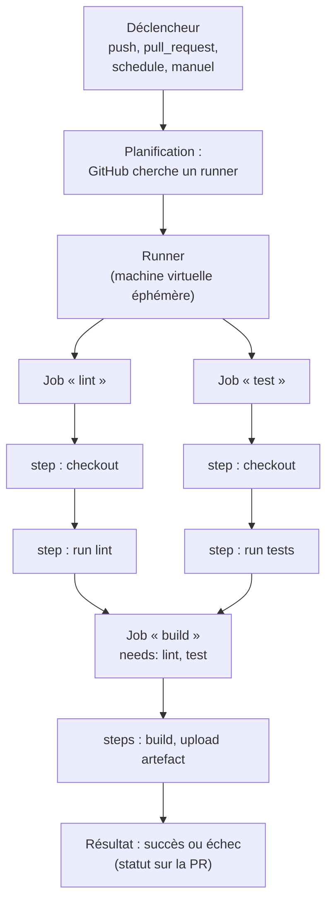

# Pipeline as code avec GitHub Actions

## Pourquoi ce cours ?

Une pipeline configurée à coups de clics dans une interface web est impossible à relire, à versionner, à copier d'un projet à l'autre et à restaurer après une erreur. Le principe du **pipeline as code** est de décrire la pipeline dans un **fichier du dépôt**, revu et versionné comme le reste du code. **GitHub Actions** est aujourd'hui l'outil le plus répandu pour cela : il est intégré à GitHub, gratuit pour les dépôts publics et dispose de milliers d'actions réutilisables. Vous apprendrez à lire et écrire un workflow, et à le tester **localement** avec `act` avant de pousser.

> Prérequis : [introduction au CI/CD](01-introduction-cicd.md) et notions de YAML (indentation, listes, dictionnaires).

## 1. Anatomie d'un workflow

Un **workflow** est un fichier YAML dans `.github/workflows/`. Il contient des **jobs** (exécutés sur des *runners*) composés d'**étapes** (*steps*).

```yaml
# .github/workflows/ci.yml
name: CI                      # nom affiché dans l'onglet Actions

on:                           # QUAND ? les déclencheurs
  push:
    branches: [main]
  pull_request:
  workflow_dispatch:          # lancement manuel

permissions:
  contents: read              # droits minimaux du jeton automatique

jobs:                         # QUOI ? les jobs
  test:
    runs-on: ubuntu-latest    # OÙ ? le runner
    steps:
      - uses: actions/checkout@v4          # action réutilisable
      - name: Installer Python
        uses: actions/setup-python@v5
        with:
          python-version: "3.12"
      - name: Lancer les tests
        run: |                             # commande shell
          python -m pip install -r requirements.txt
          python -m unittest discover -v
```

| Mot-clé | Rôle |
|---|---|
| `name` | Nom du workflow / du job / de l'étape |
| `on` | Évènements déclencheurs (`push`, `pull_request`, `schedule`, `workflow_dispatch`, `release`…) |
| `jobs.<id>` | Un job ; **les jobs s'exécutent en parallèle** par défaut |
| `runs-on` | Type de runner (`ubuntu-latest`, `windows-latest`, `macos-latest`, ou auto-hébergé) |
| `steps` | Étapes **séquentielles** d'un job, sur le **même** runner |
| `uses` | Utilise une **action** publiée (`propriétaire/dépôt@version`) |
| `run` | Exécute une commande shell |
| `with` | Paramètres d'une action |
| `env` | Variables d'environnement (workflow, job ou étape) |
| `permissions` | Droits du jeton `GITHUB_TOKEN` |



> 📌 **À retenir** : un runner hébergé est **éphémère** : rien ne persiste d'un job à l'autre. Pour partager des fichiers entre jobs, on utilise les **artefacts** ; pour accélérer, le **cache**.

## 2. Les déclencheurs en détail

```yaml
on:
  push:
    branches: [main, "release/**"]
    paths: ["src/**", "Dockerfile"]     # seulement si ces fichiers changent
    tags: ["v*"]                        # push d'un tag de version
  pull_request:
    types: [opened, synchronize]
  schedule:
    - cron: "0 3 * * 1"                 # tous les lundis à 03:00 UTC
  workflow_dispatch:
    inputs:
      environnement:
        description: "Cible du déploiement"
        required: true
        default: staging
```

## 3. Variables, contextes et secrets

- **Contextes** : `${{ github.sha }}`, `${{ github.ref_name }}`, `${{ github.actor }}`, `${{ runner.os }}`, `${{ job.status }}`.
- **Variables** (`vars`) : configuration non secrète, définie dans les paramètres du dépôt : `${{ vars.REGISTRE }}`.
- **Secrets** : valeurs sensibles chiffrées (`Settings → Secrets and variables → Actions`), lues par `${{ secrets.MON_SECRET }}`. GitHub **masque** leur valeur dans les journaux.

```yaml
    steps:
      - name: Connexion au registre
        run: echo "${{ secrets.REGISTRY_TOKEN }}" | docker login ghcr.io -u "${{ github.actor }}" --password-stdin
        env:
          LANG: fr_FR.UTF-8
```

> ⚠️ **Attention** : ne **jamais** afficher un secret (`echo $SECRET`), ne pas le mettre dans une URL, et savoir que les **pull requests de forks** n'ont pas accès aux secrets (protection volontaire). Préférez l'**authentification fédérée OIDC** vers le cloud (jetons de courte durée) aux clés d'accès permanentes. Détails dans le [cours 6](06-securite-dans-la-ci.md).

## 4. Matrices : tester plusieurs combinaisons

```yaml
jobs:
  test:
    runs-on: ${{ matrix.os }}
    strategy:
      fail-fast: false                     # continuer les autres combinaisons en cas d'échec
      matrix:
        os: [ubuntu-latest, macos-latest]
        python: ["3.11", "3.12"]
        exclude:
          - os: macos-latest
            python: "3.11"
    steps:
      - uses: actions/checkout@v4
      - uses: actions/setup-python@v5
        with: { python-version: "${{ matrix.python }}" }
      - run: python -m unittest discover
```

Cette matrice crée **3 jobs** (2 × 2 moins 1 exclusion), exécutés en parallèle. Utile pour plusieurs versions de langage, systèmes ou architectures.

## 5. Cache et artefacts

| | **Cache** | **Artefact** |
|---|---|---|
| But | **Accélérer** (réutiliser des dépendances) | **Conserver / transmettre** un résultat (binaire, rapport) |
| Durée | Jusqu'à 7 jours sans accès | Quelques jours à plusieurs mois (rétention configurable) |
| Entre jobs | Oui (par clé) | Oui (upload puis download) |
| Visible par l'humain | Non | Oui (téléchargeable) |

```yaml
      - uses: actions/cache@v4
        with:
          path: ~/.cache/pip
          key: pip-${{ runner.os }}-${{ hashFiles('requirements.txt') }}   # change si les dépendances changent
          restore-keys: pip-${{ runner.os }}-
      # ...
      - uses: actions/upload-artifact@v4
        with:
          name: rapport-tests
          path: rapport.xml
          retention-days: 7
```

> 💡 **Conseil** : la clé de cache doit contenir un **hash du fichier de dépendances** : le cache est invalidé exactement quand il doit l'être. Beaucoup d'actions `setup-*` ont une option `cache:` intégrée.

## 6. Orchestrer : `needs`, `if`, `concurrency`

```yaml
jobs:
  test:
    runs-on: ubuntu-latest
    steps: [{ run: echo "tests" }]

  build:
    needs: test                              # attend le succès de « test »
    runs-on: ubuntu-latest
    outputs:
      version: ${{ steps.v.outputs.version }}   # passer une valeur aux jobs suivants
    steps:
      - id: v
        run: echo "version=1.4.${{ github.run_number }}" >> "$GITHUB_OUTPUT"

  deploy:
    needs: [build]
    if: github.ref == 'refs/heads/main' && github.event_name == 'push'    # seulement sur main
    environment: production                  # règles d'approbation et secrets propres à l'environnement
    runs-on: ubuntu-latest
    steps:
      - run: echo "Déploiement de ${{ needs.build.outputs.version }}"

concurrency:
  group: deploy-${{ github.ref }}
  cancel-in-progress: true                   # annule l'exécution précédente de la même branche
```

| Mot-clé | Effet |
|---|---|
| `needs` | Dépendance entre jobs (ordre et condition de succès) |
| `if` | Exécution conditionnelle (job ou étape) ; `if: always()`, `failure()`, `success()` |
| `concurrency` | Évite les exécutions simultanées (déploiements qui se marchent dessus) |
| `environment` | Protection (approbations, secrets séparés) pour la production |
| `timeout-minutes` | Interrompt un job bloqué (défaut : 6 h !) |
| `continue-on-error` | Un échec n'arrête pas le workflow |

## 7. Réutiliser : actions et workflows réutilisables

- **Actions** publiées (`actions/checkout`, `docker/build-push-action`…) : **épinglez-les** sur une version précise, idéalement un **SHA de commit** (`uses: actions/checkout@<sha> # v4.1.1`), car un tag peut être déplacé.
- **Workflow réutilisable** : `on: workflow_call`, appelé depuis un autre workflow par `uses: ./.github/workflows/build.yml` : factorise la logique commune à plusieurs dépôts.
- **Action composite** : regroupe des étapes dans `action.yml`.

## 8. Tester en local avec `act`

Pousser un commit pour tester un workflow est lent. **`act`** (<https://github.com/nektos/act>) exécute vos workflows **localement**, dans des conteneurs Docker qui imitent les runners GitHub.

```bash
act -l                         # liste les jobs trouvés dans .github/workflows/
act                            # exécute l'évènement « push » par défaut
act -j test                    # exécute uniquement le job « test »
act pull_request               # simule un autre évènement
act -n                         # simulation (dry-run) : affiche sans exécuter
act -s MON_SECRET=valeur       # fournit un secret (ne le commitez pas)
act -P ubuntu-latest=catthehacker/ubuntu:act-latest   # choisir l'image du runner
```

| Limites d'`act` | Conséquence |
|---|---|
| Les images des runners locaux sont **approximatives** | Un outil présent sur GitHub peut manquer en local |
| Pas de vrais secrets, de jetons OIDC ni d'environnements protégés | Les étapes de déploiement ne sont pas testables |
| Certaines actions (cache, artefacts) ont un comportement local simplifié | Le résultat peut différer |
| Nécessite **Docker** | Pas de test sans Docker |

> 💡 **Conseil** : `act` sert à **itérer vite** sur la syntaxe et la logique ; la validation finale se fait sur GitHub. C'est l'outil utilisé dans l'[atelier 1](../ateliers-killercoda/atelier-01-premier-workflow-actions/intro.md), car Killercoda ne peut pas déclencher de vrais workflows GitHub.

### Valider la syntaxe sans exécuter

`actionlint` détecte les erreurs de syntaxe, de contextes et de scripts shell : `actionlint .github/workflows/*.yml`. Intégrez-le à un hook Git ou à la CI elle-même.

## 9. Bonnes pratiques

1. **Droits minimaux** : `permissions: contents: read` au niveau du workflow, élargis seulement au job qui en a besoin.
2. **Épingler** les actions tierces (SHA) et mettre à jour avec Dependabot.
3. **Pas de secret dans les journaux** ni dans les images.
4. **Un job = une responsabilité** ; paralléliser ce qui est indépendant.
5. **Échouer vite** : lint et tests rapides en premier.
6. **`timeout-minutes`** sur chaque job.
7. **Éviter le copier-coller** : workflows réutilisables.

## Résumé

- Un workflow est un YAML dans `.github/workflows/` : `on` (déclencheurs), `jobs` (parallèles par défaut), `steps` (séquentielles), `uses` (actions) et `run` (shell).
- **Secrets** et **variables** par contexte ; privilégier **OIDC** et les droits minimaux.
- **Matrices** pour combiner versions et systèmes ; **cache** pour la vitesse, **artefacts** pour transmettre des résultats.
- `needs`, `if`, `concurrency`, `environment` orchestrent et protègent les déploiements.
- **`act`** exécute les workflows en local pour itérer vite, avec ses limites.

## Pour aller plus loin

- Documentation : <https://docs.github.com/actions> ; `actionlint` : <https://github.com/rhysd/actionlint>.
- Marketplace d'actions : <https://github.com/marketplace?type=actions>.
- Cours suivant : [GitLab CI et alternatives](03-gitlab-ci-et-alternatives.md).
- Atelier associé : [Premier workflow avec Actions](../ateliers-killercoda/atelier-01-premier-workflow-actions/intro.md).
