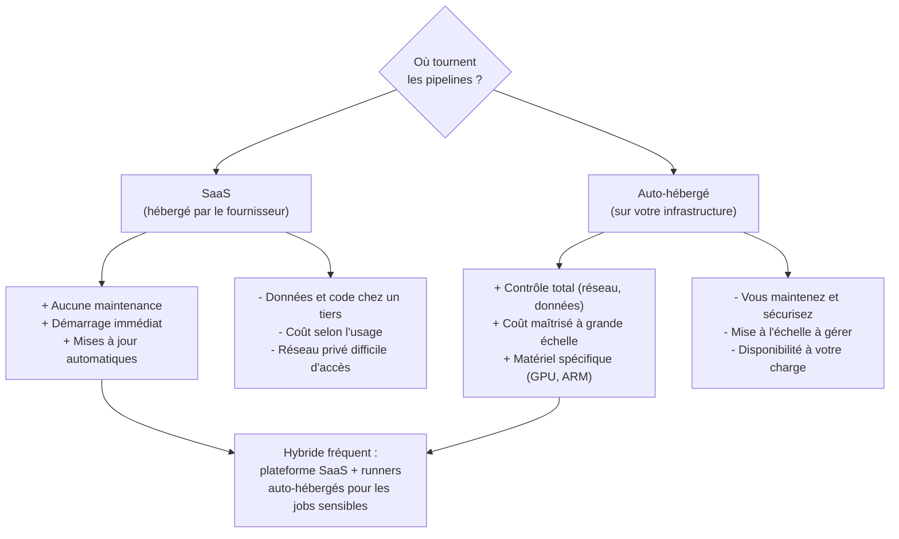

# GitLab CI et alternatives

## Pourquoi ce cours ?

GitHub Actions n'est pas le seul moteur de pipeline, et votre futur employeur utilise peut-être GitLab, Jenkins ou un outil maison. Les **concepts** sont les mêmes partout (déclencheur, jobs, étapes, artefacts, cache, runners), mais les mots et la syntaxe changent. Ce cours présente **GitLab CI/CD** en détail, compare les principaux outils et donne des **critères de choix** pour décider sans suivre la mode.

> Prérequis : [introduction au CI/CD](01-introduction-cicd.md) et [GitHub Actions](02-pipeline-as-code-github-actions.md) (pour comparer).

## 1. GitLab CI : le fichier `.gitlab-ci.yml`

Le pipeline est décrit dans `.gitlab-ci.yml` à la racine du dépôt. Les jobs sont regroupés en **stages** exécutés **dans l'ordre** ; les jobs d'un même stage tournent **en parallèle**.

```yaml
# .gitlab-ci.yml
stages: [build, test, package, deploy]

default:
  image: python:3.12-slim              # image Docker utilisée par défaut par les jobs
  cache:
    key:
      files: [requirements.txt]        # clé de cache basée sur le contenu du fichier
    paths: [.cache/pip]

variables:
  PIP_CACHE_DIR: "$CI_PROJECT_DIR/.cache/pip"

build:
  stage: build
  script:
    - pip install -r requirements.txt
    - python -m compileall src
  artifacts:
    paths: [src/]
    expire_in: 1 day

test:
  stage: test
  script:
    - python -m unittest discover -v
  coverage: '/TOTAL.*\s+(\d+%)$/'      # extrait la couverture du journal
  artifacts:
    when: always
    reports:
      junit: rapport.xml

package:
  stage: package
  image: docker:27
  services: [docker:27-dind]           # Docker-in-Docker pour construire une image
  script:
    - docker login -u "$CI_REGISTRY_USER" -p "$CI_REGISTRY_PASSWORD" "$CI_REGISTRY"
    - docker build -t "$CI_REGISTRY_IMAGE:$CI_COMMIT_SHORT_SHA" .
    - docker push "$CI_REGISTRY_IMAGE:$CI_COMMIT_SHORT_SHA"
  rules:
    - if: $CI_COMMIT_BRANCH == $CI_DEFAULT_BRANCH

deploy_staging:
  stage: deploy
  environment: { name: staging, url: https://staging.exemple.org }
  script: ["./deploy.sh staging $CI_COMMIT_SHORT_SHA"]
  rules:
    - if: $CI_COMMIT_BRANCH == $CI_DEFAULT_BRANCH

deploy_production:
  stage: deploy
  environment: { name: production }
  script: ["./deploy.sh production $CI_COMMIT_SHORT_SHA"]
  when: manual                         # approbation humaine
  rules:
    - if: $CI_COMMIT_BRANCH == $CI_DEFAULT_BRANCH
```

| Mot-clé | Rôle |
|---|---|
| `stages` | Ordre des phases |
| `image` / `services` | Conteneur d'exécution et conteneurs annexes (base de données, dind) |
| `script` / `before_script` / `after_script` | Commandes du job |
| `artifacts` | Fichiers conservés et transmis aux jobs des stages suivants |
| `cache` | Accélération (dépendances), par clé |
| `rules` | Conditions d'exécution (remplace `only`/`except`) : `if`, `changes`, `when` |
| `needs` | Exécute un job **dès que ses dépendances sont finies**, sans attendre tout le stage (DAG) |
| `extends` / `include` / `!reference` | Réutilisation (gabarits, fichiers partagés) |
| `environment` | Environnement de déploiement suivi dans l'interface |
| `variables` | Variables ; **masquées** et **protégées** dans les réglages du projet |

### Variables prédéfinies utiles

`CI_COMMIT_SHA`, `CI_COMMIT_SHORT_SHA`, `CI_COMMIT_BRANCH`, `CI_COMMIT_TAG`, `CI_PROJECT_DIR`, `CI_REGISTRY`, `CI_REGISTRY_IMAGE`, `CI_PIPELINE_SOURCE`, `CI_DEFAULT_BRANCH`.

### Les runners

Un **runner** est l'agent qui exécute les jobs. Il se **déclare** auprès de GitLab (`gitlab-runner register`) et choisit un **exécuteur** :

| Exécuteur | Principe | Usage |
|---|---|---|
| **Docker** | Chaque job dans un conteneur éphémère | Cas général |
| **Kubernetes** | Chaque job dans un pod | Scalabilité, clusters existants |
| **Shell** | Directement sur la machine | Simple mais **peu isolé** |
| **Docker Machine / autoscaling** | Machines créées à la demande | Charges variables |

Les runners **partagés** (fournis par gitlab.com) sont pratiques ; les runners **spécifiques** (auto-hébergés) donnent le contrôle (réseau privé, GPU, coûts). Les **tags** (`tags: [gpu]`) dirigent un job vers un runner précis.

> ⚠️ **Attention** : un runner **auto-hébergé** exécute du code arbitraire issu des dépôts. Ne l'attachez jamais à un dépôt public non maîtrisé, isolez-le (conteneurs éphémères, réseau restreint) et ne le laissez pas accéder à vos secrets de production.

> 📌 **À retenir** : même logique que GitHub Actions : `stages` + `jobs` + `script` + `artifacts`/`cache` + `rules`. La grosse différence de philosophie : GitLab est une **plateforme intégrée** (dépôt, registre, tickets, sécurité, environnements) alors que GitHub Actions s'appuie sur un **écosystème d'actions**.

## 2. Comparaison des principaux outils

| Critère | **GitHub Actions** | **GitLab CI** | **Jenkins** | **CircleCI** | **Drone** |
|---|---|---|---|---|---|
| Modèle | SaaS (+ runners auto-hébergés) | SaaS ou **auto-hébergé** | **Auto-hébergé** | SaaS (+ runners) | Auto-hébergé (léger) |
| Configuration | YAML `.github/workflows/` | YAML `.gitlab-ci.yml` | `Jenkinsfile` (Groovy) ou interface | YAML `.circleci/config.yml` | YAML `.drone.yml` |
| Écosystème | **Énorme** (Marketplace) | Modèles intégrés | **Énorme** (plugins, qualité variable) | Orbs | Plugins (conteneurs) |
| Courbe d'apprentissage | Douce | Douce | **Raide** (maintenance) | Moyenne | Douce |
| Maintenance | Aucune (SaaS) | Aucune ou **à votre charge** | **Lourde** (mises à jour, plugins, sécurité) | Aucune | Faible |
| Points forts | Intégration GitHub, communauté | Plateforme tout-en-un, DevSecOps intégré | Flexibilité maximale, héritage | Vitesse, cache avancé | Simplicité, conteneurs |
| Points faibles | Dépendance à GitHub | Interface dense | Dette technique, sécurité | Coût à l'échelle | Écosystème plus petit |

**Tekton** (intro) : un framework **Kubernetes-natif** (CNCF) : les tâches (`Task`), pipelines (`Pipeline`) et exécutions (`PipelineRun`) sont des **ressources Kubernetes**. Il sert à **construire sa propre plateforme CI/CD** sur un cluster, avec une grande flexibilité mais un coût d'apprentissage élevé. À considérer pour une équipe plateforme, pas pour un premier projet. Autres : **Argo Workflows**, **Buildkite**, **Azure Pipelines**, **AWS CodePipeline**, **Dagger** (pipelines en code portable).



## 3. Comment choisir ?

Il n'existe pas de « meilleur » outil, mais des critères :

| Question | Si la réponse est… | Orientation |
|---|---|---|
| **Où est votre code ?** | GitHub | GitHub Actions (intégration naturelle) |
| | GitLab | GitLab CI |
| **Contraintes de souveraineté / réseau isolé ?** | Oui | Auto-hébergé : GitLab (CE/EE), Jenkins, Drone, Tekton |
| **Équipe plateforme dédiée ?** | Oui, et cluster Kubernetes | Tekton, Argo Workflows |
| **Existant lourd (Jenkins) ?** | Oui | Migrer progressivement, pipeline par pipeline |
| **Volume de builds / budget ?** | Très élevé | Runners auto-hébergés, cache agressif |
| **Compétences de l'équipe ?** | YAML et conteneurs | Les outils YAML (GitHub, GitLab, CircleCI) |
| **Besoin de sécurité intégrée ?** | Oui | GitLab (SAST, DAST, dépendances intégrés) ou ajouter Trivy/Semgrep |
| **Risque de verrouillage ?** | À réduire | Mettre la **logique dans des scripts/Makefile/conteneurs**, la CI ne fait que les appeler |

> 💡 **Conseil** : la meilleure protection contre le verrouillage est de **garder la CI mince**. Mettez le vrai travail dans `make build`, `make test`, `make push` (ou un outil comme Dagger) ; le fichier de pipeline ne fait qu'enchaîner ces commandes. Vous testez en local, changez d'outil en quelques heures et gardez des pipelines lisibles. C'est ce que fait l'[atelier 2](../ateliers-killercoda/atelier-02-pipeline-build-test-push/intro.md).

## 4. Équivalences de vocabulaire

| Concept | GitHub Actions | GitLab CI | Jenkins |
|---|---|---|---|
| Fichier | `.github/workflows/*.yml` | `.gitlab-ci.yml` | `Jenkinsfile` |
| Unité de travail | job | job | stage / step |
| Phase | (via `needs`) | `stage` | `stage` |
| Machine | runner | runner | agent / node |
| Réutilisation | action, workflow réutilisable | `include`, `extends`, templates | bibliothèque partagée |
| Fichiers entre jobs | artefact | `artifacts` | `stash` / `archiveArtifacts` |
| Condition | `if:` | `rules:` | `when {}` |
| Approbation | `environment` protégé | `when: manual` | `input` |

## Résumé

- **GitLab CI** : `.gitlab-ci.yml`, `stages`, jobs, `script`, `artifacts`, `cache`, `rules`, `needs`, `environment`, **runners** (Docker, Kubernetes, shell).
- Comparaison : **GitHub Actions** (SaaS, écosystème), **GitLab CI** (tout-en-un), **Jenkins** (flexible mais lourd), **CircleCI**, **Drone** ; **Tekton** pour bâtir sa plateforme sur Kubernetes.
- Le choix dépend de **l'hébergement du code**, des **contraintes réseau/souveraineté**, des **compétences** et du **coût**.
- Gardez la **CI mince** (scripts, Makefile) pour limiter le verrouillage.

## Pour aller plus loin

- Documentation GitLab CI : <https://docs.gitlab.com/ee/ci/> ; Jenkins : <https://www.jenkins.io/doc/> ; Tekton : <https://tekton.dev/docs/>.
- Dagger : <https://dagger.io/> (pipelines en code, portables).
- Cours suivant : [Build, artefacts et registries](04-build-artefacts-et-registries.md).
