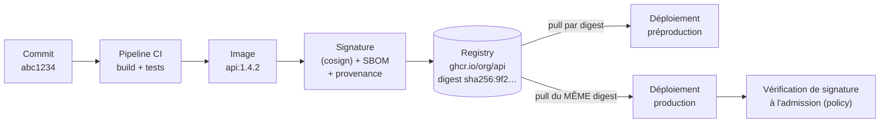

# Build, artefacts et registries

## Pourquoi ce cours ?

Le produit d'une CI n'est pas un « vert » dans une interface : c'est un **artefact** — une image, un binaire, un paquet — que l'on déploiera. Si cet artefact est reconstruit à chaque environnement, on ne teste jamais ce que l'on livre. Si on ne sait pas **d'où il vient** (quel commit, quel build), on ne peut ni le dépanner ni lui faire confiance. Ce cours traite de la construction d'artefacts **reproductibles et versionnés**, de leur stockage dans un **registre** (*registry*) et des mécanismes qui permettent de **prouver leur origine** (signature, provenance, SLSA).

> Prérequis : [Docker approfondi](../../08-docker-approfondi/README.md) (images, couches, Dockerfile) et [introduction au CI/CD](01-introduction-cicd.md).

## 1. Qu'est-ce qu'un artefact ?

Un **artefact** est le résultat figé et stockable d'un build.

| Type | Exemples | Stockage |
|---|---|---|
| **Image de conteneur** | `ghcr.io/org/api:1.4.2` | Registre d'images (OCI) |
| **Paquet de bibliothèque** | `.jar`, `.whl`, paquet npm, crate | Nexus, Artifactory, PyPI/npm privé |
| **Binaire / archive** | exécutable Go, `.tar.gz` | Releases GitHub, stockage objet |
| **Chart Helm** | `api-1.4.2.tgz` | Registre OCI ou dépôt de charts |
| **Rapports** | tests, couverture, SBOM | Artefacts de la CI |

Principe cardinal : un artefact est **immuable**. Un tag `1.4.2` ne doit **jamais** être réécrit ; pour corriger, on publie `1.4.3`.

> 📌 **À retenir** : **build once, deploy many**. L'artefact testé en recette est **exactement** celui déployé en production, identifié par son **empreinte** (`sha256:…`), pas par un tag mutable.

## 2. Le flux build → registry → deploy



## 3. Construire une image proprement

Les bases (multi-stage, cache, non-root) sont dans le [module Docker](../../08-docker-approfondi/README.md). En CI, trois points comptent :

1. **Reproductibilité** : images de base **épinglées** (`python:3.12.4-slim`, voire par digest), dépendances **verrouillées** (`requirements.txt` avec versions, `package-lock.json`).
2. **Cache** : l'ordre des couches (dépendances avant le code) et le **cache de build** distant (`--cache-from`, `--cache-to type=registry`) accélèrent les pipelines.
3. **Métadonnées** : étiquettes OCI qui relient l'image à sa source.

```dockerfile
FROM python:3.12.4-slim AS final
ARG VERSION=dev
ARG REVISION=unknown
LABEL org.opencontainers.image.version="$VERSION" \
      org.opencontainers.image.revision="$REVISION" \
      org.opencontainers.image.source="https://github.com/org/api"
```

### `buildx` : build moderne et multi-architecture

**BuildKit** via `docker buildx` apporte le cache distant et surtout le **build multi-plateforme** : une seule référence d'image (`api:1.4.2`) sert `amd64` et `arm64` (serveurs classiques et ARM, Apple Silicon, Raspberry Pi).

```bash
docker buildx create --use --name constructeur
docker buildx build \
  --platform linux/amd64,linux/arm64 \
  --tag ghcr.io/org/api:1.4.2 \
  --label org.opencontainers.image.revision="$(git rev-parse HEAD)" \
  --cache-from type=registry,ref=ghcr.io/org/api:cache \
  --cache-to   type=registry,ref=ghcr.io/org/api:cache,mode=max \
  --push .
docker buildx imagetools inspect ghcr.io/org/api:1.4.2     # liste les plateformes et le digest
```

> 💡 **Conseil** : l'émulation (QEMU) pour construire de l'ARM sur de l'x86 est **lente**. Pour de gros builds, utilisez des runners natifs de chaque architecture ou la compilation croisée (`GOARCH`, `--platform=$BUILDPLATFORM`).

## 4. Les registries

Un **registre** stocke et distribue les artefacts ; pour les images, il implémente l'**API de distribution OCI** (`docker pull/push`).

| Registre | Type | Points forts | Remarques |
|---|---|---|---|
| **Docker Hub** | SaaS public | Le plus connu, images officielles | Limites de pull pour les comptes anonymes/gratuits |
| **GHCR** (GitHub Container Registry) | SaaS | Intégré à GitHub Actions, droits liés au dépôt | `ghcr.io/org/image` |
| **GitLab Container Registry** | SaaS / auto-hébergé | Intégré à GitLab CI | Variables `CI_REGISTRY*` |
| **Harbor** | Auto-hébergé (CNCF) | Scan de vulnérabilités, signature, réplication, quotas, RBAC | Référence on-premise |
| **ECR / GCR-Artifact Registry / ACR** | Cloud (AWS, Google, Azure) | Intégration IAM, proximité des clusters | Authentification par rôles |
| **Nexus / Artifactory** | Auto-hébergé / SaaS | Tous formats (Docker, npm, Maven, PyPI…) | Registre universel |
| **`registry:2`** (distribution) | Auto-hébergé minimal | Simple, idéal pour apprendre et tester | Pas d'interface ni de scan (atelier 2) |

Critères de choix : **proximité** du cluster (latence, coût de sortie), **authentification** (jetons de courte durée plutôt que mots de passe), **fonctions de sécurité** (scan, signature, règles de rétention), **haute disponibilité**, **miroir** (cache des images publiques pour éviter les limites de pull et les pannes tierces).

> ⚠️ **Attention** : un registre public **expose** tout ce que vous y poussez, y compris des secrets oubliés dans une couche. Une couche supprimée dans un `RUN rm` **reste** dans l'historique de l'image. Scannez et n'y mettez jamais de secret ([cours 6](06-securite-dans-la-ci.md)).

## 5. Versionner : tags, SemVer et digest

### Versionnement sémantique (SemVer)

Format `MAJEUR.MINEUR.CORRECTIF` (`2.4.1`) :

| Partie | Quand l'incrémenter |
|---|---|
| **MAJEUR** | Changement **incompatible** de l'API |
| **MINEUR** | Fonctionnalité **compatible** ajoutée |
| **CORRECTIF** | Correction de bogue compatible |
| `-rc.1`, `+build5` | Préversion, métadonnée de build |

Les **Conventional Commits** (`feat:`, `fix:`, `feat!:`) permettent de **calculer automatiquement** la prochaine version (outils : `semantic-release`, `release-please`).

### Stratégie de tags d'image

| Tag | Exemple | Mutable ? | Usage |
|---|---|---|---|
| **SemVer exact** | `1.4.2` | Non (par convention) | Production |
| **Commit** | `sha-abc1234` | Non | Traçabilité, déploiements automatiques |
| **Majeur/mineur flottant** | `1.4`, `1` | **Oui** | Confort, jamais en production |
| `latest` | `latest` | **Oui** | À éviter en déploiement |
| **Branche** | `main`, `pr-42` | **Oui** | Environnements de prévisualisation |

Le **digest** (`image@sha256:…`) est la **seule** référence réellement immuable : c'est lui qu'on déploie (les outils GitOps le mettent à jour automatiquement).

```bash
docker buildx imagetools inspect ghcr.io/org/api:1.4.2 --format '{{json .Manifest.Digest}}'
kubectl set image deploy/api api=ghcr.io/org/api@sha256:9f2c…   # déployer par digest
```

## 6. Signer et prouver l'origine

Si un attaquant remplace une image dans le registre, comment le saurait-on ? La réponse : **signer** les artefacts et **vérifier** la signature avant l'exécution.

| Outil | Rôle |
|---|---|
| **cosign** (projet Sigstore) | Signe et vérifie des images ; mode **sans clé** (*keyless*) lié à l'identité OIDC du workflow CI |
| **Notation** (CNCF Notary v2) | Signature d'artefacts OCI avec infrastructure de certificats |
| **Rekor** | Journal de transparence public des signatures |
| **Politiques d'admission** (Kyverno, Connaisseur, Sigstore policy-controller) | Refusent dans le cluster toute image non signée |

```bash
# Signature sans clé depuis la CI (identité OIDC du workflow)
cosign sign --yes ghcr.io/org/api@sha256:9f2c…

# Vérification : on exige un émetteur et une identité précis
cosign verify ghcr.io/org/api@sha256:9f2c… \
  --certificate-oidc-issuer https://token.actions.githubusercontent.com \
  --certificate-identity-regexp '^https://github.com/org/api/\.github/workflows/release\.yml@refs/tags/v'
```

### SLSA : un niveau de confiance de la chaîne

**SLSA** (*Supply-chain Levels for Software Artifacts*, prononcé « salsa ») est un cadre qui décrit des **niveaux** de garantie sur la chaîne de construction :

| Niveau (build) | Garantie |
|---|---|
| **L1** | Le build produit une **provenance** (document décrivant comment l'artefact a été construit) |
| **L2** | Provenance **signée** par la plateforme de build (non falsifiable par le développeur) |
| **L3** | Build **isolé et durci** : la provenance ne peut pas être falsifiée même par un job compromis |

La **provenance** est une attestation signée qui dit : « cet artefact (digest X) a été produit par ce workflow, à partir de ce commit, dans cet environnement ». Combinée à un **SBOM** (liste des composants), elle permet de répondre vite aux questions d'audit et d'incident.

> 💡 **Conseil** : visez d'abord **SLSA 1 à 2**, ce qui est facile avec GitHub Actions (`actions/attest-build-provenance`, `slsa-github-generator`) : un job de build éphémère, des dépendances verrouillées, une provenance signée. Chaque niveau compte.

## 7. Rétention et hygiène

- **Règles de rétention** : conserver les N dernières versions, supprimer les `pr-*` après quelques jours, jamais les versions en production.
- **Garbage collection** du registre (suppression des couches orphelines).
- **Scan continu** : une image saine hier peut être vulnérable aujourd'hui (nouvelle CVE).
- **Droits** : seule la CI **pousse** ; les humains **tirent** ; les clusters **tirent** avec un jeton en lecture seule.

## Résumé

- Un **artefact** est immuable ; **build once, deploy many**, référencé par son **digest**.
- **`buildx`** : cache distant et images **multi-architecture** ; épingler les bases et verrouiller les dépendances.
- **Registres** : Docker Hub, GHCR, Harbor, ECR/GCR/ACR, Nexus ; choisir selon proximité, sécurité et auth.
- **SemVer** et tags : exact pour la production, `latest` et tags flottants à éviter.
- **cosign / Notation** signent, **SLSA** décrit le niveau de confiance, la **provenance** et le **SBOM** prouvent l'origine.

## Pour aller plus loin

- Sigstore : <https://www.sigstore.dev/> ; SLSA : <https://slsa.dev/> ; spécification OCI : <https://opencontainers.org/>.
- Harbor : <https://goharbor.io/> ; Semantic Versioning : <https://semver.org/lang/fr/>.
- Cours suivant : [Tests automatisés dans la pipeline](05-tests-automatises-dans-la-pipeline.md).
- Atelier associé : [Pipeline build, test et push](../ateliers-killercoda/atelier-02-pipeline-build-test-push/intro.md).
