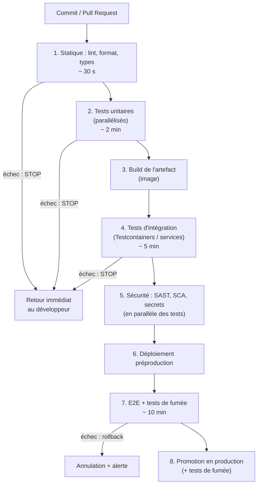

# Tests automatisés dans la pipeline

## Pourquoi ce cours ?

Une pipeline qui construit sans tester ne fait qu'**automatiser l'envoi de bogues** vers la production. À l'inverse, une pipeline qui exécute 40 minutes de tests, dont certains échouent au hasard, finit contournée : on relance jusqu'au vert, puis on ne regarde plus. Réussir ses tests en CI, c'est **choisir les bons types de tests**, les **ordonner** pour échouer vite, les **paralléliser**, et **traiter les tests instables comme des défauts** à corriger. C'est ce qui rend le déploiement continu raisonnable.

> Prérequis : [introduction au CI/CD](01-introduction-cicd.md) et [GitHub Actions](02-pipeline-as-code-github-actions.md) (jobs, matrices, artefacts).

## 1. La pyramide des tests

```text
              /\            Peu de tests, lents, coûteux, fragiles
             /E2E\          de bout en bout (navigateur, parcours complet)
            /------\
           /Intégr. \       Quelques dizaines : services réels (base, file, API)
          /----------\
         / Unitaires  \     Des milliers : rapides (ms), isolés, déterministes
        /--------------\
```

| Niveau | Teste | Vitesse | Fiabilité | Coût de maintenance | Quantité |
|---|---|---|---|---|---|
| **Statique** (lint, types, format) | Style, erreurs évidentes | Secondes | Très haute | Très faible | Tout le code |
| **Unitaire** | Une fonction/classe isolée | Millisecondes | Haute | Faible | **Majorité** |
| **Intégration** | Plusieurs composants réels (base, API) | Secondes | Moyenne | Moyen | Quelques dizaines |
| **Contrat** | L'accord entre un client et un service | Secondes | Haute | Moyen | Par interface |
| **De bout en bout (E2E)** | Le parcours utilisateur complet | Minutes | **Basse** (fragile) | Élevé | **Peu** |
| **Charge / performance** | Tenue sous trafic | Minutes à heures | Moyenne | Élevé | Ciblés |
| **Fumée (*smoke*)** | « L'application démarre-t-elle ? » après déploiement | Secondes | Haute | Faible | Quelques-uns |

La pyramide est un **équilibre de coûts**, pas un dogme : beaucoup de tests lents et fragiles en haut (le « cornet de glace ») ralentissent et fragilisent toute la livraison. Certaines architectures (micro-services) préfèrent un « diamant » avec davantage de tests d'intégration et de contrat.

> 📌 **À retenir** : plus un test est haut dans la pyramide, plus il est **lent, cher et instable**. Placez un maximum de logique dans des tests unitaires rapides, et réservez les tests E2E aux **quelques parcours vitaux** (connexion, paiement).

## 2. L'ordre d'exécution : échouer vite

Le principe **fail fast** : exécuter d'abord les contrôles **les plus rapides et les plus susceptibles d'échouer**, afin de renvoyer l'information au développeur en quelques minutes.



Règles pratiques :

1. **Lint avant tests**, **unitaires avant intégration**, **intégration avant E2E**.
2. **Ne pas construire/publier** ce qui n'a pas passé les contrôles rapides.
3. Sur une **pull request** : tests rapides (unitaires, lint, sécurité légère) ; **suite complète** sur `main` et avant la production.
4. Un **budget de temps** : visez moins de 10 minutes de retour sur une PR.

## 3. Paralléliser

| Technique | Principe | Exemple |
|---|---|---|
| **Jobs parallèles** | Les contrôles indépendants tournent en même temps | `lint`, `unit`, `sast` sans `needs` entre eux |
| **Matrice** | Une même suite sur plusieurs versions/plateformes | Python 3.11 et 3.12 |
| **Découpage de la suite (*sharding*)** | Répartir les tests en N tranches | `pytest-split`, `jest --shard=1/4`, `go test -run` par paquet |
| **Parallélisme dans le runner** | Plusieurs processus | `pytest -n auto`, `go test -p 4` |
| **Cache de dépendances et de build** | Éviter de tout refaire | `actions/cache`, cache de couches Docker |
| **Tests sélectifs** | N'exécuter que ce qui est impacté | `paths:`, outils d'impact (Nx, Bazel) |

```yaml
  tests:
    runs-on: ubuntu-latest
    strategy:
      fail-fast: false
      matrix:
        shard: [1, 2, 3, 4]
    steps:
      - uses: actions/checkout@v4
      - run: make deps
      - run: pytest --splits 4 --group ${{ matrix.shard }}
```

> ⚠️ **Attention** : paralléliser **révèle** les dépendances cachées entre tests (état partagé, ports fixes, fichiers communs, ordre d'exécution). Un test doit pouvoir s'exécuter **seul, dans n'importe quel ordre, en même temps que d'autres** : ports aléatoires, répertoires temporaires, bases de données éphémères.

## 4. Les tests instables (*flaky*)

Un test **flaky** réussit ou échoue sans changement de code. Causes fréquentes :

| Cause | Exemple | Remède |
|---|---|---|
| **Temps et attentes** | `sleep(2)` en espérant que le service soit prêt | Attendre une **condition** (sonde, *polling* avec délai maximal) |
| **Ordre / état partagé** | Un test laisse des données qui perturbent un autre | Isolation, nettoyage, données uniques par test |
| **Dépendances externes** | Appel à une API tierce réelle | Doubles (mocks), serveurs simulés, enregistrement |
| **Concurrence** | Conditions de course | Synchronisation, tests déterministes |
| **Ressources** | Runner surchargé, délais trop courts | Marges raisonnables, quotas |
| **Aléa non maîtrisé** | `random`, horloge, fuseau horaire | Graine fixe, horloge injectée |

Politique recommandée :

1. **Mesurer** : suivre le taux d'échec par test (les outils de CI et de test le fournissent).
2. **Isoler** (*quarantaine*) : marquer le test, l'exclure du chemin bloquant, créer un **ticket avec propriétaire et échéance**.
3. **Corriger ou supprimer** : un test peu fiable est pire que l'absence de test.
4. **Ne pas masquer par des relances automatiques** généralisées : un `retry` ponctuel sur un test connu peut dépanner, mais cache le défaut.

> 💡 **Conseil** : la règle « un test rouge est un incident » : tant que la branche principale est rouge, **plus rien n'est fusionné** sauf le correctif. Une équipe qui tolère le rouge perd la CI en quelques semaines.

## 5. Couverture de code (*coverage*)

La **couverture** mesure la part du code exécutée par les tests (lignes, branches).

| Idée reçue | Réalité |
|---|---|
| « 100 % de couverture = pas de bogue » | Faux : exécuter une ligne n'est pas **vérifier** son résultat |
| « Il faut un seuil global strict » | Utile comme **garde-fou** (ex. échec sous 70 %), mais pas comme objectif |
| « La couverture mesure la qualité » | Elle mesure ce qui **n'est pas** testé : zones à risque non couvertes |

Bonnes pratiques : suivre la couverture **du code modifié** dans la PR (*diff coverage*), exiger un seuil raisonnable sur le code **nouveau**, compléter par des **tests de mutation** (Stryker, mutmut, PIT) qui vérifient que les tests détectent réellement les changements de comportement.

```bash
python -m coverage run -m unittest discover
python -m coverage report --fail-under=70          # échoue sous 70 %
python -m coverage xml                             # rapport exploitable par la CI
```

## 6. Tests d'intégration avec Testcontainers

Les tests d'intégration ont besoin de **vrais** services (PostgreSQL, Redis, Kafka). Utiliser des bases partagées rend les tests instables ; des **mocks** de bases ne testent pas le vrai comportement. **Testcontainers** (bibliothèques Java, Go, Python, Node, .NET…) démarre des **conteneurs Docker éphémères** pendant le test, avec **ports aléatoires**, et les supprime ensuite.

```python
# pip install testcontainers[postgres] sqlalchemy psycopg2-binary
from testcontainers.postgres import PostgresContainer
import sqlalchemy

def test_creation_commande():
    with PostgresContainer("postgres:16-alpine") as pg:        # conteneur éphémère
        moteur = sqlalchemy.create_engine(pg.get_connection_url())
        with moteur.begin() as cx:
            cx.execute(sqlalchemy.text("CREATE TABLE commandes (id serial PRIMARY KEY, total int)"))
            cx.execute(sqlalchemy.text("INSERT INTO commandes (total) VALUES (42)"))
            assert cx.execute(sqlalchemy.text("SELECT total FROM commandes")).scalar() == 42
```

Avantages : environnement **identique** en local et en CI, tests **isolés**, aucun état résiduel. Exigence : un **démon Docker** accessible (runners hébergés par GitHub : oui ; runners Kubernetes : prévoir Docker-in-Docker ou un équivalent). Alternatives : `services:` de GitHub Actions et GitLab CI, ou Docker Compose.

## 7. Après le déploiement

- **Tests de fumée** (*smoke tests*) : quelques requêtes pour s'assurer que l'application répond (`/healthz`, une page, une transaction de test).
- **Tests synthétiques** : scénarios joués en continu en production ; alertes en cas d'échec ([monitoring](../../10-monitoring-observabilite/README.md)).
- **Tests de charge** (k6, Gatling, Locust) : sur des environnements représentatifs, avant les gros évènements.
- **Vérification automatique en déploiement progressif** : les métriques (taux d'erreur, latence) décident de la promotion ou du retour arrière ([cours 7](07-strategies-de-deploiement.md)).

## Résumé

- **Pyramide** : beaucoup de tests unitaires rapides, quelques tests d'intégration, très peu de E2E.
- **Fail fast** : statique → unitaires → build → intégration → sécurité → E2E ; suite complète sur `main`, rapide sur les PR.
- **Paralléliser** (jobs, matrices, sharding) en rendant les tests **indépendants**.
- Les tests **flaky** se mesurent, se mettent en quarantaine, se corrigent ; **rouge = incident**.
- **Couverture** : un garde-fou, pas un objectif ; compléter par les tests de mutation.
- **Testcontainers** donne des services réels, éphémères et isolés.

## Pour aller plus loin

- *Test Pyramid* (<https://martinfowler.com/articles/practical-test-pyramid.html>) ; Testcontainers : <https://testcontainers.com/>.
- Tests de charge : <https://k6.io/docs/> ; tests de contrat : <https://docs.pact.io/>.
- Cours suivant : [Sécurité dans la CI](06-securite-dans-la-ci.md).
