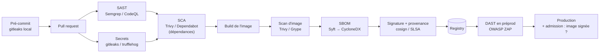

# Sécurité dans la CI

## Pourquoi ce cours ?

Une pipeline CI/CD est un **point d'accès privilégié** : elle lit le code source, détient des secrets, publie des artefacts et déploie en production. Pour un attaquant, compromettre la CI vaut mieux que compromettre un serveur. En parallèle, la majorité du code d'une application moderne vient de **dépendances tierces** : une vulnérabilité (Log4Shell) ou une dépendance piégée (*supply chain attack*) arrive en production avec un simple `npm install`. Le **shift left** consiste à détecter ces problèmes **le plus tôt possible**, dans la pipeline, quand les corriger coûte quelques minutes plutôt que des jours en production. Ce cours présente la panoplie d'analyses et la façon de les assembler sans paralyser les développeurs.

> Prérequis : [GitHub Actions](02-pipeline-as-code-github-actions.md), [artefacts et signature](04-build-artefacts-et-registries.md) et [sécurité Docker](../../08-docker-approfondi/README.md).

## 1. Shift left et défense en profondeur

```text
Coût de correction d'une faille :
 Poste dev ──► Commit ──► CI ──► Préprod ──► Production ──► Incident
   1 ×          2 ×      5 ×      20 ×         100 ×         1000 ×
            ◄──────────── « shift left » : détecter ici ─────────────
```

Aucune analyse n'est parfaite : on **superpose** des contrôles qui détectent des familles de problèmes différentes.

| Famille | Ce qu'elle cherche | Quand | Outils |
|---|---|---|---|
| **Secrets scanning** | Mots de passe, clés d'API dans le code ou l'historique | Pré-commit + CI | gitleaks, trufflehog, GitHub secret scanning |
| **SAST** (*Static Application Security Testing*) | Failles dans **votre** code source (injection, désérialisation, crypto faible) | CI (PR) | Semgrep, CodeQL, SonarQube, Bandit, gosec |
| **SCA** (*Software Composition Analysis*) | Vulnérabilités (**CVE**) et licences des **dépendances** | CI + en continu | Dependabot, Renovate, Trivy, Snyk, OSV-Scanner, `npm audit` |
| **Scan d'image / conteneur** | CVE du système de base et des paquets de l'image | Après build + en continu | Trivy, Grype, Harbor |
| **IaC scanning** | Mauvaises configurations (Terraform, Kubernetes, Dockerfile) | CI | Trivy config, Checkov, KICS, Hadolint, kube-linter |
| **DAST** (*Dynamic AST*) | Failles d'une application **en cours d'exécution** (XSS, en-têtes manquants) | Préproduction | OWASP ZAP, Nuclei |
| **SBOM** | **Inventaire** des composants du logiciel | Après build | Syft, CycloneDX, SPDX |
| **Signature / provenance** | Origine et intégrité de l'artefact | Fin de build | cosign, Notation, attestations SLSA |

## 2. Enchaîner les contrôles



> 📌 **À retenir** : sécuriser, c'est **automatiser des garde-fous** dans la pipeline (et pas seulement faire un audit annuel) avec des **seuils décidés d'avance** : quelles failles bloquent, lesquelles sont seulement signalées.

## 3. SAST : analyser le code

Le SAST lit le code sans l'exécuter et cherche des motifs dangereux.

```yaml
  sast:
    runs-on: ubuntu-latest
    permissions: { contents: read, security-events: write }
    steps:
      - uses: actions/checkout@v4
      - uses: returntocorp/semgrep-action@v1        # ou : github/codeql-action
        with:
          config: p/owasp-top-ten
```

| Outil | Points forts |
|---|---|
| **Semgrep** | Règles lisibles, rapide, personnalisable |
| **CodeQL** | Analyse sémantique profonde, intégrée à GitHub (gratuite en public) |
| **SonarQube** | Qualité **et** sécurité, tableau de bord, *quality gate* |
| **Bandit / gosec / Brakeman** | Spécialisés par langage |

Limites : **faux positifs** (le développeur finit par ignorer), faux négatifs, pas de vision de l'exécution. On **règle** les règles : commencer par les plus fiables (sévérité haute) et les faire passer en **blocage** progressivement.

## 4. SCA : maîtriser les dépendances

La plupart des vulnérabilités viennent des **bibliothèques**. Les bases publiques (NVD, GitHub Advisory, OSV) listent les **CVE** par version.

```bash
trivy fs --scanners vuln --severity HIGH,CRITICAL --exit-code 1 .     # dépendances du dépôt, échec si HIGH/CRITICAL
npm audit --audit-level=high                                          # exemple Node
```

- **Dependabot** ou **Renovate** ouvrent automatiquement des pull requests de mise à jour : le meilleur moyen de ne pas accumuler de dette.
- **Verrouiller** les versions (lockfiles) et **vérifier les empreintes** pour éviter qu'une version malveillante soit tirée silencieusement.
- Contrôler les **licences** (GPL dans un produit propriétaire…) et se méfier du **typosquatting** (`reqeusts`) et des paquets abandonnés.
- Distinguer le **risque réel** : une CVE dans une fonction jamais appelée est moins urgente (outils d'*atteignabilité* : Snyk, Endor, `govulncheck`).

> 💡 **Conseil** : définissez une **politique de SLA de correction** : critique sous 7 jours, haute sous 30 jours, etc. Sans règle, la liste de CVE grossit et plus personne ne la lit. Pour les exceptions, un fichier d'exemptions (`.trivyignore`) **avec justification et date d'expiration**.

## 5. Détection de secrets

Un secret commité (même supprimé ensuite) **reste dans l'historique Git**. La seule réponse correcte à une fuite est de **révoquer et remplacer** le secret, pas de réécrire l'historique.

```bash
gitleaks detect --source . --redact --exit-code 1            # analyse du dépôt et de l'historique
gitleaks protect --staged                                    # en pré-commit : seulement ce qui va être commité
trufflehog git file://. --only-verified                      # vérifie si le secret trouvé est encore valide
```

Mesures complémentaires : `.gitignore` pour les `.env`, **pre-commit hooks**, **GitHub push protection**, et surtout **ne pas avoir de secrets longue durée** : jetons **éphémères** (OIDC vers le cloud, identité de charge de travail), coffre (Vault, gestionnaire de secrets du cloud).

> ⚠️ **Attention** : ne mettez jamais un secret dans un `ARG`/`ENV` de Dockerfile ni dans le journal de la CI. Utilisez `RUN --mount=type=secret` (BuildKit) pour les secrets de build ; ils ne restent pas dans les couches.

## 6. Scanner l'image et l'infrastructure

```bash
trivy image --severity HIGH,CRITICAL --ignore-unfixed --exit-code 1 ghcr.io/org/api:1.4.2
trivy config --exit-code 1 k8s/                     # manifestes Kubernetes, Dockerfile, Terraform
hadolint Dockerfile                                  # bonnes pratiques de Dockerfile
```

- **`--ignore-unfixed`** masque les CVE sans correctif disponible (bruit).
- Réduire la surface : images **minimales** (`-slim`, `distroless`, `scratch`), utilisateur non root, système de fichiers en lecture seule.
- **Scanner en continu** (rescan nocturne du registre) : de nouvelles CVE apparaissent après le build.

## 7. DAST : tester l'application en marche

Le DAST attaque l'application déployée (en **préproduction**, jamais en production sans accord) comme le ferait un pirate : en-têtes de sécurité manquants, XSS, injections, mauvaises configurations.

```bash
docker run --rm -t ghcr.io/zaproxy/zaproxy:stable zap-baseline.py -t https://staging.exemple.org -r rapport-zap.html
```

`zap-baseline.py` fait une analyse **passive** rapide (sans attaque active), adaptée à la CI ; une analyse **active** (`zap-full-scan.py`) est plus longue et réservée à des environnements dédiés.

## 8. SBOM : l'inventaire des composants

Un **SBOM** (*Software Bill of Materials*) liste **tous** les composants d'un logiciel (paquets, versions, licences). Quand une nouvelle faille éclate (Log4Shell), il permet de répondre **en minutes** à : « sommes-nous touchés, et où ? »

| Format | Particularité |
|---|---|
| **CycloneDX** (OWASP) | Orienté sécurité et chaîne d'approvisionnement ; JSON/XML |
| **SPDX** (Linux Foundation) | Orienté licences et conformité ; norme ISO |

```bash
syft ghcr.io/org/api:1.4.2 -o cyclonedx-json=sbom.cdx.json    # génère le SBOM de l'image
grype sbom:sbom.cdx.json --fail-on high                        # le scanner CVE réutilise le SBOM
cosign attest --yes --predicate sbom.cdx.json --type cyclonedx ghcr.io/org/api@sha256:9f2c…   # joint le SBOM, signé
```

Les réglementations (Executive Order américain, *Cyber Resilience Act* européen) rendent le SBOM de plus en plus **obligatoire**.

## 9. Signature et provenance

Après les contrôles, on **signe** l'artefact et on enregistre sa **provenance** ([cours 4](04-build-artefacts-et-registries.md)). Le cluster applique ensuite une **politique d'admission** (Kyverno, Sigstore policy-controller) qui **refuse** toute image non signée par la bonne identité : même un registre compromis ne permet pas d'exécuter une image falsifiée.

## 10. Sécuriser la CI elle-même

| Risque | Mesure |
|---|---|
| **Secrets exposés** | Secrets d'environnement protégés, OIDC, rotation, masquage des journaux |
| **Jeton trop puissant** | `permissions:` minimales par workflow/job |
| **Action ou image tierce malveillante** | Épingler par **SHA**, limiter aux actions de confiance, mises à jour contrôlées |
| **Injection via le contexte** | Ne jamais interpoler `${{ github.event.pull_request.title }}` directement dans un `run:` (passer par une variable d'environnement) |
| **PR de forks** | Pas de secrets pour les forks ; attention à `pull_request_target` |
| **Runner auto-hébergé partagé** | Runners éphémères, isolés, réseau restreint |
| **Branche principale non protégée** | Revue obligatoire, statuts requis, commits signés, pas de push direct |
| **Déploiement sans contrôle** | Environnements protégés, approbation, journal d'audit |

```yaml
      # MAUVAIS : injection de commande possible via le titre de la PR
      - run: echo "Titre : ${{ github.event.pull_request.title }}"
      # BON : valeur passée en variable d'environnement, jamais interprétée comme du shell
      - run: echo "Titre : $TITRE"
        env:
          TITRE: ${{ github.event.pull_request.title }}
```

## 11. Politiques : bloquer sans paralyser

| Principe | Application |
|---|---|
| **Seuils clairs** | Bloquer sur les failles **critiques/élevées corrigeables** et sur les secrets ; avertir pour le reste |
| **Progressivité** | Commencer en mode *rapport*, puis passer en blocage une fois le bruit maîtrisé |
| **Exemptions tracées** | Justification, responsable, date d'expiration |
| **Retour rapide** | Résultats dans la PR (commentaires, annotations) |
| **Propriété** | Les équipes corrigent leurs alertes ; l'équipe sécurité fournit les outils et les règles |

## Résumé

- **Shift left** : détecter tôt, en superposant **secrets, SAST, SCA, scan d'image, IaC, DAST**.
- **SBOM** (Syft, CycloneDX) : inventaire exploitable en cas de nouvelle CVE ; **signature et provenance** (cosign, SLSA) + admission dans le cluster.
- Un secret fuité se **révoque** ; préférer les **jetons éphémères** (OIDC).
- **Protéger la CI** : droits minimaux, actions épinglées, pas d'injection de contexte, runners isolés, branche protégée.
- Définir des **seuils** et des **SLA de correction** réalistes pour ne pas noyer les équipes.

## Pour aller plus loin

- OWASP : <https://owasp.org/> (Top 10, *CI/CD Security Risks*) ; Trivy : <https://trivy.dev/> ; Semgrep : <https://semgrep.dev/>.
- *GitHub : Security hardening for Actions* ; OpenSSF Scorecard : <https://scorecard.dev/>.
- **Approfondir** : le [module 16 — DevSecOps](../../16-devsecops/README.md) détaille la sécurité de toute la chaîne d'approvisionnement (SLSA, SBOM, signature et provenance avec cosign, policy as code avec Kyverno, secrets avec Vault, durcissement CIS), avec trois ateliers Killercoda.
- Cours suivant : [Stratégies de déploiement](07-strategies-de-deploiement.md).
- Atelier associé : [Sécurité : SAST, SBOM et scan d'image](../ateliers-killercoda/atelier-03-securite-sast-sbom/intro.md).
