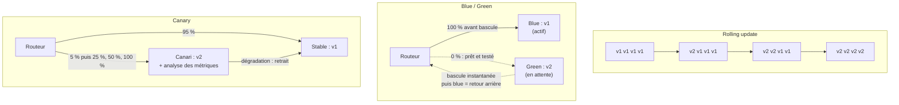

# Stratégies de déploiement

## Pourquoi ce cours ?

Déployer une nouvelle version, c'est le moment le plus risqué de la vie d'un service : la majorité des incidents suivent un changement. On ne peut pas supprimer ce risque, mais on peut **choisir sa forme** : remplacer d'un coup (et tout casser si ça va mal) ou **faire entrer la nouvelle version progressivement**, en gardant la possibilité de revenir en arrière en quelques secondes. Ce cours compare les stratégies (rolling update, blue/green, canary), distingue **canary** et **A/B testing**, introduit les **feature flags** (qui séparent *déployer* de *activer*) et traite du **rollback**.

> Prérequis : [Kubernetes approfondi](../../09-kubernetes-approfondi/README.md) (Deployments, Services, probes), [introduction au CI/CD](01-introduction-cicd.md).

## 1. Vocabulaire : déployer ≠ mettre en production ≠ publier

| Action | Signification |
|---|---|
| **Déployer** | Installer une version sur l'infrastructure |
| **Router le trafic** | Envoyer des utilisateurs réels vers cette version |
| **Activer / publier** (*release*) | Rendre une fonctionnalité **visible** aux utilisateurs |

Les stratégies agissent sur le **routage** ; les *feature flags* agissent sur l'**activation**. Les séparer est la clé de la livraison à faible risque.

## 2. Rolling update (mise à jour progressive)

Les instances de l'ancienne version sont **remplacées une par une** par la nouvelle. C'est le comportement **par défaut** des Deployments Kubernetes.

```yaml
apiVersion: apps/v1
kind: Deployment
metadata: { name: api }
spec:
  replicas: 6
  strategy:
    type: RollingUpdate
    rollingUpdate:
      maxSurge: 1            # 1 pod en plus pendant la transition
      maxUnavailable: 0      # jamais moins de 6 pods prêts
  selector: { matchLabels: { app: api } }
  template:
    metadata: { labels: { app: api } }
    spec:
      containers:
        - name: api
          image: ghcr.io/org/api:1.4.2
          readinessProbe: { httpGet: { path: /healthz, port: 8080 } }   # indispensable
```

| Avantages | Inconvénients |
|---|---|
| Simple, natif, **sans infrastructure en double** | Pendant la transition, **deux versions coexistent** (compatibilité nécessaire : API, base de données) |
| Pas de coupure si les sondes sont bien réglées | Retour arrière **lent** (c'est une autre mise à jour) |
| Économe en ressources | Le trafic est réparti **sans contrôle fin** sur la proportion |

```bash
kubectl rollout status deployment/api
kubectl rollout undo deployment/api            # retour à la révision précédente
kubectl rollout history deployment/api
```

## 3. Blue/green

On maintient **deux environnements complets** : *blue* (version actuelle, sert le trafic) et *green* (nouvelle version, prête et testée). Une fois green validé, on **bascule d'un coup** le routage ; blue reste disponible pour un **retour arrière instantané**.

| Avantages | Inconvénients |
|---|---|
| **Bascule et rollback quasi instantanés** | **Double** l'infrastructure pendant la transition (coût) |
| La nouvelle version est testée **avant** de recevoir le trafic réel | Le trafic bascule **d'un coup** : pas de test progressif sous charge réelle |
| Pas de coexistence de versions côté utilisateur | **Base de données** : le schéma doit être compatible avec les deux versions |

Sous Kubernetes : deux Deployments (`app-blue`, `app-green`) et un Service dont le sélecteur change (`version: green`), ou un Ingress / un service mesh qui route.

```bash
kubectl patch service api -p '{"spec":{"selector":{"app":"api","version":"green"}}}'    # bascule
kubectl patch service api -p '{"spec":{"selector":{"app":"api","version":"blue"}}}'     # retour arrière
```

## 4. Canary

On expose la nouvelle version à une **petite fraction** du trafic réel (1 %, 5 %, 25 %…) tout en **mesurant** ses indicateurs (erreurs, latence). Si tout va bien, on **augmente** ; sinon on **retire** le canari. Le nom vient du canari dans la mine : il alerte avant que tout le monde soit touché.

| Avantages | Inconvénients |
|---|---|
| **Impact limité** si la version est défectueuse | Plus **complexe** : routage pondéré, métriques fiables |
| Validation sur du **trafic réel** | Deux versions coexistent plus longtemps |
| Décision **automatisable** (analyse des métriques) | Demande une **observabilité** solide (voir module [Monitoring](../../10-monitoring-observabilite/README.md)) |

Trois façons de réaliser un canari sous Kubernetes :

1. **Deux Deployments derrière le même Service** (sélecteur commun) : la proportion dépend du **nombre de pods** (4 + 1 pods = ~20 % vers le canari). Simple, grossier (atelier 4).
2. **Ingress avec annotations** (NGINX `canary-weight`) : pondération au niveau HTTP.
3. **Progressive delivery** : **Argo Rollouts** ou **Flagger** pilotent des paliers (5 % → 25 % → 50 % → 100 %) et **analysent** les métriques Prometheus pour **promouvoir ou annuler** automatiquement.

```yaml
# Argo Rollouts : canari par paliers avec pauses
apiVersion: argoproj.io/v1alpha1
kind: Rollout
metadata: { name: api }
spec:
  replicas: 10
  strategy:
    canary:
      steps:
        - setWeight: 10
        - pause: { duration: 5m }
        - setWeight: 50
        - pause: { duration: 10m }
  selector: { matchLabels: { app: api } }
  template:
    metadata: { labels: { app: api } }
    spec:
      containers: [{ name: api, image: ghcr.io/org/api:1.4.2 }]
```

## 5. Comparaison



| Critère | **Rolling** | **Blue/green** | **Canary** |
|---|---|---|---|
| Coût en ressources | Faible | **Double** | Faible à moyen |
| Vitesse de rollback | Lente | **Instantanée** | Rapide (retirer le canari) |
| Exposition au risque | Progressive, peu contrôlée | **Totale** à la bascule | **Minimale**, contrôlée |
| Test sous trafic réel avant exposition totale | Partiel | Non | **Oui** |
| Complexité | **Faible** | Moyenne | Élevée |
| Besoin d'observabilité | Sondes | Sondes + tests | **Métriques détaillées** |
| Usage typique | Services courants | Changements risqués, migrations | Services critiques à fort trafic |

> 📌 **À retenir** : pas de stratégie « meilleure » : **rolling** par défaut, **blue/green** quand on veut un retour arrière instantané, **canary** quand on veut limiter l'impact sur du trafic réel et qu'on sait **mesurer**.

## 6. Canary ou A/B testing ?

Ils ressemblent à du routage partiel, mais **le but diffère**.

| | **Canary** | **A/B testing** |
|---|---|---|
| **Question** | « Cette version est-elle **saine** ? » | « Cette variante est-elle **meilleure** pour l'utilisateur ? » |
| Objectif | **Technique** : réduire le risque du déploiement | **Produit** : comparer des comportements (conversion, clics) |
| Mesures | Erreurs, latence, saturation | Métriques métier (achats, rétention) |
| Répartition | Par **pourcentage de trafic**, croissant | Par **segments d'utilisateurs** stables (même utilisateur = même variante) |
| Durée | Minutes à heures | Jours à semaines (significativité statistique) |
| Décision | Promouvoir ou annuler | Choisir la meilleure variante |
| Responsable | Ingénierie / SRE | Produit / data |

On fait souvent les deux avec le **même mécanisme** (routage par pourcentage ou par en-tête), mais les décisions et les métriques ne sont pas les mêmes.

## 7. Feature flags (bascules de fonctionnalités)

Un **feature flag** est un interrupteur dans le code qui **active ou désactive** une fonctionnalité **sans redéploiement**.

```python
if flags.est_actif("nouveau-paiement", utilisateur=utilisateur.id):
    return paiement_v2(commande)
return paiement_v1(commande)
```

| Usage | Exemple |
|---|---|
| **Déploiement progressif** | Activer pour 1 % des utilisateurs, puis 10 %… |
| **Kill switch** | Désactiver une fonctionnalité défaillante **en quelques secondes**, sans rollback |
| **Livraison sur tronc commun** (*trunk-based*) | Fusionner du code inachevé, **désactivé** |
| **Test A/B** | Variantes par segment |
| **Fonctions réservées** | Accès bêta, clients premium |

Outils : **OpenFeature** (standard), **Unleash**, **Flagsmith**, **LaunchDarkly**, ou un simple fichier de configuration.

> ⚠️ **Attention** : les flags créent une **dette** : chaque drapeau double le nombre de chemins de code à tester. **Supprimez** les flags une fois la fonctionnalité généralisée (date d'expiration, propriétaire), et testez les deux états.

## 8. Le retour arrière (*rollback*)

Aucune stratégie ne vaut sans **plan de retour arrière** testé.

| Méthode | Rapidité | Remarque |
|---|---|---|
| **Désactiver un flag** | Secondes | La meilleure : aucun redéploiement |
| **Rebasculer blue/green** | Secondes | Nécessite l'ancien environnement conservé |
| **Retirer le canari** | Secondes à minutes | Automatisable sur dégradation des métriques |
| **`kubectl rollout undo`** | Minutes | Rejoue une mise à jour vers la révision précédente |
| **Revert Git + redéploiement** (GitOps) | Minutes | Trace dans l'historique ; à privilégier ([cours 8](08-gitops-et-deploiement-declaratif.md)) |
| **Restauration de données** | Heures | Dernier recours : à éviter par conception |

Le point dur est l'**état** : base de données et messages.

- **Migrations compatibles dans les deux sens** : méthode **expand/contract** : (1) ajouter la nouvelle colonne (compatible v1 et v2), (2) déployer v2, (3) plus tard seulement, supprimer l'ancienne colonne. Jamais de migration destructrice dans le même déploiement que le code qui en dépend.
- **API et messages versionnés** : v2 doit comprendre ce que v1 produit, et inversement.
- **Fenêtre de décision** : définir à l'avance les **critères d'annulation** (taux d'erreur, latence) ; mieux : les relier aux [SLO et à la politique de budget d'erreur](../../11-sre-pratiques/cours/02-slo-sli-error-budget.md).

> 💡 **Conseil** : entraînez-vous au rollback **avant** d'en avoir besoin (jour de jeu, exercice en préproduction). Un retour arrière jamais testé échoue le jour où l'on en a besoin.

## Résumé

- **Rolling update** : simple, par défaut, versions coexistantes ; **blue/green** : bascule et rollback instantanés au prix du double de ressources ; **canary** : exposition progressive pilotée par les métriques (Argo Rollouts, Flagger).
- **Canary** = valider la **santé technique** ; **A/B testing** = comparer des variantes **produit**.
- **Feature flags** : séparer *déployer* et *activer*, kill switch ; à nettoyer régulièrement.
- **Rollback** : planifié, testé, rapide ; **migrations expand/contract** et versions de messages compatibles.
- Le choix dépend du **risque**, du **coût** et du niveau d'**observabilité**.

## Pour aller plus loin

- Argo Rollouts : <https://argo-rollouts.readthedocs.io/> ; Flagger : <https://flagger.app/> ; OpenFeature : <https://openfeature.dev/>.
- *Kubernetes : stratégies de déploiement* : <https://kubernetes.io/docs/concepts/workloads/controllers/deployment/>.
- Cours suivant : [GitOps et déploiement déclaratif](08-gitops-et-deploiement-declaratif.md).
- Atelier associé : [Déploiement canary sur Kubernetes](../ateliers-killercoda/atelier-04-deploiement-canary-kubernetes/intro.md).
