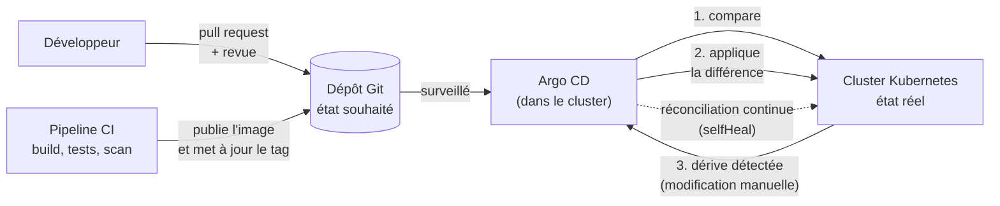

# GitOps et déploiement déclaratif

## Pourquoi ce cours ?

Quand une pipeline déploie avec `kubectl apply` ou un script, deux problèmes apparaissent. D'abord, la CI doit détenir des **identifiants puissants** du cluster. Ensuite, dès que quelqu'un modifie le cluster à la main (un `kubectl edit` « rapide »), l'état réel **dérive** de ce que décrivent les fichiers, sans que personne ne le voie. **GitOps** résout les deux : Git devient la **source de vérité unique** de l'état souhaité, et un **agent dans le cluster** tire cet état et le **réconcilie en continu**. On obtient l'audit gratuit (l'historique Git), le retour arrière par `git revert` et la détection de dérive.

> Prérequis : [Kubernetes approfondi](../../09-kubernetes-approfondi/README.md) (manifestes, namespaces, RBAC), [stratégies de déploiement](07-strategies-de-deploiement.md) et [artefacts](04-build-artefacts-et-registries.md).

## 1. Les principes de GitOps

Le groupe de travail **OpenGitOps** (CNCF) définit quatre principes :

| # | Principe | Signification |
|---|---|---|
| 1 | **Déclaratif** | Le système est décrit par son **état souhaité** (manifestes YAML), pas par une suite de commandes |
| 2 | **Versionné et immuable** | L'état souhaité est stocké dans **Git** : historique, revue de code, signatures |
| 3 | **Tiré automatiquement** (*pulled*) | Des agents **récupèrent** l'état depuis la source, plutôt que de le recevoir d'une pipeline |
| 4 | **Réconcilié en continu** | Les agents **comparent** l'état réel à l'état souhaité et **corrigent** les écarts |



> 📌 **À retenir** : la CI **ne déploie plus** : elle construit, teste, publie l'artefact et **modifie Git**. C'est l'agent GitOps qui déploie. Les identifiants du cluster ne quittent jamais le cluster.

### Push ou pull ?

| | **Push** (CI classique) | **Pull** (GitOps) |
|---|---|---|
| Qui applique ? | Pipeline externe | Agent **dans** le cluster |
| Identifiants du cluster | Stockés dans la CI (risque) | Restent dans le cluster |
| Dérive | Invisible | **Détectée / corrigée** |
| Retour arrière | Rejouer une pipeline | `git revert` |
| Audit | Journaux de CI | **Historique Git** (qui, quand, pourquoi) |
| Reconstruction d'un cluster | Rejouer les pipelines | Pointer un nouveau cluster vers le dépôt |

## 2. Argo CD

**Argo CD** (projet CNCF diplômé) est l'outil GitOps de référence pour Kubernetes. Il surveille un dépôt Git et synchronise un ou plusieurs clusters.

### La ressource `Application`

```yaml
apiVersion: argoproj.io/v1alpha1
kind: Application
metadata:
  name: api-production
  namespace: argocd
spec:
  project: default
  source:
    repoURL: https://github.com/org/config-plateforme.git   # dépôt de configuration
    targetRevision: main
    path: apps/api/overlays/production                       # dossier (Kustomize ou Helm)
  destination:
    server: https://kubernetes.default.svc                   # le cluster où tourne Argo CD
    namespace: api
  syncPolicy:
    automated:
      prune: true          # supprime du cluster ce qui n'est plus dans Git
      selfHeal: true       # annule les modifications manuelles (dérive)
    syncOptions:
      - CreateNamespace=true
    retry:
      limit: 3
      backoff: { duration: 10s, factor: 2, maxDuration: 3m }
```

| Champ | Rôle |
|---|---|
| `source` | **D'où** vient l'état voulu : dépôt, révision, chemin ; Helm/Kustomize/YAML bruts |
| `destination` | **Où** l'appliquer : cluster et namespace |
| `syncPolicy.automated` | Synchronisation **automatique** à chaque changement de Git (sinon, manuelle) |
| `prune` | **Supprime** les ressources retirées de Git (sinon elles restent « orphelines ») |
| `selfHeal` | **Rétablit** l'état de Git si quelqu'un modifie le cluster à la main |
| `syncOptions` | Comportements (création du namespace, validation…) |
| `project` | Périmètre et droits (quels dépôts, clusters, namespaces) |

États affichés : **Synced / OutOfSync** (conforme ou non à Git) et **Healthy / Progressing / Degraded** (santé des ressources).

```bash
argocd app list
argocd app diff api-production           # différences entre Git et le cluster
argocd app sync api-production           # synchronisation manuelle
argocd app rollback api-production       # retour à un déploiement précédent (préférer git revert)
```

> ⚠️ **Attention** : `prune: true` **supprime** des ressources. Testez d'abord en mode manuel, protégez les ressources sensibles (`argocd.argoproj.io/sync-options: Prune=false`) et séparez les projets : une erreur dans Git peut effacer un namespace entier.

### Plusieurs applications : *App of Apps* et `ApplicationSet`

Pour des dizaines d'applications ou de clusters, on déclare une **application racine** qui crée les autres (*App of Apps*), ou un **`ApplicationSet`** qui **génère** une `Application` par cluster, par dossier ou par pull request (environnements éphémères).

## 3. Flux CD (alternative)

**Flux** (CNCF diplômé) est l'autre grand outil GitOps, conçu comme un **ensemble de contrôleurs** (*GitOps Toolkit*) :

| Composant | Rôle |
|---|---|
| **source-controller** | Récupère Git, Helm, OCI, buckets |
| **kustomize-controller** | Applique les Kustomizations |
| **helm-controller** | Gère les `HelmRelease` |
| **notification-controller** | Alertes et webhooks |
| **image-automation** | Met à jour automatiquement les tags d'image dans Git |

| | **Argo CD** | **Flux CD** |
|---|---|---|
| Interface web | **Oui**, riche | Non native (Weave GitOps, Capacitor) |
| Philosophie | Application centrale, visualisation | Contrôleurs composables, 100 % CRD |
| Multi-clusters | Un Argo pilote plusieurs clusters | Un Flux par cluster (modèle plus décentralisé) |
| Mise à jour auto des images | Via Argo CD Image Updater | **Intégrée** |
| Courbe d'apprentissage | Douce (interface) | Plus « Kubernetes-natif » |

Les deux sont solides ; le choix dépend surtout du besoin d'interface et de multi-clusters.

## 4. Dépôt de configuration séparé

Une bonne pratique : **deux dépôts**.

| | **Dépôt applicatif** (`api`) | **Dépôt de configuration** (`config-plateforme`) |
|---|---|---|
| Contenu | Code source, Dockerfile, tests | Manifestes, charts, valeurs par environnement |
| Cycle | À chaque commit | À chaque **changement de déploiement** |
| Qui y écrit | Développeurs | CI (mise à jour du tag), équipe plateforme, via PR |
| Accès | Large | **Restreint**, revue obligatoire |

```text
config-plateforme/
├── apps/api/
│   ├── base/                    # manifestes communs
│   │   ├── deployment.yaml
│   │   ├── service.yaml
│   │   └── kustomization.yaml
│   └── overlays/
│       ├── staging/kustomization.yaml       # replicas: 2, image tag: sha-abc1234
│       └── production/kustomization.yaml    # replicas: 6, image tag: 1.4.2
└── clusters/
    └── production/applications.yaml          # les Application Argo CD
```

Avantages : l'historique de **déploiement** n'est pas mélangé à celui du code, les droits sont distincts (qui déploie ≠ qui développe), et un déploiement n'exige pas de rebuild. Le **flux de livraison** :

1. Un commit sur le dépôt applicatif déclenche la **CI** (build, tests, scan, signature, publication de l'image).
2. La CI ouvre une **pull request** sur le dépôt de configuration qui change le **tag/digest** pour *staging*.
3. Après fusion, **Argo CD** synchronise *staging*. Les tests de fumée s'exécutent.
4. La **promotion** en production = une PR (revue/approbation) qui change le tag de `production`.
5. Retour arrière = `git revert` de cette PR.

## 5. Kustomize et Helm

| | **Kustomize** | **Helm** |
|---|---|---|
| Principe | **Superposition** (*overlays*) de patchs sur des manifestes bruts | **Gabarits** (templates Go) paramétrés par des `values` |
| Intégré à `kubectl` | Oui (`kubectl apply -k`) | Non (outil séparé) |
| Atout | Pas de langage de gabarit, YAML valide à tout moment | Paquets versionnés, dépendances, partage (charts publics) |
| Limite | Moins adapté à de très gros paramétrages | Gabarits difficiles à lire/déboguer |
| Usage typique | Variantes par environnement de **vos** applications | Installer des logiciels tiers (Prometheus, Ingress…) |

```yaml
# overlays/production/kustomization.yaml
resources: [../../base]
images:
  - name: ghcr.io/org/api
    newTag: 1.4.2                      # CI : modifie cette ligne via une PR
patches:
  - target: { kind: Deployment, name: api }
    patch: |-
      - op: replace
        path: /spec/replicas
        value: 6
```

On combine souvent les deux : charts Helm pour les composants tiers, Kustomize pour vos applications ; Argo CD et Flux savent rendre l'un et l'autre.

> 💡 **Conseil** : **ne commitez pas de sortie générée** (le résultat de `helm template`). Laissez l'agent GitOps rendre les gabarits : Git contient la **source** (valeurs), pas la sortie.

## 6. Gérer les secrets en GitOps

Contradiction apparente : tout est dans Git, mais **jamais de secret en clair dans Git**. Trois approches :

| Approche | Principe | Outils |
|---|---|---|
| **Secrets chiffrés dans Git** | On commite un secret **chiffré** ; seul le cluster peut le déchiffrer | **Sealed Secrets** (clé asymétrique du cluster), **SOPS** (+ age/KMS) |
| **Secrets externes** | Git ne contient qu'une **référence** ; un opérateur récupère la valeur dans un coffre | **External Secrets Operator**, Secrets Store CSI Driver (Vault, AWS/GCP/Azure) |
| **Injection à l'exécution** | L'application lit le coffre directement | Vault Agent, identités de charge de travail |

```yaml
# Sealed Secrets : ce fichier est SÛR à commiter (chiffré avec la clé publique du cluster)
apiVersion: bitnami.com/v1alpha1
kind: SealedSecret
metadata: { name: db-credentials, namespace: api }
spec:
  encryptedData:
    password: AgBy8hCi…chiffré…
---
# External Secrets : seule la référence est dans Git
apiVersion: external-secrets.io/v1beta1
kind: ExternalSecret
metadata: { name: db-credentials, namespace: api }
spec:
  secretStoreRef: { name: coffre-prod, kind: ClusterSecretStore }
  target: { name: db-credentials }
  data:
    - secretKey: password
      remoteRef: { key: prod/api/db, property: password }
```

> ⚠️ **Attention** : un `Secret` Kubernetes n'est que de l'**encodage base64**, pas du chiffrement. Activez le chiffrement au repos d'`etcd`, limitez le RBAC et privilégiez les **secrets externes** pour les valeurs critiques (rotation centralisée, audit).

## 7. Adopter GitOps : pièges et bonnes pratiques

| Piège | Réponse |
|---|---|
| Modifications manuelles en urgence | `selfHeal` les annule : prévoir une **procédure de dérogation** (mettre l'application en pause, corriger, puis reporter dans Git) |
| Boucle de synchronisation (champ modifié par un autre contrôleur, comme les `replicas` d'un HPA) | Configurer `ignoreDifferences` |
| Ordre des ressources (CRD avant ressources) | `sync-waves` et hooks (`PreSync`, `PostSync`) |
| Dépôt unique « fourre-tout » | Structurer par application/environnement, droits distincts |
| Promotion entre environnements fastidieuse | Automatiser les PR de promotion, ou utiliser Kargo/Argo CD Image Updater |
| Migrations de base de données | Jobs `PreSync` avec la méthode expand/contract ([cours 7](07-strategies-de-deploiement.md)) |
| Pas de visibilité | Notifications (Slack), métriques d'Argo CD dans [Prometheus](../../10-monitoring-observabilite/README.md) |

GitOps rejoint la **fiabilité** : la dérive supprimée, les changements tracés et les retours arrière rapides améliorent les métriques DORA (délai de livraison, temps de rétablissement) décrites dans le [premier cours](01-introduction-cicd.md).

## Résumé

- **GitOps** : état souhaité **déclaratif** et **versionné** dans Git, **tiré** par un agent qui **réconcilie en continu** ; la CI construit et met à jour Git, elle ne déploie plus.
- **Argo CD** : `Application` (`source`, `destination`, `syncPolicy.automated` avec `prune` et `selfHeal`) ; **Flux CD** : contrôleurs composables.
- **Dépôt de configuration séparé** avec *overlays* par environnement ; promotion par PR, rollback par `git revert`.
- **Kustomize** (patchs) et **Helm** (gabarits) ; **secrets** : Sealed Secrets/SOPS (chiffrés) ou External Secrets (références).
- Attention à `prune`, aux modifications manuelles et à l'ordre de synchronisation.

## Pour aller plus loin

- OpenGitOps : <https://opengitops.dev/> ; Argo CD : <https://argo-cd.readthedocs.io/> ; Flux : <https://fluxcd.io/docs/>.
- Sealed Secrets : <https://github.com/bitnami-labs/sealed-secrets> ; External Secrets : <https://external-secrets.io/>.
- Retour au [sommaire du module 12](../README.md), puis le module [Monitoring et observabilité](../../10-monitoring-observabilite/README.md) pour observer ce que vous livrez.
