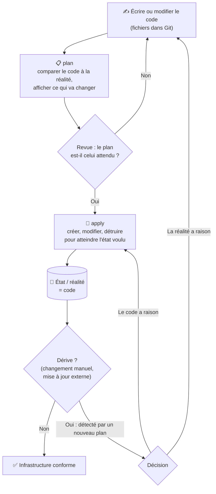

# Introduction à l'Infrastructure as Code

## Pourquoi ce cours ?

Imaginez qu'on vous demande de recréer, à l'identique, l'infrastructure de production : 12 serveurs, 3 réseaux, un équilibreur de charge, des règles de pare-feu, des comptes. Si elle a été construite **à la main** (clics dans une console, commandes tapées « de mémoire », correctifs d'urgence jamais notés), c'est impossible : personne ne sait plus ce qui existe réellement ni pourquoi. Chaque serveur est un **flocon de neige** unique, fragile, que l'on n'ose plus toucher.

L'**Infrastructure as Code** (IaC) résout ce problème : on **décrit l'infrastructure dans des fichiers**, versionnés dans Git, et un outil la **crée, la modifie et la détruit** à partir de cette description. L'infrastructure devient **reproductible, relue, testée et auditable** comme du code. C'est la brique qui vient naturellement après le [CI/CD](../../12-cicd/cours/01-introduction-cicd.md) : celui-ci déploie des applications, l'IaC **fournit l'infrastructure qui les reçoit**.

> Prérequis : [Linux](../../04-linux-expert/README.md), [réseaux](../../06-reseaux-devops/README.md) et [Git](../../07-git-branching-interactif/README.md). Les notions de cloud public seront approfondies plus tard : ce module s'appuie surtout sur des exemples locaux, faciles à reproduire.

## 1. Qu'est-ce que l'IaC ?

| Sans IaC (« ClickOps ») | Avec IaC |
|---|---|
| Configuration par console web ou commandes manuelles | Configuration décrite dans des **fichiers texte** |
| Connaissance dans la tête de quelques personnes | Connaissance **dans le dépôt Git** |
| Environnements qui divergent (dev ≠ prod) | Mêmes fichiers, **paramétrés** par environnement |
| Reconstruire = des jours, avec des oublis | Reconstruire = **une commande** |
| Pas d'historique, pas de revue | Historique Git, **revue de code**, retour arrière |
| Erreurs humaines fréquentes | Changements **prévisibles** (`plan`) et rejouables |

Le terme recouvre deux grandes familles d'outils :

| Famille | Rôle | Exemples |
|---|---|---|
| **Provisioning** (approvisionnement) | **Créer** l'infrastructure : réseaux, machines, bases, DNS, comptes | Terraform, OpenTofu, Pulumi, CloudFormation |
| **Gestion de configuration** | **Configurer** ce qui tourne dans les machines : paquets, fichiers, services, utilisateurs | Ansible, Puppet, Chef, Salt |

> 📌 **À retenir** : l'IaC n'est pas un outil, c'est une **pratique** : *tout ce qui peut être décrit dans un fichier l'est, et tout changement passe par ce fichier*. Les outils ne sont que le moyen.

## 2. Déclaratif ou impératif ?

Il y a deux façons de décrire un résultat.

| | **Impératif** (« comment faire ») | **Déclaratif** (« ce que je veux ») |
|---|---|---|
| Principe | Une **suite d'instructions** exécutées dans l'ordre | Une **description de l'état final** voulu |
| Exemple | « Crée le disque, puis la VM, puis attache le disque » | « Il doit exister une VM avec ce disque » |
| Rejouer | Peut créer des doublons ou échouer | L'outil **compare** et ne fait que **la différence** |
| Exemple d'outil | Script Bash, `aws ec2 run-instances` | Terraform (HCL), Kubernetes (YAML) |

```bash
# Impératif : si on le lance deux fois, on obtient DEUX serveurs
create-server --name web01 --size small

# Déclaratif (HCL, vu au cours suivant) : relancé dix fois, il y a TOUJOURS un seul web01
# resource "serveur" "web01" { taille = "small" }
```

Ansible se situe **entre les deux** : un playbook est écrit comme une suite de tâches (impératif en apparence), mais chaque module décrit un **état** (« le paquet nginx est présent ») et se comporte donc de façon déclarative.

## 3. L'idempotence

Une opération est **idempotente** si l'exécuter **une ou plusieurs fois** donne **le même résultat** final.

| Idempotent | Non idempotent |
|---|---|
| `mkdir -p /srv/app` | `mkdir /srv/app` (erreur au 2ᵉ appel) |
| « Le paquet nginx est installé » | `apt install nginx` lancé par un script qui ajoute des lignes à chaque fois |
| `echo "x" > fichier` (écrase) | `echo "x" >> fichier` (ajoute à chaque exécution) |
| Terraform `apply` | Un script qui crée une VM à chaque exécution |

L'idempotence est la **propriété clé** de l'IaC : elle permet de **relancer** sans crainte, de **corriger un écart** (la dérive) en rejouant, et d'intégrer l'infrastructure dans un **pipeline** automatique. Dans Ansible, elle se lit dans le résultat : `ok` (rien à faire) ou `changed` (quelque chose a été modifié) ; au deuxième passage, **tout doit être `ok`** (`changed=0`).

> 💡 **Conseil** : pour tester l'idempotence d'un playbook ou d'un module Terraform, lance-le **deux fois de suite** : le second passage ne doit **rien changer**. C'est le test le plus simple et le plus efficace, que vous ferez dans les ateliers.

## 4. Infrastructure mutable ou immuable

| | **Mutable** | **Immuable** |
|---|---|---|
| Principe | On **modifie** les serveurs existants (mises à jour sur place) | On **remplace** le serveur par un neuf, jamais on ne le modifie |
| Outil typique | Ansible sur des machines durables | Packer + Terraform, conteneurs |
| Avantage | Simple, rapide pour de petits changements | Pas de dérive, retour arrière trivial |
| Risque | **Dérive de configuration** (*configuration drift*) | Demande des images/artefacts bien construits |

On parle de **« pets » contre « cattle »** : des **animaux de compagnie** (serveurs uniques, soignés à la main) contre du **bétail** (serveurs interchangeables, remplacés sans état d'âme). L'IaC pousse vers le bétail.

## 5. Pourquoi Git et l'IaC vont ensemble

Comme l'infrastructure est du texte, on lui applique **toute la discipline du code** :

- **Historique** : qui a changé quoi, quand, pourquoi (`git log`, `git blame`).
- **Revue** : une *pull request* sur l'infrastructure est relue **avant** application, avec le résultat prévisible (`plan`) en commentaire.
- **Retour arrière** : `git revert` puis rejouer = retour à l'état précédent.
- **Branches** : tester un changement sur un environnement de test avant la production.
- **Audit et conformité** : l'historique Git prouve qui a autorisé chaque modification.
- **Source de vérité unique** : le dépôt dit ce qui **devrait** exister (voir [GitOps](../../12-cicd/cours/08-gitops-et-deploiement-declaratif.md)).

## 6. Le cycle de vie et la dérive

La **dérive** (*drift*) est l'écart entre **ce que décrit le code** et **ce qui existe réellement** : un collègue ouvre un port « en urgence » dans la console, une mise à jour automatique modifie un fichier. Sans IaC, cette dérive est **invisible** ; avec elle, on la **détecte** (en comparant) et on la **corrige**.



Deux issues quand une dérive est détectée : soit le **code a raison** et on **réapplique** pour remettre la réalité en conformité, soit la **réalité a raison** (un correctif légitime fait à la main) et on **met le code à jour** pour qu'il la reflète.

> ⚠️ **Attention** : un changement manuel « juste pour dépanner » est la cause n°1 de dérive. Si l'urgence l'impose, **reporte-le dans le code dans l'heure** ; sinon le prochain `apply` l'annulera, ou pire, personne n'osera plus relancer l'outil.

## 7. Panorama des outils

| Outil | Type | Langage | Particularités |
|---|---|---|---|
| **Terraform** (HashiCorp) | Provisioning, déclaratif | **HCL** | Le standard ; des milliers de *providers* ; fichier d'état ; licence **BSL** depuis 2023 |
| **OpenTofu** | Provisioning, déclaratif | HCL | **Fork libre** de Terraform (Linux Foundation, licence MPL 2.0), commande `tofu`, très compatible |
| **Ansible** (Red Hat) | Configuration et orchestration | **YAML** | **Sans agent** (SSH), simple à lire ; modules idempotents |
| **Pulumi** | Provisioning, déclaratif | Python, TypeScript, Go, C#… | On écrit l'infrastructure dans un **vrai langage de programmation** |
| **AWS CloudFormation** | Provisioning, déclaratif | YAML / JSON | Natif **AWS** uniquement (équivalents : **Bicep** pour Azure, Deployment Manager pour GCP) |
| **Crossplane** | Provisioning, déclaratif | YAML (CRD Kubernetes) | L'infrastructure cloud pilotée **depuis Kubernetes** |
| **Puppet, Chef, Salt** | Gestion de configuration | DSL Ruby, YAML | Plus anciens, souvent avec **agent** |

> 💡 **Conseil** : n'essaie pas de tout apprendre. Le tandem **Terraform (ou OpenTofu) + Ansible** couvre la majorité des besoins et reste le plus demandé. Ce module leur est consacré ; les concepts se transposent aux autres outils.

## Résumé

- L'**IaC** décrit l'infrastructure dans des **fichiers versionnés** ; l'outil la crée et la maintient. Elle rend l'infrastructure **reproductible, relue, auditable**.
- **Déclaratif** (état final voulu) ou **impératif** (suite d'instructions) ; Terraform est déclaratif, Ansible l'est via ses modules.
- L'**idempotence** (rejouer = même résultat) est la propriété clé : on la teste en lançant **deux fois**.
- **Mutable** (on modifie) ou **immuable** (on remplace) ; l'IaC encourage le « bétail » plutôt que les « animaux de compagnie ».
- Cycle : **écrire → plan → revue → apply → détecter la dérive → corriger**.
- Outils : **Terraform/OpenTofu** (provisioning), **Ansible** (configuration), Pulumi, CloudFormation, Crossplane.

## Pour aller plus loin

- *Infrastructure as Code* (Kief Morris, O'Reilly) ; *Terraform: Up & Running* (Yevgeniy Brikman).
- Documentation : <https://developer.hashicorp.com/terraform/docs> ; <https://opentofu.org/docs/> ; <https://docs.ansible.com/>.
- Cours suivant : [Terraform : les fondamentaux](02-terraform-fondamentaux.md).
- Pratique : [Premier projet Terraform](../ateliers-killercoda/atelier-01-premier-projet-terraform/intro.md).
