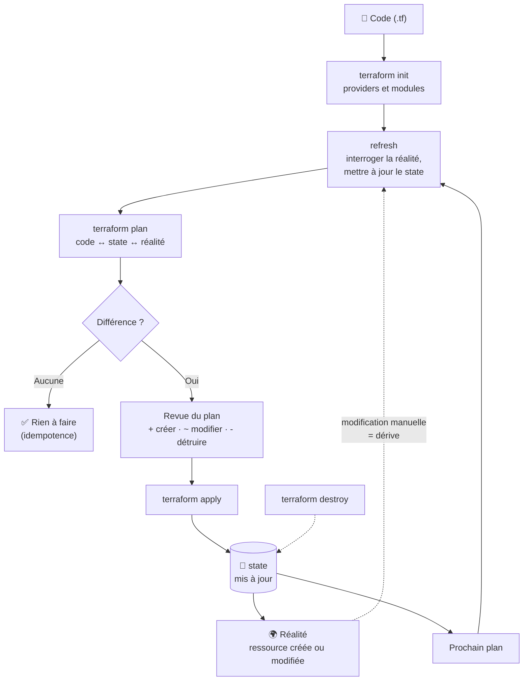

# Terraform : les fondamentaux

## Pourquoi ce cours ?

Terraform est l'outil d'IaC le plus répandu : avec **un seul langage** (HCL) et **une seule commande** (`terraform apply`), on crée et on maintient des ressources chez **n'importe quel fournisseur** (AWS, Azure, Google Cloud, Kubernetes, DNS, GitHub…) grâce à des *providers*. Son idée centrale : il garde une **mémoire de ce qu'il a créé** (le *state*, l'état), compare le code à cette mémoire et à la réalité, puis n'exécute **que la différence**. Ce cours en pose les bases ; le [suivant](03-terraform-avance.md) traite de modules, d'import et de tests.

> Prérequis : [Introduction à l'IaC](01-introduction-iac.md). Les exemples utilisent surtout les providers **`local`** et **`random`**, qui ne demandent **aucun compte cloud** : on voit les mêmes mécanismes qu'avec un vrai cloud, sans rien facturer.

## 1. HCL : le langage de Terraform

**HCL** (*HashiCorp Configuration Language*) est un langage de configuration lisible. Les fichiers se terminent par `.tf`. Tout est fait de **blocs** et d'**arguments** :

```hcl
terraform {                               # bloc de configuration de Terraform lui-même
  required_version = ">= 1.5"
  required_providers {
    local = {
      source  = "hashicorp/local"
      version = "~> 2.5"                  # 2.5.x et suivants, mais jamais 3.x
    }
  }
}

resource "local_file" "bienvenue" {       # bloc : <type de ressource> "<nom local>"
  filename = "${path.module}/sortie/bienvenue.txt"     # argument = expression
  content  = "Bonjour depuis Terraform\n"
}
```

| Élément | Rôle |
|---|---|
| **Bloc** (`resource "type" "nom" { … }`) | Une unité de configuration |
| **Argument** (`clé = valeur`) | Un paramètre du bloc |
| **Expression** | Une valeur calculée : littéral, référence (`var.nom`), fonction (`upper(...)`), interpolation (`"${...}"`) |
| `#` ou `//` / `/* */` | Commentaires |
| Types | `string`, `number`, `bool`, `list(...)`, `map(...)`, `object({...})`, `set(...)` |

Terraform lit **tous les `.tf` du dossier**, sans ordre : on les range par habitude en `main.tf` (ressources), `variables.tf`, `outputs.tf`, `providers.tf`, `versions.tf`.

## 2. Providers et ressources

- Un **provider** est un **plugin** qui sait parler à une API (AWS, Kubernetes, `local`, `random`…). Il est téléchargé depuis le **registre** (`registry.terraform.io`) par `terraform init`.
- Une **resource** est un **objet géré** par Terraform : un fichier, une VM, un bucket, un enregistrement DNS. Elle est identifiée par `type.nom` (`local_file.bienvenue`).
- Un **data source** (`data "..." "..." {}`) **lit** quelque chose qui existe déjà **sans le gérer** (une image, un VPC existant, un fichier).

```hcl
provider "local" {}                       # (pas de paramètre ici ; avec un cloud : région, identifiants…)

resource "random_pet" "nom" {             # génère un nom aléatoire mémorisé dans le state
  length = 2
}

resource "local_file" "serveur" {
  filename = "${path.module}/sortie/${random_pet.nom.id}.txt"
  content  = "Serveur ${random_pet.nom.id}\n"
}

data "local_file" "existant" {            # LIT un fichier : ne le crée ni ne le modifie
  filename = "/etc/hostname"
}
```

> 💡 **Conseil** : **épingle toujours** la version des providers (`version = "~> 2.5"`). Sans cela, un `init` futur peut télécharger une version majeure aux comportements différents. Le fichier **`.terraform.lock.hcl`**, créé par `init`, enregistre les versions et les empreintes exactes : **commite-le** dans Git.

## 3. Variables, locals et outputs

```hcl
variable "environnement" {
  type        = string
  description = "Nom de l'environnement (dev, staging, prod)"
  default     = "dev"
  validation {
    condition     = contains(["dev", "staging", "prod"], var.environnement)
    error_message = "L'environnement doit être dev, staging ou prod."
  }
}

variable "mot_de_passe" {
  type      = string
  sensitive = true                        # masqué dans les affichages (pas dans le state !)
}

locals {                                  # valeurs calculées réutilisables
  prefixe = "app-${var.environnement}"
}

output "fichier" {
  description = "Chemin du fichier créé"
  value       = local_file.serveur.filename
}
```

| Concept | Rôle | Se référence par |
|---|---|---|
| `variable` | **Entrée** du code (paramètre) | `var.nom` |
| `locals` | **Calcul interne**, pour éviter les répétitions | `local.nom` |
| `output` | **Sortie** : affichée à la fin, utilisable par un autre module ou script | `terraform output nom` |

Plusieurs façons de **fournir une valeur** à une variable, de la moins à la plus prioritaire :

1. la valeur `default` ;
2. un fichier `terraform.tfvars` ou `*.auto.tfvars` (chargés automatiquement) ;
3. `-var-file=prod.tfvars` ;
4. `-var="environnement=prod"` ;
5. la variable d'environnement `TF_VAR_environnement=prod`.

> ⚠️ **Attention** : `sensitive = true` ne fait que **masquer** la valeur à l'écran. Elle reste **en clair dans le fichier d'état**. Ne mets **jamais** un secret dans un `.tfvars` commité dans Git (voir [bonnes pratiques](07-bonnes-pratiques-iac.md)).

## 4. Les commandes essentielles

```bash
terraform init          # télécharge les providers et modules, prépare le dossier de travail
terraform fmt           # reformate le code (style canonique)
terraform validate      # vérifie la syntaxe et la cohérence interne (sans rien contacter)
terraform plan          # compare code ↔ state ↔ réalité, AFFICHE ce qui va changer (ne change rien)
terraform apply         # exécute le plan, après confirmation (-auto-approve pour passer outre)
terraform destroy       # détruit TOUT ce que cette configuration gère
terraform output        # affiche les sorties
terraform show          # affiche l'état actuel de façon lisible
```

Dans un plan, les symboles se lisent ainsi :

| Symbole | Signification |
|---|---|
| `+` | Ressource à **créer** |
| `~` | Ressource à **modifier sur place** |
| `-` | Ressource à **détruire** |
| `-/+` | Ressource à **détruire puis recréer** (changement qui ne peut pas se faire sur place) |

```text
Plan: 1 to add, 0 to change, 0 to destroy.
```

> 📌 **À retenir** : **lis toujours le plan** avant `apply`, surtout les `-` et `-/+`. Un champ innocent renommé peut provoquer la **destruction puis la recréation** d'une base de données. `terraform plan -out=plan.tfplan` puis `terraform apply plan.tfplan` garantit qu'on applique **exactement** ce qui a été relu.

## 5. Le state (l'état)

Terraform conserve la correspondance entre **vos blocs** et **les objets réels** dans un fichier d'**état** (`terraform.tfstate`, du JSON). Sans lui, Terraform ne saurait pas que `local_file.bienvenue` correspond au fichier `/tmp/x/bienvenue.txt`.

```bash
terraform state list                            # ressources suivies
terraform state show local_file.bienvenue       # détail d'une ressource
terraform state mv ancien.nom nouveau.nom       # renommer sans détruire
terraform state rm local_file.bienvenue         # cesser de gérer (sans détruire l'objet réel)
```

### State local ou distant ?

| | **Local** (`terraform.tfstate` dans le dossier) | **Distant** (backend) |
|---|---|---|
| Équipe | ❌ Un seul poste ; conflits dès qu'on est deux | ✅ **Partagé**, accessible à toute l'équipe et à la CI |
| Verrouillage | ❌ Aucun | ✅ **Verrou** : un seul `apply` à la fois |
| Sauvegarde | ❌ À votre charge | ✅ Versionné, répliqué |
| Sécurité | ❌ Fichier en clair sur un disque | ✅ Chiffré, accès contrôlé |
| Usage | Apprendre, essais | **Tout travail réel** |

Exemples de *backends* :

```hcl
terraform {
  backend "s3" {                       # AWS S3 (ou un stockage compatible S3 : MinIO, Ceph…)
    bucket       = "mon-equipe-tfstate"
    key          = "prod/reseau.tfstate"
    region       = "eu-west-3"
    encrypt      = true                # chiffrement côté serveur
    use_lockfile = true                # verrouillage natif S3 (Terraform ≥ 1.10) ; auparavant : une table DynamoDB
  }
}
```

Autres choix : **HCP Terraform** (Terraform Cloud, service managé avec runs distants), l'état géré par **GitLab**, `azurerm` (Azure Storage), `gcs` (Google Cloud Storage), `pg` (PostgreSQL), `http`. Pour migrer : `terraform init -migrate-state`.

> ⚠️ **Attention** : le state contient **toutes les valeurs des ressources, secrets compris, en clair** (mots de passe générés, clés). **Ne le commite jamais dans Git**, restreins l'accès au backend et active le chiffrement. Ajoute `*.tfstate*` et `.terraform/` au `.gitignore`.

## 6. Dépendances entre ressources

Terraform construit un **graphe de dépendances** et crée en parallèle tout ce qui est indépendant.

- **Dépendance implicite** : une ressource **référence** une autre (`random_pet.nom.id`). Terraform en déduit l'ordre ; c'est le cas général, à privilégier.
- **Dépendance explicite** : `depends_on = [ressource]`, quand le lien existe **sans référence** (par exemple une règle de pare-feu qui doit exister avant qu'un serveur démarre).

```hcl
resource "local_file" "config" {
  filename = "${path.module}/sortie/config.txt"
  content  = "serveur=${random_pet.nom.id}\n"   # référence → dépendance implicite
}

resource "local_file" "readme" {
  filename   = "${path.module}/sortie/LISEZMOI.txt"
  content    = "Voir config.txt\n"
  depends_on = [local_file.config]              # dépendance explicite
}
```

```bash
terraform graph | dot -Tpng > graphe.png        # visualiser le graphe (nécessite graphviz)
```

## 7. Le cycle de vie d'une ressource



À chaque `plan` (et `apply`), Terraform commence par un **refresh** : il interroge l'API réelle, met le state à jour, puis compare au code. C'est ainsi qu'il **détecte la dérive** : si un objet a changé hors de Terraform, le plan montre l'écart à corriger.

## Résumé

- **HCL** : blocs (`resource`, `variable`, `output`, `provider`, `terraform`…), arguments, expressions ; tous les `.tf` du dossier sont lus.
- **Providers** (plugins téléchargés par `init`, versions épinglées, `.terraform.lock.hcl` commité), **resources** (objets gérés), **data sources** (lecture seule).
- **Variables** (entrées), **locals** (calculs), **outputs** (sorties) ; `sensitive` masque mais ne protège pas.
- Cycle : `init` → `fmt` / `validate` → **`plan`** (toujours relu) → `apply` → `destroy`.
- Le **state** relie le code à la réalité : **distant, verrouillé, chiffré** en équipe ; **jamais** dans Git ; il contient des secrets en clair.
- Dépendances **implicites** (références, à privilégier) et **explicites** (`depends_on`) ; le graphe permet le parallélisme.

## Pour aller plus loin

- Documentation : <https://developer.hashicorp.com/terraform/language> ; registre : <https://registry.terraform.io/>.
- Fonctions utiles : `format`, `join`, `lookup`, `merge`, `cidrsubnet`, `templatefile`, `file` (`terraform console` pour les essayer).
- Cours suivant : [Terraform avancé](03-terraform-avance.md).
- Pratique : [Premier projet Terraform](../ateliers-killercoda/atelier-01-premier-projet-terraform/intro.md).
