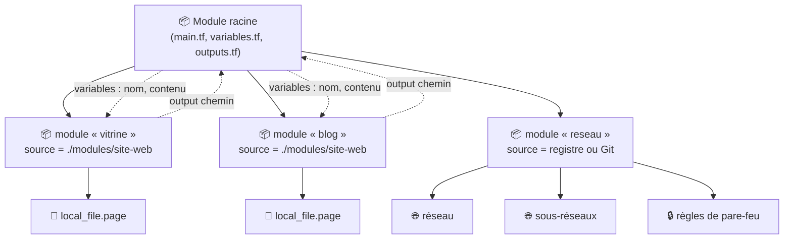

# Terraform avancé

## Pourquoi ce cours ?

Un premier projet Terraform tient dans un dossier et quelques fichiers. Puis l'infrastructure grandit : trois environnements, des dizaines de ressources presque identiques, plusieurs équipes, un état partagé qu'on n'ose plus toucher. Sans méthode, le code se **copie-colle**, les modifications deviennent risquantes et une erreur de manipulation peut **détruire une base de données**. Ce cours donne les outils pour **structurer** (modules), **dupliquer proprement** (`for_each`), **faire évoluer sans casser** (`moved`, `import`, `lifecycle`), **vérifier** (`terraform test`) et **protéger** l'état. Il présente aussi **OpenTofu**, le fork libre de Terraform.

> Prérequis : [Terraform : les fondamentaux](02-terraform-fondamentaux.md) (HCL, `plan`/`apply`, state).

## 1. Les modules : réutiliser et structurer

Un **module** est un **dossier de fichiers `.tf`** que l'on appelle depuis un autre. Tout projet Terraform est déjà un module : le **module racine** (*root module*), celui d'où l'on lance `terraform`. Il peut **appeler** des **modules enfants**.

```text
mon-projet/                      ← module RACINE (on y lance terraform)
├── main.tf
├── variables.tf
├── outputs.tf
└── modules/
    └── site-web/                ← module ENFANT, réutilisable
        ├── main.tf              (les ressources)
        ├── variables.tf         (ses ENTRÉES)
        └── outputs.tf           (ses SORTIES)
```

```hcl
# modules/site-web/variables.tf
variable "nom" {
  type = string
}

variable "contenu" {
  type    = string
  default = "Bonjour"
}

# modules/site-web/main.tf
resource "local_file" "page" {
  filename = "${path.root}/sortie/${var.nom}/index.html"
  content  = "<h1>${var.contenu} ${var.nom}</h1>\n"
}

# modules/site-web/outputs.tf
output "chemin" { value = local_file.page.filename }

# main.tf (racine) : on APPELLE le module, une fois par site
module "vitrine" {
  source  = "./modules/site-web"
  nom     = "vitrine"
}
module "blog" {
  source  = "./modules/site-web"
  nom     = "blog"
  contenu = "Bienvenue sur le blog de"
}

output "pages" { value = [module.vitrine.chemin, module.blog.chemin] }
```

| Notion | Détail |
|---|---|
| **`source`** | Chemin local (`./modules/…`), dépôt Git (`git::https://…?ref=v1.2.0`) ou **registre** (`terraform-aws-modules/vpc/aws`) |
| **`version`** | Pour un module de registre : `version = "~> 5.0"` (toujours épingler) |
| **Entrées / sorties** | Un module n'accède qu'à ses **variables** ; il ne « voit » pas le reste. Il expose des `output` |
| **Adresse dans le state** | `module.vitrine.local_file.page` : le nom du module préfixe la ressource |

> 💡 **Conseil** : écris un module quand tu **répètes un même assemblage** deux fois ou plus (réseau + sous-réseaux, VM + disque + règles). Évite le sur-module : un module qui enveloppe **une seule** ressource sans valeur ajoutée complique plutôt qu'il ne simplifie.



## 2. Plusieurs environnements : workspaces ou répertoires ?

Comment appliquer le **même code** à `dev`, `staging` et `prod` ?

| | **Workspaces** (`terraform workspace`) | **Répertoires séparés** (un dossier par environnement) |
|---|---|---|
| Principe | Un **même code**, **plusieurs states** nommés dans un même backend | Un dossier par environnement, qui **appelle les mêmes modules** |
| Commandes | `terraform workspace new prod`, `select`, `list` | `cd envs/prod && terraform apply` |
| Isolation | **Faible** : même backend, mêmes identifiants, même code (on s'y trompe de workspace) | **Forte** : state, backend et droits **distincts** par environnement |
| Différences entre environnements | Via `terraform.workspace` et des conditions, vite illisible | Variables et modules **explicites** par dossier |
| Usage conseillé | Environnements **éphémères** (une branche = un workspace) | **Dev / staging / prod** durables |

```text
infra/
├── modules/                    # le code réutilisable
│   ├── reseau/
│   └── application/
└── envs/                       # un dossier PAR environnement, chacun avec son state
    ├── dev/      main.tf  terraform.tfvars  backend.tf
    ├── staging/  main.tf  terraform.tfvars  backend.tf
    └── prod/     main.tf  terraform.tfvars  backend.tf
```

> 📌 **À retenir** : pour la **production**, préfère des **répertoires séparés** (ou des outils comme Terragrunt) : une erreur de workspace ne doit pas pouvoir détruire la prod. Les workspaces conviennent aux environnements jetables.

## 3. Créer plusieurs ressources : `count`, `for_each`, `dynamic`

```hcl
# count : N copies identiques, repérées par un NUMÉRO (0, 1, 2…)
resource "local_file" "noeud" {
  count    = 3
  filename = "${path.module}/sortie/noeud-${count.index}.txt"
  content  = "noeud ${count.index}\n"
}

# for_each : une ressource PAR ÉLÉMENT d'une map ou d'un set, repérée par sa CLÉ
variable "services" {
  type    = map(string)
  default = { web = "80", api = "8080", db = "5432" }
}

resource "local_file" "service" {
  for_each = var.services
  filename = "${path.module}/sortie/${each.key}.conf"
  content  = "port=${each.value}\n"
}
```

| | `count` | `for_each` |
|---|---|---|
| Identifiant dans le state | **Numéro** : `local_file.noeud[0]` | **Clé** : `local_file.service["web"]` |
| Supprimer un élément du milieu | ⚠️ Les suivants **changent de numéro** : Terraform détruit et recrée | ✅ Seule la ressource de la clé supprimée disparaît |
| Condition « créer ou non » | `count = var.actif ? 1 : 0` | `for_each = var.actif ? { x = 1 } : {}` |
| À préférer | Cas simples (0 ou 1 ressource) | **Collections nommées** (le plus souvent) |

> ⚠️ **Attention** : avec `count`, supprimer `noeud-1` d'une liste de trois **décale** le dernier : Terraform veut détruire l'ancien `noeud-2` et le recréer. Sur des serveurs, c'est une panne. **`for_each` avec des clés stables** évite ce piège.

Pour répéter un **sous-bloc** (par exemple des règles de pare-feu), on utilise `dynamic` :

```hcl
dynamic "ingress" {
  for_each = var.ports
  content {
    from_port = ingress.value
    to_port   = ingress.value
  }
}
```

## 4. Faire évoluer sans casser : `moved`, `import`, `lifecycle`

### `moved` : renommer ou déplacer sans détruire

Si tu renommes une ressource dans le code, Terraform croit à une **suppression** suivie d'une **création**. Un bloc `moved` (Terraform ≥ 1.1) lui dit que c'est le **même objet** :

```hcl
moved {
  from = local_file.ancien_nom
  to   = local_file.nouveau_nom
}
```

Il sert aussi pour passer une ressource **dans un module**, ou de `count` à `for_each`. Une fois appliqué partout, on peut le retirer (ou le garder comme historique).

### `import` : reprendre en main une ressource existante

Pour mettre sous Terraform quelque chose créé **à la main** :

```hcl
import {                                  # Terraform ≥ 1.5 : bloc déclaratif, vérifiable avec plan
  to = local_file.existant
  id = "/etc/motd"
}
```

```bash
terraform plan -generate-config-out=genere.tf    # (≥ 1.5) génère le code HCL de la ressource importée
terraform import local_file.existant /etc/motd   # ancienne commande impérative, toujours valable
```

Après un `import`, un `plan` doit annoncer **« No changes »** : sinon, ton code ne décrit pas fidèlement l'existant.

### `lifecycle` : garde-fous et comportements

```hcl
resource "local_file" "critique" {
  filename = "${path.module}/sortie/donnees.txt"
  content  = "important\n"

  lifecycle {
    prevent_destroy       = true                  # tout plan qui détruirait cette ressource ÉCHOUE
    create_before_destroy = true                  # crée le remplaçant AVANT de détruire l'ancien
    ignore_changes        = [content]             # ignore les modifications externes de cet argument
    replace_triggered_by  = [random_pet.version]  # force le remplacement quand une autre ressource change
  }
}
```

| Option | Quand l'utiliser |
|---|---|
| `prevent_destroy` | Bases de données, stockage de données : une erreur ne doit **pas** pouvoir les supprimer |
| `create_before_destroy` | Remplacement **sans interruption** (équilibreur, certificat) |
| `ignore_changes` | Un autre système modifie légitimement un champ (étiquettes ajoutées par une politique, nombre d'instances géré par un autoscaler) |
| `precondition` / `postcondition` | Vérifier des hypothèses (« l'image existe », « le disque fait ≥ 50 Go ») avec un message clair |

> ⚠️ **Attention** : `prevent_destroy` n'empêche pas `terraform destroy` de **s'arrêter en erreur** ; il n'empêche pas de **retirer le bloc** puis de détruire. C'est un garde-fou contre l'accident, pas contre la malveillance : ajoute des **droits restreints** et une **revue** sur les changements d'infrastructure sensibles.

## 5. Les provisioners : et pourquoi les éviter

Les **provisioners** (`local-exec`, `remote-exec`, `file`) exécutent des commandes **pendant** la création d'une ressource :

```hcl
resource "terraform_data" "demo" {
  provisioner "local-exec" {
    command = "echo 'serveur créé' >> journal.txt"
  }
}
```

Terraform les présente lui-même comme **un dernier recours**. Les raisons :

| Problème | Conséquence |
|---|---|
| Les commandes **ne font pas partie du modèle déclaratif** : Terraform ne sait ni les rejouer, ni détecter une dérive | Pas d'idempotence : le résultat dépend de l'état de la machine |
| Un échec laisse la ressource **« tainted »** (à recréer) | Recréations inattendues |
| Elles supposent un **accès réseau/SSH** au moment de la création | Fragile, lent, difficile à tester |
| Elles mélangent **provisioning** et **configuration** | Une responsabilité de trop |

À la place : **cloud-init** / *user data* (la machine se configure au démarrage), des **images pré-construites** (Packer), ou **Ansible** exécuté après coup (voir [Terraform vs Ansible](06-terraform-vs-ansible.md)). Pour une **action unique** sans ressource, utilise la ressource `terraform_data`.

## 6. Tester son code Terraform

| Niveau | Outil | Ce qu'il vérifie |
|---|---|---|
| Syntaxe et cohérence | `terraform fmt -check`, `terraform validate` | Format, références, types |
| Analyse statique | `tflint`, `trivy config`, `checkov` | Mauvaises pratiques, **failles de configuration** |
| Test natif | **`terraform test`** (≥ 1.6) | Le module **se comporte comme attendu** |
| Test d'intégration | **Terratest** (Go) | Déploie réellement, vérifie, détruit |

Un test natif est un fichier `*.tftest.hcl` :

```hcl
# tests/site-web.tftest.hcl
variables {
  nom = "test"
}

run "cree_la_page" {
  command = apply                      # (ou plan : vérifie sans créer)

  assert {
    condition     = fileexists("${path.root}/sortie/test/index.html")
    error_message = "La page d'accueil n'a pas été créée."
  }
  assert {
    condition     = strcontains(local_file.page.content, "test")
    error_message = "Le contenu ne mentionne pas le nom du site."
  }
}
```

```bash
terraform test                         # exécute tous les tests, puis détruit ce qu'il a créé
```

Depuis Terraform 1.7, on peut **simuler** un provider (`mock_provider`) pour tester **sans cloud réel** ni coût.

## 7. Sécuriser le state

Le fichier d'état est **la ressource la plus sensible** d'un projet Terraform : il contient **toutes les valeurs, secrets compris**.

| Mesure | Détail |
|---|---|
| **Backend distant** | S3 / GCS / Azure Blob / HCP Terraform : jamais de state local en équipe |
| **Chiffrement au repos** | `encrypt = true` (S3), clés KMS gérées ; stockage chiffré par défaut chez les autres |
| **Verrouillage (locking)** | Empêche deux `apply` simultanés ; sans lui, l'état peut être **corrompu** |
| **Contrôle d'accès** | Seuls la CI et quelques personnes peuvent **lire** (et surtout écrire) le state |
| **Versionnement du stockage** | Pour **revenir** à un état précédent après une erreur |
| **Pas de secret dans le state** | Récupérer les secrets **à l'exécution** (Vault, gestionnaire de secrets) plutôt que de les faire passer par Terraform ; `sensitive` ne protège pas le state |
| **Chiffrement côté client** | **OpenTofu ≥ 1.7** chiffre le state **avant** de l'écrire (fonction absente de Terraform) |

## 8. OpenTofu : le fork

En **août 2023**, HashiCorp a remplacé la licence libre de Terraform (MPL) par la **BSL** (*Business Source License*), qui restreint certains usages commerciaux. La communauté a créé **OpenTofu**, un **fork** hébergé par la **Linux Foundation**, sous licence **MPL 2.0** (libre).

| | **Terraform** | **OpenTofu** |
|---|---|---|
| Licence | BSL 1.1 (source disponible) | **MPL 2.0** (libre) |
| Commande | `terraform` | `tofu` |
| Compatibilité | — | Fichiers `.tf` et state **compatibles** (versions ≤ 1.5 identiques ; divergence croissante ensuite) |
| Registre | `registry.terraform.io` | `registry.opentofu.org` (miroir des providers) |
| Fonctions propres | HCP Terraform, Sentinel | Chiffrement du state, `for_each` sur les providers, variables dans `backend` |

```bash
tofu init && tofu plan && tofu apply          # les commandes sont les mêmes
```

> 💡 **Conseil** : tout ce cours s'applique à **Terraform et OpenTofu** : remplace simplement `terraform` par `tofu`. Pour un projet nouveau, choisis selon la **licence** acceptable pour ton organisation, l'**outillage** déjà en place (HCP Terraform, Atlantis…) et la **communauté** ; la migration reste simple dans les deux sens tant qu'on n'utilise pas de fonction exclusive.

## Résumé

- **Modules** : dossiers réutilisables avec entrées (`variable`), sorties (`output`) et `source` (local, Git, registre) ; module **racine** + enfants ; versions épinglées.
- **Environnements** : **répertoires séparés** (isolation forte, pour la production) plutôt que **workspaces** (même backend et mêmes droits, pour l'éphémère).
- **`for_each`** (clés stables) plutôt que **`count`** (numéros qui se décalent) ; `dynamic` pour répéter des sous-blocs.
- **`moved`** (renommer sans détruire), **`import`** (reprendre l'existant), **`lifecycle`** (`prevent_destroy`, `create_before_destroy`, `ignore_changes`).
- **Provisioners** : dernier recours ; préférer cloud-init, Packer ou Ansible.
- **Tests** : `fmt`, `validate`, analyse statique, **`terraform test`**, Terratest.
- **State** : distant, chiffré, verrouillé, accès restreint ; le chiffrement côté client existe dans **OpenTofu**, fork libre et compatible de Terraform.

## Pour aller plus loin

- Documentation : <https://developer.hashicorp.com/terraform/language/modules>, <https://developer.hashicorp.com/terraform/language/tests> ; OpenTofu : <https://opentofu.org/docs/>.
- Outils : `tflint`, `terraform-docs`, **Terragrunt** (DRY des environnements), `Infracost` (estimation des coûts).
- Cours suivant : [Ansible : les fondamentaux](04-ansible-fondamentaux.md).
- Pratique : [Modules et rôles](../ateliers-killercoda/atelier-03-modules-et-roles/intro.md).
