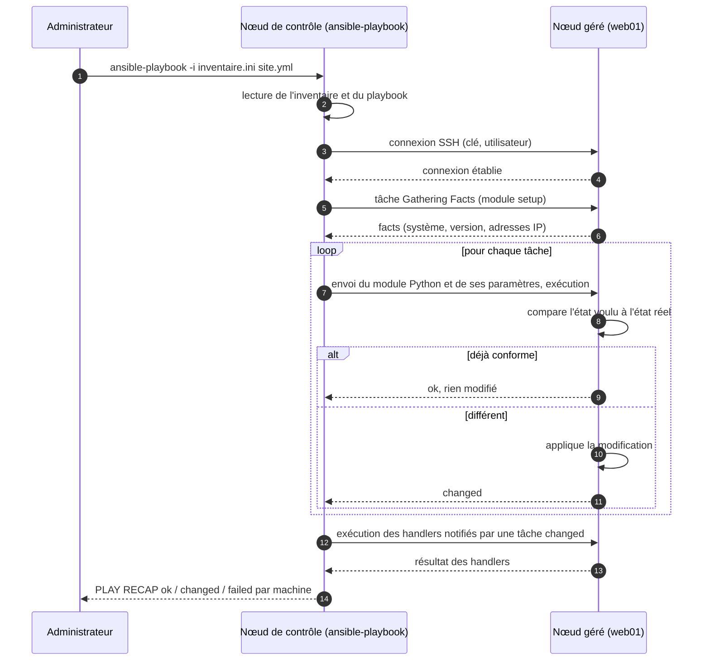

# Ansible : les fondamentaux

## Pourquoi ce cours ?

Une fois les machines créées (par Terraform, ou par un hébergeur), il faut les **configurer** : installer nginx, déposer un fichier de configuration, créer un utilisateur, démarrer un service, et le faire de la **même façon sur 3 ou 300 serveurs**. En SSH, à la main, c'est lent et source d'erreurs ; avec des scripts Bash, on obtient des programmes fragiles qui ne se rejouent pas sans casse. **Ansible** répond à ce besoin : on écrit en **YAML** l'état voulu des machines, Ansible se connecte en **SSH** (sans installer d'agent), n'exécute **que ce qui manque** et indique clairement ce qu'il a changé. Il est lisible par un non-développeur, ce qui explique son succès.

> Prérequis : [Introduction à l'IaC](01-introduction-iac.md) (idempotence), [SSH et clés](../../02-linux-intermediaire/cours/04-ssh-cles.md), [gestion des paquets](../../02-linux-intermediaire/cours/02-gestion-paquets.md) et [services systemd](../../02-linux-intermediaire/cours/01-processus-services.md).

## 1. Architecture

```text
 ┌──────────────────────────┐                    ┌─────────────────────────┐
 │ NŒUD DE CONTRÔLE         │   SSH (clé)        │ NŒUD GÉRÉ (web01)        │
 │ (ton poste, une CI)      │ ─────────────────► │  Python présent          │
 │  • Ansible installé      │                    │  (aucun agent à installer)│
 │  • inventaire            │                    └─────────────────────────┘
 │  • playbooks             │ ─────────────────► ┌─────────────────────────┐
 └──────────────────────────┘                    │ NŒUD GÉRÉ (web02) …      │
                                                 └─────────────────────────┘
```

| Élément | Rôle |
|---|---|
| **Nœud de contrôle** (*control node*) | La machine **d'où l'on lance** Ansible (Linux ou macOS ; Windows via WSL). **Seul endroit** où Ansible est installé |
| **Nœuds gérés** (*managed nodes*) | Les machines **configurées**. **Sans agent** : il leur faut seulement **SSH** et **Python** (pour la plupart des modules) |
| **Inventaire** | La **liste** des machines, regroupées |
| **Playbook** | Le fichier YAML qui décrit **quoi faire sur quelles machines** |
| **Module** | Une unité d'action idempotente (`apt`, `copy`, `service`…) |
| **Tâche** (*task*) | Un appel de module avec ses paramètres |

> 📌 **À retenir** : Ansible est **sans agent** (*agentless*) et fonctionne en **« push »** : le nœud de contrôle **pousse** la configuration. Les machines n'ont rien à exécuter en permanence, ce qui réduit la surface d'attaque et la maintenance (au prix d'un accès SSH de la machine de contrôle vers toutes les autres).

## 2. L'inventaire

```ini
# inventaire.ini
[web]
web01 ansible_host=192.168.56.11
web02 ansible_host=192.168.56.12

[db]
db01  ansible_host=192.168.56.21

[prod:children]            # un groupe de groupes
web
db

[all:vars]
ansible_user=deploy
ansible_ssh_private_key_file=~/.ssh/id_ed25519
```

```yaml
# inventaire.yml (même chose en YAML)
all:
  children:
    web:
      hosts:
        web01: { ansible_host: 192.168.56.11 }
        web02: { ansible_host: 192.168.56.12 }
```

Pour travailler **sur la machine courante** (apprentissage, test), l'inventaire se réduit à :

```ini
localhost ansible_connection=local
```

```bash
ansible -i inventaire.ini all -m ping            # test de connexion et de Python (« pong » attendu)
ansible -i inventaire.ini web -m command -a "uptime"     # commande ponctuelle (« ad hoc ») sur le groupe web
ansible-inventory -i inventaire.ini --list       # voir l'inventaire tel qu'Ansible le comprend
```

Les **variables** peuvent être placées à côté de l'inventaire : `group_vars/web.yml` (pour tout le groupe) et `host_vars/web01.yml` (pour une machine). Un fichier **`ansible.cfg`** dans le dossier du projet fixe des valeurs par défaut (`inventory = inventaire.ini`, `host_key_checking`, utilisateur…).

## 3. Un premier playbook

```yaml
# site.yml
---
- name: Configurer les serveurs web           # un « play » : quoi, sur qui
  hosts: web                                  # groupe ou machine de l'inventaire
  become: true                                # exécuter avec les droits root (sudo)
  vars:
    port_http: 8080

  tasks:
    - name: Installer nginx                   # chaque tâche appelle UN module
      ansible.builtin.package:
        name: nginx
        state: present                        # état voulu, pas une action

    - name: Déposer la configuration
      ansible.builtin.copy:
        dest: /etc/nginx/conf.d/site.conf
        content: |
          server { listen {{ port_http }}; root /var/www/site; }
        mode: "0644"
      notify: Recharger nginx                 # déclenche le handler SI la tâche a changé quelque chose

    - name: Démarrer et activer nginx
      ansible.builtin.service:
        name: nginx
        state: started
        enabled: true

  handlers:
    - name: Recharger nginx
      ansible.builtin.service:
        name: nginx
        state: reloaded
```

```bash
ansible-playbook -i inventaire.ini site.yml
```

### Anatomie

| Mot-clé | Rôle |
|---|---|
| `hosts` | Les machines ciblées (groupe, nom, `all`, motif) |
| `become` | Élévation de privilèges (équivalent de `sudo`) |
| `vars` | Variables du play (`{{ variable }}` pour les utiliser) |
| `tasks` | Liste ordonnée d'actions |
| `handlers` | Tâches **déclenchées par `notify`** |
| `name` | Libellé affiché : **toujours** en mettre un, il documente |

### Les modules à connaître

Les noms complets (**FQCN**, *fully qualified collection name*) évitent les ambiguïtés : `ansible.builtin.copy`.

| Besoin | Module |
|---|---|
| Installer un paquet | `ansible.builtin.package` (portable), `apt`, `dnf` |
| Démarrer / activer un service | `ansible.builtin.service`, `systemd` |
| Copier un fichier | `ansible.builtin.copy` |
| Générer un fichier à partir d'un modèle | `ansible.builtin.template` (Jinja2) |
| Créer dossier / lien / droits | `ansible.builtin.file` |
| Modifier **une ligne** d'un fichier | `ansible.builtin.lineinfile`, `blockinfile` |
| Utilisateurs et groupes | `ansible.builtin.user`, `group` |
| Télécharger | `ansible.builtin.get_url` |
| Attendre un port, une connexion | `ansible.builtin.wait_for`, `wait_for_connection` |
| Commande brute (dernier recours) | `ansible.builtin.command`, `shell` |

> ⚠️ **Attention** : `command` et `shell` **ne sont pas idempotents** : ils s'exécutent et signalent `changed` à **chaque** passage. Utilise d'abord un **module dédié**. Si tu dois en passer par `command`, ajoute `creates:` / `removes:` ou `changed_when:` pour dire quand il y a réellement changement.

## 4. Variables et facts

```yaml
- name: Afficher des informations
  hosts: all
  vars:
    environnement: dev
  tasks:
    - name: Montrer des variables et des facts
      ansible.builtin.debug:
        msg: "{{ inventory_hostname }} tourne sous {{ ansible_facts['distribution'] }} {{ ansible_facts['distribution_version'] }} ({{ environnement }})"
```

Les **facts** sont des informations **collectées automatiquement** sur chaque machine au début du play (`gather_facts: true`, par défaut) : système, version, adresses IP, mémoire, disques. On les voit avec `ansible localhost -m setup`. Ils permettent d'adapter le comportement : `when: ansible_facts['os_family'] == "RedHat"`.

Variables, de la **moins** à la **plus** prioritaire (aperçu) : valeurs par défaut du rôle → inventaire / `group_vars` → `host_vars` → `vars` du play → `vars_files` → faits / variables enregistrées (`register`) → **`-e` en ligne de commande** (toujours gagnant).

## 5. Idempotence : lire `ok` et `changed`

À la fin d'un playbook, le **récapitulatif** (`PLAY RECAP`) compte les résultats par machine :

```text
PLAY RECAP *********************************************************************
localhost : ok=5  changed=3  unreachable=0  failed=0  skipped=0  rescued=0  ignored=0
```

| État | Signification |
|---|---|
| **`ok`** | La tâche s'est exécutée, **rien n'a eu besoin d'être modifié** (l'état voulu était déjà là) |
| **`changed`** | Quelque chose a été **modifié** pour atteindre l'état voulu |
| `failed` | Erreur : le play s'arrête pour cette machine |
| `skipped` | Condition `when:` fausse : tâche ignorée |
| `unreachable` | Machine injoignable (SSH, réseau) |

Au **premier passage**, on voit des `changed`. Au **second passage**, sans rien toucher, le résultat doit être **`changed=0`** : c'est la preuve d'idempotence.

> 💡 **Conseil** : un `changed` qui apparaît **à chaque exécution** signale presque toujours une tâche `command`/`shell` sans `changed_when`, ou un fichier régénéré avec une valeur variable (horodatage). C'est la première chose à corriger : un playbook qui change toujours **cache** les vrais changements.

## 6. Vérifier avant d'agir

```bash
ansible-playbook site.yml --syntax-check       # syntaxe YAML et structure : rien n'est exécuté
ansible-playbook site.yml --check              # « à blanc » : simule, ne modifie rien (dry-run)
ansible-playbook site.yml --check --diff       # + montre les différences de fichiers qui seraient appliquées
ansible-playbook site.yml --list-tasks         # liste les tâches prévues
ansible-playbook site.yml --limit web01        # restreint à une machine ou un groupe
ansible-playbook site.yml -v                   # verbeux (-vv, -vvv : plus de détails, utile pour SSH)
ansible-lint site.yml                          # bonnes pratiques (voir cours suivant)
```

> ⚠️ **Attention** : `--check` est **fiable pour les modules** idempotents, mais il peut afficher des erreurs sur des tâches qui **dépendent d'un résultat précédent** (une tâche qui installe un paquet, suivie d'une qui le configure, ne trouvera pas le paquet en mode simulation). Considère-le comme une **aide**, pas comme une garantie.

## 7. Déroulement d'un playbook



Pour chaque tâche, Ansible **copie** un petit programme (le module) sur la machine, **l'exécute**, récupère le **résultat en JSON**, puis **le supprime**. Rien de permanent n'est installé.

## Résumé

- Ansible est **sans agent** : un **nœud de contrôle** configure des **nœuds gérés** en **SSH** (et Python), en mode « push ».
- **Inventaire** (machines et groupes, `group_vars` / `host_vars`), **playbook** (YAML : `hosts`, `become`, `vars`, `tasks`, `handlers`), **modules** idempotents (`package`, `service`, `copy`, `template`, `file`, `user`…).
- Les **handlers** ne s'exécutent que **si une tâche notifiante a changé** quelque chose, et **en fin de play**.
- **Facts** : informations collectées sur chaque machine ; **variables** avec ordre de priorité (`-e` gagne toujours).
- **Idempotence** : `ok` (rien à faire) / `changed` (modifié) ; **2ᵉ passage = `changed=0`**. `command` et `shell` ne sont pas idempotents sans `creates` / `changed_when`.
- Vérifier avant d'agir : `--syntax-check`, `--check`, `--diff`, `--list-tasks`, `--limit`.

## Pour aller plus loin

- Documentation : <https://docs.ansible.com/ansible/latest/> ; index des modules : <https://docs.ansible.com/ansible/latest/collections/ansible/builtin/>.
- `ansible-doc ansible.builtin.copy` : la documentation d'un module **dans le terminal**.
- Cours suivant : [Ansible avancé](05-ansible-avance.md).
- Pratique : [Playbook idempotent](../ateliers-killercoda/atelier-02-ansible-playbook-idempotent/intro.md).
